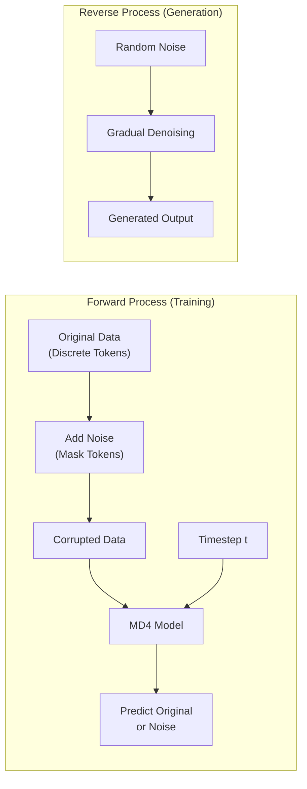
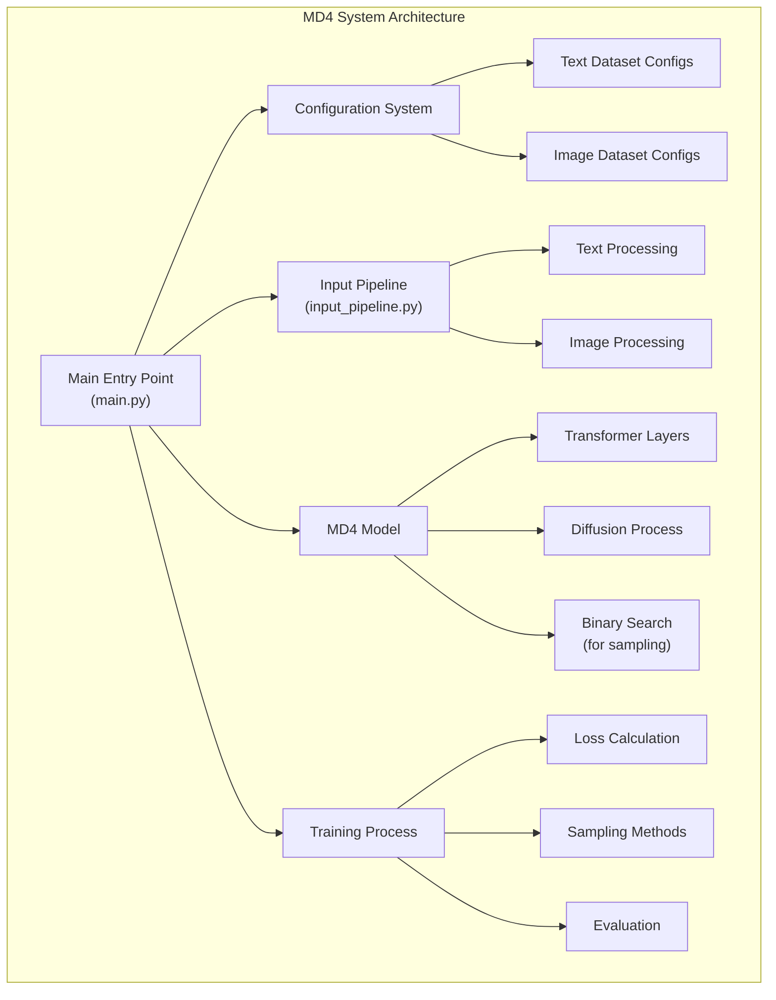
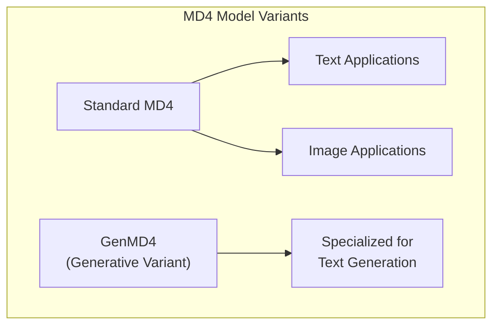
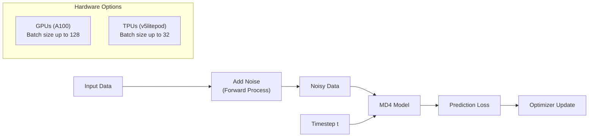
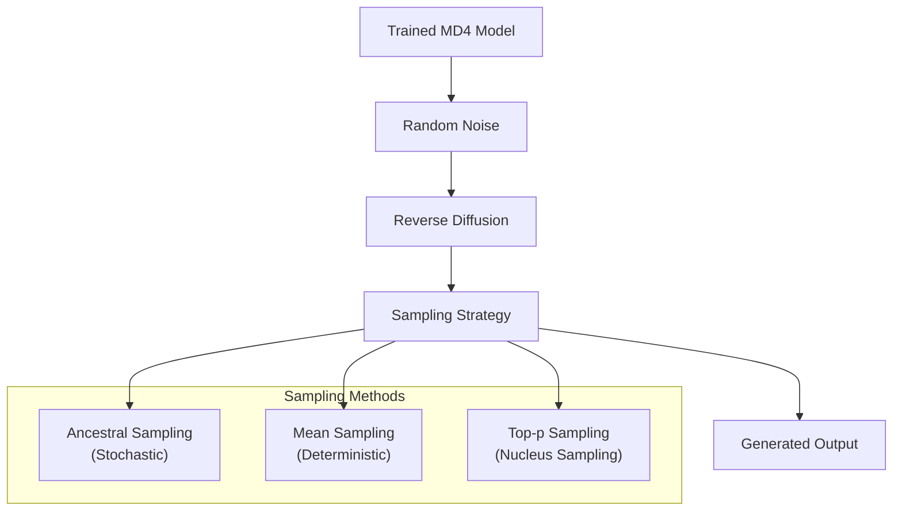

<!-- source: DeepWiki mcp.deepwiki.com · repo google-deepmind/md4 · page 1 MD4: Masked Diffusion for Discrete Data · fetched 2026-10-26 -->

# MD4: Masked Diffusion for Discrete Data

<details>
<summary>Relevant source files</summary>

The following files were used as context for generating this wiki page:

- [README.md](README.md)
- [md4/__init__.py](md4/__init__.py)

</details>


## Purpose and Scope

This document provides an introduction to MD4 (Masked Diffusion for Discrete Data), a framework that implements a simplified and generalized masked diffusion approach for generating discrete data such as text and images. We cover the core concepts, architecture, supported data types, and basic usage patterns. For more detailed information about installation and setup, please see [Installation and Setup](#1.1). For in-depth architectural details, refer to [System Architecture](#2).

## What is Masked Diffusion?

Masked Diffusion is a generative modeling approach that adapts diffusion models to work effectively with discrete data. Unlike traditional diffusion models that operate in continuous space, masked diffusion is specifically designed for discrete tokens such as text characters, words, or image pixels after discretization.



Sources: [README.md:1-1]()

## Core Architecture

MD4 employs a transformer-based architecture that learns to predict original data from corrupted or noised versions. The system is designed to be modular, with clear separation between configuration, data processing, model definition, and training/sampling processes.



Sources: [README.md:18-39]()

## Supported Data Types

MD4 is designed to work with multiple types of discrete data:

| Data Type | Supported Datasets | Description |
|-----------|-------------------|-------------|
| Text | OpenWebText | Large-scale web text corpus |
| | Text8 | Character-level text dataset with 27 unique characters |
| | FineWeb-EDU | Educational content from the web |
| Images | CIFAR-10 | 32x32 pixel RGB images across 10 classes |
| | ImageNet-64 | 64x64 pixel RGB images across 1000 classes |

Each data type requires specific preprocessing steps to convert the data into discrete tokens that can be processed by the diffusion model.

Sources: [README.md:21-39]()

## Model Variants

The MD4 framework includes two primary model variants:



1. **Standard MD4**: The base implementation that works with both text and image data.
2. **GenMD4**: A specialized variant optimized for generative applications, primarily focused on text data.

The model size and configuration can be adjusted based on available computational resources. For example, the README mentions an MD4-S model, which likely refers to a smaller version of the architecture.

Sources: [README.md:28-39]()

## Training Process

The training process involves corrupting the input data by adding noise according to a predetermined schedule, then training the model to predict either the original data or the noise itself.



The batch size depends on available compute resources:
- Eight A100 GPUs can support a maximum batch size of 128 for an MD4-S model with sequence length 1024
- Eight v5litepod TPU chips can support a maximum batch size of 32

Sources: [README.md:41-46]()

## Sampling and Generation

MD4 supports multiple sampling strategies for generating new content:



The binary search implementation provides efficient methods for top-k and top-p (nucleus) sampling, which are particularly important for high-quality text generation.

Sources: [README.md:28-39]()

## Usage Example

To train an MD4 model on text data like OpenWebText:

```
python md4/main.py --config=md4/configs/md4/openwebtext.py --sharded=false --workdir=./expt
```

For image data like CIFAR-10:

```
python md4/main.py --config=md4/configs/md4/cifar10.py --sharded=false --workdir=./expt
```

The framework handles the data loading, model initialization, training loop, and evaluation process.

Sources: [README.md:28-39]()

## Summary

MD4 represents a versatile framework for training diffusion models on discrete data types, offering:

1. Support for multiple data modalities (text and images)
2. Different model variants for various applications
3. Flexible configuration for model architecture, diffusion process, and training
4. Support for both GPU and TPU acceleration
5. Advanced sampling methods for high-quality generation

The system follows a modular design that allows for easy experimentation with different datasets, model architectures, and diffusion processes.

Sources: [README.md:1-76]()

---

