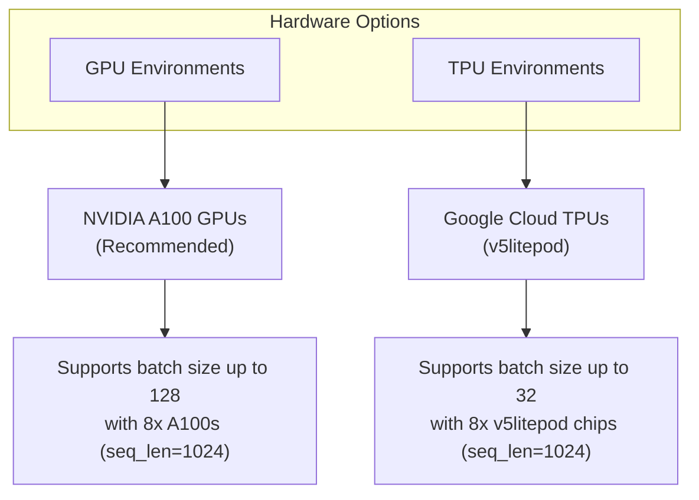
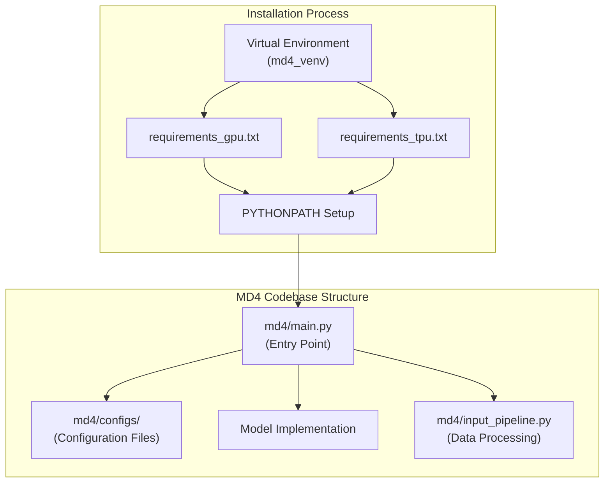
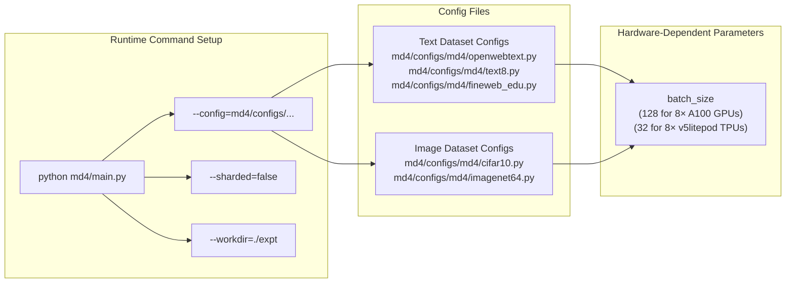

<!-- source: DeepWiki mcp.deepwiki.com · repo google-deepmind/md4 · page 1.1 Installation and Setup · fetched 2026-10-26 -->

# Installation and Setup

<details>
<summary>Relevant source files</summary>

The following files were used as context for generating this wiki page:

- [CONTRIBUTING.md](CONTRIBUTING.md)
- [README.md](README.md)

</details>


This page provides comprehensive instructions for setting up the MD4 (Masked Diffusion for Discrete Data) environment, installing dependencies, and preparing the system for both GPU and TPU usage. For information about the overall system architecture, see [System Architecture](#2), and for training instructions, see [Training MD4 Models](#5).

## Environment Requirements

Before installing MD4, ensure your system meets the following requirements:

### Hardware Requirements

MD4 can run on both GPU and TPU hardware:



Sources: [README.md:42-46]()

### Software Requirements

The following software is required to run MD4:

- Python 3.8 or newer
- Git (for cloning the repository)
- CUDA drivers (for GPU usage)

## Installation Steps

Follow these steps to set up MD4 on your system:

### 1. Clone the Repository

```bash
git clone https://github.com/google-deepmind/md4.git
cd md4
```

### 2. Create and Activate a Python Virtual Environment

```bash
python -m venv md4_venv
source md4_venv/bin/activate  # On Windows: md4_venv\Scripts\activate
```

### 3. Install Dependencies

Install the appropriate dependencies based on your hardware:

```bash
# For GPU environments:
pip install -r requirements_gpu.txt

# For TPU environments:
pip install -r requirements_tpu.txt
```

### 4. Set Up PYTHONPATH

Ensure the MD4 directory is in your Python path:

```bash
export PYTHONPATH="$PYTHONPATH:$(pwd)"  # On Windows: set PYTHONPATH=%PYTHONPATH%;%CD%
```

Sources: [README.md:7-17]()

## Installation Architecture

The following diagram illustrates the relationship between installation components and the MD4 codebase structure:



Sources: [README.md:12-17]()

## Data Preparation

Before training, you need to prepare the datasets:

### Preparing OpenWebText

To tokenize and pack examples from the OpenWebText dataset:

```bash
mkdir data_dir
python prepare_openwebtext_data.py
```

Sources: [README.md:21-26]()

## Basic Usage

After installation, you can train MD4 models on different datasets:

### Training on Text Datasets

To train an MD4-S model on OpenWebText or Fineweb-EDU text data:

```bash
python md4/main.py --config=md4/configs/md4/openwebtext.py --sharded=false --workdir=./expt
```

### Training on Image Datasets

To train an MD4-S model on CIFAR-10 or ImageNet-64 image data:

```bash
python md4/main.py --config=md4/configs/md4/cifar10.py --sharded=false --workdir=./expt
```

Sources: [README.md:28-39]()

## Configuration and Hardware Considerations

When setting up MD4 for training, the batch size is a critical parameter that depends on your available compute resources. The following table summarizes the recommended batch sizes for different hardware configurations:

| Hardware Configuration | Model Variant | Sequence Length | Maximum Batch Size |
|-----------------------|---------------|----------------|-------------------|
| 8× NVIDIA A100 GPUs   | MD4-S         | 1024           | 128               |
| 8× v5litepod TPU chips| MD4-S         | 1024           | 32                |

To adjust batch size in your configuration, modify the appropriate configuration file in the `md4/configs/` directory.



Sources: [README.md:41-46]()

## Troubleshooting

Common installation issues and their solutions:

### PYTHONPATH Issues

If you encounter import errors when running the code, ensure your PYTHONPATH is set correctly:

```bash
# Check current PYTHONPATH
echo $PYTHONPATH

# Set it again if needed
export PYTHONPATH="$PYTHONPATH:/path/to/md4"
```

### GPU/TPU Device Not Found

If the system cannot detect your accelerator:

1. For GPUs: Ensure CUDA is properly installed and visible to Python
2. For TPUs: Verify your Google Cloud TPU configuration and access permissions

## Next Steps

After successful installation and setup:

1. For dataset configuration details, see [Text Dataset Configurations](#3.1) and [Image Dataset Configurations](#3.2)
2. To understand the training process, see [Training MD4 Models](#5)
3. For sampling and generation instructions, see [Sampling and Generation](#6)

Sources: [README.md:5-46]()

---

