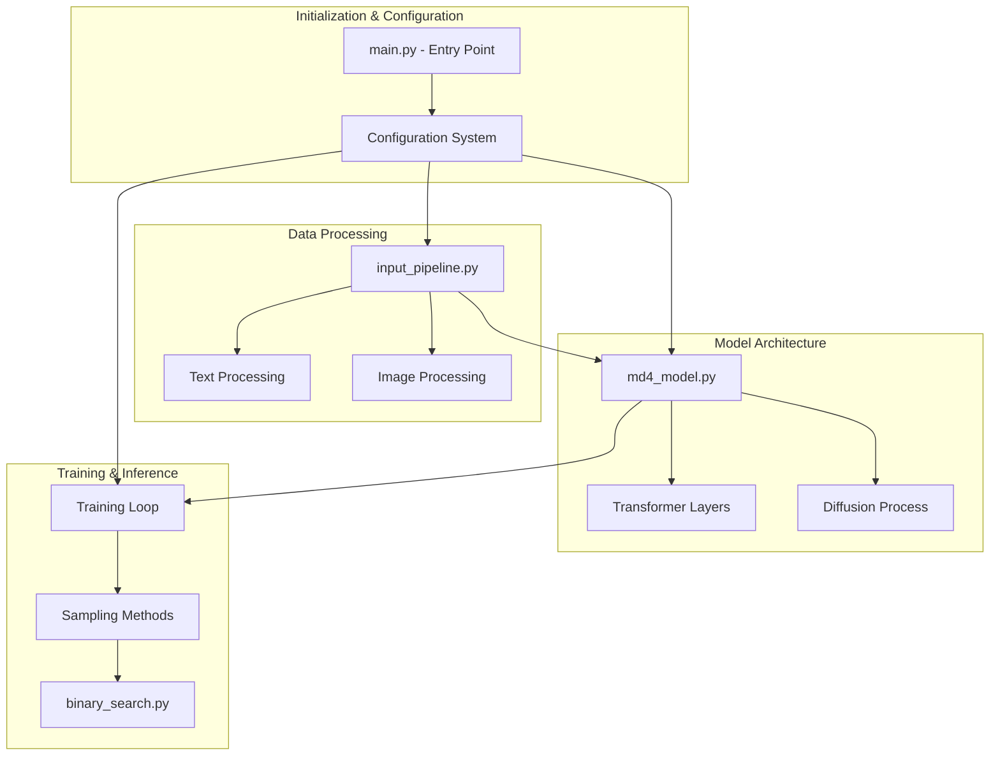
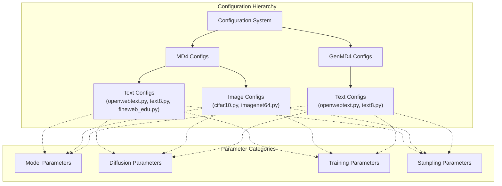
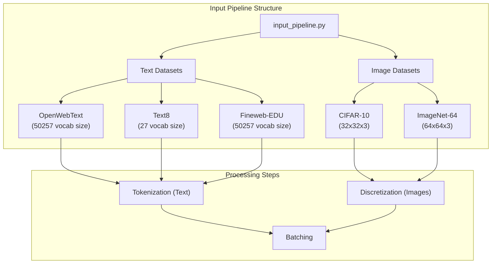
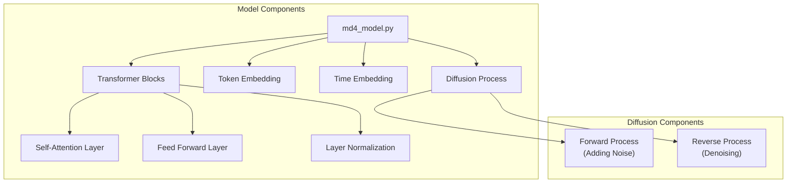
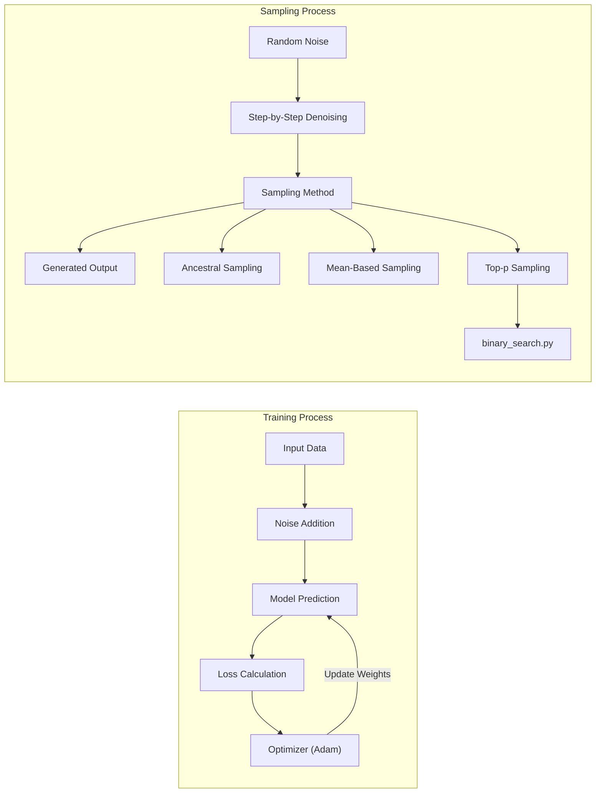
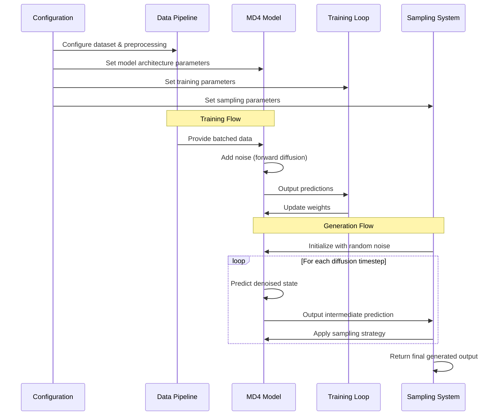
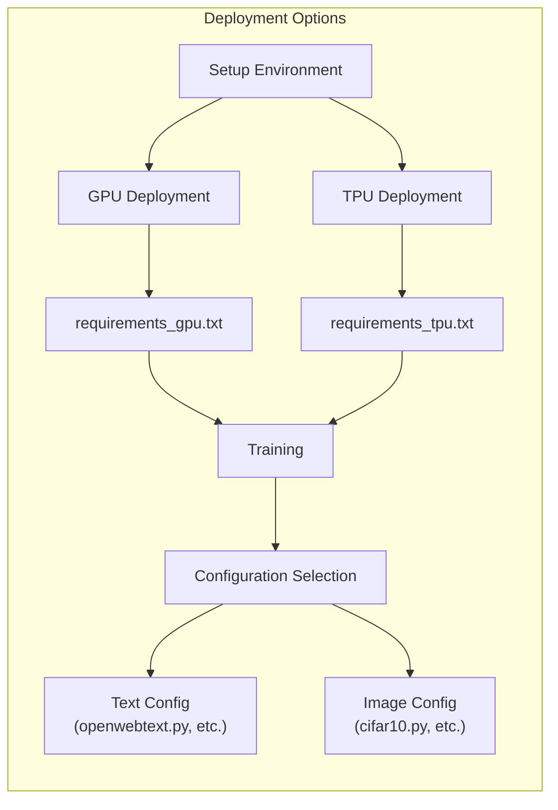
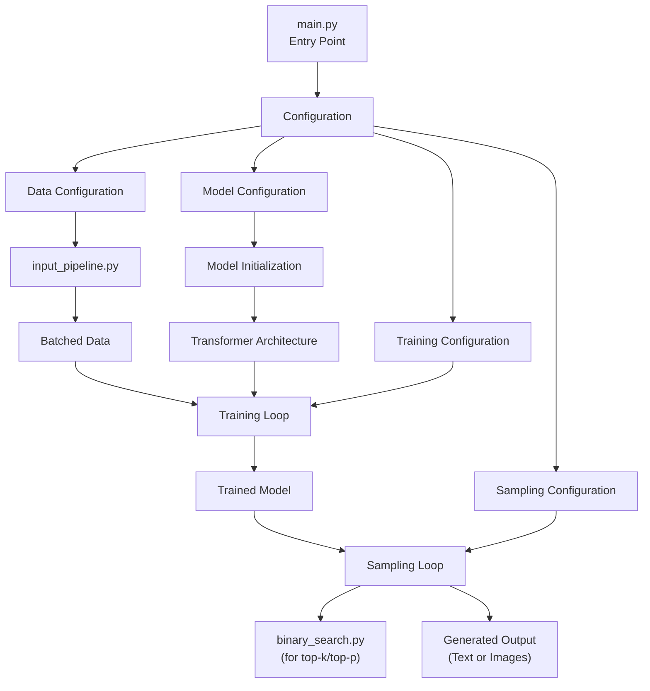

<!-- source: DeepWiki mcp.deepwiki.com · repo google-deepmind/md4 · page 2 System Architecture · fetched 2026-10-26 -->

# System Architecture

Relevant source files

The following files were used as context for generating this wiki page:

- [README.md](README.md)
- [md4/__init__.py](md4/__init__.py)

This document provides an overview of the MD4 (Masked Diffusion for Discrete Data) system architecture, explaining the key components and their interactions. It covers the high-level architecture design, core components, data flow, and how the different subsystems work together to implement the masked diffusion approach for discrete data types. For specific model variants and their differences, see [Model Variants](#2.1).

## High-Level System Architecture

The MD4 system consists of several interrelated components that work together to train diffusion models on discrete data such as text and images.

Sources: README.md

## Core Components

### Configuration System

The configuration system defines the model parameters, training settings, and dataset-specific configurations. The system supports several pre-defined configurations for both text and image datasets.

Sources: README.md

### Input Pipeline

The input pipeline handles data loading, preprocessing, and batching for both text and image datasets. It supports multiple datasets including OpenWebText, Text8, and FineWeb-EDU for text, and CIFAR-10 and ImageNet-64 for images.

Sources: README.md

### Model Architecture

The MD4 model architecture is based on transformer layers with a diffusion process applied to discrete data. The architecture is designed to be flexible and can be applied to both text and image modalities.

Sources: README.md

### Training and Sampling System

The training process includes forward diffusion, loss calculation, and optimization. The sampling system supports various generation strategies including ancestral sampling, mean-based sampling, and top-p (nucleus) sampling.

Sources: README.md

## Data Flow and Component Interactions

This diagram illustrates how data flows through the MD4 system during training and generation:

Sources: README.md

## Hardware and Deployment Requirements

The MD4 system supports different hardware accelerators for training and inference:

| Hardware | Supported | Batch Size (MD4-S, seq_len=1024) | Notes |
|----------|-----------|----------------------------------|-------|
| GPU (A100) | Yes | Up to 128 | Using 8x A100 GPUs |
| TPU (v5litepod) | Yes | Up to 32 | Using 8x v5litepod chips |

The system is designed to scale based on available hardware resources. Batch sizes need to be adjusted according to the compute resources available. For optimal performance:

1. For GPU deployments: Use `requirements_gpu.txt` for dependencies
2. For TPU deployments: Use `requirements_tpu.txt` for dependencies

Sources: README.md

## System Integration

The following diagram shows how all components of the MD4 system integrate together, from configuration to output generation:

Sources: README.md

## Summary

The MD4 system implements a masked diffusion approach for discrete data types. The architecture is designed to be flexible, supporting various datasets and model configurations. Key architectural components include:

1. **Configuration System**: Provides dataset-specific and model-specific parameters
2. **Input Pipeline**: Handles data loading and preprocessing for text and image datasets
3. **Model Architecture**: Based on transformer layers with diffusion process
4. **Training System**: Implements the forward diffusion process and optimization
5. **Sampling System**: Supports various generation strategies with efficient implementations

This modular design allows for easy experimentation with different datasets, model sizes, and sampling strategies. For specific model variants and their differences, see [Model Variants](#2.1), and for detailed configuration options, see [Configuration System](#3).

---

