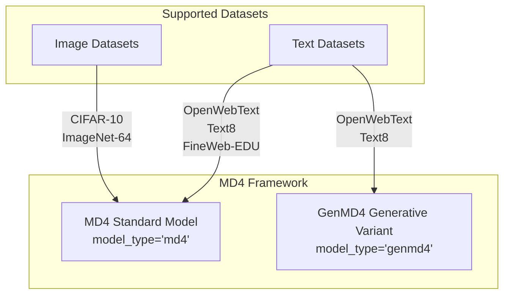
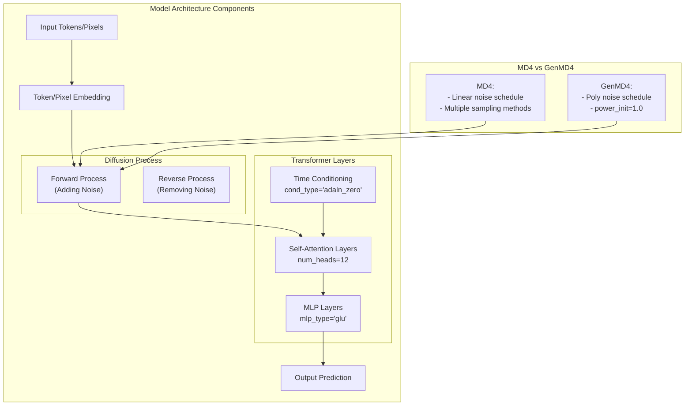
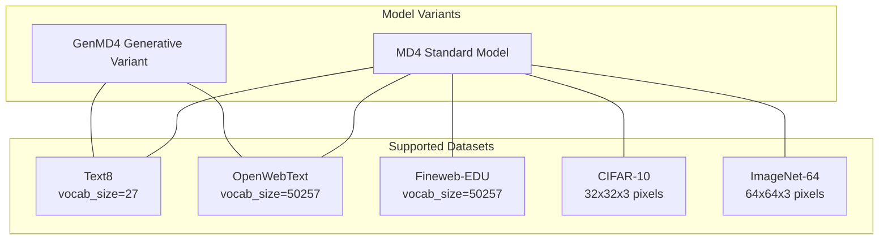

<!-- source: DeepWiki mcp.deepwiki.com · repo google-deepmind/md4 · page 2.1 Model Variants · fetched 2026-10-26 -->

# Model Variants

<details>
<summary>Relevant source files</summary>

The following files were used as context for generating this wiki page:

- [md4/configs/genmd4/openwebtext.py](md4/configs/genmd4/openwebtext.py)
- [md4/configs/md4/openwebtext.py](md4/configs/md4/openwebtext.py)

</details>


This page documents the different model variants available in the MD4 (Masked Diffusion for Discrete Data) system. The MD4 repository provides two main model variants: the standard MD4 model and the GenMD4 (Generative MD4) variant. This page explains their differences, capabilities, and use cases.

For information about configuring these model variants for specific datasets, see [Configuration System](#3).

## Overview of MD4 Model Variants

MD4 offers two model variants that serve different purposes in the masked diffusion framework:

1. **MD4 (Standard Model)**: The primary implementation that supports both text and image modalities
2. **GenMD4 (Generative Variant)**: A specialized variant optimized for generative text tasks



Sources: [md4/configs/md4/openwebtext.py:34](). [md4/configs/genmd4/openwebtext.py:34]()

## MD4 Standard Model

The standard MD4 model is a versatile implementation that supports both text and image data types. It uses a masked diffusion approach to model discrete data distributions.

### Key Characteristics

- **Model Type**: Identified by `model_type = "md4"` in configuration
- **Data Support**: Works with both text and image modalities
- **Sampling Methods**: Supports multiple sampling approaches
  - Ancestral sampling
  - Mean sampling
  - Top-p (nucleus) sampling
- **Sampling Grid Options**: Offers uniform or cosine sampling grid

### Configuration Example

The standard MD4 model is configured with parameters tailored to the specific dataset type:

```
# Model identification
config.model_type = "md4"

# Diffusion process settings
config.timesteps = 1000
config.noise_schedule = "linear"  # Options: linear, cosine, poly[exponent]

# Sampling configuration
config.sampler = "ancestral"  # Options: ancestral, mean, topp
config.sampling_grid = "cosine"  # Options: uniform, cosine
config.topp = 0.98  # For top-p sampling
```

Sources: [md4/configs/md4/openwebtext.py:34-85]()

## GenMD4 Generative Variant

The GenMD4 variant is optimized specifically for generative tasks, with a focus on text generation. It features modifications to the standard MD4 architecture to enhance its generative capabilities.

### Key Characteristics

- **Model Type**: Identified by `model_type = "genmd4"` in configuration
- **Data Support**: Currently only supports text datasets (OpenWebText, Text8)
- **Power Initialization**: Uses `power_init` parameter (set to 1.0 by default)
- **Noise Schedule**: Uses polynomial noise schedule by default, compared to linear in standard MD4

### Configuration Example

The GenMD4 variant has several distinctive configuration elements:

```
# Model identification
config.model_type = "genmd4"

# Diffusion process settings
config.timesteps = 1000
config.noise_schedule = "poly"  # Uses polynomial noise schedule
config.power_init = 1.0
```

Sources: [md4/configs/genmd4/openwebtext.py:34-42]()

## Comparison Between Model Variants

The following table highlights the key differences between MD4 and GenMD4 variants:

| Feature | MD4 (Standard) | GenMD4 (Generative) |
|---------|----------------|---------------------|
| Model Type | `"md4"` | `"genmd4"` |
| Text Dataset Support | OpenWebText, Text8, FineWeb-EDU | OpenWebText, Text8 |
| Image Dataset Support | CIFAR-10, ImageNet-64 | None |
| Default Noise Schedule | Linear | Polynomial |
| Power Initialization | Not specified | 1.0 |
| Sampling Methods | Ancestral, Mean, Top-p | Not explicitly configured |
| Use Case Focus | General-purpose modeling | Text generation optimization |

Sources: [md4/configs/md4/openwebtext.py:34-85](). [md4/configs/genmd4/openwebtext.py:34-42]()

## Model Architecture Details

Both model variants use the same core transformer-based architecture but with different configurations that affect their behavior and performance on specific tasks.



Sources: [md4/configs/md4/openwebtext.py:46-57](). [md4/configs/genmd4/openwebtext.py:45-56]()

## When to Use Each Variant

### Use MD4 Standard Model When:

- You need to work with both text and image data
- You want flexibility in sampling methods
- You need to experiment with different noise schedules
- You want a general-purpose discrete diffusion model

### Use GenMD4 Variant When:

- You're specifically focused on text generation tasks
- You want a model variant potentially optimized for generation quality
- You're working with text datasets like OpenWebText or Text8
- You prefer a polynomial noise schedule for the diffusion process

## Dataset Compatibility



Sources: [md4/configs/md4/openwebtext.py:29-33](). [md4/configs/genmd4/openwebtext.py:29-35]()

## Configuration Parameters Comparison

Both model variants share many configuration parameters but differ in several key aspects. The following table shows important configuration parameters for both variants:

| Parameter | MD4 (Standard) | GenMD4 (Generative) |
|-----------|----------------|---------------------|
| `model_type` | `"md4"` | `"genmd4"` |
| `noise_schedule` | `"linear"` | `"poly"` |
| `power_init` | Not present | `1.0` |
| `feature_dim` | `64` | `64` |
| `n_layers` | `12` | `12` |
| `num_heads` | `12` | `12` |
| `mlp_type` | `"glu"` | `"glu"` |
| `cond_type` | `"adaln_zero"` | `"adaln_zero"` |
| `learning_rate` | `3e-4` | `3e-4` |
| Sampling configs | Present | Not present |

Sources: [md4/configs/md4/openwebtext.py:34-85](). [md4/configs/genmd4/openwebtext.py:34-56]()

## Summary

The MD4 framework provides two model variants to address different use cases within the masked diffusion approach:

1. **MD4 Standard Model**: A versatile implementation supporting both text and image data with flexible sampling methods
2. **GenMD4 Generative Variant**: A specialized variant focused on text generation tasks with optimizations like polynomial noise scheduling

The choice between these variants depends on your specific application requirements, dataset modality, and whether you need specialized generation capabilities or general-purpose diffusion modeling.

---

