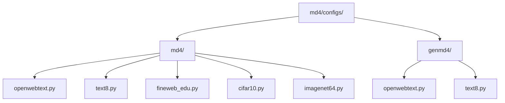
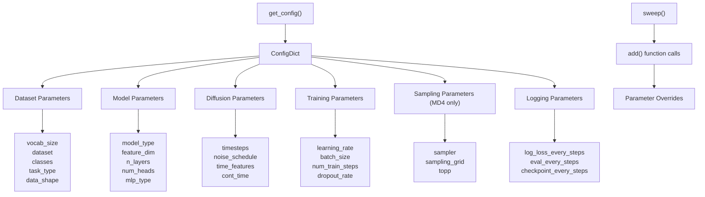
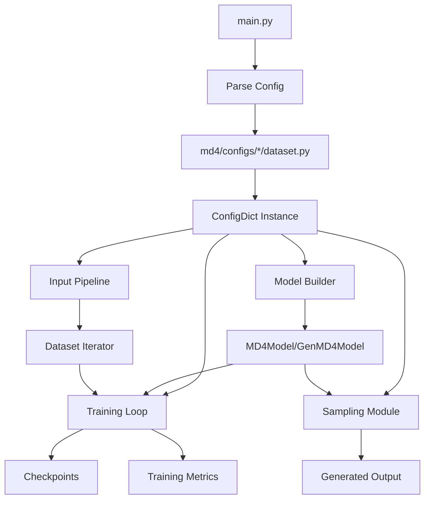

<!-- source: DeepWiki mcp.deepwiki.com · repo google-deepmind/md4 · page 3 Configuration System · fetched 2026-10-26 -->

# Configuration System

<details>
<summary>Relevant source files</summary>

The following files were used as context for generating this wiki page:

- [README.md](README.md)
- [md4/configs/genmd4/openwebtext.py](md4/configs/genmd4/openwebtext.py)
- [md4/configs/md4/openwebtext.py](md4/configs/md4/openwebtext.py)

</details>


The MD4 Configuration System provides a structured way to define and manage parameters for model training, architecture, data processing, and sampling. This system enables consistent configuration across different model variants and datasets, supporting both text and image modalities.

For information about dataset-specific configurations, see [Text Dataset Configurations](#3.1) and [Image Dataset Configurations](#3.2).

## Configuration File Organization

The configuration files in MD4 are organized hierarchically based on model variant and dataset type.



Sources: [md4/configs/md4/openwebtext.py](), [md4/configs/genmd4/openwebtext.py]()

Each configuration file follows a standard structure:

1. A `get_config()` function that returns a `ConfigDict` with default parameters
2. An optional `sweep()` function for hyperparameter tuning

## Configuration File Structure

Each configuration file defines a comprehensive set of parameters using the `ml_collections.ConfigDict` class. Here's an example of how a typical configuration file is structured:



Sources: [md4/configs/md4/openwebtext.py:23-102](), [md4/configs/genmd4/openwebtext.py:23-92]()

## Key Configuration Parameters

The following table outlines the core parameters found in MD4 configuration files:

| Parameter Category | Key Parameters | Description | Typical Values |
|-------------------|----------------|-------------|----------------|
| Dataset | `vocab_size` | Size of vocabulary | 50257 (OpenWebText), 27 (Text8) |
| Dataset | `dataset` | Dataset name | "openwebtext", "text8", "cifar10" |
| Dataset | `task_type` | Data modality | "text" or "image" |
| Dataset | `data_shape` | Shape of input data | (1024,) for text |
| Model | `model_type` | Model variant | "md4" or "genmd4" |
| Model | `feature_dim` | Feature embedding dimension | 64 |
| Model | `n_layers` | Number of transformer layers | 12 |
| Model | `num_heads` | Number of attention heads | 12 |
| Diffusion | `timesteps` | Number of diffusion steps | 1000 |
| Diffusion | `noise_schedule` | Noise schedule type | "linear", "cosine", "poly" |
| Diffusion | `time_features` | Type of time features | "t" |
| Training | `learning_rate` | Optimizer learning rate | 3e-4 |
| Training | `batch_size` | Training batch size | 512 |
| Training | `num_train_steps` | Total training steps | 1,000,000 |
| Sampling | `sampler` | Sampling method (MD4 only) | "ancestral", "mean", "topp" |
| Sampling | `topp` | Top-p value (MD4 only) | 0.98 |
| Logging | `checkpoint_every_steps` | Checkpoint frequency | 5000 |

Sources: [md4/configs/md4/openwebtext.py:29-90](), [md4/configs/genmd4/openwebtext.py:29-83]()

## Configuration System Integration

The configuration system is central to the operation of MD4, feeding parameters to all major components of the system:



Sources: [README.md:28-39]()

## Usage Examples

### Basic Training Command

To train a model using a specific configuration:

```bash
python md4/main.py --config=md4/configs/md4/openwebtext.py --workdir=./expt
```

For image data:

```bash
python md4/main.py --config=md4/configs/md4/cifar10.py --workdir=./expt
```

Sources: [README.md:28-39]()

### Batch Size Considerations

The README provides guidance on selecting appropriate batch sizes based on available hardware:

> "For training a MD4-S model with sequence length 1024, eight `A100` GPUs can support a maximum batch size of `128`. If running on TPUs, eight `v5litepod` chips can support a maximum batch size of `32`."

Sources: [README.md:41-46]()

## Hyperparameter Tuning with Sweeps

Each configuration file includes a `sweep()` function that enables hyperparameter tuning:

```python
def sweep(add: abc.Callable[..., None]):
    """Starts multiple work units with varying config args."""
    add(
        noise_schedule="linear",
        dropout_rate=0.02,
        weight_decay=0.03,
    )
```

This function launches training runs with the specified parameter overrides. Multiple parameter combinations can be tested by calling `add()` with different parameters.

To run a sweep:

```bash
python md4/main.py --config=md4/configs/md4/openwebtext.py --workdir=./expt
```

To disable the sweep functionality:

```bash
python md4/main.py --config=md4/configs/md4/openwebtext.py --workdir=./expt --nosweep
```

Sources: [md4/configs/md4/openwebtext.py:98-115](), [md4/configs/genmd4/openwebtext.py:98-104]()

## MD4 vs GenMD4 Configuration Differences

The standard MD4 model and the GenMD4 variant have some key configuration differences:

| Feature | MD4 | GenMD4 |
|---------|-----|--------|
| Model Type | "md4" | "genmd4" |
| Default Noise Schedule | "linear" | "poly" |
| Power Initialization | Not used | Uses `power_init=1.0` |
| Sampling Parameters | Includes `sampler`, `sampling_grid`, `topp` | Does not include sampling parameters |
| Supported Datasets | Text and Images | Text only (based on provided configs) |

Sources: [md4/configs/md4/openwebtext.py:34-85](), [md4/configs/genmd4/openwebtext.py:34-43]()

## Best Practices

When working with the MD4 configuration system, consider these best practices:

1. **Start with existing configs**: Use the provided configuration files as templates for new experiments.
2. **Hardware-aware batch sizing**: Adjust batch sizes based on your available hardware.
3. **Systematic hyperparameter tuning**: Use the sweep functionality to explore parameter spaces methodically.
4. **Parameter organization**: Keep related parameters grouped together when creating custom configurations.
5. **Check compatibility**: Ensure parameters are consistent with the chosen model type (MD4 or GenMD4).

Sources: [md4/configs/md4/openwebtext.py](), [md4/configs/genmd4/openwebtext.py](), [README.md:41-46]()

---

