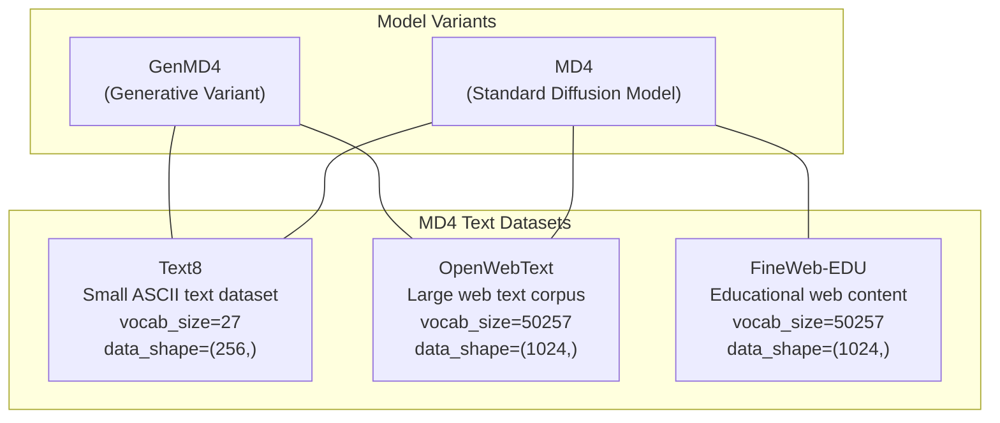
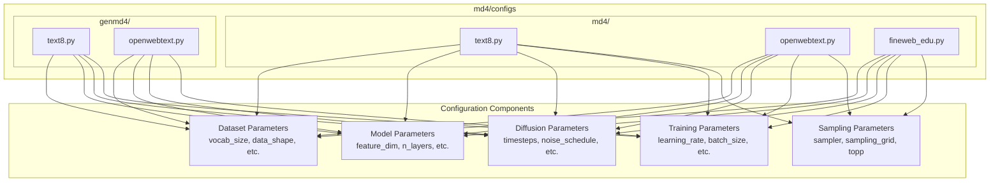
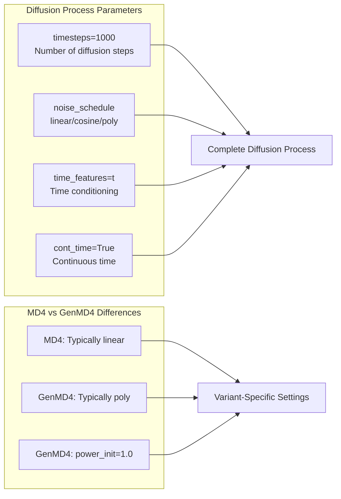

<!-- source: DeepWiki mcp.deepwiki.com · repo google-deepmind/md4 · page 3.1 Text Dataset Configurations · fetched 2026-10-26 -->

# Text Dataset Configurations

<details>
<summary>Relevant source files</summary>

The following files were used as context for generating this wiki page:

- [md4/configs/genmd4/openwebtext.py](md4/configs/genmd4/openwebtext.py)
- [md4/configs/genmd4/text8.py](md4/configs/genmd4/text8.py)
- [md4/configs/md4/fineweb_edu.py](md4/configs/md4/fineweb_edu.py)
- [md4/configs/md4/openwebtext.py](md4/configs/md4/openwebtext.py)
- [md4/configs/md4/text8.py](md4/configs/md4/text8.py)

</details>


This page documents the configuration options for text datasets used with the MD4 (Masked Diffusion for Discrete Data) framework. It covers the three supported text datasets: Text8, OpenWebText, and FineWeb-EDU, as well as their configuration parameters for both the standard MD4 and generative GenMD4 model variants. For information about image dataset configurations, see [Image Dataset Configurations](#3.2).

## Supported Text Datasets

MD4 supports three primary text datasets, each with different characteristics and use cases.



Sources: [md4/configs/md4/text8.py:29-36](), [md4/configs/md4/openwebtext.py:29-36](), [md4/configs/md4/fineweb_edu.py:29-37](), [md4/configs/genmd4/text8.py:29-36](), [md4/configs/genmd4/openwebtext.py:29-36]()

## Configuration File Structure

Text dataset configurations are defined in Python files under the `md4/configs/` directory, organized by model variant and dataset name.



Sources: [md4/configs/md4/text8.py](), [md4/configs/md4/openwebtext.py](), [md4/configs/md4/fineweb_edu.py](), [md4/configs/genmd4/text8.py](), [md4/configs/genmd4/openwebtext.py]()

## Dataset-Specific Configuration Parameters

Each text dataset has unique configuration parameters that optimize model performance for that specific dataset.

### Text8

Text8 is a character-level dataset derived from Wikipedia text, consisting of 100 million lowercase characters in English with a vocab size of 27 (26 lowercase letters plus space).

| Parameter | MD4 Value | GenMD4 Value | Description |
|-----------|-----------|--------------|-------------|
| `vocab_size` | 27 | 27 | Vocabulary size (26 letters + space) |
| `dataset` | "text8" | "text8" | Dataset identifier |
| `data_shape` | (256,) | (256,) | Sequence length |
| `outside_embed` | True | True | Use outside embeddings |
| `grain_num_workers` | 15 | 15 | Number of data loader workers |

Sources: [md4/configs/md4/text8.py:29-36](), [md4/configs/md4/text8.py:96](), [md4/configs/genmd4/text8.py:29-36](), [md4/configs/genmd4/text8.py:88]()

### OpenWebText

OpenWebText is a large-scale web text corpus with a large vocabulary (50,257 tokens) that mirrors the dataset used to train GPT-2.

| Parameter | MD4 Value | GenMD4 Value | Description |
|-----------|-----------|--------------|-------------|
| `vocab_size` | 50257 | 50259 | Vocabulary size (GPT-2 tokenizer) |
| `dataset` | "openwebtext" | "openwebtext" | Dataset identifier |
| `data_shape` | (1024,) | (1024,) | Sequence length |
| `outside_embed` | False | False | Don't use outside embeddings |
| `grain_num_workers` | 1 | 15 | Number of data loader workers |

Sources: [md4/configs/md4/openwebtext.py:29-36](), [md4/configs/md4/openwebtext.py:98](), [md4/configs/genmd4/openwebtext.py:29-36](), [md4/configs/genmd4/openwebtext.py:88]()

### FineWeb-EDU

FineWeb-EDU contains educational content from the web, using the same tokenizer as OpenWebText but with more curated content.

| Parameter | MD4 Value | GenMD4 Value | Description |
|-----------|-----------|--------------|-------------|
| `vocab_size` | 50257 | N/A | Vocabulary size (GPT-2 tokenizer) |
| `dataset` | "fineweb_edu" | N/A | Dataset identifier |
| `data_shape` | (1024,) | N/A | Sequence length |
| `use_v2_input_pipeline` | True | N/A | Use version 2 of input pipeline |
| `outside_embed` | False | N/A | Don't use outside embeddings |
| `grain_num_workers` | 1 | N/A | Number of data loader workers |

Sources: [md4/configs/md4/fineweb_edu.py:29-37](), [md4/configs/md4/fineweb_edu.py:99]()

## Common Configuration Parameters

Beyond dataset-specific settings, several configuration categories apply across all text datasets.

### Model Parameters

These parameters define the architecture and capacity of the model.

| Parameter | Typical Value | Description |
|-----------|---------------|-------------|
| `model_type` | "md4" or "genmd4" | Model variant |
| `task_type` | "text" | Task modality |
| `feature_dim` | 64 | Feature dimension |
| `n_layers` | 12 | Number of transformer layers |
| `num_heads` | 12 | Number of attention heads |
| `mlp_type` | "glu" | MLP type in transformer |
| `dropout_rate` | 0.0-0.05 | Dropout rate |
| `depth_scaled_init` | True | Use depth-scaled initialization |
| `cond_type` | "adaln_zero" | Conditioning type |

Sources: [md4/configs/md4/text8.py:33-57](), [md4/configs/genmd4/text8.py:33-57](), [md4/configs/md4/openwebtext.py:33-57](), [md4/configs/genmd4/openwebtext.py:33-57](), [md4/configs/md4/fineweb_edu.py:34-58]()

### Diffusion Parameters

These parameters control the diffusion process.



Sources: [md4/configs/md4/text8.py:38-44](), [md4/configs/genmd4/text8.py:38-43](), [md4/configs/md4/openwebtext.py:38-44](), [md4/configs/genmd4/openwebtext.py:38-43](), [md4/configs/md4/fineweb_edu.py:39-45]()

### Training Parameters

These parameters control the training process.

| Parameter | Typical Value | Description |
|-----------|---------------|-------------|
| `learning_rate` | 3e-4 | Base learning rate |
| `learning_rate_schedule` | "cosine" | Learning rate schedule |
| `warmup_steps` | 2000 | Number of warmup steps |
| `weight_decay` | 0.0-0.03 | Weight decay for regularization |
| `batch_size` | 512 | Global batch size |
| `num_train_steps` | 1,000,000 | Number of training steps |
| `ema_rate` | 0.9999 | Exponential moving average rate |
| `b2` | 0.999 | Adam optimizer beta2 parameter |
| `clip` | 0.0 | Gradient clipping value |

Sources: [md4/configs/md4/text8.py:59-77](), [md4/configs/genmd4/text8.py:58-77](), [md4/configs/md4/openwebtext.py:59-77](), [md4/configs/genmd4/openwebtext.py:58-77](), [md4/configs/md4/fineweb_edu.py:60-78]()

### Sampling Parameters

These parameters control the generation process (only present in MD4 configs, not GenMD4).

| Parameter | Typical Value | Description |
|-----------|---------------|-------------|
| `sampler` | "ancestral" | Sampling method (options: "ancestral", "mean", "topp") |
| `sampling_grid` | "cosine" | Sampling grid type (options: "uniform", "cosine") |
| `topp` | 0.98 | Top-p value for nucleus sampling |

Sources: [md4/configs/md4/text8.py:80-85](), [md4/configs/md4/openwebtext.py:80-85](), [md4/configs/md4/fineweb_edu.py:81-86]()

## Configuration Sweep Parameters

All configuration files include a `sweep()` function that allows for hyperparameter sweeps during training. These typically vary learning rate, dropout rate, and weight decay.

```python
# Example sweep parameters from OpenWebText MD4 config
learning_rate=3e-4
dropout_rate=0.02
weight_decay=0.03
```

Sources: [md4/configs/md4/text8.py:106-112](), [md4/configs/genmd4/text8.py:98-104](), [md4/configs/md4/openwebtext.py:110-115](), [md4/configs/genmd4/openwebtext.py:98-104](), [md4/configs/md4/fineweb_edu.py:110-116]()

## MD4 vs GenMD4 Differences

The standard MD4 and generative GenMD4 variants have several key differences in their text dataset configurations.

| Feature | MD4 | GenMD4 |
|---------|-----|--------|
| Supported Datasets | Text8, OpenWebText, FineWeb-EDU | Text8, OpenWebText |
| Noise Schedule | Typically "linear" | "poly" |
| Power Initialization | Not used | `power_init=1.0` |
| Sampling Parameters | Explicit (`sampler`, `sampling_grid`, `topp`) | Not explicitly defined |
| OpenWebText Vocabulary | 50257 | 50259 |

Sources: [md4/configs/md4/text8.py](), [md4/configs/genmd4/text8.py](), [md4/configs/md4/openwebtext.py](), [md4/configs/genmd4/openwebtext.py](), [md4/configs/md4/fineweb_edu.py]()

## Configuring a Custom Text Dataset

To configure a custom text dataset, you would typically need to:

1. Create a new configuration file based on an existing template
2. Set the appropriate vocabulary size and data shape
3. Adjust model parameters based on dataset complexity
4. Tune diffusion and training parameters as needed

The choice between Text8-like (character-level) or OpenWebText-like (token-level) configurations will depend on your vocabulary size and tokenization method.

---

