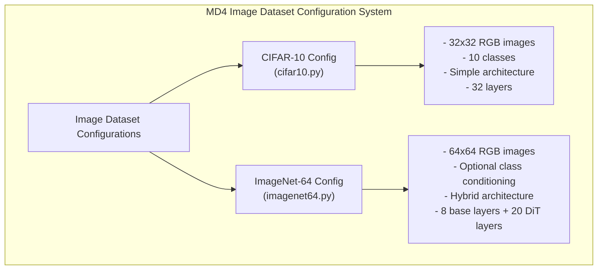
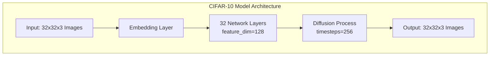
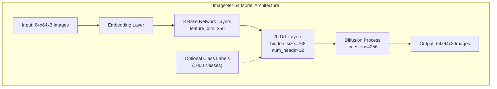
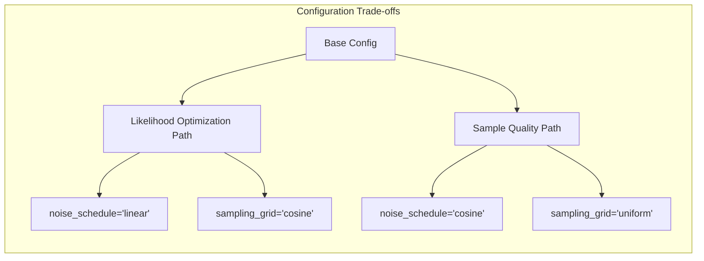
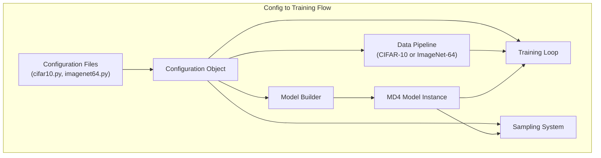

<!-- source: DeepWiki mcp.deepwiki.com · repo google-deepmind/md4 · page 3.2 Image Dataset Configurations · fetched 2026-10-26 -->

# Image Dataset Configurations

<details>
<summary>Relevant source files</summary>

The following files were used as context for generating this wiki page:

- [md4/configs/md4/cifar10.py](md4/configs/md4/cifar10.py)
- [md4/configs/md4/imagenet64.py](md4/configs/md4/imagenet64.py)

</details>


## Purpose and Scope

This page documents the configuration options for image datasets in the MD4 (Masked Diffusion for Discrete Data) framework. Specifically, it covers the configuration parameters for CIFAR-10 and ImageNet-64 datasets, including model architecture settings, training parameters, and sampling options. For text dataset configurations, see [Text Dataset Configurations](#3.1).

## Overview of Image Datasets

MD4 currently supports two primary image datasets:

1. **CIFAR-10**: A dataset of 60,000 32×32 RGB images across 10 classes
2. **ImageNet-64**: Downsampled version of ImageNet with 64×64 RGB images



Sources: [md4/configs/md4/cifar10.py:1-117](), [md4/configs/md4/imagenet64.py:1-131]()

## Common Configuration Parameters

Both image datasets share a common set of configuration parameters that control various aspects of the model training and sampling process.

### Core Parameters

| Parameter | Description | Typical Values |
|-----------|-------------|----------------|
| `vocab_size` | Size of vocabulary (pixel values) | 256 (8-bit color) |
| `task_type` | Type of data being modeled | "image" |
| `model_type` | Model architecture type | "md4" |
| `timesteps` | Number of diffusion timesteps | 256 |
| `noise_schedule` | Schedule for noise addition | "linear", "cosine" |
| `time_features` | Type of time features | "t" |
| `cont_time` | Whether to use continuous time | True |

### Training Parameters

| Parameter | Description | Typical Values |
|-----------|-------------|----------------|
| `learning_rate` | Base learning rate | 2e-4 |
| `learning_rate_schedule` | Learning rate schedule | "cosine" |
| `warmup_steps` | Number of warmup steps | 100 |
| `weight_decay` | Weight decay regularization | 0.01 |
| `num_train_steps` | Maximum training steps | 2,000,000 |
| `ema_rate` | Exponential moving average rate | 0.9999 |

### Sampling Parameters

| Parameter | Description | Typical Values |
|-----------|-------------|----------------|
| `sampler` | Sampling strategy | "ancestral", "mean", "topp" |
| `sampling_grid` | Grid type for sampling timesteps | "uniform", "cosine" |
| `topp` | Probability threshold for top-p sampling | 0.98 |

Sources: [md4/configs/md4/cifar10.py:28-84](), [md4/configs/md4/imagenet64.py:28-84]()

## CIFAR-10 Configuration

The CIFAR-10 configuration is designed for training MD4 models on 32×32 RGB images. It uses a simpler architecture compared to ImageNet-64.



### Key Configuration Values

```python
config.vocab_size = 256
config.dataset = "cifar10"
config.data_shape = (32, 32, 3)
config.feature_dim = 128
config.n_layers = 32
config.batch_size = 256
```

### Optimization Goals

The CIFAR-10 configuration includes sweep options for different optimization goals:

- **Best likelihood results**: Uses linear noise schedule with cosine sampling grid
- **Best sample quality**: Uses cosine noise schedule with uniform sampling grid

Sources: [md4/configs/md4/cifar10.py:16-117]()

## ImageNet-64 Configuration

The ImageNet-64 configuration is designed for training on larger 64×64 RGB images, with an option for class-conditional generation. It uses a hybrid architecture that combines standard layers with Diffusion Transformer (DiT) layers.



### Key Configuration Values

```python
config.vocab_size = 256
config.dataset = "downsampled_imagenet/64x64"
config.data_shape = (64, 64, 3)
config.feature_dim = 256
config.n_layers = 8
config.n_dit_layers = 20
config.dit_num_heads = 12
config.dit_hidden_size = 768
config.batch_size = 512
```

### Model Variants

The ImageNet-64 configuration supports both unconditional and class-conditional models:

- **Unconditional**: Default configuration without class conditioning
- **Class-conditional**: Optional configuration with 1000 ImageNet classes

Sources: [md4/configs/md4/imagenet64.py:16-131]()

## Configuration Comparison

Below is a side-by-side comparison of key configuration differences between CIFAR-10 and ImageNet-64:

| Parameter | CIFAR-10 | ImageNet-64 |
|-----------|----------|-------------|
| Image dimensions | 32×32×3 | 64×64×3 |
| Feature dimension | 128 | 256 |
| Number of layers | 32 | 8 + 20 DiT layers |
| Batch size | 256 | 512 |
| DiT architecture | Not used | Used with 20 layers |
| Class conditioning | Not supported | Optional (1000 classes) |

Sources: [md4/configs/md4/cifar10.py:1-117](), [md4/configs/md4/imagenet64.py:1-131]()

## Customizing Image Dataset Configurations

The configuration system allows for customizing various parameters to achieve different trade-offs between likelihood optimization and sample quality. This is primarily controlled through the `sweep` function in each configuration file.



### Best Practices

- **For best likelihood results**:
  - Use linear noise schedule
  - Use cosine sampling grid
  
- **For best sample quality**:
  - Use cosine noise schedule
  - Use uniform sampling grid

- **For ImageNet-64 specifically**:
  - For best likelihood: Use n_layers=24, n_dit_layers=12
  - Default configuration: n_layers=8, n_dit_layers=20

Sources: [md4/configs/md4/cifar10.py:102-117](), [md4/configs/md4/imagenet64.py:102-131]()

## Relationship to Training System

The image dataset configurations are used by the main training system to determine model architecture, training parameters, and sampling behavior.



Sources: [md4/configs/md4/cifar10.py:1-117](), [md4/configs/md4/imagenet64.py:1-131]()

---

