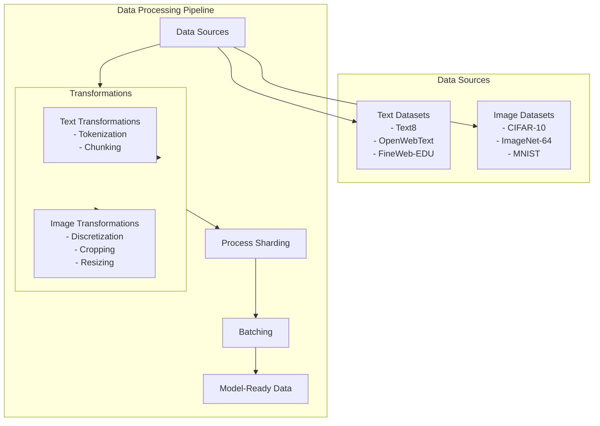
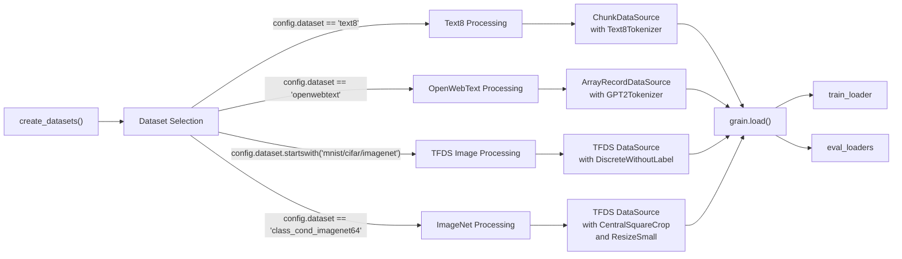
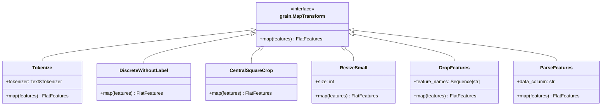
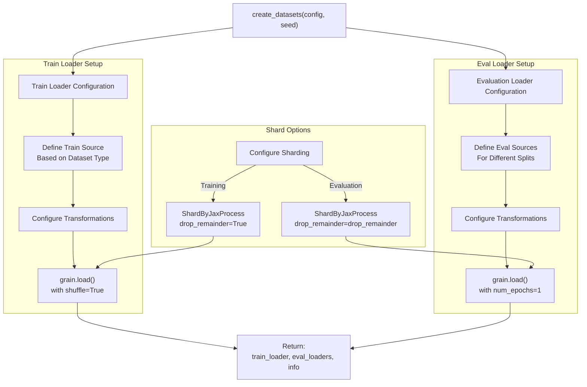

<!-- source: DeepWiki mcp.deepwiki.com · repo google-deepmind/md4 · page 4 Data Processing Pipeline · fetched 2026-10-26 -->

# Data Processing Pipeline

<details>
<summary>Relevant source files</summary>

The following files were used as context for generating this wiki page:

- [README.md](README.md)
- [md4/input_pipeline.py](md4/input_pipeline.py)

</details>


This document describes the data processing pipeline of the MD4 (Masked Diffusion for Discrete Data) system, which is responsible for loading, transforming, and preparing both text and image data for training and evaluation. The pipeline provides a unified interface for processing different data modalities while accommodating their specific requirements.

For information about specific text dataset processing details, see [Text Data Processing](#4.1). For specific image dataset processing information, see [Image Data Processing](#4.2).

## Overview

The MD4 data processing pipeline provides a deterministic, configurable approach to prepare data for masked diffusion models. The pipeline supports both text datasets (Text8, OpenWebText, FineWeb-EDU) and image datasets (CIFAR-10, ImageNet-64), with appropriate transformations for each data type.



Diagram: High-level Data Processing Pipeline Overview

Sources: [md4/input_pipeline.py:16-19]()

## Data Sources and Configuration

The MD4 system supports various data sources that are loaded and configured according to the specified dataset in the configuration.

### Text Datasets

- **Text8**: A character-level dataset with 27 characters vocabulary (26 lowercase letters and space)
- **OpenWebText**: A large collection of web text using GPT-2 tokenizer with 50,257 vocabulary size

### Image Datasets

- **CIFAR-10**: 32x32 RGB images in 10 classes
- **ImageNet-64**: 64x64 RGB images of the ImageNet dataset
- **MNIST**: 28x28 grayscale handwritten digit images



Diagram: Dataset Sources and Loading Flow

Sources: [md4/input_pipeline.py:284-407]()

## Data Tokenization and Preprocessing

Different data types require different preprocessing steps:

### Text Tokenization

For text data, the system uses appropriate tokenizers:

1. **Text8Tokenizer**: A custom tokenizer for character-level encoding with a small vocabulary size (27)
2. **GPT2Tokenizer**: Used for OpenWebText and other rich text datasets with a vocabulary size of 50,257

### Image Preprocessing

For image data, the system applies various transformations:

1. **Discretization**: Converts image data to discrete values
2. **Cropping**: Applies central square cropping (for ImageNet)
3. **Resizing**: Resizes images to the target dimensions (e.g., 64x64 for ImageNet)



Diagram: Data Transformation Classes Hierarchy

Sources: [md4/input_pipeline.py:172-262]()

## Text Data Processing Detail

### Text8 Processing

The Text8 dataset is processed as follows:

1. Data is downloaded from the source URL if not present
2. The raw text is split into train, validation, and test segments
3. Text is chunked into sequences of the configured length (typically 256)
4. Each character is tokenized using the `Text8Tokenizer`

```
Text8 Processing Flow:
Raw Text → Chunking → Character Tokenization → Batching
```

| Component | Function |
|-----------|----------|
| `Text8Tokenizer` | Encodes characters to integer tokens (a-z → 0-25, space → 26) |
| `ChunkDataSource` | Divides text into chunks of specified length (overlapping or non-overlapping) |
| `Tokenize` transform | Applies the tokenizer to each chunk |

Sources: [md4/input_pipeline.py:52-136](), [md4/input_pipeline.py:138-179]()

### OpenWebText Processing

For the OpenWebText dataset:

1. Uses precomputed tokenized data stored in ArrayRecord format
2. Each example is parsed using the `ParseFeatures` transformation
3. Uses GPT-2 tokenizer with a vocabulary size of 50,257
4. Configured for a sequence length of 1024

Sources: [md4/input_pipeline.py:331-348]()

## Image Data Processing Detail

Different image datasets are processed with specific transformations:

### CIFAR-10 and MNIST Processing

For CIFAR-10 and MNIST:

1. Loaded using TensorFlow Datasets (TFDS)
2. Processed using the `DiscreteWithoutLabel` transformation to remove labels
3. Images are converted to integer format for the discrete diffusion model

### ImageNet-64 Processing

For ImageNet-64:

1. Loaded from ImageNet2012 TFDS dataset
2. Applied `CentralSquareCrop` to create square images
3. Resized to 64x64 using `ResizeSmall` transformation
4. Unnecessary features removed with `DropFeatures`

Sources: [md4/input_pipeline.py:349-373]()

## Data Loading and Batching

The data pipeline uses Grain library to efficiently load and batch data:



Diagram: Data Loading and Batching Process

Sources: [md4/input_pipeline.py:284-407]()

Key configuration parameters include:

| Parameter | Description |
|-----------|-------------|
| `batch_size` | Total batch size across all processes |
| `process_batch_size` | Batch size per process (batch_size / process_count) |
| `grain_num_workers` | Number of workers for data loading |
| `eval_pad_last_batch` | Whether to pad the last batch during evaluation |
| `eval_batch_size` | Batch size for evaluation (defaults to training batch_size) |

Sources: [md4/input_pipeline.py:297-301]()

## Integration with Training

The data pipeline integrates with the training process through the `create_datasets` function, which returns:

1. `train_loader`: A Grain data loader for training data
2. `eval_loaders`: A dictionary of data loaders for evaluation data
3. `info`: Additional information like tokenizers needed by the model

The `get_num_train_steps` function calculates the total number of training steps based on the dataset size, batch size, and number of epochs.

```python
# Example usage in training loop
train_loader, eval_loaders, info = create_datasets(config, seed)
num_train_steps = get_num_train_steps(config)

for batch in train_loader:
    # Training step with batch
    ...

# Evaluation
for split, eval_loader in eval_loaders.items():
    for batch in eval_loader:
        # Evaluation step with batch
        ...
```

Sources: [md4/input_pipeline.py:264-282](), [md4/input_pipeline.py:284-407]()

## Usage Examples

### Preparing OpenWebText Data

Before training a model on OpenWebText, you need to prepare the dataset:

```bash
mkdir data_dir
python prepare_openwebtext_data.py
```

This tokenizes the text data and packs it into the required format for efficient loading during training.

Sources: [README.md:20-26]()

### Training with the Prepared Data

Once the data is prepared, you can train a model using:

```bash
python md4/main.py --config=md4/configs/md4/openwebtext.py --sharded=false --workdir=./expt
```

For image data:

```bash
python md4/main.py --config=md4/configs/md4/cifar10.py --sharded=false --workdir=./expt
```

Sources: [README.md:28-39]()

## Hardware Considerations

The batch size used in the data pipeline should be chosen based on available hardware:

- For a MD4-S model with sequence length 1024:
  - Eight A100 GPUs can support a maximum batch size of 128
  - Eight v5litepod TPU chips can support a maximum batch size of 32

Sources: [README.md:41-46]()

---

