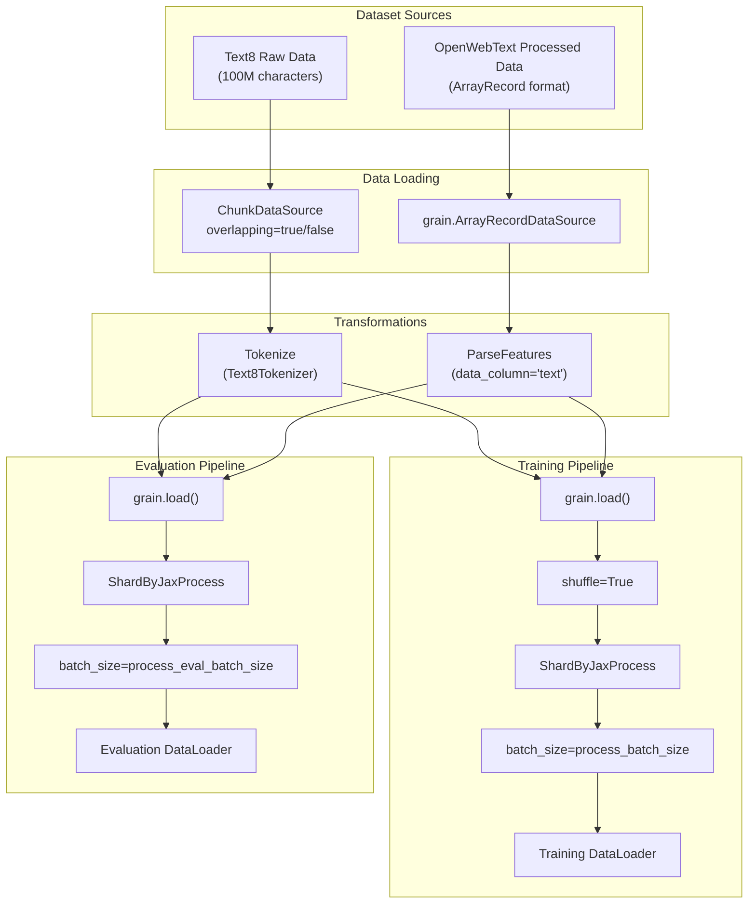
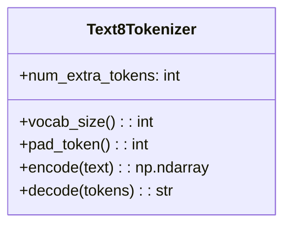
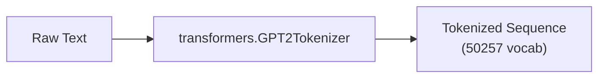
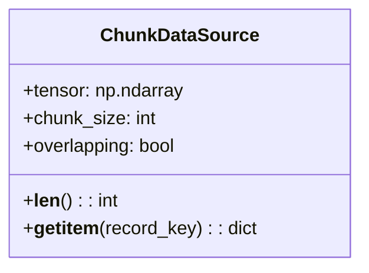
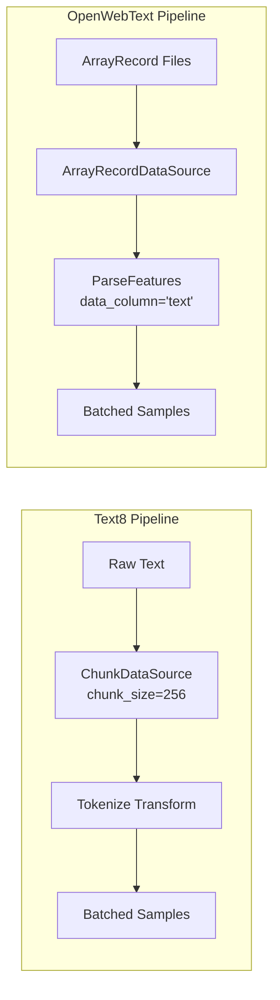
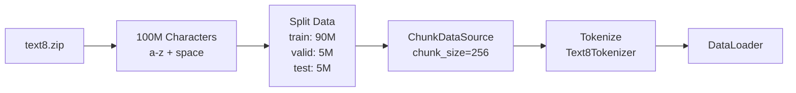
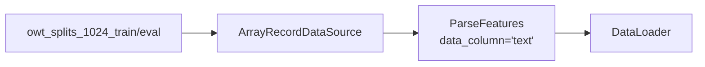

<!-- source: DeepWiki mcp.deepwiki.com · repo google-deepmind/md4 · page 4.1 Text Data Processing · fetched 2026-10-26 -->

# Text Data Processing

Relevant source files

The following files were used as context for generating this wiki page:

- [md4/configs/md4/openwebtext.py](md4/configs/md4/openwebtext.py)
- [md4/configs/md4/text8.py](md4/configs/md4/text8.py)
- [md4/input_pipeline.py](md4/input_pipeline.py)

This document details how text data is processed, tokenized, and prepared for training and generation in the MD4 (Masked Diffusion for Discrete Data) framework. It covers the implementation of text data sources, tokenization mechanisms, and the data loading pipeline. For information about image data processing, see [Image Data Processing](#4.2).

## Supported Text Datasets

MD4 supports the following text datasets:

| Dataset | Vocabulary Size | Sequence Length | Description |
|---------|----------------|-----------------|-------------|
| Text8 | 27 | 256 | Character-level dataset with lowercase letters and space |
| OpenWebText | 50257 | 1024 | Web text corpus tokenized with GPT-2 tokenizer |

Sources: [md4/configs/md4/text8.py:29-35](), [md4/configs/md4/openwebtext.py:29-35]()

## Text Data Processing Pipeline

The following diagram illustrates the overall text data processing pipeline in MD4:

Sources: [md4/input_pipeline.py:284-407]()

## Tokenization

MD4 implements different tokenization strategies depending on the dataset being used:

### Text8 Tokenizer

For the Text8 dataset, MD4 uses a custom character-level tokenizer that maps lowercase letters (a-z) to integers 0-25, with the space character represented by token 26.

The tokenizer performs the following operations:
- **Encoding**: Converts ASCII character codes to token IDs (a=0, b=1, ..., z=25, space=26)
- **Decoding**: Converts token IDs back to ASCII characters and joins them into a string

Sources: [md4/input_pipeline.py:52-74]()

### GPT-2 Tokenizer

For OpenWebText, MD4 uses the pretrained GPT-2 tokenizer from the HuggingFace transformers library, which has a vocabulary size of 50257 tokens.

Sources: [md4/input_pipeline.py:347-348]()

## Chunking Mechanism

Text data is divided into fixed-length chunks using the `ChunkDataSource` class:

The chunking mechanism supports two modes:
- **Non-overlapping**: Text is divided into discrete chunks of length `chunk_size`
- **Overlapping**: Creates chunks that overlap, enabling more training samples (used for Text8 training)

Sources: [md4/input_pipeline.py:138-169]()

## Data Transformation Pipeline

Text data undergoes several transformations before being fed to the model:

The pipeline consists of these key transformations:

1. **Tokenize**: Converts text to token IDs using the appropriate tokenizer
2. **ParseFeatures**: For OpenWebText, parses the serialized examples from ArrayRecord format

Sources: [md4/input_pipeline.py:172-180](), [md4/input_pipeline.py:242-261]()

## Data Loading and Batching

The `create_datasets` function orchestrates the entire data loading process:

```mermaid
flowchart TD
    Config["Configuration<br>batch_size, per_device_batch_size"] --> ProcessBatchSize["Calculate process_batch_size<br>batch_size / jax.process_count()"]
    
    ProcessBatchSize --> TrainLoader["Train DataLoader<br>grain.load()"]
    ProcessBatchSize --> EvalLoader["Eval DataLoader<br>grain.load()"]
    
    subgraph "Train Loading Parameters"
        TSource["Data Source"]
        TShuffle["shuffle=True"]
        TSeed["seed=config seed"]
        TShardOpt["ShardByJaxProcess<br>drop_remainder=True"]
        TTrans["train_transformations"]
        TBatch["batch_size=process_batch_size"]
        TWorker["worker_count=config.grain_num_workers"]
    end
    
    TSource & TShuffle & TSeed & TShardOpt & TTrans & TBatch & TWorker --> TrainLoader
    
    subgraph "Eval Loading Parameters"
        ESource["Eval Data Source"]
        ENumEpochs["num_epochs=1"]
        EShardOpt["ShardByJaxProcess<br>drop_remainder=True"]
        ETrans["eval_transformations"]
        EBatch["batch_size=process_eval_batch_size"]
        EWorker["worker_count=0"]
        EDropRem["drop_remainder=True"]
    end
    
    ESource & ENumEpochs & EShardOpt & ETrans & EBatch & EWorker & EDropRem --> EvalLoader
```

The loading process handles:
- Sharding data across multiple JAX processes for distributed training
- Batching samples based on device count and configured batch size
- Applying appropriate transformations based on dataset type

Sources: [md4/input_pipeline.py:284-407]()

## Dataset-Specific Processing

### Text8 Processing

For Text8, the processing flow is:

1. Download and unzip the text8.zip file if not already present
2. Split data into train (90M chars), validation (5M chars), and test (5M chars)
3. Create ChunkDataSource with appropriate chunking parameters
4. Apply Text8Tokenizer transformation

Sources: [md4/input_pipeline.py:77-136](), [md4/input_pipeline.py:308-328]()

### OpenWebText Processing

For OpenWebText, the processing flow is:

1. Load preprocessed data from ArrayRecord files
2. Create ArrayRecordDataSource pointing to train and eval paths
3. Apply ParseFeatures transformation to extract tokenized text
4. Use GPT-2 tokenizer for any additional processing

Sources: [md4/input_pipeline.py:331-349]()

## Configuration Parameters

Text data processing is controlled by several configuration parameters:

| Parameter | Description | Text8 Value | OpenWebText Value |
|-----------|-------------|-------------|-------------------|
| vocab_size | Size of the token vocabulary | 27 | 50257 |
| data_shape | Shape of the input sequence | (256,) | (1024,) |
| task_type | Type of task | "text" | "text" |
| outside_embed | Whether to use outside embedding | True | False |
| batch_size | Global batch size | 512 | 512 |
| grain_num_workers | Number of data loading workers | 15 | 1 |

Sources: [md4/configs/md4/text8.py:23-100](), [md4/configs/md4/openwebtext.py:23-102]()

## Integration with Training Pipeline

The text data processing pipeline integrates with the training system through the `create_datasets` function, which returns:

1. A training data loader (`grain.DataLoader`)
2. A dictionary of evaluation data loaders for each evaluation split
3. Additional information like the tokenizer instance

These components are then used by the main training loop to fetch batches of tokenized text sequences for model training and evaluation.

Sources: [md4/input_pipeline.py:284-407]()

---

