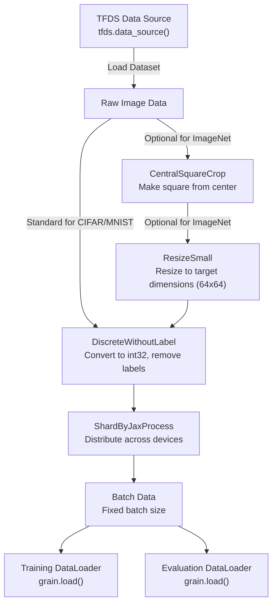
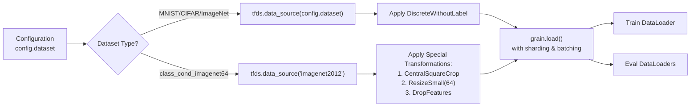
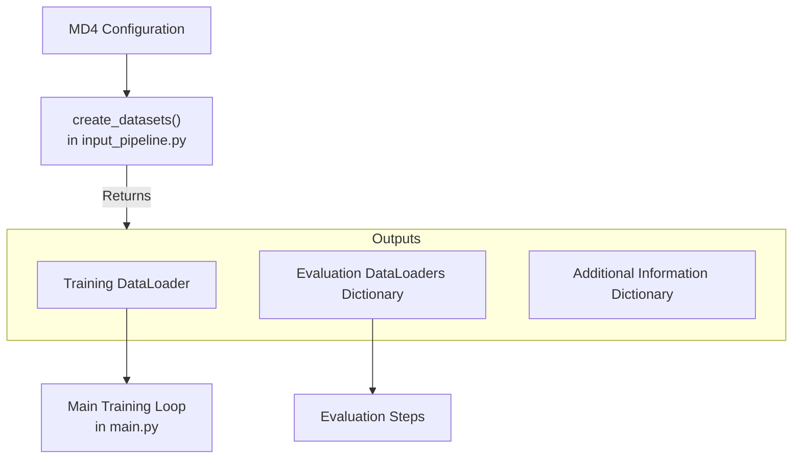

<!-- source: DeepWiki mcp.deepwiki.com · repo google-deepmind/md4 · page 4.2 Image Data Processing · fetched 2026-10-26 -->

# Image Data Processing

<details>
<summary>Relevant source files</summary>

The following files were used as context for generating this wiki page:

- [md4/configs/md4/cifar10.py](md4/configs/md4/cifar10.py)
- [md4/configs/md4/imagenet64.py](md4/configs/md4/imagenet64.py)
- [md4/input_pipeline.py](md4/input_pipeline.py)

</details>


This page documents the image data processing pipeline used in the MD4 (Masked Diffusion for Discrete Data) model. It covers how image datasets are loaded, preprocessed, and prepared for training and evaluation. The MD4 model treats images as discrete data by working with 8-bit color values (0-255) per channel, which aligns with its core approach of handling discrete tokens.

For information about text data processing, see [Text Data Processing](#4.1).

## Supported Image Datasets

MD4 currently supports the following image datasets:

| Dataset | Resolution | Color Channels | Data Shape | Vocabulary Size |
|---------|------------|----------------|------------|----------------|
| CIFAR-10 | 32×32 | 3 (RGB) | (32, 32, 3) | 256 |
| ImageNet-64 | 64×64 | 3 (RGB) | (64, 64, 3) | 256 |
| Class-conditional ImageNet-64 | 64×64 | 3 (RGB) | (64, 64, 3) | 256 |

Each pixel channel value is treated as a discrete token from a vocabulary of size 256 (representing 0-255 intensity values).

Sources: [md4/configs/md4/cifar10.py:28-35](), [md4/configs/md4/imagenet64.py:28-35]()

## Image Data Pipeline Architecture



This diagram illustrates the image data processing flow. The pipeline starts by loading the dataset through TFDS, applies appropriate transformations, shards the data across devices, and batches it for training or evaluation.

Sources: [md4/input_pipeline.py:183-225](), [md4/input_pipeline.py:349-372](), [md4/input_pipeline.py:376-406]()

## Image Preprocessing Transformations

### DiscreteWithoutLabel

The most fundamental transformation for image data processing is `DiscreteWithoutLabel`, which:
1. Converts image data to int32 data type
2. Removes any label or ID fields that aren't needed for unsupervised training

```python
@dataclasses.dataclass(frozen=True)
class DiscreteWithoutLabel(grain.MapTransform):
  def map(self, features):
    features["image"] = features["image"].astype(np.int32)
    if "label" in features:
      del features["label"]
    if "id" in features:
      del features["id"]
    return features
```

This transformation ensures that images are treated as discrete tokens suitable for the diffusion process.

Sources: [md4/input_pipeline.py:183-192]()

### Additional ImageNet-Specific Transformations

For ImageNet, which starts with variable-sized images, additional preprocessing is required:

1. **CentralSquareCrop**: Crops the image to a square from the center
   ```python
   @dataclasses.dataclass(frozen=True)
   class CentralSquareCrop(grain.MapTransform):
     def map(self, features: FlatFeatures) -> FlatFeatures:
       image = features["image"]
       h, w = image.shape[:2]
       size = min(h, w)
       top = (h - size) // 2
       left = (w - size) // 2
       image = image[top : top + size, left : left + size, :]
       features["image"] = image
       return features
   ```

2. **ResizeSmall**: Resizes the image to the target dimensions (64×64 for ImageNet-64)
   ```python
   @dataclasses.dataclass(frozen=True)
   class ResizeSmall(grain.MapTransform):
     size: int
     def map(self, features: FlatFeatures) -> FlatFeatures:
       image = features["image"]
       size = self.size
       image = cv2.resize(image, dsize=(size, size), interpolation=cv2.INTER_AREA)
       features["image"] = image.astype(np.int32)
       return features
   ```

Sources: [md4/input_pipeline.py:195-225]()

## Dataset Loading Implementation

The image datasets are loaded using TensorFlow Datasets (TFDS). The function `create_datasets` in `input_pipeline.py` contains the logic for determining which dataset to load and how to process it:



For standard image datasets (CIFAR-10, ImageNet-64), only the `DiscreteWithoutLabel` transformation is applied. For class-conditional ImageNet, a sequence of transformations is applied to prepare the data.

Sources: [md4/input_pipeline.py:284-407](), [md4/input_pipeline.py:349-372]()

## Configuration Options for Image Data

The configuration system provides several options specific to image datasets:

### Basic Dataset Configuration

```python
# CIFAR-10 configuration example
config.vocab_size = 256
config.dataset = "cifar10"
config.classes = -1  # -1 means unconditional model
config.task_type = "image"
config.data_shape = (32, 32, 3)
```

### Model Architecture Considerations

Different image resolutions require different model architectures:

| Dataset | Feature Dimension | Layers | DIT Layers | Notes |
|---------|-------------------|--------|------------|-------|
| CIFAR-10 | 128 | 32 | 0 | Smaller networks sufficient |
| ImageNet-64 | 256 | 8 | 20 | Uses additional DIT (DiT transformer) layers |

For example, the configuration for ImageNet-64 includes additional transformer layers (DiT) to handle the higher resolution:

```python
# ImageNet-64 configuration
config.feature_dim = 256
config.n_layers = 8  # Base layers
config.n_dit_layers = 20  # Additional transformer layers
config.dit_num_heads = 12
config.dit_hidden_size = 768
```

Sources: [md4/configs/md4/cifar10.py:28-57](), [md4/configs/md4/imagenet64.py:28-57]()

## Data Sharding and Batching

To efficiently process data across multiple devices, the MD4 system implements:

1. **Data Sharding**: Data is sharded across JAX processes using `grain.ShardByJaxProcess`
2. **Batching**: Fixed batch sizes are used for training and evaluation
3. **Parallelism**: The `grain_num_workers` parameter controls the number of worker processes for data loading

```python
train_loader = grain.load(
    source=train_source,
    shuffle=True,
    seed=seed,
    shard_options=grain.ShardByJaxProcess(drop_remainder=True),
    transformations=train_transformations,
    batch_size=process_batch_size,
    worker_count=config.grain_num_workers,
)
```

The batch size is calculated based on the total batch size divided by the number of JAX processes:

```python
process_batch_size = config.batch_size // jax.process_count()
```

This ensures efficient distribution of the workload across multiple devices.

Sources: [md4/input_pipeline.py:376-385](), [md4/input_pipeline.py:298-300]()

## Typical Configuration Values for Image Datasets

| Parameter | CIFAR-10 | ImageNet-64 | Description |
|-----------|----------|-------------|-------------|
| batch_size | 256 | 512 | Total batch size across all devices |
| feature_dim | 128 | 256 | Model feature dimension |
| n_layers | 32 | 8 | Number of base model layers |
| n_dit_layers | 0 | 20 | Number of DiT transformer layers |
| timesteps | 256 | 256 | Number of diffusion timesteps |
| noise_schedule | "linear" | "linear" | Type of noise schedule |
| sampling_grid | "cosine" | "cosine" | Grid for sampling timesteps |

These configuration values can be adjusted based on the available computational resources and the desired quality/speed tradeoff.

Sources: [md4/configs/md4/cifar10.py:46-84](), [md4/configs/md4/imagenet64.py:46-84]()

## Integration with the Training Pipeline

The image data pipeline integrates with the main training loop through the `create_datasets` function, which returns:

1. A training data loader
2. A dictionary of evaluation data loaders for different splits
3. A dictionary of additional information



This design allows the main training loop to be agnostic to the specifics of the data modality, making the system modular and extensible.

Sources: [md4/input_pipeline.py:284-407]()

## Summary

The image data processing pipeline in MD4 provides a robust and efficient way to prepare image data for masked diffusion models. It handles different dataset types and resolutions while ensuring that the data is properly formatted as discrete tokens. The pipeline leverages TFDS for data loading and Grain for efficient distribution and processing, making it suitable for large-scale training on multiple devices.

---

