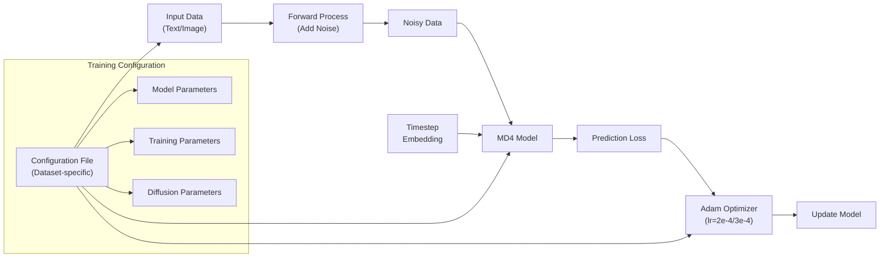
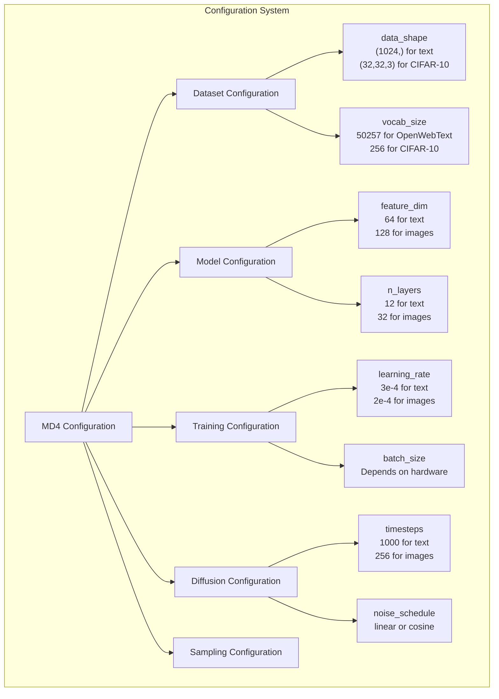
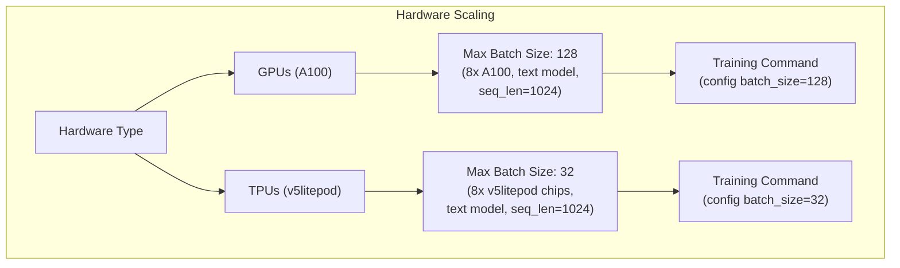
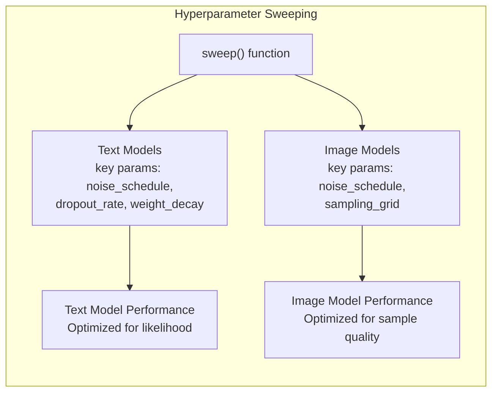

<!-- source: DeepWiki mcp.deepwiki.com · repo google-deepmind/md4 · page 5 Training MD4 Models · fetched 2026-10-26 -->

# Training MD4 Models

<details>
<summary>Relevant source files</summary>

The following files were used as context for generating this wiki page:

- [README.md](README.md)
- [md4/configs/md4/cifar10.py](md4/configs/md4/cifar10.py)
- [md4/configs/md4/openwebtext.py](md4/configs/md4/openwebtext.py)

</details>


This document provides a comprehensive guide to training Masked Diffusion for Discrete Data (MD4) models. It covers the entire training process from configuration to execution, with specific considerations for different data types and hardware setups. For information about sampling and generation with trained models, see [Sampling and Generation](#6).

## Training Process Overview

Training an MD4 model follows a standard diffusion model training process, where the model learns to denoise progressively corrupted data. The MD4 approach simplifies this process for discrete data types like text and images.



Sources: [md4/configs/md4/openwebtext.py:1-102](), [md4/configs/md4/cifar10.py:1-98](), [README.md:28-39]()

## Configuration System

MD4 uses a comprehensive configuration system that allows you to specify all aspects of model training. Each dataset has its own configuration file that defines default parameters optimized for that dataset.

### Key Configuration Parameters

| Parameter Group | Key Parameters | Description |
|-----------------|----------------|-------------|
| Dataset | `vocab_size`, `dataset`, `data_shape`, `task_type` | Defines the dataset and its characteristics |
| Diffusion Process | `timesteps`, `noise_schedule`, `time_features` | Controls the noise addition process |
| Model Architecture | `feature_dim`, `n_layers`, `num_heads`, `dropout_rate` | Defines the neural network structure |
| Training | `learning_rate`, `batch_size`, `num_train_steps`, `weight_decay` | Controls the optimization process |
| Sampling | `sampler`, `sampling_grid`, `topp` | Defines how samples are generated during evaluation |
| Logging & Checkpointing | `log_loss_every_steps`, `checkpoint_every_steps` | Controls progress tracking |



Sources: [md4/configs/md4/openwebtext.py:23-102](), [md4/configs/md4/cifar10.py:23-99]()

### Text-Specific Configuration

Text models (such as those trained on OpenWebText) typically use these parameter values:

- `vocab_size`: 50257 (for GPT-2 tokenizer)
- `data_shape`: (1024,) - sequence length
- `feature_dim`: 64
- `n_layers`: 12
- `timesteps`: 1000
- `learning_rate`: 3e-4

Sources: [md4/configs/md4/openwebtext.py:28-36](), [md4/configs/md4/openwebtext.py:46-57]()

### Image-Specific Configuration

Image models (such as those trained on CIFAR-10) typically use these parameter values:

- `vocab_size`: 256 (for 8-bit pixel values)
- `data_shape`: (32, 32, 3) for CIFAR-10
- `feature_dim`: 128
- `n_layers`: 32
- `timesteps`: 256
- `learning_rate`: 2e-4

Sources: [md4/configs/md4/cifar10.py:28-36](), [md4/configs/md4/cifar10.py:46-57]()

## Hardware Requirements and Scaling

The batch size you can use depends on your available hardware. MD4 training can be done on both GPUs and TPUs, with different performance characteristics.



Sources: [README.md:41-46]()

## Running Training

### Training Command

To train an MD4 model, use the main.py script with an appropriate configuration:

For text data:
```bash
python md4/main.py --config=md4/configs/md4/openwebtext.py --sharded=false --workdir=./expt
```

For image data:
```bash
python md4/main.py --config=md4/configs/md4/cifar10.py --sharded=false --workdir=./expt
```

The `--workdir` parameter specifies where checkpoints and logs will be saved. The `--sharded` parameter determines whether to use distributed training.

Sources: [README.md:28-39]()

### Data Preparation

For text data like OpenWebText, tokenization and data packing must be done before training:

```bash
mkdir data_dir
python prepare_openwebtext_data.py
```

Sources: [README.md:21-26]()

## Monitoring and Checkpointing

The training progress is logged at regular intervals and checkpoints are saved for later use. These behaviors are controlled by the following configuration parameters:

- `log_loss_every_steps`: How often to log the loss (default: 500 steps)
- `eval_every_steps`: How often to evaluate the model (default: 10,000 steps)
- `checkpoint_every_steps`: How often to save a checkpoint (default: 5,000 steps)
- `checkpoint_keep_period`: How long to keep checkpoints (default varies by dataset)

Sources: [md4/configs/md4/openwebtext.py:87-90](), [md4/configs/md4/cifar10.py:86-89]()

## Hyperparameter Tuning

MD4 includes a sweep functionality for hyperparameter tuning. Each configuration file has a `sweep()` function that defines parameter combinations to try.



Sources: [md4/configs/md4/openwebtext.py:105-125](), [md4/configs/md4/cifar10.py:102-116]()

### Key Hyperparameters for Tuning

Text models:
- `noise_schedule`: "linear" (default for likelihood optimization)
- `dropout_rate`: 0.02 (small models)
- `weight_decay`: 0.03

Image models:
- `noise_schedule`: "linear" (for likelihood) or "cosine" (for sample quality)
- `sampling_grid`: "cosine" (for likelihood) or "uniform" (for sample quality)

Sources: [md4/configs/md4/openwebtext.py:110-115](), [md4/configs/md4/cifar10.py:108-116]()

## Training Duration and Resources

The default training configurations run for a substantial number of steps:
- Text models (OpenWebText): 1,000,000 training steps
- Image models (CIFAR-10): 2,000,000 training steps

Be prepared for long training times, especially when using smaller batch sizes or less powerful hardware. Monitor GPU/TPU memory usage to avoid out-of-memory errors, and adjust batch size accordingly.

Sources: [md4/configs/md4/openwebtext.py:69](), [md4/configs/md4/cifar10.py:69]()

## Optimizing for Different Objectives

Depending on your goals, you may want to optimize your model differently:

1. For best likelihood (reconstruction quality):
   - Use `noise_schedule="linear"`
   - Use `sampling_grid="cosine"`

2. For best sample quality (generation):
   - Use `noise_schedule="cosine"`
   - Use `sampling_grid="uniform"`

Sources: [md4/configs/md4/cifar10.py:107-116]()

---

