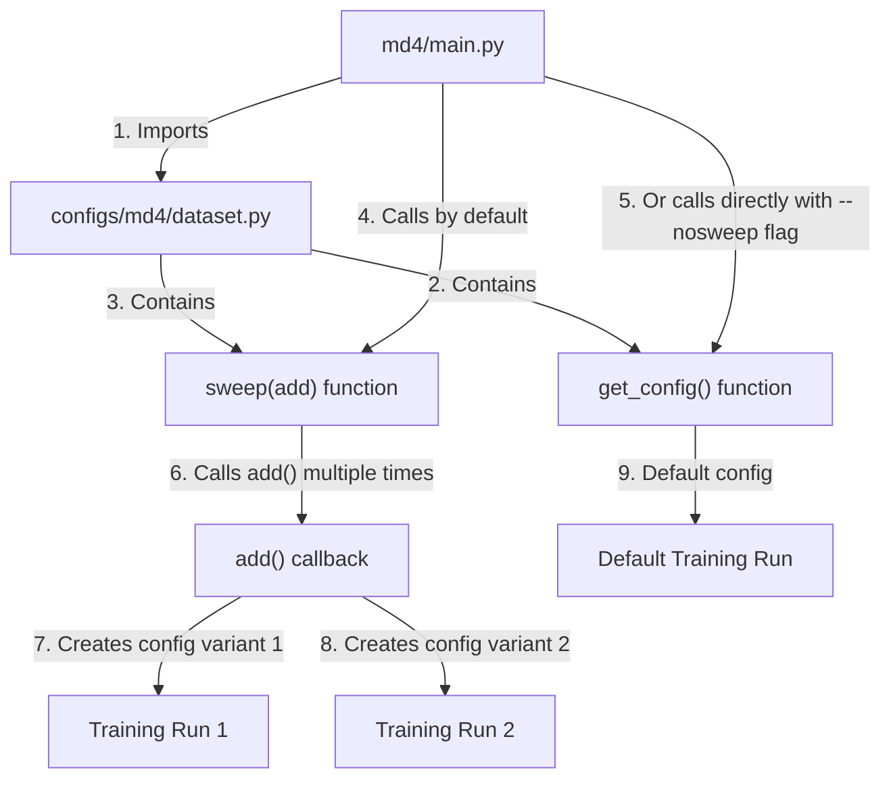
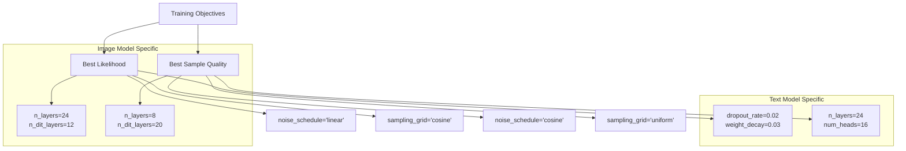

<!-- source: DeepWiki mcp.deepwiki.com · repo google-deepmind/md4 · page 5.1 Hyperparameter Tuning · fetched 2026-10-26 -->

# Hyperparameter Tuning

<details>
<summary>Relevant source files</summary>

The following files were used as context for generating this wiki page:

- [md4/configs/md4/cifar10.py](md4/configs/md4/cifar10.py)
- [md4/configs/md4/imagenet64.py](md4/configs/md4/imagenet64.py)
- [md4/configs/md4/openwebtext.py](md4/configs/md4/openwebtext.py)

</details>


This document explains how to optimize MD4 model performance through hyperparameter tuning using the built-in sweep functionality. The MD4 codebase provides a structured approach to experiment with different hyperparameter combinations for various datasets and training objectives.

For information about the general training process, see [Training MD4 Models](#5).

## MD4 Hyperparameter Tuning Architecture

The MD4 codebase implements hyperparameter tuning through a `sweep()` function defined in each dataset configuration file. This function enables running multiple training experiments with different hyperparameter settings.

### Hyperparameter Tuning System Workflow



Sources: [md4/configs/md4/cifar10.py:103-117](), [md4/configs/md4/imagenet64.py:103-131](), [md4/configs/md4/openwebtext.py:105-125]()

## Key Hyperparameters in MD4

The MD4 codebase organizes hyperparameters into logical categories that affect different aspects of model performance:

```mermaid
flowchart TD
    ConfigFile["configs/md4/*.py"]
    
    ConfigFile --> ModelArch["Model Architecture Parameters"]
    ConfigFile --> DiffProc["Diffusion Process Parameters"]
    ConfigFile --> TrainParams["Training Parameters"]
    ConfigFile --> SampParams["Sampling Parameters"]
    
    ModelArch --> FeatureDim["config.feature_dim"]
    ModelArch --> NLayers["config.n_layers"]
    ModelArch --> NumHeads["config.num_heads"]
    ModelArch --> Dropout["config.dropout_rate"]
    
    DiffProc --> Timesteps["config.timesteps"]
    DiffProc --> NoiseSchedule["config.noise_schedule"]
    DiffProc --> TimeFeatures["config.time_features"]
    DiffProc --> ContTime["config.cont_time"]
    
    TrainParams --> LR["config.learning_rate"]
    TrainParams --> BatchSize["config.batch_size"]
    TrainParams --> WeightDecay["config.weight_decay"]
    TrainParams --> TrainSteps["config.num_train_steps"]
    
    SampParams --> Sampler["config.sampler"]
    SampParams --> SamplingGrid["config.sampling_grid"]
    SampParams --> TopP["config.topp"]
```



Sources: [md4/configs/md4/cifar10.py:28-76](), [md4/configs/md4/imagenet64.py:28-76](), [md4/configs/md4/openwebtext.py:28-77]()

### Key Hyperparameter Tables

#### Model Architecture Parameters

| Parameter | Description | Typical Values |
|-----------|-------------|----------------|
| `feature_dim` | Feature dimensionality | 64, 128, 256 |
| `n_layers` | Number of model layers | 8, 12, 24, 32 |
| `num_heads` | Number of attention heads | 12, 16 |
| `dropout_rate` | Dropout rate for regularization | 0.0, 0.02, 0.1 |

#### Diffusion Process Parameters

| Parameter | Description | Typical Values |
|-----------|-------------|----------------|
| `timesteps` | Number of diffusion timesteps | 256, 1000 |
| `noise_schedule` | Schedule for noise addition | `"linear"`, `"cosine"` |
| `time_features` | Type of time embedding features | `"t"`, `"none"` |
| `cont_time` | Whether to use continuous time | `True`, `False` |

#### Training Parameters

| Parameter | Description | Typical Values |
|-----------|-------------|----------------|
| `learning_rate` | Learning rate for optimization | 2e-4, 3e-4 |
| `batch_size` | Training batch size | 256, 512 |
| `weight_decay` | Weight decay coefficient | 0.0, 0.01, 0.03 |
| `num_train_steps` | Number of training steps | 1M, 2M |

#### Sampling Parameters

| Parameter | Description | Typical Values |
|-----------|-------------|----------------|
| `sampler` | Sampling strategy | `"ancestral"`, `"mean"`, `"topp"` |
| `sampling_grid` | Grid for sampling timesteps | `"uniform"`, `"cosine"` |
| `topp` | Parameter for top-p sampling | 0.98 |

Sources: [md4/configs/md4/cifar10.py:28-85](), [md4/configs/md4/imagenet64.py:28-85](), [md4/configs/md4/openwebtext.py:28-86]()

## Using the Sweep Functionality

The `sweep()` function in configuration files defines hyperparameter variations for multiple training runs. Each call to the `add()` callback function within `sweep()` creates a separate training job with specified hyperparameter overrides.

### Common Hyperparameter Sweeps by Objective



Sources: [md4/configs/md4/cifar10.py:103-117](), [md4/configs/md4/imagenet64.py:103-131](), [md4/configs/md4/openwebtext.py:105-125]()

### Example Sweep Configurations

#### CIFAR-10 Image Dataset

```python
def sweep(add: abc.Callable[..., None]):
    # For best likelihood results
    add(
        noise_schedule="linear",
        sampling_grid="cosine",
    )
    # For best sample quality (commented out by default)
    # add(
    #     noise_schedule="cosine",
    #     sampling_grid="uniform",
    # )
```

Source: [md4/configs/md4/cifar10.py:103-117]()

#### ImageNet-64 Image Dataset

```python
def sweep(add: abc.Callable[..., None]):
    # Train unconditional model
    add(
        dataset="downsampled_imagenet/64x64",
        sampling_grid="cosine",
        noise_schedule="linear",
        n_layers=8,
        n_dit_layers=20,
    )
    # Cosine schedule: worse likelihood, for best sample quality
    # add(
    #     dataset="downsampled_imagenet/64x64",
    #     sampling_grid="uniform",
    #     noise_schedule="cosine",
    #     n_layers=8,
    #     n_dit_layers=20,
    # )
```

Source: [md4/configs/md4/imagenet64.py:103-131]()

#### OpenWebText Text Dataset

```python
def sweep(add: abc.Callable[..., None]):
    # Small size
    add(
        noise_schedule="linear",
        dropout_rate=0.02,
        weight_decay=0.03,
    )
    # Medium size
    # add(
    #     noise_schedule="cosine",
    #     n_layers=24,
    #     num_heads=16,
    #     batch_size=512,
    #     sampling_grid="uniform",
    #     dropout_rate=0.0,
    #     weight_decay=0.03,
    # )
```

Source: [md4/configs/md4/openwebtext.py:105-125]()

## Running Hyperparameter Sweeps

The MD4 codebase launcher automatically calls the `sweep()` function in the selected configuration file, which initiates multiple training runs with different hyperparameter settings.

### Running a sweep:

```bash
# Run with default sweep behavior
python -m md4.main --config=configs/md4/cifar10
```

### Disabling sweeps:

If you want to run only the default configuration without hyperparameter variation:

```bash
# Run with sweep disabled
python -m md4.main --config=configs/md4/cifar10 --nosweep
```

### Creating custom sweeps:

To create custom hyperparameter sweeps, modify the `sweep()` function in the appropriate configuration file:

1. Open the configuration file for your dataset (e.g., `configs/md4/cifar10.py`)
2. Locate the `sweep()` function at the bottom of the file
3. Add or modify the `add()` calls with your desired hyperparameter combinations
4. Run the training with your customized sweeps

## Best Practices for Hyperparameter Tuning

1. **Start with recommended configurations**: Use the predefined sweep configurations as starting points since they already target common objectives like best likelihood or best sample quality.

2. **Understand the trade-offs**: 
   - `noise_schedule="linear"` with `sampling_grid="cosine"` typically gives better likelihood
   - `noise_schedule="cosine"` with `sampling_grid="uniform"` typically gives better sample quality

3. **Prioritize key hyperparameters by data type**:
   - For image models: focus on `n_layers`, `n_dit_layers`, and `noise_schedule`
   - For text models: focus on `n_layers`, `num_heads`, and `dropout_rate`

4. **Hardware considerations**: Larger models (more layers, higher feature dimensions) require more memory and computational resources. Scale your batch size appropriately for your hardware.

5. **Document your results**: Keep track of hyperparameter combinations and their performance metrics to build knowledge for future experiments.

Sources: [md4/configs/md4/cifar10.py:103-117](), [md4/configs/md4/imagenet64.py:103-131](), [md4/configs/md4/openwebtext.py:105-125]()

---

