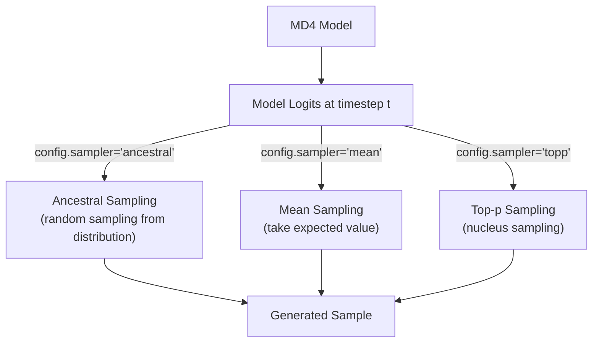
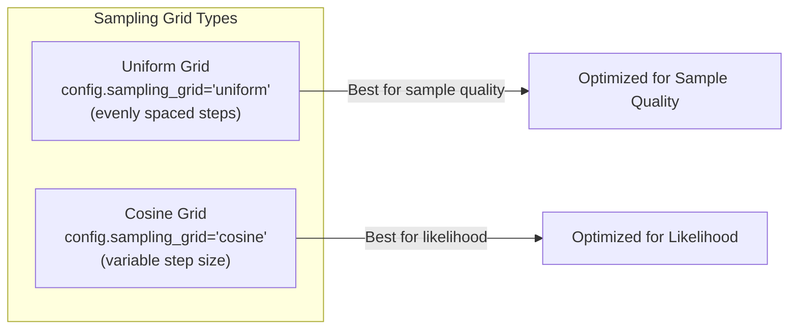
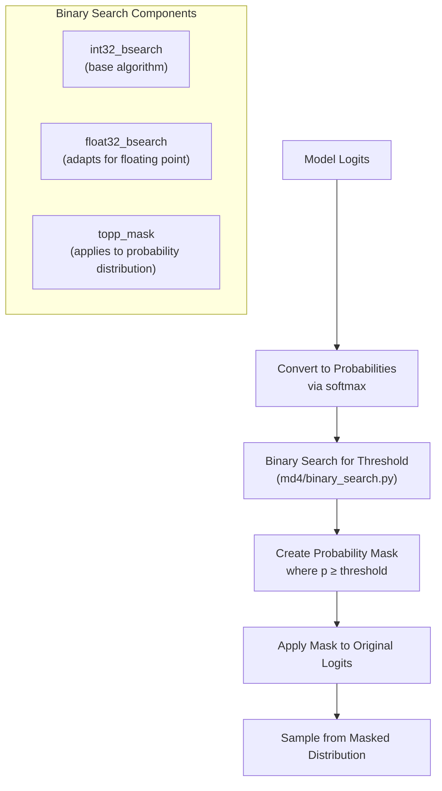
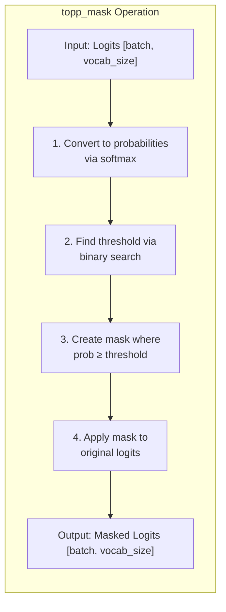

<!-- source: DeepWiki mcp.deepwiki.com · repo google-deepmind/md4 · page 6 Sampling and Generation · fetched 2026-10-26 -->

# Sampling and Generation

Relevant source files

The following files were used as context for generating this wiki page:

- [md4/binary_search.py](md4/binary_search.py)
- [md4/configs/md4/cifar10.py](md4/configs/md4/cifar10.py)
- [md4/configs/md4/openwebtext.py](md4/configs/md4/openwebtext.py)

This document explains the different sampling methods and generation techniques used in MD4 (Masked Diffusion for Discrete Data). It covers how to generate samples from trained models using various sampling strategies, how these methods are configured, and the efficient implementations that enable high-quality generation of discrete data.

## Overview of Sampling in Diffusion Models

In masked diffusion models, generation involves reversing the diffusion process - starting from pure noise and gradually denoising the data until a clean sample is produced. MD4 implements several sampling methods that offer different trade-offs between sample quality, diversity, and computational efficiency.

Sources: [md4/configs/md4/cifar10.py:78-84](), [md4/configs/md4/openwebtext.py:79-85]()

## Sampling Methods in MD4

MD4 offers three distinct sampling methods, each configurable via the `config.sampler` parameter:

### Ancestral Sampling

Ancestral sampling follows the original reverse diffusion process, where at each denoising step, tokens are sampled from the full predicted distribution. This introduces randomness and helps maintain diversity in the generated samples.

- **Configuration**: Set `config.sampler = "ancestral"`
- **Use case**: Best for applications where diversity of outputs is important

### Mean Sampling

Mean sampling takes the expected value (mean) of the distribution at each denoising step rather than sampling randomly. This produces more deterministic results.

- **Configuration**: Set `config.sampler = "mean"`
- **Use case**: Best for applications where consistent, high-quality outputs are desired

### Top-p (Nucleus) Sampling

Top-p sampling restricts the sampling process to the smallest set of tokens that together have a cumulative probability mass exceeding a threshold p. This technique helps balance between quality and diversity by avoiding both overly deterministic outputs and random, low-probability choices.

- **Configuration**: 
  - Set `config.sampler = "topp"`
  - Set `config.topp = 0.98` (or another threshold between 0 and 1)
- **Use case**: Best for text generation where both quality and diversity are important

Sources: [md4/configs/md4/cifar10.py:79-84](), [md4/configs/md4/openwebtext.py:80-85](), [md4/binary_search.py:233-302]()

## Sampling Grid Types

The sampling grid determines how timesteps are allocated during the reverse diffusion process. MD4 supports two types of sampling grids:

### Uniform Grid

A uniform grid evenly spaces the sampling steps throughout the reverse diffusion process.

- **Configuration**: Set `config.sampling_grid = "uniform"`
- **Use case**: Often preferred for better sample quality, especially with cosine noise schedule

### Cosine Grid

A cosine grid uses a cosine schedule to determine sampling steps, allocating more steps to critical parts of the diffusion process.

- **Configuration**: Set `config.sampling_grid = "cosine"`
- **Use case**: Often preferred for better likelihood results, especially with linear noise schedule

Sources: [md4/configs/md4/cifar10.py:80-82](), [md4/configs/md4/cifar10.py:107-116]()

## Efficient Binary Search Implementation for Top-p Sampling

For efficient top-p sampling, MD4 implements a sophisticated binary search algorithm that works directly with float32 bit patterns. This approach enables fast masking operations during the sampling process, which is critical for high-performance generation.

The binary search implementation in MD4 consists of several components:

1. **Base Binary Search (`int32_bsearch`)**: A batched binary search over int32 values
2. **Float32 Binary Search (`float32_bsearch`)**: Adapts the binary search to work with floating-point numbers
3. **Top-p Masking (`topp_mask`)**: Uses binary search to efficiently find the threshold for masking logits

This implementation is optimized for performance on modern accelerators (GPUs/TPUs) and supports batched operations, making it suitable for generating multiple samples in parallel.

Sources: [md4/binary_search.py:16-302](), [md4/binary_search.py:233-302]()

## How Top-p Masking Works

The `topp_mask` function masks logits to the smallest set of choices with a total probability mass >= p:

1. Convert logits to probabilities using softmax
2. Use binary search to find the threshold value where cumulative probability is just below p
3. Create a mask that preserves only values above this threshold
4. Apply the mask to the original logits, replacing masked values with a specified value

Sources: [md4/binary_search.py:233-302]()

## Optimizing For Different Objectives

Different sampling configurations can optimize for different objectives:

| Objective | Recommended Configuration | 
|-----------|---------------------------|
| Best likelihood results | `noise_schedule="linear"` with `sampling_grid="cosine"` |
| Best sample quality | `noise_schedule="cosine"` with `sampling_grid="uniform"` |

Sources: [md4/configs/md4/cifar10.py:107-116]()

## Implementation Considerations

When implementing top-k or top-p sampling in MD4, there are important performance considerations:

1. **Sharding considerations**: The vocab_size axis should be unsharded on input to avoid excessive latency from reductions.
2. **Memory considerations**: For optimal performance, the entire input array should fit in a fast memory tier.
3. **Batch processing**: Consider splitting large batches into microbatches processed sequentially to manage memory usage.

These optimizations are particularly important when generating text with large vocabulary sizes.

Sources: [md4/binary_search.py:170-191](), [md4/binary_search.py:233-245]()

## Related Pages

For more information about the binary search implementations used for efficient top-k and top-p sampling/masking, see [Binary Search Implementations](#6.1).

For details on how to configure and train MD4 models, see [Training MD4 Models](#5).

---

