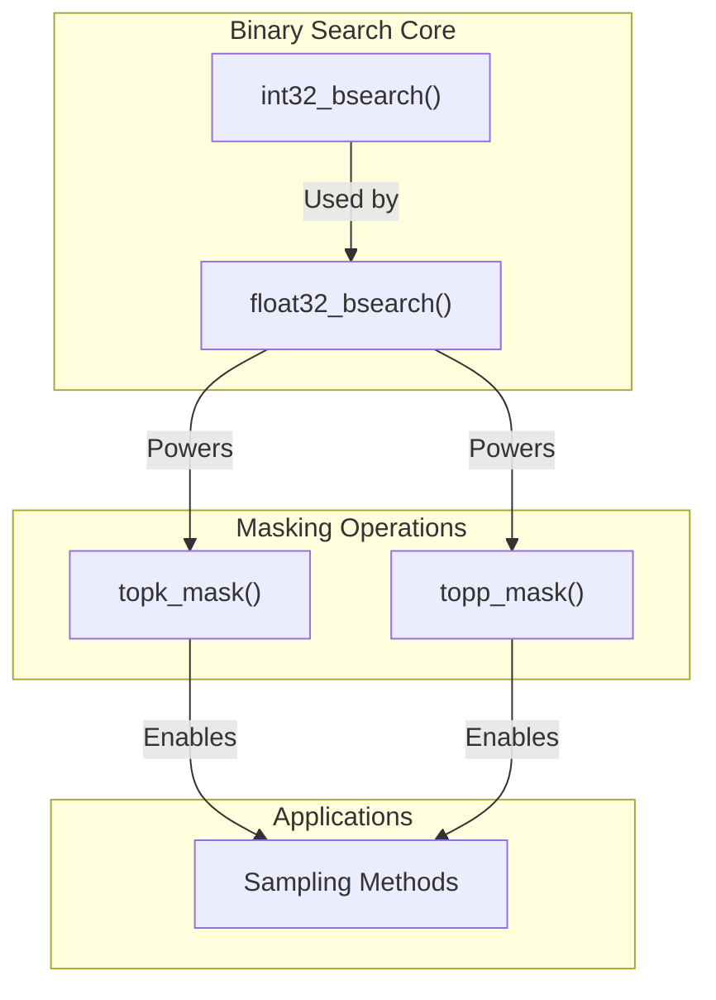
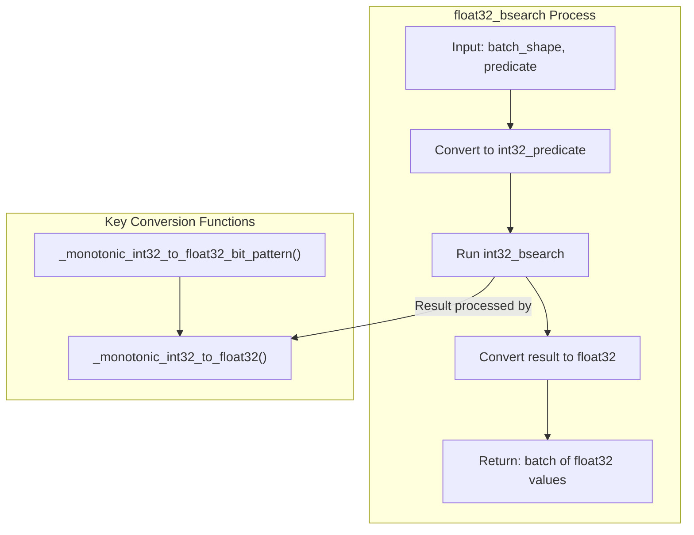
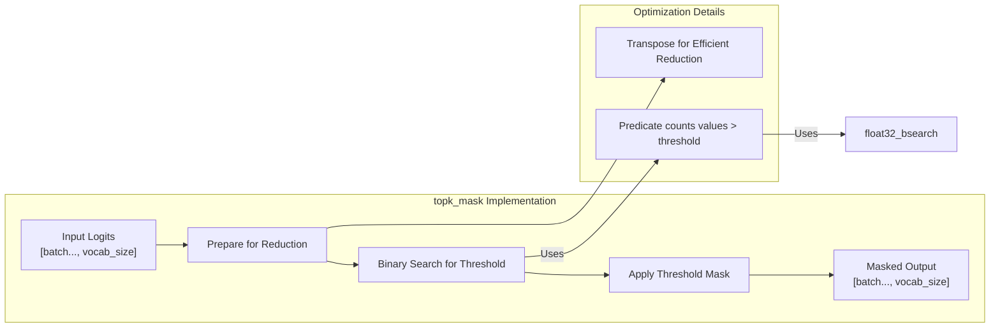
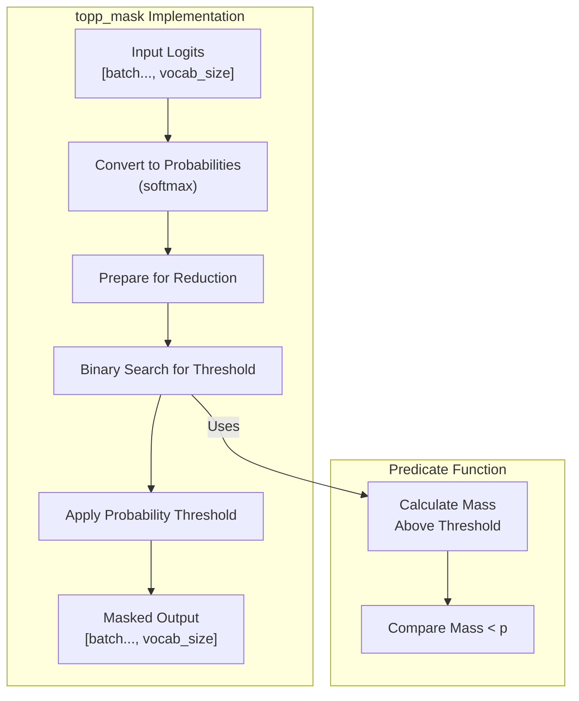
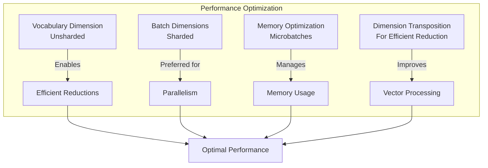
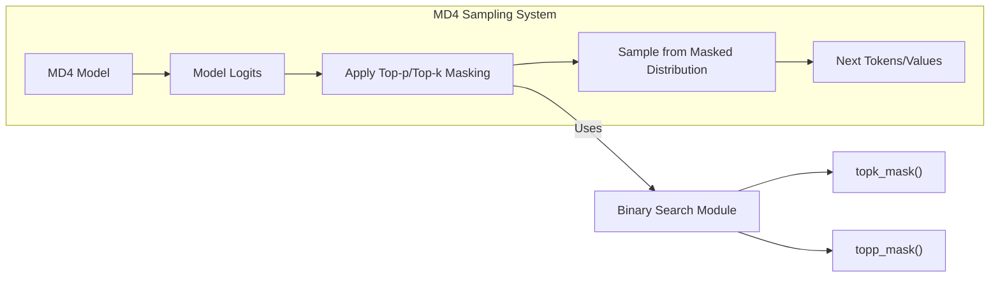

<!-- source: DeepWiki mcp.deepwiki.com · repo google-deepmind/md4 · page 6.1 Binary Search Implementations · fetched 2026-10-26 -->

# Binary Search Implementations

<details>
<summary>Relevant source files</summary>

The following files were used as context for generating this wiki page:

- [md4/binary_search.py](md4/binary_search.py)

</details>


This page documents the binary search implementations used in MD4 to efficiently perform top-k and top-p (nucleus) sampling for discrete data generation. These implementations are foundational for high-quality sampling from diffusion models, particularly when working with language models where efficient token selection is critical. For information about the sampling methods that use these implementations, see [Sampling and Generation](#6).

## Purpose and Overview

The binary search module provides specialized implementations for efficiently finding threshold values over arrays of logits, enabling fast top-k and top-p masking operations. These operations are crucial for:
- Limiting the vocabulary to only the most likely tokens during sampling
- Maintaining diversity in generated outputs
- Improving quality while controlling computational costs

The implementations are optimized for performance on both GPU and TPU hardware, with careful consideration of memory usage and parallel execution.

Sources: [md4/binary_search.py:16-23]()

## Core Binary Search Implementations

MD4 provides two core binary search implementations:

1. `int32_bsearch`: Binary search over int32 values
2. `float32_bsearch`: Binary search over float32 values (built on top of int32_bsearch)

These functions serve as the foundation for the higher-level masking operations.



**Binary Search Implementation Hierarchy**

Sources: [md4/binary_search.py:32-167]()

### Integer Binary Search (`int32_bsearch`)

The `int32_bsearch` function implements a batch-friendly binary search over 32-bit integers. Key characteristics:

- **Purpose**: For each element in a batch, find the largest int32 value where a predicate is False
- **Input**: Batch shape and a monotonic predicate function
- **Output**: For each batch element, the largest int32 for which the predicate returns False
- **Implementation**: Uses bit manipulation for efficiency, testing bits from most to least significant

The code efficiently searches through all 32 bits of the int32 space without recursion, making it highly optimized for GPU/TPU execution.

Sources: [md4/binary_search.py:32-74]()

### Float32 Binary Search (`float32_bsearch`)

Built on top of `int32_bsearch`, this function enables searching over float32 values:

- **Purpose**: Find the largest finite non-NaN float32 for which a predicate is False
- **Implementation**: Handles the complexity of IEEE 754 floating-point representation
- **Special Features**: 
  - Properly handles the floating-point total order
  - Manages special values (NaN, infinity) correctly
  - Maps between int32 bit patterns and float32 values



**Float32 Binary Search Process Flow**

Sources: [md4/binary_search.py:77-167]()

## Top-k and Top-p Masking Implementations

### Top-k Masking (`topk_mask`)

The `topk_mask` function selectively preserves only the top-k highest values in a tensor:

- **Purpose**: Keep only the k largest values per batch element, masking all others
- **Input**: 
  - `x`: Values before masking [batch..., vocab_size]
  - `k`: Number of elements to keep
  - `replace_val`: Value to use for masked elements
- **Output**: Original values where in top-k, otherwise replaced with `replace_val`
- **Algorithm**:
  1. Uses binary search to find optimal cutoff threshold
  2. Applies threshold comparison to create mask
  3. Preserves original values above threshold



**Top-k Masking Process**

Sources: [md4/binary_search.py:170-230]()

### Top-p Masking (`topp_mask`)

The `topp_mask` function implements nucleus sampling by preserving elements whose cumulative probability exceeds threshold p:

- **Purpose**: Keep the smallest set of tokens that have cumulative probability >= p
- **Input**:
  - `logits`: Unnormalized log probabilities [batch..., vocab_size]
  - `p`: Probability threshold (0.0-1.0)
  - `replace_val`: Value to use for masked elements
- **Output**: Original logits where in top-p set, otherwise replaced with `replace_val`
- **Algorithm**:
  1. Converts logits to probabilities using softmax
  2. Uses binary search to find optimal probability threshold
  3. Computes cumulative probability mass for tokens above threshold
  4. Preserves logits where probabilities >= threshold



**Top-p (Nucleus) Sampling Process**

Sources: [md4/binary_search.py:233-302]()

## Performance Considerations

Both masking implementations include important optimizations:

1. **Dimension Swapping**: Reductions over the vocabulary dimension are transposed to the second-last dimension to avoid inefficient vector lane reductions
   ```
   x_for_loop = jnp.swapaxes(x_for_loop, -1, -2)
   ```

2. **Sharding Recommendations**:
   - Vocabulary dimension should be unsharded to avoid excessive reduction latency
   - Batch axes are preferred for sharding

3. **Memory Management**:
   - Most efficient when the entire input array fits in fast memory
   - Consider using microbatches for large inputs



**Performance Optimization Strategies**

Sources: [md4/binary_search.py:171-178](), [md4/binary_search.py:179-183](), [md4/binary_search.py:191-206](), [md4/binary_search.py:238-250]()

## Integration with Sampling Methods

These binary search implementations are crucial for the sampling process in MD4:

1. During the reverse diffusion process, top-p sampling is commonly used to maintain diversity while focusing on high-probability tokens
2. The implementation efficiently allows for batched sampling operations
3. The functions work in concert with the model's logits to produce high-quality samples



**Integration with MD4 Sampling System**

Sources: [md4/binary_search.py:233-302]()

## Summary

The binary search implementations in MD4 provide efficient solutions for top-k and top-p masking operations, which are essential for high-quality sampling from discrete diffusion models. The implementations are carefully optimized for performance on modern accelerators, with special attention to memory usage, parallel execution, and numerical precision.

These implementations enable MD4 to efficiently generate high-quality samples from large vocabulary distributions, whether for text or discretized image data.

Sources: [md4/binary_search.py:16-23]()

---

