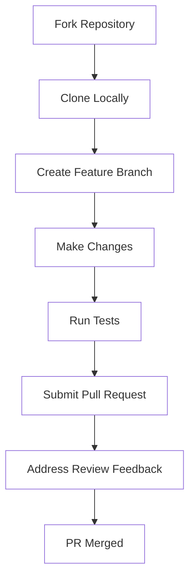
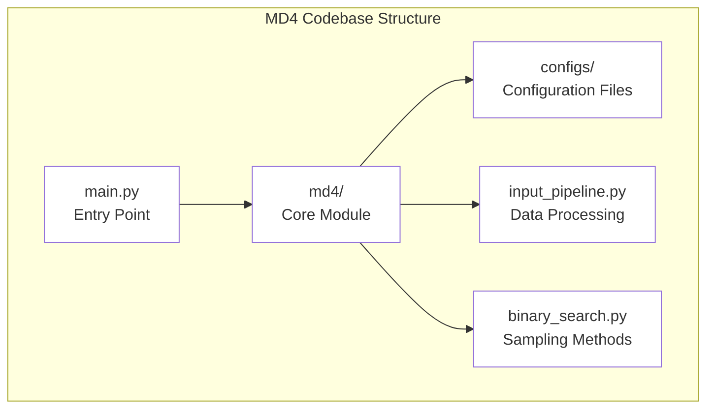
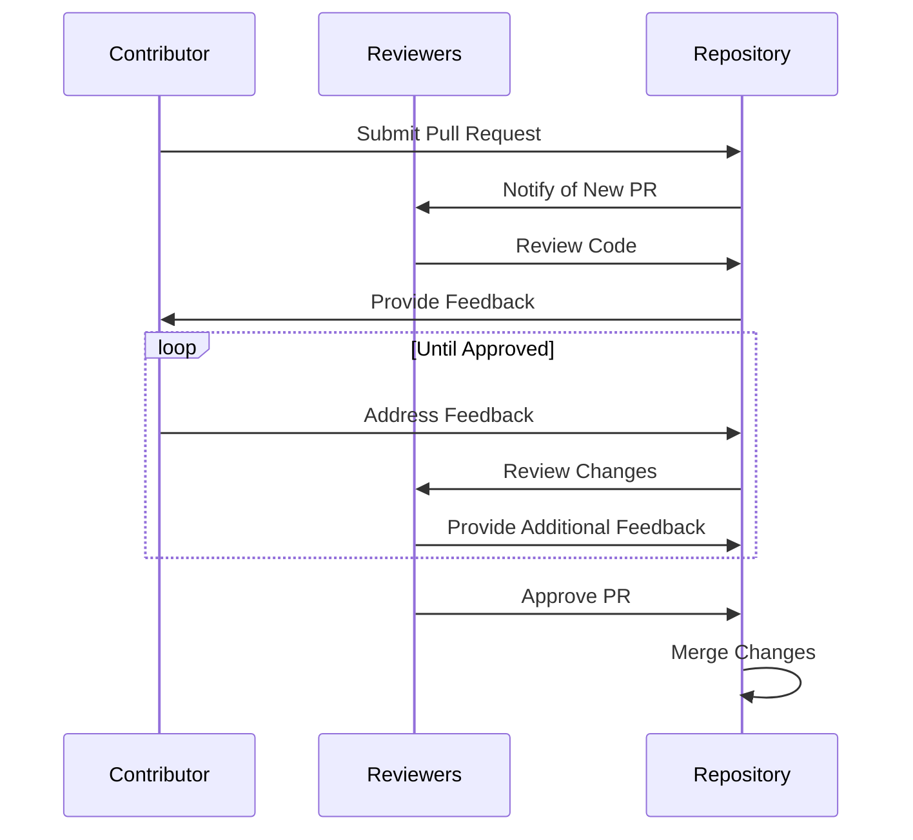

<!-- source: DeepWiki mcp.deepwiki.com · repo google-deepmind/md4 · page 7 Contributing to MD4 · fetched 2026-10-26 -->

# Contributing to MD4

<details>
<summary>Relevant source files</summary>

The following files were used as context for generating this wiki page:

- [.gitignore](.gitignore)
- [CONTRIBUTING.md](CONTRIBUTING.md)
- [LICENSE](LICENSE)

</details>


This document provides guidelines and instructions for contributing to the MD4 (Masked Diffusion for Discrete Data) project. It covers the contribution workflow, code standards, and legal requirements for submitting changes to the codebase. For information about the overall architecture of MD4, see [System Architecture](#2).

## Prerequisites for Contributing

Before contributing to MD4, ensure you have:

1. Familiarized yourself with the [MD4 architecture](#2)
2. Set up your development environment as described in [Installation and Setup](#1.1)
3. Understood the specific component you wish to modify or enhance

## Contribution Workflow

The MD4 project follows a standard GitHub-based contribution workflow:



Sources: [CONTRIBUTING.md:15-20]()

### Step 1: Fork and Clone

1. Fork the MD4 repository on GitHub
2. Clone your fork locally:
   ```bash
   git clone https://github.com/YOUR-USERNAME/md4.git
   cd md4
   ```

### Step 2: Create a Feature Branch

Create a branch for your changes:
```bash
git checkout -b feature/your-feature-name
```

### Step 3: Make Changes

Implement your changes, following the code organization structure:



Sources: [.gitignore:1-25]()

### Step 4: Testing

Ensure your changes:
- Pass all existing tests
- Include new tests for new functionality
- Don't break existing functionality

### Step 5: Submit a Pull Request

1. Push your changes to your fork
2. Create a pull request against the main repository
3. Provide a clear description of the changes and their purpose

## Legal Requirements

### Contributor License Agreement

All contributions to MD4 must be accompanied by a Contributor License Agreement (CLA):

1. Visit https://cla.developers.google.com/ to sign the CLA
2. You generally only need to submit a CLA once for all Google projects

### License Compliance

The MD4 project is licensed under the Apache License 2.0. All contributions must comply with this license:

- Ensure any new files include the proper license header
- Don't include code with incompatible licenses
- Don't add new dependencies with incompatible licenses

Sources: [CONTRIBUTING.md:3-13](), [LICENSE:1-203]()

## Code Review Process

All submissions to the MD4 project require review through GitHub pull requests:



Sources: [CONTRIBUTING.md:15-20]()

### Review Guidelines

1. Be responsive to feedback
2. Make requested changes promptly
3. Ensure all automated checks pass
4. Address all comments before requesting re-review

## Community Guidelines

This project follows [Google's Open Source Community Guidelines](https://opensource.google/conduct/), which promote:

- Using welcoming and inclusive language
- Being respectful of differing viewpoints and experiences
- Gracefully accepting constructive criticism
- Focusing on what is best for the community

Sources: [CONTRIBUTING.md:22-25]()

## Suggested Areas for Contribution

The MD4 project welcomes contributions in several areas:

| Area | Description | Relevant Files |
|------|-------------|----------------|
| Model Variants | Implementations of new model architectures | `md4/model.py` |
| Dataset Support | Adding support for new datasets | `md4/input_pipeline.py`, `configs/` |
| Sampling Methods | Implementing new sampling strategies | `md4/binary_search.py` |
| Documentation | Improving existing docs or adding tutorials | `.md` files |
| Performance Optimization | Optimizing model training and inference | Various files |

## Documentation Standards

When contributing documentation:

1. Use clear, concise language
2. Include examples where appropriate
3. Update relevant wiki pages
4. Ensure code comments are meaningful and up-to-date

## Best Practices for Pull Requests

1. **Keep changes focused**: Each PR should address a single concern
2. **Write meaningful commit messages**: Clearly describe what each commit does
3. **Update documentation**: When changing functionality, update relevant documentation
4. **Reference issues**: If your PR addresses an issue, reference it in the description
5. **Be responsive**: Respond to review comments promptly

By following these guidelines, you'll help maintain the quality and consistency of the MD4 codebase while making the review process smoother for everyone involved.