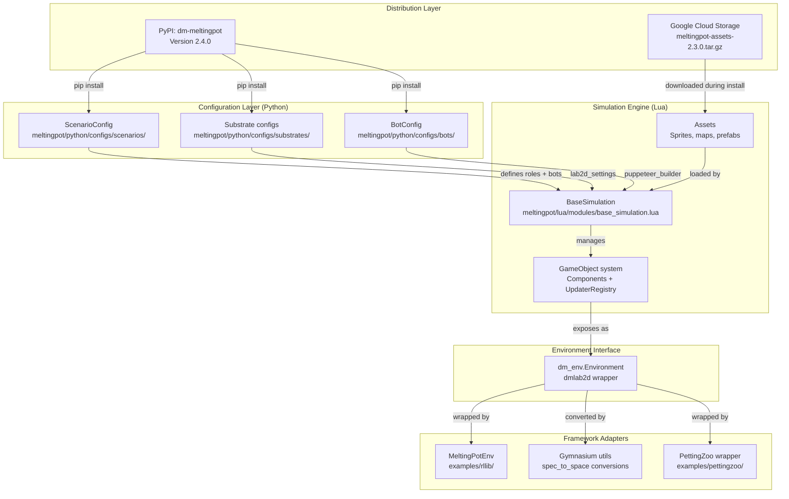
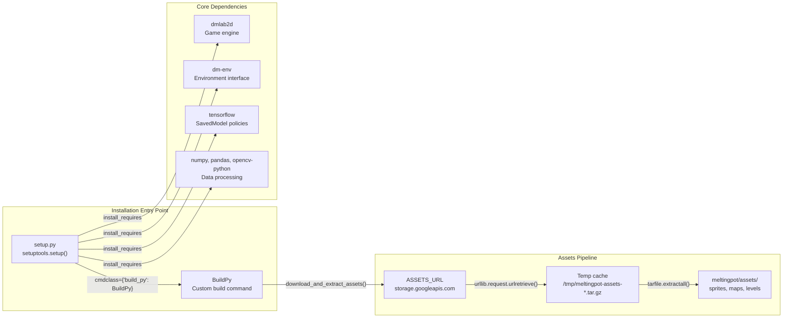
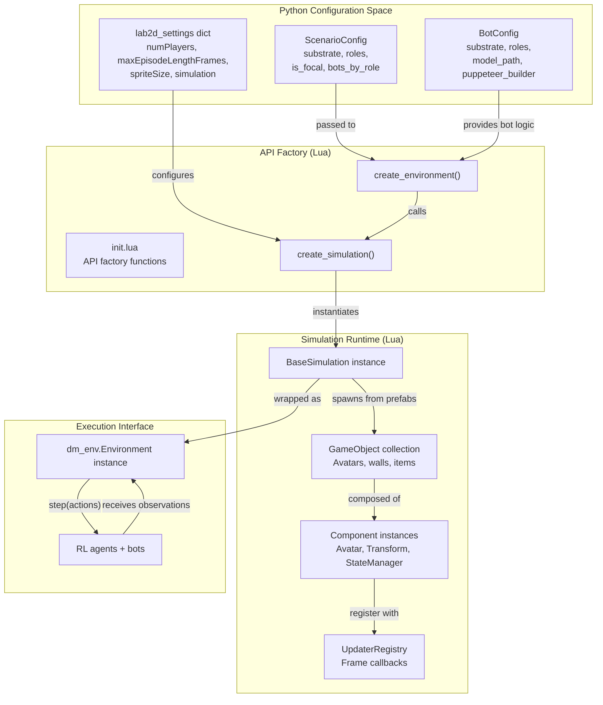

<!-- source: DeepWiki mcp.deepwiki.com · repo google-deepmind/meltingpot · page 1 Overview · fetched 2026-10-26 -->

# Overview

Relevant source files

The following files were used as context for generating this wiki page:

- [.gitignore](.gitignore)
- [CHANGELOG.md](CHANGELOG.md)
- [README.md](README.md)
- [notebooks/evaluation_results.ipynb](notebooks/evaluation_results.ipynb)
- [setup.py](setup.py)

This document provides a high-level introduction to the Melting Pot repository, explaining its purpose as a multi-agent reinforcement learning research suite and describing the overall system architecture. For specific installation instructions, see [Installation](#2.1). For detailed information about the Lua simulation engine, see [Lua Simulation Engine](#4.2). For framework-specific integration details, see [Framework Integration](#5).

## Purpose and Scope

Melting Pot is a test suite for evaluating multi-agent reinforcement learning (MARL) algorithms across social scenarios. The repository provides:

- **50+ substrates**: Multi-agent game environments that define interaction mechanics
- **256+ scenarios**: Specific test configurations combining substrates with bot populations
- **Bot ecosystem**: Pre-trained policies and puppeteers for population-based evaluation
- **Framework integrations**: Adapters for RLLib, Gymnasium, and PettingZoo
- **Evaluation utilities**: Tools for measuring generalization to novel social situations

The system is distributed as the `dm-meltingpot` Python package on PyPI, with game assets hosted separately on Google Cloud Storage.

Sources: [README.md:27-47](), [setup.py:103-112]()

## What is Melting Pot

Melting Pot assesses whether MARL agents can generalize to novel social situations involving both familiar and unfamiliar individuals. The benchmark tests a broad range of social interactions including cooperation, competition, deception, reciprocation, and trust.

The evaluation methodology uses:

- **Training substrates**: Environments where focal agents are trained
- **Test scenarios**: Held-out configurations with different bot populations
- **Normalized scoring**: Performance metrics normalized across scenarios to rank algorithms

This approach quantifies two key capabilities:
1. Performance across diverse social situations with interdependent agents
2. Effective interaction with unfamiliar individuals not seen during training

Sources: [README.md:29-43]()

## Repository Structure

The repository is organized into distinct functional layers:

| Directory | Purpose | Key Contents |
|-----------|---------|--------------|
| `meltingpot/` | Core package | Python configs, Lua simulation, utilities |
| `meltingpot/lua/` | Simulation engine | BaseSimulation, components, level scripts |
| `meltingpot/python/` | Configuration layer | Substrate/scenario/bot configs |
| `examples/` | Integration examples | RLLib training scripts, PettingZoo adapters |
| `notebooks/` | Analysis tools | Evaluation result visualization |
| `.github/workflows/` | CI/CD pipelines | Testing, security scanning, publishing |

Sources: [setup.py:132-138](), [.gitignore:16-29]()

## System Architecture Overview

Melting Pot uses a layered architecture where Python configurations define what to simulate, a Lua engine executes the simulation, and framework adapters expose it to RL libraries.

**Diagram: Melting Pot Layered Architecture**

The data flows from configuration to runtime as follows:

1. **Configuration Phase**: Python configs (`ScenarioConfig`, `BotConfig`, substrate settings) define the environment
2. **Instantiation Phase**: Lua `BaseSimulation` builds the game world from configurations and assets
3. **Runtime Phase**: `dm_env.Environment` interface exposes timesteps to agents
4. **Integration Phase**: Framework adapters translate `dm_env` to target API (RLLib, Gymnasium, etc.)

Sources: [setup.py:25-28](), [README.md:63-67]()

## Core Dependencies and Build Process

Melting Pot has a custom build process that downloads game assets during installation.

**Diagram: Build and Dependency System**

The custom `BuildPy` command [setup.py:44-100]() handles asset management:

1. Downloads `meltingpot-assets-{ASSETS_VERSION}.tar.gz` from GCS
2. Caches the tarball in temp directory
3. Extracts assets to `meltingpot/assets/`
4. Copies assets to build directory during package build

This split versioning strategy allows assets (v2.3.0) and code (v2.4.0) to be updated independently.

Sources: [setup.py:25-100](), [setup.py:140-155]()

## Key Abstractions

### Substrates vs Scenarios

| Concept | Definition | Configuration |
|---------|------------|---------------|
| **Substrate** | Base multi-agent game environment with specific mechanics | Defined by Lua levels, prefabs, and `lab2d_settings` |
| **Scenario** | Substrate + specific bot population + role assignment | Defined by `ScenarioConfig` Python dataclass |

Example: `clean_up` is a substrate. `clean_up_20` is a scenario that runs `clean_up` with 20 specific bots.

### Bots and Policies

The system supports two types of non-focal agents:

1. **Saved model bots**: Pre-trained TensorFlow SavedModels that generate actions
2. **Puppet bots**: Scripted behaviors controlled by `Puppeteer` classes

Both are configured through `BotConfig` objects that specify:
- Which substrate the bot is designed for
- What roles the bot can play
- Path to saved model OR puppeteer builder function

Sources: [README.md:29-36]()

## Configuration-to-Runtime Pipeline

The system translates declarative Python configurations into live Lua simulations:

**Diagram: Configuration to Runtime Data Flow**

The pipeline executes as follows:

1. Python code defines `ScenarioConfig` and `BotConfig` instances
2. Lua `init.lua` factory functions receive these configurations
3. `BaseSimulation` is instantiated with settings from `lab2d_settings`
4. GameObjects are spawned from prefabs defined in configurations
5. Components attached to GameObjects register updater callbacks
6. The simulation is wrapped as a `dm_env.Environment` for agent interaction

Sources: [README.md:124-147]()

## Version and Release Information

The project uses semantic versioning with split version numbers for code and assets:

| Component | Current Version | Location |
|-----------|----------------|----------|
| Python package | 2.4.0 | PyPI `dm-meltingpot` |
| Game assets | 2.3.0 | GCS `meltingpot-assets-{version}.tar.gz` |
| Python support | 3.11, 3.12, 3.13 | `python_requires` in setup.py |

Recent changes (v2.4.0):
- Split out subjects with additional checks for VideoSubject
- Updated opencv version support
- Fixed `clean_up_20` scenario to use correct puppet bot
- Removed duplicate `territory__rooms_6` scenario

Sources: [setup.py:25-26](), [CHANGELOG.md:8-19](), [setup.py:139]()

## Integration Points

Melting Pot provides three primary integration paths for RL frameworks:

### RLLib Integration

Uses `MeltingPotEnv` wrapper that implements Ray's `MultiAgentEnv` interface. Handles multi-agent action/observation spaces and parallel stepping.

### Gymnasium Integration

Provides utility functions for converting `dm_env` specs to `gym.Space` objects and transforming timesteps to Gymnasium format.

### PettingZoo Integration

Wraps `dm_env.Environment` to implement PettingZoo's AEC or Parallel API, enabling use with Stable-Baselines3.

For detailed integration examples, see [Framework Integration](#5).

Sources: [README.md:158-175]()

## Evaluation and Analysis

The repository includes evaluation utilities and pre-computed results:

- **Evaluation library**: `meltingpot/utils/evaluation/evaluation.py` for running scenarios
- **Results dataset**: Hosted on GCS as `meltingpot-results-{version}.feather`
- **Analysis notebooks**: Jupyter notebooks for visualizing performance across scenarios
- **Normalization**: Scores normalized per-scenario to enable cross-algorithm comparison

The evaluation methodology computes normalized scores by:
1. Running each MAPLA (Multi-Agent Policy Learning Algorithm) on all test scenarios
2. Normalizing per-scenario scores to [0, 1] range
3. Aggregating to substrate-level and overall scores
4. Ranking algorithms by mean normalized performance

Sources: [README.md:124-129](), [notebooks/evaluation_results.ipynb:274-288]()

---

