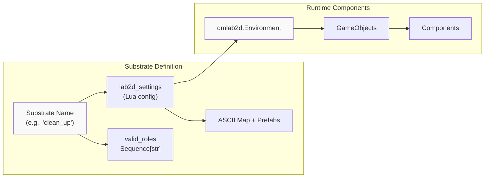
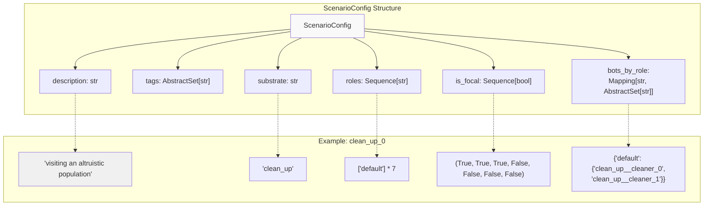
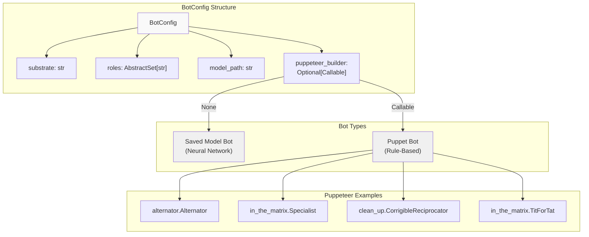
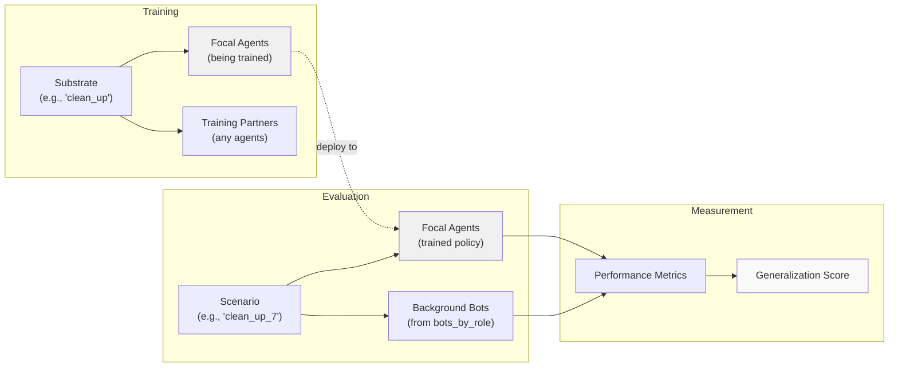
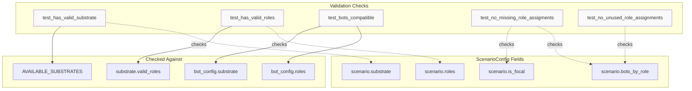

<!-- source: DeepWiki mcp.deepwiki.com · repo google-deepmind/meltingpot · page 1.1 What is Melting Pot · fetched 2026-10-26 -->

# What is Melting Pot

<details>
<summary>Relevant source files</summary>

The following files were used as context for generating this wiki page:

- [README.md](README.md)
- [meltingpot/configs/bots/__init__.py](meltingpot/configs/bots/__init__.py)
- [meltingpot/configs/scenarios/__init__.py](meltingpot/configs/scenarios/__init__.py)
- [meltingpot/configs/scenarios/scenario_configs_test.py](meltingpot/configs/scenarios/scenario_configs_test.py)

</details>


This page introduces Melting Pot as a research suite for multi-agent reinforcement learning (MARL), explaining its core components—**substrates**, **scenarios**, and **bots**—and how they work together to evaluate agent behavior in social contexts. For information about the system's technical architecture, see [System Architecture](#1.2). For installation instructions, see [Installation](#2.1).

---

## Overview

Melting Pot is a test suite designed to assess whether multi-agent reinforcement learning algorithms can generalize to novel social situations. It provides a benchmark for evaluating how agents:

- Perform across a diverse range of social interactions (cooperation, competition, deception, reciprocation, trust, etc.)
- Adapt to unfamiliar individuals not encountered during training
- Handle scenarios involving interdependence between agents

The suite consists of **50+ substrates** (multi-agent game environments) for training and **256+ scenarios** (specific test configurations) for evaluation.

**Sources:** [README.md:27-43]()

---

## Core Components

### Substrates: Multi-Agent Game Environments

A **substrate** is a base multi-agent game environment that defines the rules, map layout, available actions, and reward structure. Each substrate represents a distinct social dilemma or interaction pattern.

Examples include:
- **`clean_up`** - A public goods game where agents must balance consuming resources with cleaning pollution
- **`prisoners_dilemma_in_the_matrix__arena`** - A spatial implementation of the classic Prisoner's Dilemma
- **`collaborative_cooking__asymmetric`** - A coordination task requiring role specialization
- **`allelopathic_harvest__open`** - A convention-following scenario with competing resource preferences

Substrates are configured using **`lab2d_settings`** (Lua-based game engine configuration) and can specify multiple **valid roles** for players.

**Sources:** [README.md:33-34](), [meltingpot/configs/scenarios/__init__.py:39]()



**Diagram: Substrate Structure**

**Sources:** [meltingpot/configs/scenarios/scenario_configs_test.py:66]()

### Scenarios: Test Configurations

A **scenario** is a specific configuration of a substrate that defines:
- Which player slots are **focal** (agents under evaluation)
- Which player slots are **background** (filled by bots)
- The **roles** assigned to each player
- Which **bots** can be sampled to fill background slots

Scenarios are defined using the `ScenarioConfig` dataclass and stored in the `SCENARIO_CONFIGS` dictionary.

**Sources:** [meltingpot/configs/scenarios/__init__.py:23-52]()



**Diagram: ScenarioConfig Data Structure**

**Sources:** [meltingpot/configs/scenarios/__init__.py:1148-1163]()

#### Scenario Taxonomy

Scenarios are tagged to indicate the social skills they test:

| Tag | Description | Example Scenarios |
|-----|-------------|-------------------|
| `visitor` | Focal agents join an established population | `clean_up_0`, `chemistry__three_metabolic_cycles_3` |
| `resident` | Focal agents form the majority, visited by bots | `clean_up_1`, `boat_race__eight_races_2` |
| `reciprocity` | Tests conditional cooperation | `chicken_in_the_matrix__repeated_5` |
| `convention_following` | Tests adaptation to local norms | `allelopathic_harvest__open_0` |
| `partner_choice` | Tests selective association | `boat_race__eight_races_4` |
| `exploitation` | Tests resistance to being taken advantage of | `coins_5` |
| `acceptance` | Tests tolerance of non-cooperators | `clean_up_1` |

**Sources:** [meltingpot/configs/scenarios/__init__.py:61-62,150-153,288-292]()

### Bots: Background Population Agents

A **bot** is a pre-trained or scripted agent used to populate background player slots in scenarios. Bots are defined using the `BotConfig` dataclass and stored in the `BOT_CONFIGS` dictionary.

Bots come in two types:

#### 1. Saved Model Bots
Pre-trained neural network policies stored as TensorFlow SavedModels.

**Sources:** [meltingpot/configs/bots/__init__.py:465-483]()

```python
# Example from BOT_CONFIGS
clean_up__cleaner_0=saved_model(
    substrate='clean_up',
    model='cleaner_0',
)
```

#### 2. Puppet Bots
Rule-based agents controlled by a **puppeteer** that dynamically selects goals based on game state.

**Sources:** [meltingpot/configs/bots/__init__.py:486-506]()

```python
# Example from BOT_CONFIGS
clean_up__puppet_alternator_first_cleans_0=puppet(
    substrate='clean_up',
    model='puppet_0',
    roles=('default',),
    puppeteer_builder=functools.partial(
        alternator.Alternator,
        goals=[
            _PUPPET_GOALS['clean_up']['CLEAN'],
            _PUPPET_GOALS['clean_up']['EAT'],
        ],
        steps_per_goal=200,
    ))
```

**Sources:** [meltingpot/configs/bots/__init__.py:1073-1084]()



**Diagram: Bot Types and Puppeteers**

**Sources:** [meltingpot/configs/bots/__init__.py:445-462]()

---

## The Evaluation Framework

Melting Pot's evaluation framework operates on the principle of **generalization to novel social partners**. The workflow is:

1. **Training Phase**: Train focal agents on substrates (with any training partners)
2. **Evaluation Phase**: Deploy trained agents into scenarios with unfamiliar background bots
3. **Measurement**: Assess performance on held-out scenarios to quantify generalization



**Diagram: Training and Evaluation Pipeline**

**Sources:** [README.md:35-43]()

### Focal vs Background Players

Each scenario specifies which players are **focal** (under evaluation) and which are **background** (filled by bots):

```python
# Example: clean_up_0 scenario
is_focal=(True,) * 3 + (False,) * 4
# Players 0-2: Focal agents (3 total)
# Players 3-6: Background bots (4 total)
```

The `is_focal` sequence must match the length of `roles`, and at least one player must be focal.

**Sources:** [meltingpot/configs/scenarios/__init__.py:1156](), [meltingpot/configs/scenarios/scenario_configs_test.py:57-62]()

### Role Assignment

Scenarios can assign different **roles** to players, which may affect their observations, action spaces, or reward functions:

```python
# Example: allelopathic_harvest__open_0
roles=['player_who_likes_red',] * 8 + ['player_who_likes_green',] * 8
# 8 players prefer red berries, 8 prefer green berries
```

Background roles must have corresponding bot assignments in `bots_by_role`:

```python
bots_by_role={
    'player_who_likes_red': {
        'allelopathic_harvest__open__bot_that_supports_green_0',
        # ... more bots
    },
    'player_who_likes_green': {
        'allelopathic_harvest__open__bot_that_supports_green_0',
        # ... more bots
    },
}
```

**Sources:** [meltingpot/configs/scenarios/__init__.py:66-82](), [meltingpot/configs/scenarios/scenario_configs_test.py:88-96]()

---

## Key Code Entities

### Configuration Dictionaries

| Entity | Location | Description |
|--------|----------|-------------|
| `SCENARIO_CONFIGS` | [meltingpot/configs/scenarios/__init__.py:55]() | Mapping of scenario names to `ScenarioConfig` objects (256+ entries) |
| `BOT_CONFIGS` | [meltingpot/configs/bots/__init__.py:509]() | Mapping of bot names to `BotConfig` objects |
| `_PUPPET_GOALS` | [meltingpot/configs/bots/__init__.py:44]() | Ordered puppet goals for each substrate |
| `_RESOURCES` | [meltingpot/configs/bots/__init__.py:224]() | Resource definitions for "in the matrix" substrates |

**Sources:** [meltingpot/configs/scenarios/__init__.py:55](), [meltingpot/configs/bots/__init__.py:509]()

### Validation Rules

The test suite enforces several validation rules on scenario configurations:

1. **Substrate must exist** - `scenario.substrate` must be in `SUBSTRATES`
2. **Roles must be valid** - All roles in `scenario.roles` must be in the substrate's `valid_roles`
3. **Bots must be compatible** - Each bot's `substrate` and `roles` must match the scenario
4. **All background roles must have bots** - Every role with `is_focal=False` must appear in `bots_by_role`
5. **No unused bot assignments** - All roles in `bots_by_role` must have at least one background player

**Sources:** [meltingpot/configs/scenarios/scenario_configs_test.py:48-104]()



**Diagram: Scenario Validation Architecture**

**Sources:** [meltingpot/configs/scenarios/scenario_configs_test.py:48-104]()

---

## Scale and Coverage

Melting Pot provides comprehensive coverage of multi-agent scenarios:

| Dimension | Count | Notes |
|-----------|-------|-------|
| Substrates | 50+ | Diverse game mechanics and social dilemmas |
| Scenarios | 256+ | Test configurations across all substrates |
| Bots | Hundreds | Mix of neural network and rule-based agents |
| Social Skills Tested | 15+ | Tags include cooperation, reciprocity, trust, etc. |

The test suite ensures complete coverage:
- All substrates are used by at least one scenario
- All bots are used by at least one scenario
- No duplicate scenarios exist

**Sources:** [README.md:33-34](), [meltingpot/configs/scenarios/scenario_configs_test.py:113-123]()

---

