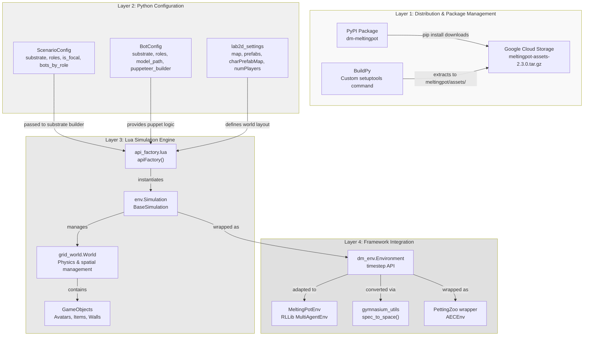
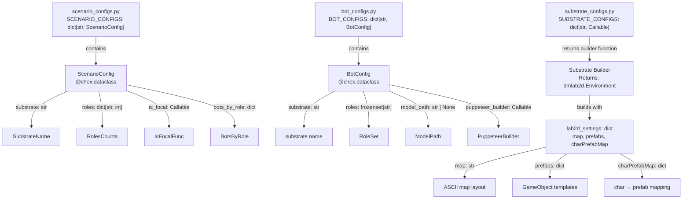
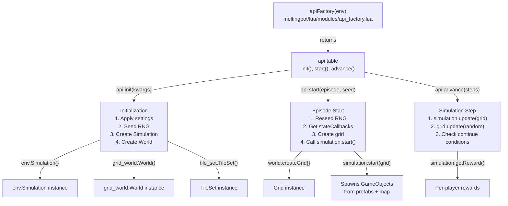
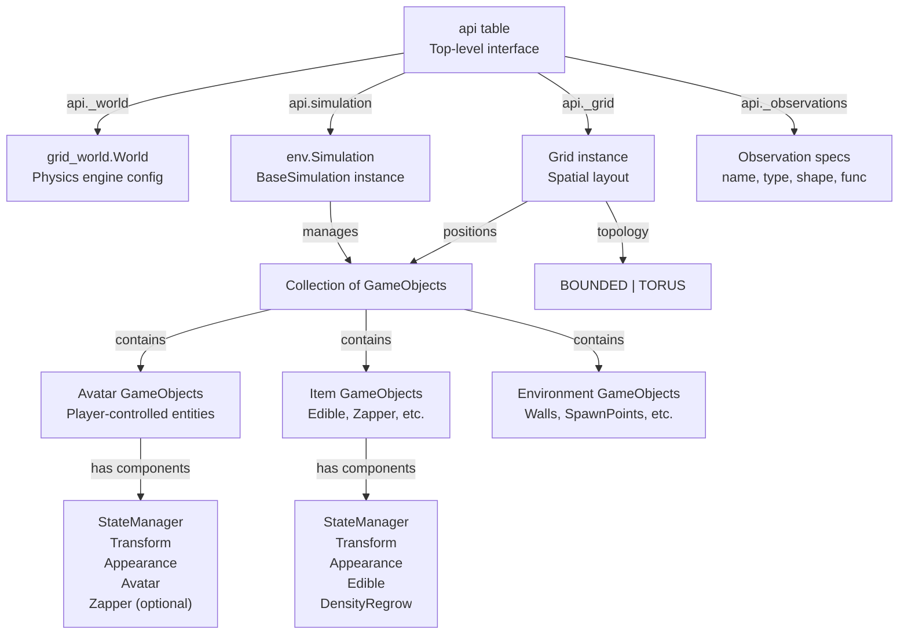
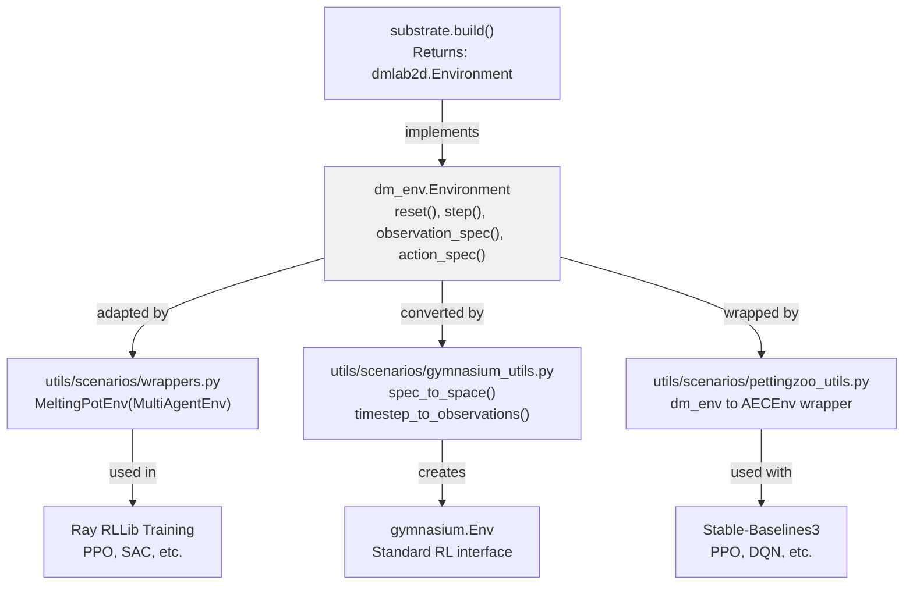
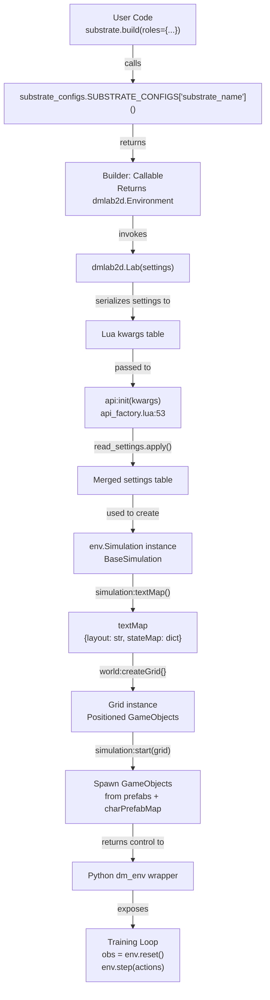

<!-- source: DeepWiki mcp.deepwiki.com · repo google-deepmind/meltingpot · page 1.2 System Architecture · fetched 2026-10-26 -->

# System Architecture

Relevant source files

The following files were used as context for generating this wiki page:

- [.gitignore](.gitignore)
- [CHANGELOG.md](CHANGELOG.md)
- [examples/tutorial/harvest/configs/environment/harvest.py](examples/tutorial/harvest/configs/environment/harvest.py)
- [examples/tutorial/harvest/configs/environment/harvest_finished.py](examples/tutorial/harvest/configs/environment/harvest_finished.py)
- [meltingpot/lua/modules/api_factory.lua](meltingpot/lua/modules/api_factory.lua)
- [notebooks/evaluation_results.ipynb](notebooks/evaluation_results.ipynb)
- [setup.py](setup.py)

## Purpose and Scope

This page provides a technical overview of Melting Pot's layered architecture, explaining how the major subsystems interact and how data flows through the system from package installation to runtime execution. 

For installation details, see [Installation](#2.1). For deep dives into specific components, see [Python Configuration Layer](#4.1), [Lua Simulation Engine](#4.2), and [Framework Integration](#5).

---

## Architectural Overview

Melting Pot uses a **four-layer architecture** that separates concerns between distribution, configuration, simulation, and framework integration:

**Sources:** [setup.py:1-171](), [meltingpot/lua/modules/api_factory.lua:1-118](), [CHANGELOG.md:1-234]()

---

## Layer 1: Distribution and Package Management

The distribution layer handles package installation and asset management through a custom build process.

### Package Distribution Architecture

```mermaid
graph LR
    User["pip install dm-meltingpot"]
    setuptools["setuptools.setup()"]
    BuildPyClass["BuildPy<br/>class build_py.build_py"]
    
    User -->|"invokes"| setuptools
    setuptools -->|"cmdclass={'build_py': BuildPy}"| BuildPyClass
    
    BuildPyClass -->|"download_and_extract_assets()"| DownloadAssets
    DownloadAssets["urllib.request.urlretrieve()"]
    TmpCache["/tmp/meltingpot-assets-2.3.0.tar.gz"]
    
    DownloadAssets -->|"downloads from"| GCS_URL["ASSETS_URL<br/>storage.googleapis.com"]
    GCS_URL -->|"caches to"| TmpCache
    
    BuildPyClass -->|"extract_assets()"| ExtractAssets
    ExtractAssets["tarfile.open().extractall()"]
    FinalLocation["meltingpot/assets/<br/>lua/, sprites/, etc."]
    
    TmpCache -->|"extracts to"| FinalLocation
    
    BuildPyClass -->|"build_assets()"| CopyAssets
    CopyAssets["shutil.copytree()"]
    BuildLib["build/lib/meltingpot/assets/"]
    
    FinalLocation -->|"copies to"| BuildLib
```

| Component | Version | Purpose |
|-----------|---------|---------|
| Package Version | `2.4.0` | Code and Python modules |
| Assets Version | `2.3.0` | Game sprites, Lua scripts, maps |
| `ASSETS_URL` | GCS path | Hosted separately from code |
| `BuildPy` class | Custom command | Downloads assets during installation |

The split versioning strategy allows updating code without re-downloading multi-megabyte asset files.

**Sources:** [setup.py:25-100]()

### Dependency Graph

The package has a deep dependency tree rooted in `dmlab2d`, the core game engine:

| Dependency | Role |
|------------|------|
| `dmlab2d` | Core Lua-based game engine (C++ with Lua bindings) |
| `dm-env` | DeepMind environment API (timestep protocol) |
| `tensorflow` | ML framework for saved model policies |
| `numpy`, `opencv-python` | Array operations and image processing |
| `pygame` | Human play interface |
| `reactivex` | Observable streams for events |
| `ml-collections` | Configuration dictionaries |

**Sources:** [setup.py:140-155]()

---

## Layer 2: Python Configuration Layer

The Python layer provides declarative configuration objects that define what to simulate and how agents behave.

### Configuration Object Hierarchy

**Sources:** [examples/tutorial/harvest/configs/environment/harvest_finished.py:1-228](), [examples/tutorial/harvest/configs/environment/harvest.py:1-47]()

### Configuration to Runtime Translation

Python configurations are serialized and passed to the Lua runtime:

| Python Config | Lua Equivalent | Purpose |
|---------------|----------------|---------|
| `lab2d_settings['map']` | `textMap.layout` | ASCII grid defining spawn positions |
| `lab2d_settings['prefabs']` | `simulation.prefabs` | GameObject component definitions |
| `lab2d_settings['charPrefabMap']` | `textMap.stateMap` | Maps ASCII chars to prefab names |
| `lab2d_settings['numPlayers']` | `api._settings.numPlayers` | Number of controllable avatars |
| `lab2d_settings['maxEpisodeLengthFrames']` | `api._settings.maxEpisodeLengthFrames` | Episode timeout |

**Sources:** [examples/tutorial/harvest/configs/environment/harvest_finished.py:176-228]()

---

## Layer 3: Lua Simulation Engine

The simulation engine is implemented in Lua and runs inside `dmlab2d`, providing a component-based game object system.

### API Factory and Initialization Flow

**Sources:** [meltingpot/lua/modules/api_factory.lua:26-117]()

### Runtime Object Graph

At runtime, the system maintains these key objects:

**Sources:** [meltingpot/lua/modules/api_factory.lua:26-68](), [examples/tutorial/harvest/configs/environment/harvest_finished.py:38-173]()

### Key Runtime Methods

| Method | File Location | Purpose |
|--------|---------------|---------|
| `api:init(kwargs)` | [api_factory.lua:53-67]() | Initialize simulation and world |
| `api:start(episode, seed)` | [api_factory.lua:85-102]() | Start new episode, create grid from map |
| `api:advance(steps)` | [api_factory.lua:104-111]() | Step simulation, update grid, return rewards |
| `api:discreteActions(actions)` | [api_factory.lua:81-83]() | Apply player actions |
| `api:observation(idx)` | [api_factory.lua:73-75]() | Get observation for player |

**Sources:** [meltingpot/lua/modules/api_factory.lua:53-111]()

---

## Layer 4: Framework Integration

Melting Pot provides adapters to make substrates compatible with popular RL frameworks.

### Integration Adapter Architecture

| Adapter | Input API | Output API | Key Transformations |
|---------|-----------|------------|---------------------|
| `MeltingPotEnv` | `dm_env.Environment` | `ray.rllib.MultiAgentEnv` | Converts timesteps to RLLib dict format |
| `spec_to_space()` | `dm_env.specs.Array` | `gymnasium.spaces.Space` | Maps spec types to Gym space types |
| PettingZoo wrapper | `dm_env.Environment` | `pettingzoo.AECEnv` | Adapts to alternating execution cycle API |

**Sources:** Based on high-level diagrams provided

---

## Data Flow: Configuration to Runtime

The complete data flow from Python configuration to Lua runtime execution:

**Sources:** [meltingpot/lua/modules/api_factory.lua:53-102](), [examples/tutorial/harvest/configs/environment/harvest_finished.py:176-228]()

---

## Versioning and Release Strategy

Melting Pot uses **split versioning** to decouple code from assets:

| Version Type | Current Version | Update Frequency | Contents |
|--------------|-----------------|------------------|----------|
| Package Version | `2.4.0` | Each release | Python code, Lua scripts, configs |
| Assets Version | `2.3.0` | Less frequent | Sprites, pre-trained models, maps |

This allows bug fixes in Python code without requiring users to re-download large asset bundles.

**Timeline of Major Changes:**

- **v2.0.0** (2022-11): Complete rewrite with new substrates, heterogeneous roles
- **v2.2.0** (2023-07): Made pip-installable, assets downloaded during install
- **v2.3.0** (2024-06): Added NeurIPS 2023 competition scenarios and bots
- **v2.4.0** (2024-12): VideoSubject improvements, bug fixes

**Sources:** [CHANGELOG.md:1-234](), [setup.py:25-26]()

---

## Key Design Principles

The architecture embodies several design principles:

1. **Separation of Concerns**: Configuration (Python) is separate from simulation (Lua) is separate from framework integration (adapters)

2. **Component-Based Design**: GameObjects are composed of modular Components, enabling flexible behavior assembly

3. **Framework Agnostic Core**: The `dm_env.Environment` interface allows adaptation to any RL framework

4. **Reproducibility**: Explicit seeding, locked dependencies ([requirements.txt]()), hashed packages

5. **Split Versioning**: Code and assets versioned independently to minimize download size

**Sources:** [setup.py:1-171](), [meltingpot/lua/modules/api_factory.lua:1-118]()

---

