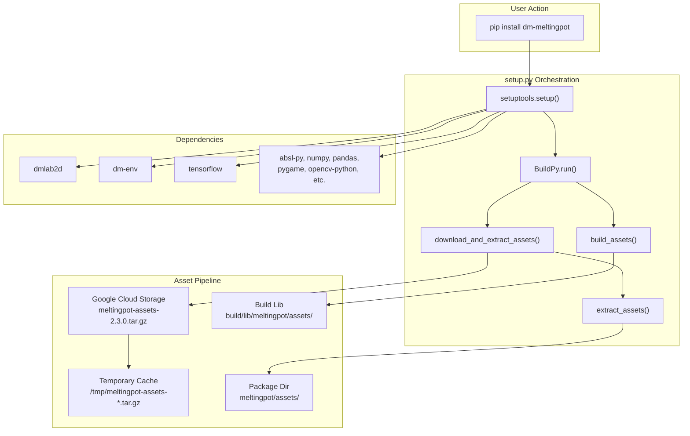
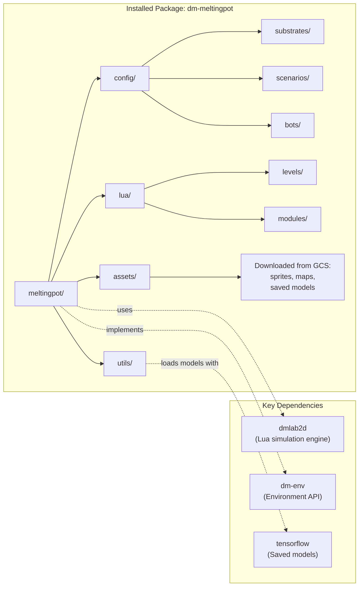
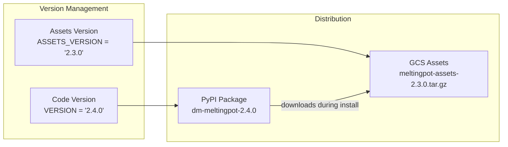
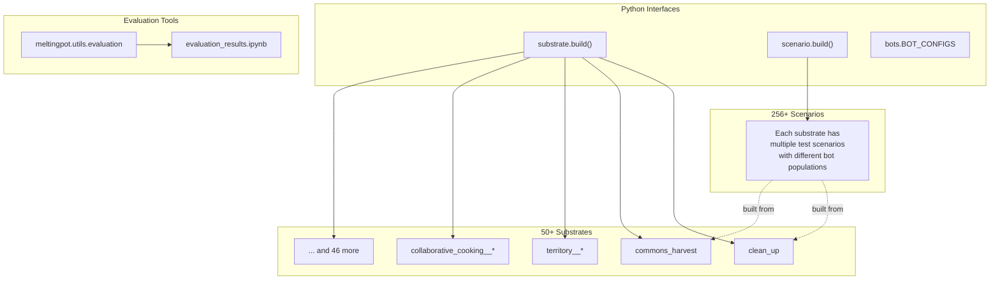

<!-- source: DeepWiki mcp.deepwiki.com · repo google-deepmind/meltingpot · page 2 Getting Started · fetched 2026-10-26 -->

# Getting Started

<details>
<summary>Relevant source files</summary>

The following files were used as context for generating this wiki page:

- [.gitignore](.gitignore)
- [CHANGELOG.md](CHANGELOG.md)
- [README.md](README.md)
- [notebooks/evaluation_results.ipynb](notebooks/evaluation_results.ipynb)
- [setup.py](setup.py)

</details>


This page provides an overview of installing and using Melting Pot. It covers the installation process, what happens under the hood, and your first steps with the framework. For detailed installation procedures, see [Installation](#2.1). For a comprehensive quick start tutorial, see [Quick Start Guide](#2.2). For development environment setup, see [Development Environment Setup](#2.3).

## Purpose and Scope

This document guides you through:
- Understanding the installation process and what gets installed
- Installing Melting Pot via PyPI or from source
- Running your first environment
- Understanding the package structure after installation

This page provides conceptual understanding. Detailed step-by-step instructions are in the child pages.

## Installation Methods

Melting Pot can be installed in two ways:

### PyPI Installation (Recommended for Users)

The simplest method uses pip:

```bash
pip install dm-meltingpot
```

This triggers a custom build process that downloads game assets from Google Cloud Storage during installation.

**Sources:** [README.md:54-67](), [setup.py:102-170]()

### Editable Installation (For Development)

For working on the Melting Pot source code:

```bash
git clone -b main https://github.com/google-deepmind/meltingpot
cd meltingpot
pip install --editable .[dev]
```

The `[dev]` extra installs development tools like `pytest`, `pylint`, `pytype`, and `pyink`.

**Sources:** [README.md:69-99](), [setup.py:156-169]()

## Installation Architecture

The following diagram shows the custom installation process orchestrated by the `BuildPy` command:



**Key Components:**

| Component | Purpose | File Reference |
|-----------|---------|---------------|
| `BuildPy` | Custom build command that extends `build_py.build_py` | [setup.py:44-100]() |
| `ASSETS_URL` | GCS location of versioned assets | [setup.py:28]() |
| `download_and_extract_assets()` | Downloads assets to temp cache, then extracts | [setup.py:53-65]() |
| `download_assets()` | Retrieves tar file from GCS or uses cached copy | [setup.py:67-76]() |
| `extract_assets()` | Extracts tar to `meltingpot/assets/` | [setup.py:78-87]() |
| `build_assets()` | Copies assets from package to build lib | [setup.py:89-99]() |

**Sources:** [setup.py:1-171](), [README.md:52-68]()

## Package Structure After Installation

After installation, the package structure looks like this:



**Sources:** [setup.py:132-138](), [.gitignore:27-29]()

## Asset Versioning

Melting Pot uses **split versioning**: code and assets are versioned independently.



**Why Split Versioning?**
- Assets (sprites, maps, saved models) change less frequently than code
- Reduces download size when only code changes
- Assets are ~large binary files, code is lightweight

**Sources:** [setup.py:25-28](), [CHANGELOG.md:8-42]()

## System Requirements

| Requirement | Details |
|------------|---------|
| Python | 3.11, 3.12, or 3.13 |
| Operating System | Linux (x86_64), macOS (x86_64 or arm64) |
| dmlab2d | Pre-built wheels available for common platforms |
| GPU (Optional) | CUDA support for training (via TensorFlow) |

**Note on dmlab2d:** If no pre-built wheel is available for your platform, you must build dmlab2d from source. See the [dmlab2d README](https://github.com/google-deepmind/lab2d/blob/main/README.md).

**Sources:** [setup.py:123-128](), [setup.py:139-155](), [README.md:63-67]()

## First Steps with Melting Pot

### Basic Usage Pattern

The typical workflow for using Melting Pot follows this pattern:

```mermaid
graph TB
    subgraph "1. Import"
        IMP["import meltingpot"]
    end
    
    subgraph "2. Load Substrate"
        LOAD["substrate.build(<br/>  substrate_name,<br/>  roles=...)")
        ENV["Returns dm_env.Environment"]
    end
    
    subgraph "3. Interaction Loop"
        RESET["env.reset()"]
        STEP["env.step(actions)"]
        OBS["timestep.observation"]
        REWARD["timestep.reward"]
    end
    
    subgraph "4. Framework Integration"
        RLLIB["RLLib wrapper"]
        GYM["Gymnasium wrapper"]
        PETTING["PettingZoo wrapper"]
    end
    
    IMP --> LOAD
    LOAD --> ENV
    ENV --> RESET
    RESET --> STEP
    STEP --> OBS
    STEP --> REWARD
    STEP --> STEP
    
    ENV -.->|can wrap with| RLLIB
    ENV -.->|can wrap with| GYM
    ENV -.->|can wrap with| PETTING
```

**Sources:** [README.md:122-148](), [README.md:158-175]()

### Interactive Play Example

Melting Pot includes human player scripts for interactive testing:

```bash
# Play the clean_up substrate
python meltingpot/human_players/play_clean_up.py

# Controls:
# W, A, S, D - Move
# Q, E - Turn
# 1 - Fire zapper
# 2 - Fire cleaning beam
# TAB - Switch between players
```

**Sources:** [README.md:133-147]()

### Example Training Script

An RLlib self-play example demonstrates basic training:

```bash
# Install example dependencies
pip install -r examples/requirements.txt

# Run self-play training
cd examples/rllib
python self_play_train.py
```

**Note:** This is an illustrative example, not a recommended training configuration for competitive performance.

**Sources:** [README.md:149-175]()

## What You Get After Installation



**Sources:** [README.md:28-47](), [README.md:123-131](), [notebooks/evaluation_results.ipynb:1-519]()

## Next Steps

After installation, proceed to:

1. **[Installation](#2.1)** - Detailed installation instructions, troubleshooting, and platform-specific notes
2. **[Quick Start Guide](#2.2)** - Step-by-step tutorial for loading substrates, running episodes, and understanding observations
3. **[Development Environment Setup](#2.3)** - Setting up the devcontainer, CUDA support, and development tools

For understanding the concepts before diving into code:
- See [Substrates and Scenarios](#3.1) to understand the environment structure
- See [Observations and Action Spaces](#3.4) to understand the agent interface

For training agents:
- See [RLLib Integration](#5.1) for distributed training
- See [Training with RLLib](#8.1) for practical examples

**Sources:** [README.md:1-213]()

---

