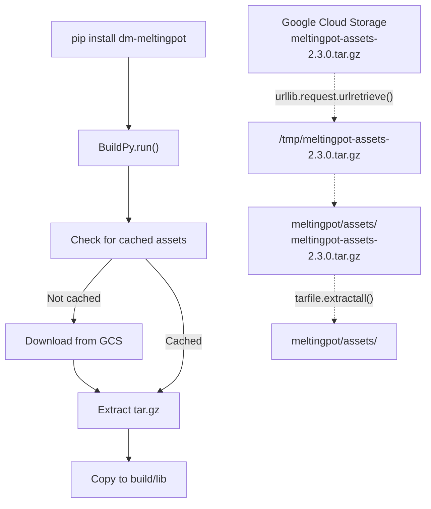
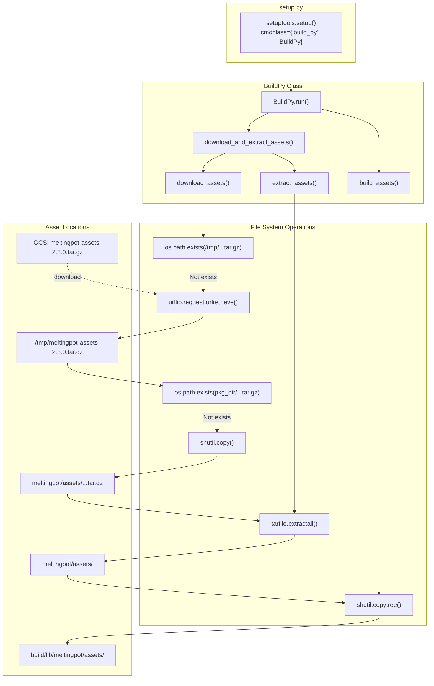
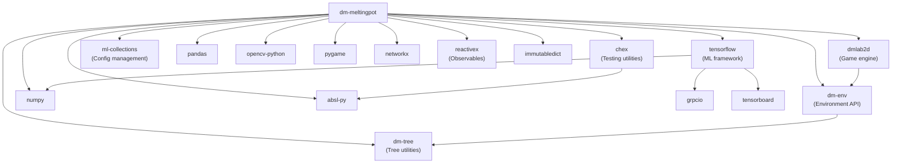

<!-- source: DeepWiki mcp.deepwiki.com · repo google-deepmind/meltingpot · page 2.1 Installation · fetched 2026-10-26 -->

# Installation

<details>
<summary>Relevant source files</summary>

The following files were used as context for generating this wiki page:

- [.gitignore](.gitignore)
- [CHANGELOG.md](CHANGELOG.md)
- [README.md](README.md)
- [bin/install.sh](bin/install.sh)
- [bin/test.sh](bin/test.sh)
- [bin/test_examples.sh](bin/test_examples.sh)
- [bin/update_requirements.sh](bin/update_requirements.sh)
- [notebooks/evaluation_results.ipynb](notebooks/evaluation_results.ipynb)
- [requirements.txt](requirements.txt)
- [setup.py](setup.py)

</details>


## Purpose and Scope

This document covers the installation of Melting Pot from PyPI or from source, including the custom asset downloading mechanism and dependency requirements. For setting up the full development environment with Docker containers and development tools, see [Development Environment Setup](#2.3). For package building and dependency management, see [Build and Package System](#7.1) and [Dependency Management](#7.2).

## Prerequisites

### Python Version

Melting Pot requires **Python 3.11 or later**. The package supports Python 3.11, 3.12, and 3.13.

**Sources:** [setup.py:139](), [setup.py:126-128]()

### Operating System Compatibility

The package officially supports:
- **Linux** (POSIX-compatible)
- **macOS** (MacOS X)

**Sources:** [setup.py:123-124]()

### DeepMind Lab2D Dependency

Melting Pot is built on top of `dmlab2d`, which is distributed as pre-built wheels. If no appropriate wheel is available for your platform, you will need to build `dmlab2d` from source. Refer to the [dmlab2d README](https://github.com/google-deepmind/lab2d/blob/main/README.md) for build instructions.

**Sources:** [README.md:63-67](), [setup.py:144]()

## PyPI Installation

### Basic Installation

The simplest installation method is via PyPI:

```bash
pip install dm-meltingpot
```

This command installs the `dm-meltingpot` package (version 2.4.0) along with all required dependencies.

**Sources:** [README.md:54-61](), [setup.py:25]()

### What Gets Installed

The installation includes:

| Component | Description |
|-----------|-------------|
| **Python Package** | Core `meltingpot` module with configuration layer |
| **Lua Scripts** | Simulation engine code (levels and modules) |
| **Game Assets** | Sprites, maps, and level data (downloaded separately) |
| **Dependencies** | All required packages including `dmlab2d`, `tensorflow`, `dm-env` |

**Sources:** [setup.py:132-138](), [setup.py:140-155]()

### Custom Asset Download Process

During installation, a custom `BuildPy` command automatically downloads game assets from Google Cloud Storage:



**Asset Download Flow:**

1. **Cache Check**: First checks temporary directory (`/tmp`) for existing asset tarball
2. **Download**: If not cached, downloads from `http://storage.googleapis.com/dm-meltingpot/meltingpot-assets-{ASSETS_VERSION}.tar.gz`
3. **Package Cache**: Copies tarball to package directory for reuse
4. **Extraction**: Extracts assets to `meltingpot/assets/` directory
5. **Build Copy**: In non-editable mode, copies assets to `build/lib/meltingpot/assets/`

**Sources:** [setup.py:26-29](), [setup.py:44-100]()

### Asset Versioning

The code version and asset version are managed independently:

| Version Type | Current Version | Location |
|--------------|-----------------|----------|
| Package Version | 2.4.0 | [setup.py:25]() |
| Assets Version | 2.3.0 | [setup.py:26]() |

This split versioning allows asset updates without code changes and vice versa.

**Sources:** [setup.py:25-28]()

## Manual Installation (Development)

### Cloning the Repository

```bash
git clone -b main https://github.com/google-deepmind/meltingpot
cd meltingpot
```

**Sources:** [README.md:74-79]()

### Virtual Environment Setup (Recommended)

```bash
python -m venv venv
source venv/bin/activate  # On Linux/macOS
```

**Sources:** [README.md:81-86]()

### Editable Installation

Install in editable mode to work on the source code:

```bash
pip install --editable .[dev]
```

The `[dev]` extra includes development tools:
- `build` - Package building
- `isort` - Import sorting
- `pipreqs` - Dependency scanning
- `pip-tools` - Dependency compilation
- `pyink` - Code formatting (Black variant)
- `pylint` - Linting
- `pytest-xdist` - Parallel testing
- `pytype` - Type checking
- `twine` - Package uploading

**Sources:** [README.md:88-92](), [setup.py:156-169]()

### Dependency Installation with Hash Verification

For reproducible builds with security verification:

```bash
pip install --no-deps --require-hashes --requirement requirements.txt
pip install --no-deps --no-index --no-build-isolation --editable .
```

This approach:
- Installs exact versions with cryptographic hash verification
- Separates dependency installation from package installation
- Ensures reproducible builds

**Sources:** [bin/install.sh:21-28](), [requirements.txt:1-5]()

### Verifying Installation

Test the installation by running the test suite:

```bash
pytest --pyargs meltingpot
```

Or using the test script:

```bash
bash bin/test.sh
```

**Sources:** [README.md:94-98](), [bin/test.sh:22-23]()

## Installation Architecture

### BuildPy Command Flow



**Sources:** [setup.py:44-100](), [setup.py:131]()

### Dependency Tree

The core runtime dependencies form this hierarchy:



**Sources:** [setup.py:140-155](), [requirements.txt:7-396]()

## Devcontainer Installation

### Platform Limitations

The pre-configured devcontainer **only supports x86 platforms**. Users on arm64 architectures (e.g., Apple M1/M2 Macs) must use the manual installation method.

**Sources:** [README.md:100-103]()

### Quick Start with Devcontainer

The repository includes a pre-configured development environment using the [devcontainer](https://containers.dev) standard. You can launch it using:

- **GitHub Codespaces**: One-click launch from the repository
- **VSCode Dev Containers**: Local container with VSCode integration

**Sources:** [README.md:105-111]()

### CUDA Support

For GPU training, CUDA support requires:

1. Install the `nvidia-container-toolkit` package on the host
2. Run Docker with the `--gpus all` flag

GitHub Codespaces automatically configures GPU access when available.

**Sources:** [README.md:113-119]()

## Verification and Troubleshooting

### Testing Installation

After installation, verify the package works correctly:

```bash
# Quick test - import the package
python -c "import meltingpot"

# Run full test suite
pytest --pyargs meltingpot

# Run with parallel execution
pytest -n auto --pyargs meltingpot
```

**Sources:** [README.md:94-98]()

### Common Issues

| Issue | Cause | Solution |
|-------|-------|----------|
| **No dmlab2d wheel available** | Unsupported platform | Build dmlab2d from source |
| **Asset download fails** | Network/proxy issues | Manually download assets from GCS URL |
| **Version conflicts** | Incompatible dependencies | Use `requirements.txt` with `--require-hashes` |
| **Import errors** | Incomplete installation | Re-run `pip install --editable .[dev]` |

**Sources:** [README.md:63-67](), [setup.py:28]()

### Checking Installed Versions

```bash
pip show dm-meltingpot
pip list
```

**Sources:** [bin/install.sh:31]()

## Package Metadata

The installed package includes the following metadata:

| Field | Value |
|-------|-------|
| **Name** | dm-meltingpot |
| **Version** | 2.4.0 |
| **License** | Apache 2.0 |
| **Author** | DeepMind |
| **URL** | https://github.com/google-deepmind/meltingpot |
| **Description** | A suite of test scenarios for multi-agent reinforcement learning |

**Sources:** [setup.py:103-116]()

---

