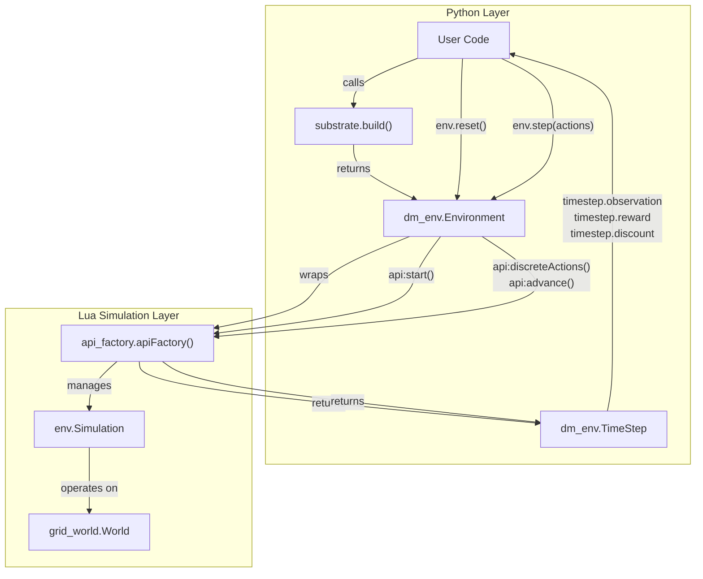
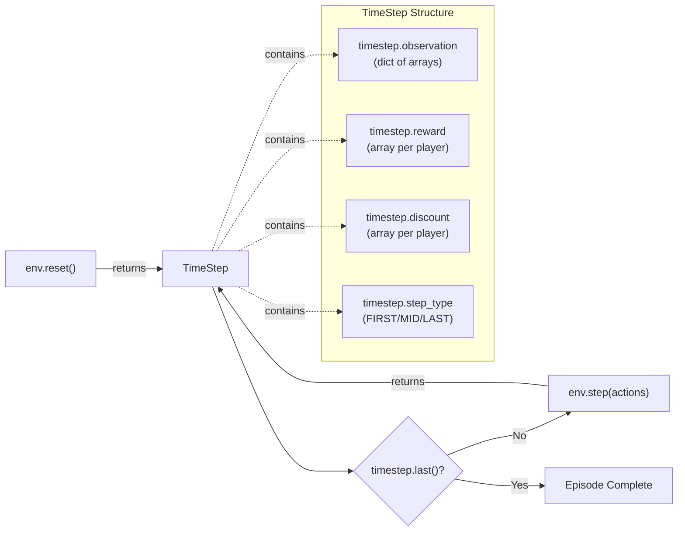
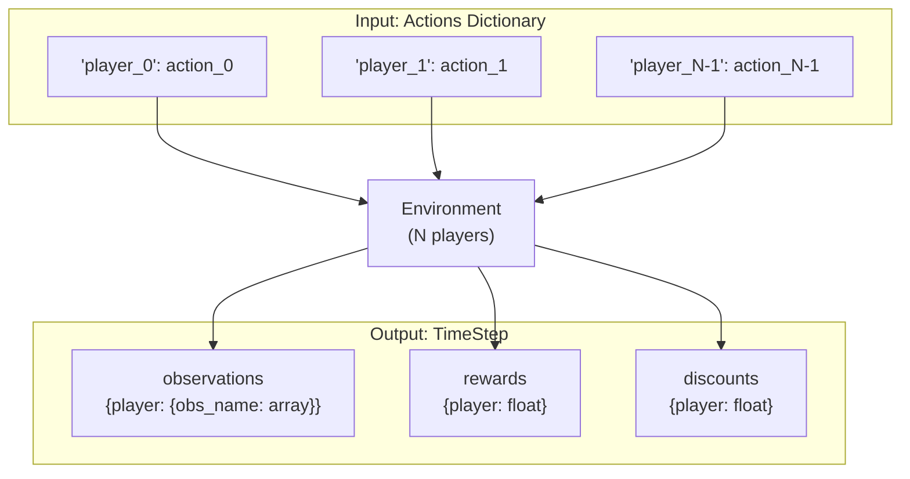

<!-- source: DeepWiki mcp.deepwiki.com · repo google-deepmind/meltingpot · page 2.2 Quick Start Guide · fetched 2026-10-26 -->

# Quick Start Guide

<details>
<summary>Relevant source files</summary>

The following files were used as context for generating this wiki page:

- [README.md](README.md)
- [examples/tutorial/harvest/configs/environment/harvest.py](examples/tutorial/harvest/configs/environment/harvest.py)
- [examples/tutorial/harvest/configs/environment/harvest_finished.py](examples/tutorial/harvest/configs/environment/harvest_finished.py)
- [meltingpot/lua/modules/api_factory.lua](meltingpot/lua/modules/api_factory.lua)

</details>


This guide provides the essential steps to load and interact with Melting Pot environments. It assumes you have already completed installation (see [Installation](#2.1)) and covers the basic API patterns for running episodes, observing agent states, and submitting actions.

For setting up a development environment, see [Development Environment Setup](#2.3). For interactive debugging and human play, see [Human Play Mode](#8.2). For training agents with RL frameworks, see [Framework Integration](#5).

---

## Environment Interface Overview

Melting Pot environments implement the `dm_env.Environment` interface, which provides a standardized API for multi-agent reinforcement learning. Each environment exposes observations, accepts actions, and returns rewards through a timestep-based protocol.

**Diagram: dm_env Interface Flow**



Sources: [meltingpot/lua/modules/api_factory.lua:26-117](), [README.md:122-148]()

The core interaction loop follows this pattern:

1. **Build** the environment using a substrate configuration
2. **Reset** to start an episode and receive initial observations
3. **Step** repeatedly with actions to advance the simulation
4. **Extract** observations, rewards, and episode termination signals from timesteps

---

## Loading a Substrate

Substrates are loaded using the `substrate.build()` function, which takes a substrate name and optional configuration parameters. Melting Pot provides 50+ pre-configured substrates.

**Basic Substrate Loading Pattern:**

```python
from meltingpot import substrate

# Load a substrate by name
env = substrate.build(substrate_name='clean_up')

# Inspect environment specifications
print(env.observation_spec())
print(env.action_spec())
```

**Available Configuration Parameters:**

| Parameter | Type | Description |
|-----------|------|-------------|
| `substrate_name` | str | Name of the substrate to load (e.g., 'clean_up', 'prisoners_dilemma_in_the_matrix__arena') |
| `roles` | Sequence[str] | Optional role assignments for players |
| `config` | ConfigDict | Optional lab2d_settings overrides |

The `build()` function internally:
1. Loads the substrate's Python configuration from `SUBSTRATE_CONFIGS`
2. Passes the `lab2d_settings` to the Lua runtime
3. Instantiates the simulation through `api_factory.apiFactory()`
4. Returns a `dm_env.Environment` wrapper

Sources: [README.md:54-68](), [meltingpot/lua/modules/api_factory.lua:53-67]()

---

## Running Your First Episode

An episode consists of resetting the environment and stepping through it until termination. The `dm_env.TimeStep` object contains all information about the current state.

**Diagram: Episode Execution Flow**



Sources: [meltingpot/lua/modules/api_factory.lua:85-111]()

**Episode Loop Example:**

```python
# Reset environment
timestep = env.reset()

# Run until episode ends
while not timestep.last():
    # Sample random actions for all players
    actions = {
        player: env.action_spec()[player].sample()
        for player in env.action_spec().keys()
    }
    
    # Step the environment
    timestep = env.step(actions)
    
    # Access observations, rewards, and discounts
    observations = timestep.observation
    rewards = timestep.reward
    discounts = timestep.discount
```

The Lua simulation manages episode lifecycle through:
- `api:start()` - Initializes grid, spawns players [api_factory.lua:85-102]()
- `api:advance()` - Updates simulation, checks termination [api_factory.lua:104-111]()
- `maxEpisodeLengthFrames` - Episode length limit [api_factory.lua:42]()

Sources: [meltingpot/lua/modules/api_factory.lua:85-111](), [README.md:122-148]()

---

## Understanding Observations

Observations are returned as dictionaries where keys are observation names and values are numpy arrays. Each substrate defines which observation types are available.

**Observation Structure:**

| Observation Name | Shape | Description |
|-----------------|-------|-------------|
| `RGB` | `(height, width, 3)` | Agent's egocentric RGB view |
| `WORLD.RGB` | `(world_height, world_width, 3)` | Global top-down RGB view |
| `POSITION` | `(2,)` | Agent's (x, y) world coordinates |
| `ORIENTATION` | `(4,)` | One-hot encoded facing direction |

The available observations are configured in the substrate's `individual_observation_names` and `global_observation_names`:

```python
# From tutorial configuration
config.individual_observation_names = ["RGB"]
config.global_observation_names = ["WORLD.RGB"]
```

**Observation Specifications:**

```python
# Inspect observation specs
obs_spec = env.observation_spec()

# For multi-agent environments, specs are per-player
for player_name, player_obs_spec in obs_spec.items():
    for obs_name, spec in player_obs_spec.items():
        print(f"{player_name}.{obs_name}: {spec.shape} {spec.dtype}")
```

Observations are generated in Lua by:
1. `simulation:addObservations()` - Registers observation callbacks [api_factory.lua:66]()
2. `observation.func(grid)` - Executes rendering functions [api_factory.lua:74]()
3. Sprite rendering via `tile_set.TileSet` [api_factory.lua:48-50]()

Sources: [examples/tutorial/harvest/configs/environment/harvest_finished.py:181-182](), [examples/tutorial/harvest/configs/environment/harvest.py:24-25](), [meltingpot/lua/modules/api_factory.lua:66-74]()

---

## Understanding Actions

Actions are discrete integers representing different behaviors. Each player submits one action per timestep.

**Common Action Mappings:**

| Action Index | Description |
|-------------|-------------|
| 0 | No-op / Do nothing |
| 1 | Move forward |
| 2 | Move backward |
| 3 | Strafe left |
| 4 | Strafe right |
| 5 | Turn left |
| 6 | Turn right |
| 7+ | Substrate-specific actions (e.g., fire zapper, clean) |

**Action Specification Pattern:**

```python
# Get action specs for all players
action_spec = env.action_spec()

# Each player has a discrete action space
for player_name, spec in action_spec.items():
    print(f"{player_name}: {spec.num_values} possible actions")
    
# Submit actions as a dictionary
actions = {
    'player_0': 1,  # Move forward
    'player_1': 5,  # Turn left
    'player_2': 7,  # Fire zapper
}
timestep = env.step(actions)
```

The action space is defined in Lua:
- `simulation:discreteActionSpec()` - Returns action specifications [api_factory.lua:77-79]()
- `simulation:discreteActions(actions)` - Processes action inputs [api_factory.lua:81-83]()
- Avatar components interpret actions based on their configuration

Sources: [meltingpot/lua/modules/api_factory.lua:77-83](), [README.md:143-147]()

---

## Multi-Agent Interaction

Melting Pot environments are inherently multi-agent. All players step simultaneously, and observations/rewards are returned for each player.

**Diagram: Multi-Agent Timestep Structure**



Sources: [meltingpot/lua/modules/api_factory.lua:104-111]()

**Multi-Agent Considerations:**

1. **Synchronous Steps**: All players submit actions simultaneously
2. **Per-Player Observations**: Each player receives their own egocentric view
3. **Per-Player Rewards**: Rewards can differ based on individual contributions
4. **Shared Environment**: Players interact through the same grid world

**Number of Players:**

The number of players is configured in `lab2d_settings`:

```python
config.lab2d_settings = {
    "numPlayers": 5,  # Exactly 5 players in this environment
    # ... other settings
}
```

Sources: [examples/tutorial/harvest/configs/environment/harvest_finished.py:206-207](), [meltingpot/lua/modules/api_factory.lua:39-59]()

---

## Interactive Testing

For quick experimentation, Melting Pot provides human playable scripts:

```bash
# Play the clean_up substrate interactively
python meltingpot/human_players/play_clean_up.py

# Controls:
# W, A, S, D - Movement
# Q, E - Turn
# 1 - Fire zapper
# 2 - Fire cleaning beam
# TAB - Switch between players
```

Available substrates in `human_players/` directory include variants that can be selected with `--level_name` flag.

Sources: [README.md:133-147]()

---

## Next Steps

After familiarizing yourself with basic environment interaction:

1. **Framework Integration**: Adapt Melting Pot to your RL framework
   - [RLLib Integration](#5.1) for Ray RLLib and multi-agent training
   - [Gymnasium Integration](#5.2) for gym-compatible wrappers
   - [PettingZoo Integration](#5.3) for Stable-Baselines3

2. **Training Agents**: Run self-play experiments
   - [Training with RLLib](#8.1) for end-to-end training examples

3. **Evaluation**: Assess agent performance
   - [Evaluation System](#8.3) for metrics and analysis

4. **Content Creation**: Build custom scenarios
   - [Substrates and Scenarios](#3.1) for understanding the configuration model
   - [Substrate Creation Tutorial](#6.1) for creating new environments

5. **Advanced Concepts**: Dive into the architecture
   - [GameObject and Component System](#3.3) for the Lua engine internals
   - [Observations and Action Spaces](#3.4) for detailed observation types

Sources: [README.md:149-180]()

---

