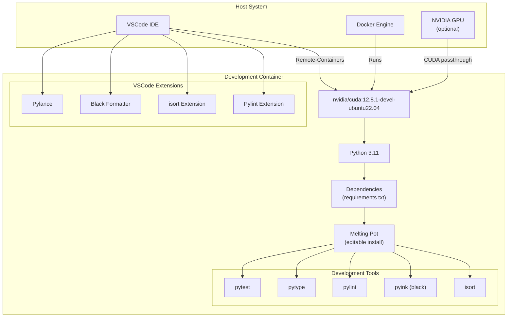
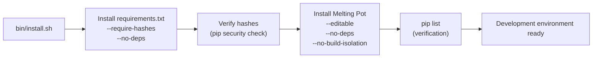
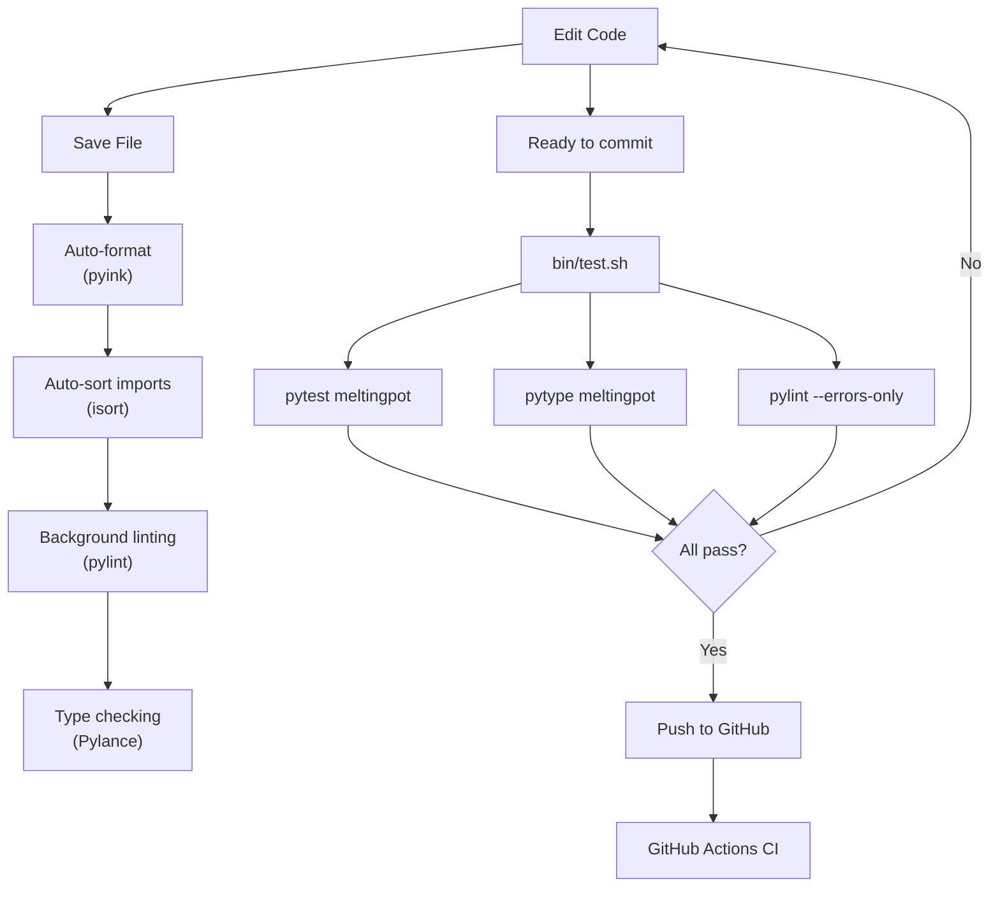

<!-- source: DeepWiki mcp.deepwiki.com · repo google-deepmind/meltingpot · page 2.3 Development Environment Setup · fetched 2026-10-26 -->

# Development Environment Setup

<details>
<summary>Relevant source files</summary>

The following files were used as context for generating this wiki page:

- [.devcontainer/Dockerfile](.devcontainer/Dockerfile)
- [.devcontainer/devcontainer.json](.devcontainer/devcontainer.json)
- [.github/dependabot.yml](.github/dependabot.yml)
- [.vscode/settings.json](.vscode/settings.json)
- [bin/install.sh](bin/install.sh)
- [bin/test.sh](bin/test.sh)
- [bin/test_examples.sh](bin/test_examples.sh)
- [bin/update_requirements.sh](bin/update_requirements.sh)
- [requirements.txt](requirements.txt)

</details>


## Purpose and Scope

This document describes how to set up a complete development environment for contributing to the Melting Pot codebase. It covers the containerized development setup, CUDA GPU support, integrated development tools, and quality assurance workflows.

For installing Melting Pot as an end user, see [Installation](#2.1). For running your first environment after installation, see [Quick Start Guide](#2.2).

## Development Container Overview

Melting Pot uses a containerized development environment based on Docker and VSCode's devcontainer specification. This provides a consistent, reproducible development setup across different host systems.

### Container Architecture



Sources: [.devcontainer/Dockerfile](), [.devcontainer/devcontainer.json](), [.vscode/settings.json]()

## Docker Configuration

### Base Image

The development container uses an NVIDIA CUDA base image to provide GPU acceleration support:

```dockerfile
FROM nvidia/cuda:12.8.1-devel-ubuntu22.04@sha256:a99a1860ba8e2916e5c3e73b72ec4c4301653a84586e05bfc9a2aa2d58027e97
```

This image includes:
- **CUDA 12.8.1**: Full CUDA development toolkit for GPU-accelerated workloads
- **Ubuntu 22.04**: Long-term support base system
- **SHA256 pinning**: Ensures reproducible builds

**Sources:** [.devcontainer/Dockerfile:3]()

### System Dependencies

The container installs essential build and development tools:

| Package | Purpose |
|---------|---------|
| `build-essential` | C/C++ compilation toolchain (required for dmlab2d) |
| `curl` | Download utilities |
| `ffmpeg` | Video processing (for rendering observations) |
| `git` | Version control |
| `python3.11` + `python3.11-dev` | Python runtime and headers |
| `rsync` | File synchronization utilities |

**Sources:** [.devcontainer/Dockerfile:8-17]()

### Python Configuration

Python 3.11 is configured as the default Python interpreter:

```bash
update-alternatives --install /usr/bin/python python /usr/bin/python3.11 1
update-alternatives --install /usr/bin/python3 python3 /usr/bin/python3.11 1
```

The latest `pip` and `setuptools` are installed to support modern Python packaging:

**Sources:** [.devcontainer/Dockerfile:20-28]()

## VSCode Devcontainer Configuration

### Container Runtime Parameters

The devcontainer is configured with specific runtime parameters for performance:

| Parameter | Value | Purpose |
|-----------|-------|---------|
| `--shm-size` | `6gb` | Shared memory for RLlib multiprocessing (recommended 30% of RAM for large machines) |

**Sources:** [.devcontainer/devcontainer.json:11-16]()

### Post-Creation Setup

After the container is created, the installation script automatically runs:

```json
"postCreateCommand": "bin/install.sh"
```

This executes [`bin/install.sh`]() which:
1. Installs all dependencies from `requirements.txt` with hash verification
2. Installs Melting Pot in editable mode with `--editable` flag
3. Lists all installed packages for verification

**Sources:** [.devcontainer/devcontainer.json:17](), [bin/install.sh]()

### VSCode Extensions

The devcontainer automatically installs these VSCode extensions:

| Extension ID | Purpose |
|--------------|---------|
| `donjayamanne.githistory` | Git history visualization |
| `ms-azuretools.vscode-docker` | Docker container management |
| `ms-python.black-formatter` | Code formatting with pyink |
| `ms-python.isort` | Import sorting |
| `ms-python.pylint` | Linting and error detection |
| `ms-python.python` | Core Python support |
| `ms-python.vscode-pylance` | Type checking and IntelliSense |

**Sources:** [.devcontainer/devcontainer.json:20-28]()

## Installation for Development

### Installation Script Workflow



**Sources:** [bin/install.sh]()

### Installation Commands

The installation process uses strict security and reproducibility flags:

```bash
# Install dependencies with hash verification
pip install --no-deps --require-hashes --requirement requirements.txt

# Install Melting Pot in editable mode
pip install --no-deps --no-index --no-build-isolation --editable .
```

**Key flags:**
- `--no-deps`: Prevent automatic dependency resolution (use locked requirements)
- `--require-hashes`: Enforce SHA256 hash verification for supply chain security
- `--editable`: Install as symlink for live code changes
- `--no-build-isolation`: Use existing environment instead of temporary build environment

**Sources:** [bin/install.sh:22-27]()

## VSCode Development Settings

### Code Formatting Configuration

The repository enforces Google Python style guidelines:

| Setting | Value | Purpose |
|---------|-------|---------|
| `editor.rulers` | `[80]` | 80-character line length limit |
| `editor.tabSize` | `2` | 2-space indentation |
| `editor.insertSpaces` | `true` | Spaces instead of tabs |
| `editor.formatOnSave` | `true` | Auto-format on save |
| `editor.formatOnSaveMode` | `"modifications"` | Format only modified lines |

**Sources:** [.vscode/settings.json:3-14]()

### Python Tool Integration

VSCode is configured to use specific formatters and linters:

```json
{
  "[python]": {
    "editor.defaultFormatter": "ms-python.black-formatter",
    "editor.codeActionsOnSave": {
      "source.organizeImports": "explicit"
    }
  },
  "black-formatter.path": ["pyink"],
  "isort.args": ["--resolve-all-configs"],
  "isort.check": true
}
```

**Tool configuration:**
- **Formatter**: `pyink` (Google-style Black fork)
- **Import organizer**: `isort` with project configuration
- **Linter**: `pylint` with full checks enabled
- **Type checker**: Pylance (powered by Pyright)

**Sources:** [.vscode/settings.json:40-50]()

### File Exclusions

Development artifacts are hidden from the file explorer:

| Pattern | Description |
|---------|-------------|
| `**/*.egg-info` | Package metadata |
| `**/.eggs` | Setuptools build artifacts |
| `**/*.py[cod]` | Compiled Python bytecode |
| `**/__pycache__` | Python cache directories |
| `**/.cache` | General cache directories |
| `**/.pytest_cache` | pytest cache |
| `**/.pytype` | pytype type inference cache |

**Sources:** [.vscode/settings.json:25-33]()

## Development Workflow

### Code Quality Pipeline



**Sources:** [.vscode/settings.json:12-14](), [bin/test.sh]()

### Testing Scripts

The repository provides three testing scripts:

#### Core Package Testing

**Script:** `bin/test.sh`

Runs the complete test suite for the core `meltingpot` package:

```bash
pytest meltingpot          # Unit and integration tests
pytype meltingpot          # Static type checking
pylint --errors-only meltingpot  # Linting with error-only mode
```

**Sources:** [bin/test.sh:22-33]()

#### Examples Testing

**Script:** `bin/test_examples.sh`

Validates all example code in the `examples/` directory:

```bash
pytest examples            # Test example scripts
pytype examples            # Type check examples
pylint --errors-only examples  # Lint examples
```

**Sources:** [bin/test_examples.sh:22-33]()

#### Dependency Updates

**Script:** `bin/update_requirements.sh`

Regenerates `requirements.txt` with updated dependency versions:

```bash
pip-compile --generate-hashes \
            --reuse-hashes \
            --strip-extras \
            --allow-unsafe \
            --upgrade \
            --extra dev \
            setup.py
```

This creates a fully locked requirements file with SHA256 hashes for all dependencies.

**Sources:** [bin/update_requirements.sh:21-22]()

## Code Quality Tools

### Tool Configuration Matrix

| Tool | Configuration File | Purpose | CI Integration |
|------|-------------------|---------|----------------|
| `pytest` | `pytest.ini` (inferred) | Unit testing | ✓ (test-meltingpot.yml) |
| `pytype` | Default | Static type checking | ✓ (test-meltingpot.yml) |
| `pylint` | `.pylintrc` | Code linting | ✓ (test-meltingpot.yml) |
| `pyink` | Default Black config | Code formatting | Manual/on-save |
| `isort` | `pyproject.toml` (inferred) | Import sorting | Manual/on-save |

**Sources:** [bin/test.sh](), [.vscode/settings.json:47-49]()

### Pytest Configuration

Pytest is configured for parallel test execution. The CI system uses:

```bash
pytest -n auto  # Auto-detect CPU count and parallelize
```

This significantly speeds up the test suite by running tests concurrently across multiple processes.

**Sources:** Referenced in CI workflows

### Type Checking with Pytype

Pytype performs static type inference and checking across the entire codebase. It:
- Infers types from Python code without annotations
- Validates type consistency
- Detects common runtime errors at compile time
- Generates `.pytype/` cache for incremental checking

The cache directory is excluded from version control and file watchers.

**Sources:** [.vscode/settings.json:32]()

### Linting with Pylint

Pylint is configured to run in error-only mode for CI:

```bash
pylint --errors-only meltingpot
```

This focuses on critical issues while allowing warnings to be addressed separately. The full linter (without `--errors-only`) can be run during development for comprehensive code quality checks.

**Sources:** [bin/test.sh:32-33]()

## Dependency Management

### Locked Dependencies with Hashes

The `requirements.txt` file is auto-generated using `pip-compile` and includes:
- **Exact version pins**: Every dependency has a specific version
- **SHA256 hashes**: Supply chain security through hash verification
- **Dependency tree**: Comments show which packages require each dependency

Example format:
```
absl-py==2.2.2 \
    --hash=sha256:bf25b2c2eed013ca456918c453d687eab4e8309fba81ee2f4c1a6aa2494175eb \
    --hash=sha256:e5797bc6abe45f64fd95dc06394ca3f2bedf3b5d895e9da691c9ee3397d70092
    # via
    #   chex
    #   dm-env
    #   dm-meltingpot (setup.py)
```

**Sources:** [requirements.txt:7-16]()

### Dependabot Configuration

Automated dependency updates are managed through Dependabot:

```yaml
updates:
  - package-ecosystem: github-actions
    schedule:
      interval: monthly
  
  - package-ecosystem: docker
    directory: /.devcontainer
    schedule:
      interval: monthly
  
  - package-ecosystem: devcontainers
    schedule:
      interval: monthly
```

This ensures:
- GitHub Actions are kept up-to-date
- Docker base images receive security updates
- Devcontainer configuration stays current

**Sources:** [.github/dependabot.yml]()

## CUDA and GPU Support

### GPU Acceleration

The development container includes full CUDA 12.8.1 development libraries, enabling:
- **GPU-accelerated training**: TensorFlow operations run on GPU
- **Parallel rendering**: dmlab2d can leverage GPU for faster rendering
- **RLlib distributed training**: Multi-GPU training support

### CUDA Availability

CUDA support is automatically detected:
- **If NVIDIA GPU present**: Full GPU acceleration available
- **If no GPU present**: Container still works, falls back to CPU

The base image (`nvidia/cuda:12.8.1-devel-ubuntu22.04`) includes both CUDA runtime and development tools, so GPU code can be both executed and compiled within the container.

**Sources:** [.devcontainer/Dockerfile:3]()

## Summary

The Melting Pot development environment provides:

1. **Containerized setup**: Consistent environment across machines using Docker and devcontainer
2. **GPU support**: Optional CUDA acceleration for training and rendering
3. **Automated tooling**: Format-on-save, import sorting, and background linting
4. **Quality gates**: pytest, pytype, and pylint enforce code quality
5. **Security**: Hash-verified dependencies and automated security updates
6. **Reproducibility**: Locked dependencies and pinned Docker images

To get started, open the repository in VSCode with the Remote-Containers extension, and the container will automatically build and configure itself using the `postCreateCommand`.

**Sources:** [.devcontainer/Dockerfile](), [.devcontainer/devcontainer.json](), [.vscode/settings.json](), [bin/install.sh]()

---

