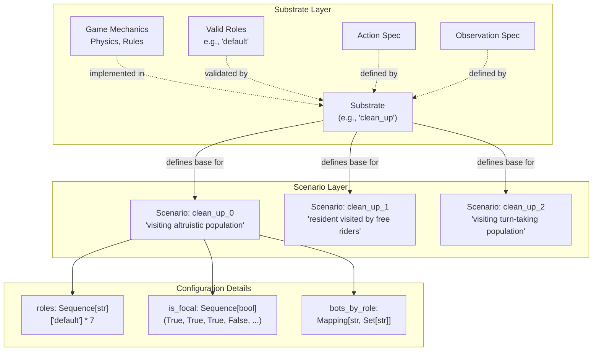
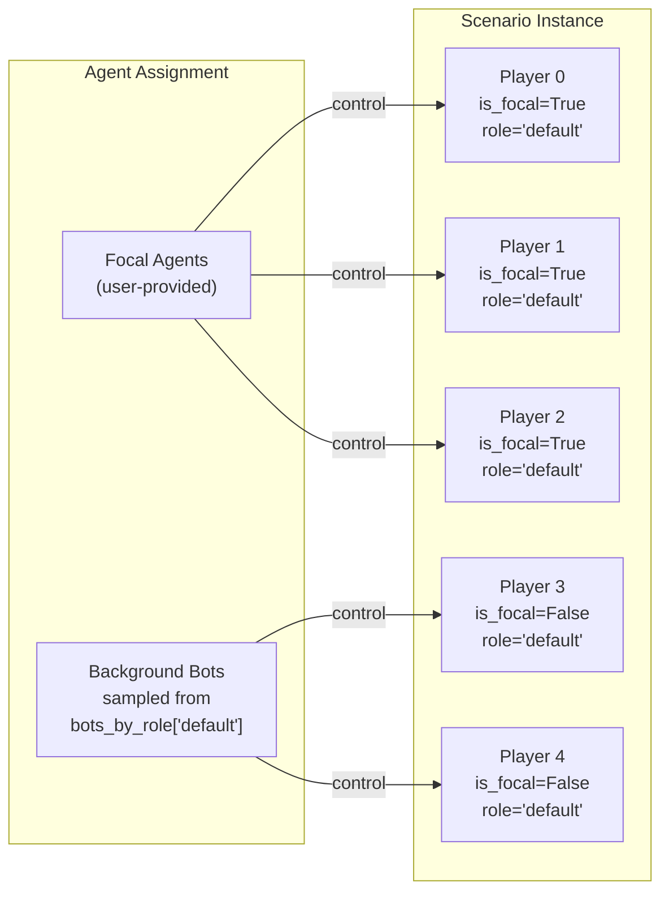
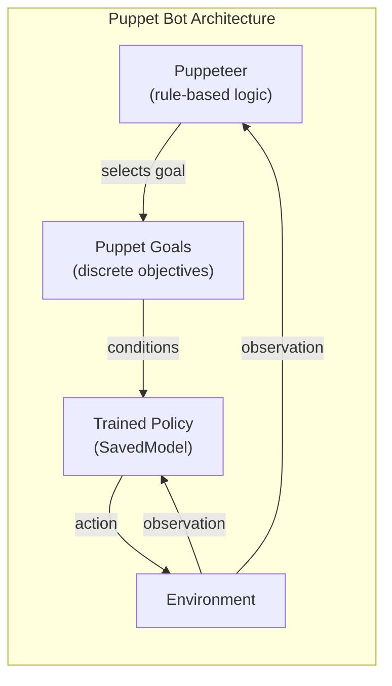
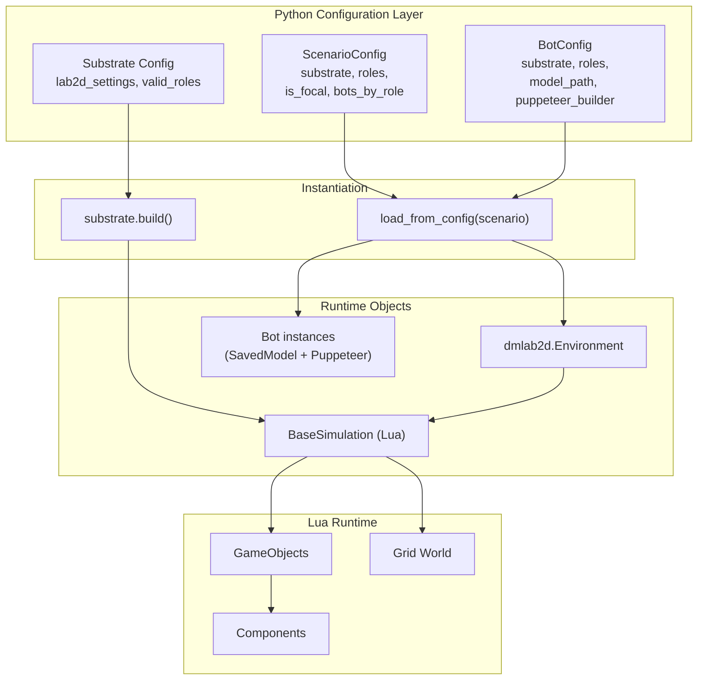
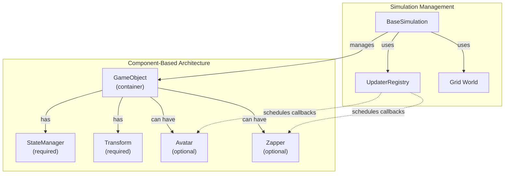

<!-- source: DeepWiki mcp.deepwiki.com · repo google-deepmind/meltingpot · page 3 Core Concepts · fetched 2026-10-26 -->

# Core Concepts

<details>
<summary>Relevant source files</summary>

The following files were used as context for generating this wiki page:

- [README.md](README.md)
- [meltingpot/configs/bots/__init__.py](meltingpot/configs/bots/__init__.py)
- [meltingpot/configs/scenarios/__init__.py](meltingpot/configs/scenarios/__init__.py)
- [meltingpot/configs/scenarios/scenario_configs_test.py](meltingpot/configs/scenarios/scenario_configs_test.py)

</details>


This page explains the fundamental concepts of Melting Pot's architecture: substrates, scenarios, bots, roles, and the component-based game engine. These concepts form the foundation for understanding how to use and extend Melting Pot environments.

For installation and setup instructions, see [Getting Started](#2). For framework-specific integration details, see [Framework Integration](#5). For creating new content, see [Creating Content](#6).

## Substrates and Scenarios

Melting Pot's evaluation framework is built on two core abstractions: **substrates** and **scenarios**.

### Substrates

A **substrate** is a multi-agent game environment that defines the base mechanics, rules, and interactions. Substrates are implemented as Lua-based environments using the dmlab2d engine. Melting Pot includes 50+ substrates covering diverse social dilemmas such as:

- Public goods problems (`clean_up`, `commons_harvest`)
- Coordination games (`bach_or_stravinsky_in_the_matrix`, `pure_coordination_in_the_matrix`)
- Cooperative tasks (`collaborative_cooking`, `coop_mining`)
- Resource allocation (`territory__rooms`, `allelopathic_harvest`)

Each substrate defines:
- Game mechanics and physics
- Available actions
- Observation specifications
- Reward structure
- Valid roles for players

### Scenarios

A **scenario** is a specific configuration of a substrate that defines:
- Which player slots are filled by focal agents (being evaluated)
- Which player slots are filled by background bots
- What roles each player assumes
- Which bots are eligible for each background role

Melting Pot provides 256+ scenarios designed to test generalization across different social contexts.



**Sources:** [meltingpot/configs/scenarios/__init__.py:23-52](), [README.md:27-43]()

## Scenario Configuration Structure

The `ScenarioConfig` dataclass defines how scenarios are configured:

```mermaid
classDiagram
    class ScenarioConfig {
        +str description
        +AbstractSet~str~ tags
        +str substrate
        +Sequence~str~ roles
        +Sequence~bool~ is_focal
        +Mapping~str,AbstractSet~str~~ bots_by_role
    }
    
    class Example_clean_up_0 {
        description: "visiting altruistic population"
        tags: {"visitor", ...}
        substrate: "clean_up"
        roles: ("default",) * 7
        is_focal: (True, True, True, False, False, False, False)
        bots_by_role: {"default": {"cleaner_0", "cleaner_1"}}
    }
    
    ScenarioConfig <|-- Example_clean_up_0
    
    note for ScenarioConfig "Defined in:\nmeltingpot/configs/scenarios/__init__.py:23-52"
    note for Example_clean_up_0 "Example instance:\nmeltingpot/configs/scenarios/__init__.py:1148-1163"
```

**Key Fields:**

| Field | Type | Description |
|-------|------|-------------|
| `description` | `str` | Human-readable description of the scenario |
| `tags` | `AbstractSet[str]` | Tags like `'visitor'`, `'reciprocity'`, `'convention_following'` |
| `substrate` | `str` | Name of the base substrate |
| `roles` | `Sequence[str]` | Role for each player slot (e.g., `'default'`, `'bach_fan'`, `'parent'`) |
| `is_focal` | `Sequence[bool]` | `True` if slot filled by focal agent, `False` for bot |
| `bots_by_role` | `Mapping[str, AbstractSet[str]]` | Eligible bot names for each background role |

**Sources:** [meltingpot/configs/scenarios/__init__.py:23-52](), [meltingpot/configs/scenarios/__init__.py:1148-1163]()

## Roles and Player Types

### Roles

Roles distinguish different player configurations within a substrate. Some substrates have asymmetric roles with different:
- Reward functions
- Available actions  
- Observation perspectives
- Game-theoretic incentives

Examples:
- `'bach_fan'` vs `'stravinsky_fan'` in coordination games
- `'parent'` vs `'child'` in `daycare`
- `'default'` for symmetric substrates

**Sources:** [meltingpot/configs/scenarios/__init__.py:40](), [meltingpot/configs/scenarios/scenario_configs_test.py:65-67]()

### Focal vs Background Players

The `is_focal` sequence determines player slot assignments:

- **Focal players** (`is_focal[i] == True`): Slots for agents being evaluated
- **Background players** (`is_focal[i] == False`): Slots filled by bots from `bots_by_role`

This enables testing how focal agents interact with diverse bot populations and social contexts.



**Sources:** [meltingpot/configs/scenarios/__init__.py:32-35](), [meltingpot/configs/scenarios/scenario_configs_test.py:57-62]()

## Bot Configuration System

Bots provide background agents for scenarios. The `BotConfig` dataclass defines bot specifications:

```mermaid
classDiagram
    class BotConfig {
        +str substrate
        +AbstractSet~str~ roles
        +str model_path
        +Optional~Callable~ puppeteer_builder
    }
    
    class SavedModelBot {
        substrate: "clean_up"
        roles: {"default"}
        model_path: "assets/saved_models/clean_up/cleaner_0"
        puppeteer_builder: None
    }
    
    class PuppetBot {
        substrate: "clean_up"
        roles: {"default"}
        model_path: "assets/saved_models/clean_up/puppet_0"
        puppeteer_builder: functools.partial(Alternator, ...)
    }
    
    BotConfig <|-- SavedModelBot
    BotConfig <|-- PuppetBot
    
    note for BotConfig "Defined in:\nmeltingpot/configs/bots/__init__.py:445-463"
```

**Sources:** [meltingpot/configs/bots/__init__.py:445-463]()

### Saved Model Bots

Saved model bots use trained neural network policies stored as TensorFlow SavedModels. They provide naturalistic, learned behaviors.

Example configuration:
```python
# From meltingpot/configs/bots/__init__.py:1057-1064
clean_up__cleaner_0 = saved_model(
    substrate='clean_up',
    model='cleaner_0',
)
```

The `saved_model()` function constructs paths like: `{MODELS_ROOT}/clean_up/cleaner_0`

**Sources:** [meltingpot/configs/bots/__init__.py:465-484](), [meltingpot/configs/bots/__init__.py:1057-1064]()

### Puppet Bots

Puppet bots combine a trained policy with a **puppeteer** - a rule-based controller that dynamically sets goals for the policy. This enables programmatic behavior patterns.



Example configuration:
```python
# From meltingpot/configs/bots/__init__.py:1073-1084
clean_up__puppet_alternator_first_cleans_0 = puppet(
    substrate='clean_up',
    model='puppet_0',
    roles=('default',),
    puppeteer_builder=functools.partial(
        alternator.Alternator,
        goals=[
            _PUPPET_GOALS['clean_up']['CLEAN'],
            _PUPPET_GOALS['clean_up']['EAT'],
        ],
        steps_per_goal=200,
    )
)
```

**Sources:** [meltingpot/configs/bots/__init__.py:486-507](), [meltingpot/configs/bots/__init__.py:1073-1097]()

## Puppet Goals and Resources

### Puppet Goals

Puppet goals are discrete behavioral objectives that condition the policy. Each substrate with puppet bots defines an ordered list of goals:

```python
# From meltingpot/configs/bots/__init__.py:78-86
_PUPPET_GOALS = immutabledict.immutabledict(
    clean_up=puppeteer.puppet_goals([
        'EAT',
        'CLEAN',
    ]),
    clean_up_3_goals=puppeteer.puppet_goals([
        'EAT',
        'CLEAN',
        'SANCTION',
    ]),
    # ...
)
```

The index in this list corresponds to the goal's numeric encoding passed to the policy.

**Sources:** [meltingpot/configs/bots/__init__.py:44-222]()

### Resources

For "in the matrix" substrates, resources define collectible items and their associated goals:

```python
# From meltingpot/configs/bots/__init__.py:250-273
_RESOURCES = immutabledict.immutabledict(
    chicken_in_the_matrix__arena=immutabledict.immutabledict({
        'DOVE': in_the_matrix.Resource(
            index=0,
            collect_goal=_PUPPET_GOALS['chicken_in_the_matrix__arena']['COLLECT_DOVE'],
            interact_goal=_PUPPET_GOALS['chicken_in_the_matrix__arena']['INTERACT_PLAYING_DOVE'],
        ),
        'HAWK': in_the_matrix.Resource(
            index=1,
            collect_goal=_PUPPET_GOALS['chicken_in_the_matrix__arena']['COLLECT_HAWK'],
            interact_goal=_PUPPET_GOALS['chicken_in_the_matrix__arena']['INTERACT_PLAYING_HAWK'],
        ),
    }),
)
```

Resources link collectibles to their pickup goals and interaction goals, enabling puppeteers to implement strategic behaviors.

**Sources:** [meltingpot/configs/bots/__init__.py:224-442]()

## Puppeteer Types

Melting Pot provides several puppeteer implementations:

| Puppeteer Class | Purpose | Example Use |
|-----------------|---------|-------------|
| `FixedGoal` | Always pursues same goal | Pure cooperator/defector |
| `Alternator` | Cycles through goals | Turn-taking behaviors |
| `TitForTat` | Mirrors partner's actions | Reciprocal cooperation |
| `GrimTrigger` | Cooperates until defected on k times | Punishment strategies |
| `Corrigible` | Starts defecting, switches if punished | Teachable behaviors |
| `ConditionalCleaner` | Cooperates if others cooperate | Conditional cooperation |
| `ConventionFollower` | Adapts to observed conventions | Social learning |

**Sources:** [meltingpot/configs/bots/__init__.py:22-31]()

## Configuration-to-Runtime Flow

The following diagram shows how Python configurations are transformed into running environments:



**Sources:** [meltingpot/configs/scenarios/__init__.py:23-52](), [meltingpot/configs/bots/__init__.py:445-463]()

## GameObject and Component Architecture Overview

While substrates are configured in Python, the game engine runs in Lua using a component-based architecture. This design is covered in detail in [GameObject and Component System](#3.3).

Key concepts:

- **GameObject**: Container entities that exist in the game world
- **Components**: Modular behaviors attached to GameObjects (e.g., `Avatar`, `Zapper`, `Transform`)
- **BaseSimulation**: Orchestrates GameObjects, manages simulation loop
- **UpdaterRegistry**: Schedules component callbacks each frame



**Sources:** Based on high-level architecture diagrams provided, detailed in [GameObject and Component System](#3.3)

## Observation and Action Spaces

Substrates define how agents perceive and act in the environment. These specifications vary by substrate but follow consistent patterns. Details are covered in [Observations and Action Spaces](#3.4).

Key observation types:
- **RGB observations**: First-person pixel view
- **Layered observations**: Symbolic grid representations
- **Inventory**: Agent-specific state information

Key action patterns:
- Discrete action spaces (move, turn, interact)
- Varying action sets per substrate
- Role-specific action availability

**Sources:** Based on README overview and architecture diagrams

## Summary

The core concepts of Melting Pot form a hierarchical structure:

1. **Substrates** define base game mechanics and valid roles
2. **Scenarios** configure specific social contexts using substrates
3. **Roles** enable asymmetric player configurations
4. **Bots** populate background player slots with diverse behaviors
5. **Puppeteers** provide rule-based control for puppet bots
6. **GameObject/Component system** implements the game engine in Lua

Understanding these concepts enables effective use of Melting Pot for multi-agent RL research and extension with new content.

---

