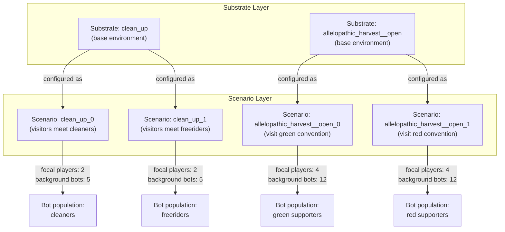
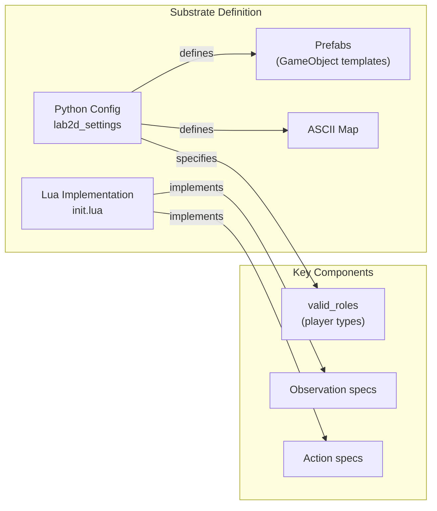
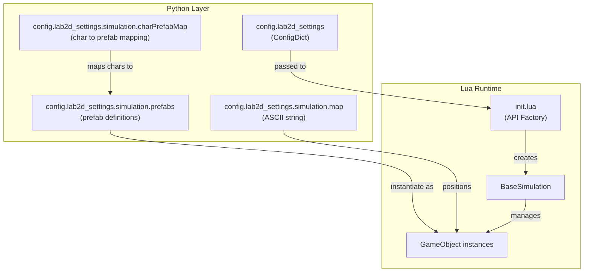
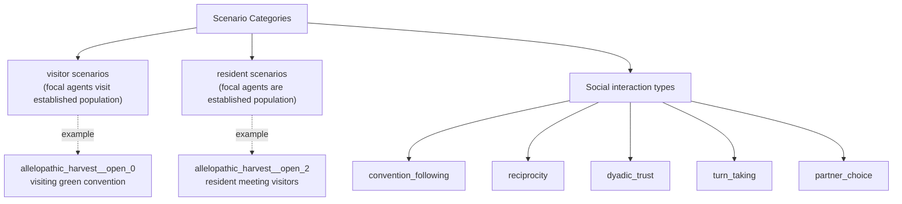
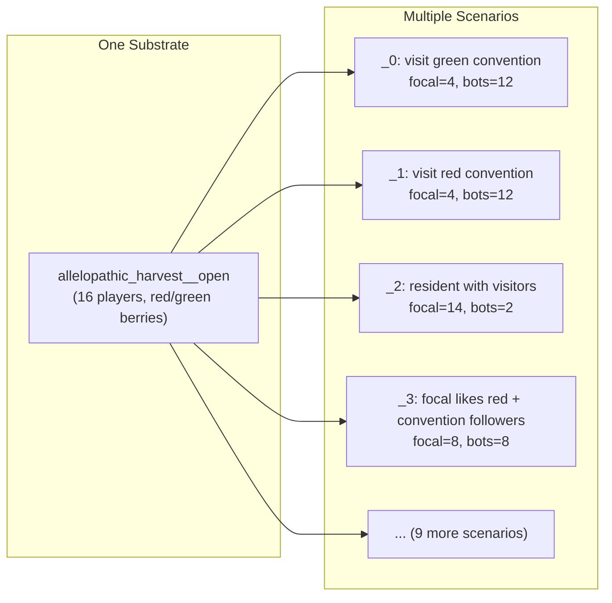
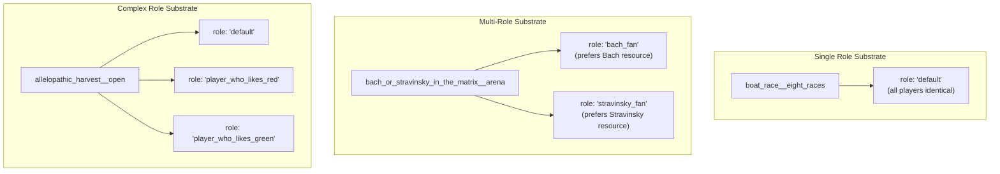
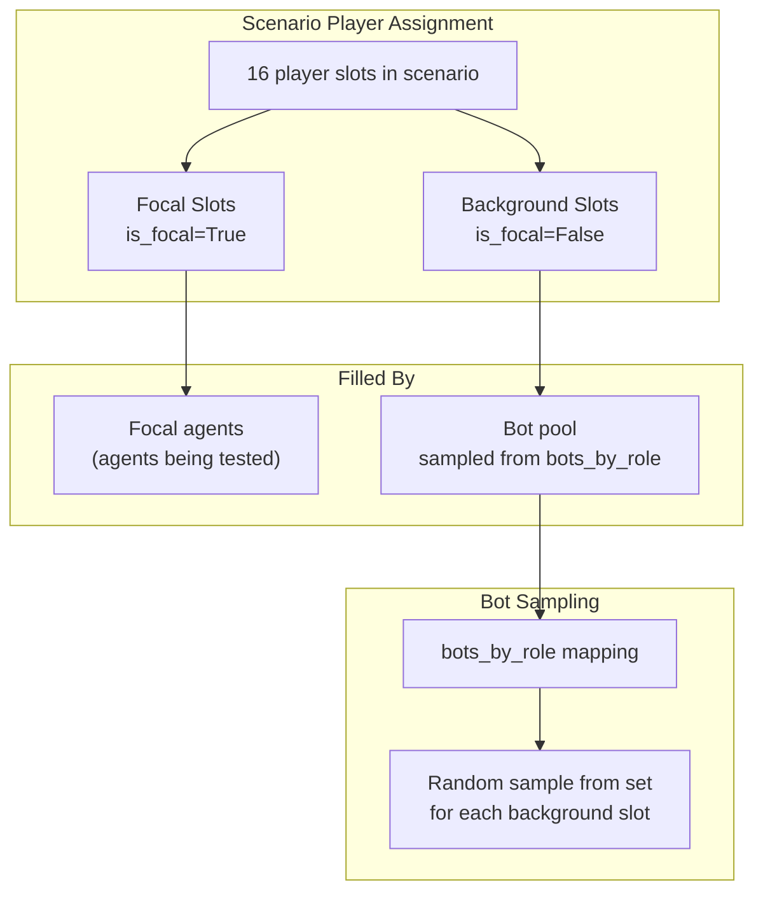
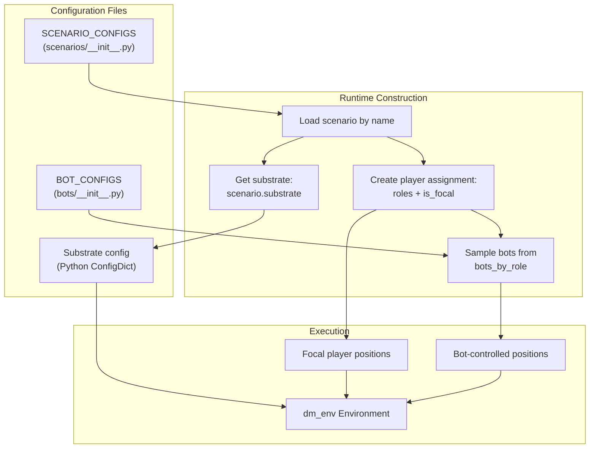
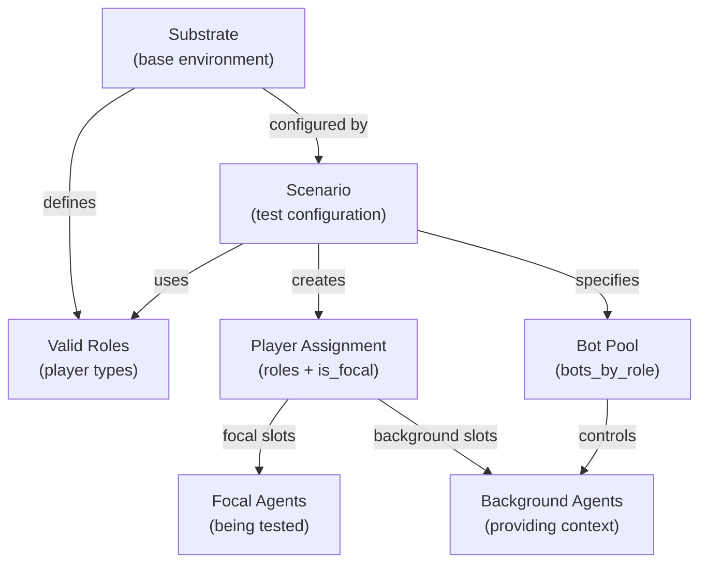

<!-- source: DeepWiki mcp.deepwiki.com · repo google-deepmind/meltingpot · page 3.1 Substrates and Scenarios · fetched 2026-10-26 -->

# Substrates and Scenarios

<details>
<summary>Relevant source files</summary>

The following files were used as context for generating this wiki page:

- [README.md](README.md)
- [docs/advanced.md](docs/advanced.md)
- [docs/extending.md](docs/extending.md)
- [docs/substrate_tutorial/index.md](docs/substrate_tutorial/index.md)
- [docs/substrates.md](docs/substrates.md)
- [meltingpot/configs/bots/__init__.py](meltingpot/configs/bots/__init__.py)
- [meltingpot/configs/scenarios/__init__.py](meltingpot/configs/scenarios/__init__.py)
- [meltingpot/configs/scenarios/scenario_configs_test.py](meltingpot/configs/scenarios/scenario_configs_test.py)
- [meltingpot/lua/modules/colors.lua](meltingpot/lua/modules/colors.lua)

</details>


This page explains the fundamental structure of Melting Pot's test environments: **substrates** (base game environments) and **scenarios** (specific test configurations). Understanding the distinction and relationship between these two concepts is essential for working with Melting Pot.

For implementation details on creating new substrates, see [Substrate Creation Tutorial](#6.1). For information on bot implementations that populate scenarios, see [Bots and Policies](#3.2).

## Overview

Melting Pot provides **50+ substrates** and **256+ scenarios** for evaluating multi-agent reinforcement learning. The key distinction:

- **Substrate**: A base game environment with specific rules, maps, objects, and dynamics (e.g., `clean_up`, `prisoners_dilemma_in_the_matrix__arena`)
- **Scenario**: A specific configuration of a substrate that defines which agents are focal (being tested) and which are background bots with pre-defined behaviors



Sources: [README.md:33-43](), [meltingpot/configs/scenarios/__init__.py:23-52]()

## Substrates: Base Game Environments

A **substrate** is a complete multi-agent game environment with:

- **Game mechanics**: Rules, physics, rewards
- **Visual layout**: ASCII maps defining spatial structure  
- **GameObject prefabs**: Templates for avatars, items, walls, etc.
- **Valid roles**: Player types that can exist in the environment (e.g., `bach_fan`, `stravinsky_fan`)

### Substrate Structure



**Example substrate structure** from `allelopathic_harvest__open`:

| Attribute | Value |
|-----------|-------|
| Name | `allelopathic_harvest__open` |
| Valid roles | `default`, `player_who_likes_red`, `player_who_likes_green` |
| Player count | 16 |
| Episode length | 1000 frames |
| Map size | Variable (defined by ASCII map) |

Sources: [docs/substrates.md:1-79](), [docs/substrate_tutorial/index.md:1-69]()

### Substrate Configuration Code Entities

The substrate configuration lives in Python and connects to Lua runtime:



Sources: [docs/substrates.md:138-158](), [meltingpot/configs/scenarios/__init__.py:23-52]()

## Scenarios: Test Configurations

A **scenario** specifies exactly which agents are being tested (focal) and which background population they interact with (bots). This allows systematic evaluation of how agents generalize to different social contexts.

### ScenarioConfig Structure

The `ScenarioConfig` dataclass defines a scenario:

```mermaid
classDiagram
    class ScenarioConfig {
        +str description
        +AbstractSet~str~ tags
        +str substrate
        +Sequence~str~ roles
        +Sequence~bool~ is_focal
        +Mapping~str,AbstractSet~ bots_by_role
    }
    
    class Example {
        substrate: "allelopathic_harvest__open"
        roles: ["player_who_likes_red"] * 8 + ["player_who_likes_green"] * 8
        is_focal: (True,) * 4 + (False,) * 12
        bots_by_role: {"player_who_likes_red": {...}, "player_who_likes_green": {...}}
    }
    
    ScenarioConfig --> Example : instance
```

**Key attributes explained**:

| Attribute | Purpose | Example |
|-----------|---------|---------|
| `substrate` | Base environment to use | `"bach_or_stravinsky_in_the_matrix__arena"` |
| `roles` | Role for each player slot | `["bach_fan", "stravinsky_fan", "bach_fan", ...]` |
| `is_focal` | Which slots are focal players | `[True, True, False, False, ...]` |
| `bots_by_role` | Bot pool for each background role | `{"stravinsky_fan": {"bot_0", "bot_1"}}` |
| `tags` | Categorization for analysis | `{"visitor", "convention_following"}` |

Sources: [meltingpot/configs/scenarios/__init__.py:23-52](), [meltingpot/configs/scenarios/scenario_configs_test.py:37-105]()

### Scenario Types

Scenarios are categorized by tags that describe the social situation being tested:



Sources: [meltingpot/configs/scenarios/__init__.py:57-270]()

## Relationship: Substrates to Scenarios

The mapping from substrates to scenarios follows a one-to-many relationship:



### Configuration Validation

The test suite enforces consistency between substrates and scenarios:

| Validation Rule | Implementation |
|----------------|----------------|
| Scenario name starts with substrate name | [scenario_configs_test.py:53-54]() |
| Substrate exists in `SUBSTRATES` | [scenario_configs_test.py:48-49]() |
| All roles are valid for substrate | [scenario_configs_test.py:65-67]() |
| All bots are compatible with substrate/role | [scenario_configs_test.py:75-85]() |
| All background roles have bot assignments | [scenario_configs_test.py:88-96]() |

Sources: [meltingpot/configs/scenarios/scenario_configs_test.py:37-117]()

## Roles and Player Assignment

**Roles** define different player types within a substrate. Some substrates have a single `default` role, while others have multiple specialized roles.

### Role Examples by Substrate



### Role Assignment in Scenarios

A scenario assigns a role to each player slot:

**Example from `bach_or_stravinsky_in_the_matrix__arena_0`**:
```python
roles = ('bach_fan',) * 4 + ('stravinsky_fan',) * 4  # 8 players total
is_focal = (True,) * 1 + (False,) * 7  # 1 focal, 7 bots
```

This creates:
- Position 0: `bach_fan` role, focal player ✓
- Positions 1-3: `bach_fan` role, bots
- Positions 4-7: `stravinsky_fan` role, bots

Sources: [meltingpot/configs/scenarios/__init__.py:287-304](), [docs/extending.md:8-60]()

## Focal vs Background Players

The `is_focal` attribute determines which player slots are filled by **focal agents** (being evaluated) versus **background bots** (providing context).



### Visitor vs Resident Scenarios

Two common patterns:

| Pattern | Focal Count | Bot Count | Purpose |
|---------|-------------|-----------|---------|
| **Visitor** | Low (1-4) | High (5-15) | Test generalization to new populations |
| **Resident** | High (5-15) | Low (1-4) | Test response to newcomers |

**Visitor example** (`boat_race__eight_races_0`):
- `is_focal=(True,) * 1 + (False,) * 5`
- 1 focal agent visits 5 cooperator bots

**Resident example** (`boat_race__eight_races_2`):
- `is_focal=(True,) * 5 + (False,) * 1`
- 5 focal agents host 1 cooperator bot

Sources: [meltingpot/configs/scenarios/__init__.py:529-567]()

## Configuration to Runtime Flow

The complete flow from configuration to running scenario:



### Code Entities in Flow

| Step | Code Entity | File Path |
|------|-------------|-----------|
| Scenario definition | `SCENARIO_CONFIGS[name]` | [scenarios/__init__.py:55-56]() |
| Bot definition | `BOT_CONFIGS[bot_name]` | [bots/__init__.py:509]() |
| Substrate config | `substrates.get_config(name)` | Referenced in tests |
| Role validation | `substrates.get_config().valid_roles` | [scenario_configs_test.py:66]() |
| Bot compatibility check | `bot_config.substrate`, `bot_config.roles` | [scenario_configs_test.py:30-34]() |

Sources: [meltingpot/configs/scenarios/__init__.py:1-52](), [meltingpot/configs/bots/__init__.py:445-507]()

## Scenario Configuration Examples

### Example 1: Simple Visitor Scenario

**Scenario**: `bach_or_stravinsky_in_the_matrix__arena_0`

```python
ScenarioConfig(
    description='visiting background population who picks bach',
    tags={'convention_following', 'visitor'},
    substrate='bach_or_stravinsky_in_the_matrix__arena',
    roles=('bach_fan',) * 4 + ('stravinsky_fan',) * 4,
    is_focal=(True,) * 1 + (False,) * 7,
    bots_by_role={
        'bach_fan': ('bach_or_stravinsky_in_the_matrix__arena__bach_picker_0',),
        'stravinsky_fan': ('bach_or_stravinsky_in_the_matrix__arena__bach_picker_0',),
    }
)
```

**Interpretation**:
- 8 total players (4 bach fans, 4 stravinsky fans)
- 1 focal agent (position 0, bach_fan role)
- 7 background bots (all controlled by bach_picker_0 bot)
- Tests: Can focal agent adapt to a population that picks Bach?

Sources: [meltingpot/configs/scenarios/__init__.py:287-304]()

### Example 2: Complex Multi-Bot Scenario

**Scenario**: `allelopathic_harvest__open_12`

```python
ScenarioConfig(
    description='focals are resident, visited by convention followers and bots who plant green',
    tags={'convention_following'},
    substrate='allelopathic_harvest__open',
    roles=['player_who_likes_red',] * 8 + ['player_who_likes_green',] * 8,
    is_focal=(True,) * 12 + (False,) * 4,
    bots_by_role={
        'player_who_likes_green': {
            'allelopathic_harvest__open__bot_that_supports_green_0',
            'allelopathic_harvest__open__puppet_convention_follower_0',
        },
    }
)
```

**Interpretation**:
- 16 total players (8 red likers, 8 green likers)
- 12 focal agents (resident population)
- 4 background bots (sampled from 2 different bot types)
- Tests: How do focal residents respond to mixed visitor population?

Sources: [meltingpot/configs/scenarios/__init__.py:271-286]()

## Summary: Key Relationships



**Core principles**:
1. **Substrates** are reusable game environments with defined roles
2. **Scenarios** configure substrates with specific focal/bot distributions
3. **Roles** link scenarios to valid player types in substrates
4. **Bots** must be compatible with both substrate and assigned role
5. Multiple scenarios test different social contexts within same substrate

Sources: [README.md:29-47](), [docs/extending.md:8-60](), [meltingpot/configs/scenarios/scenario_configs_test.py:1-128]()

---

