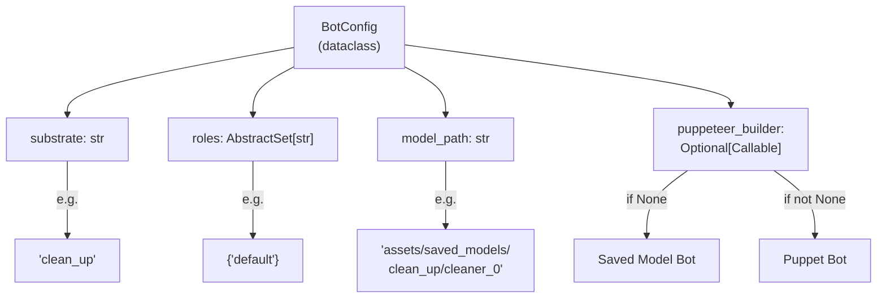
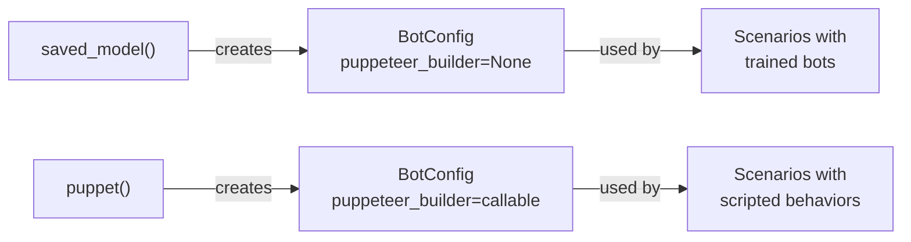
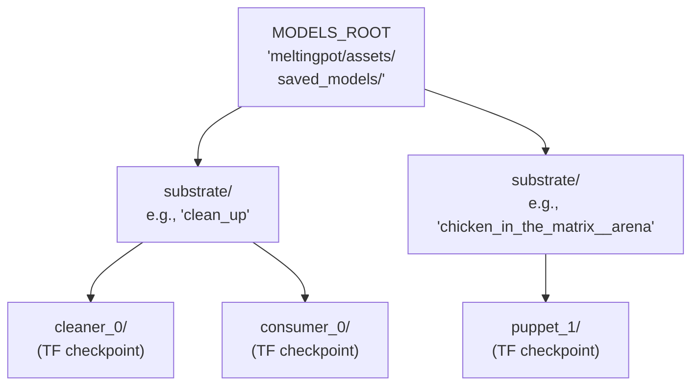
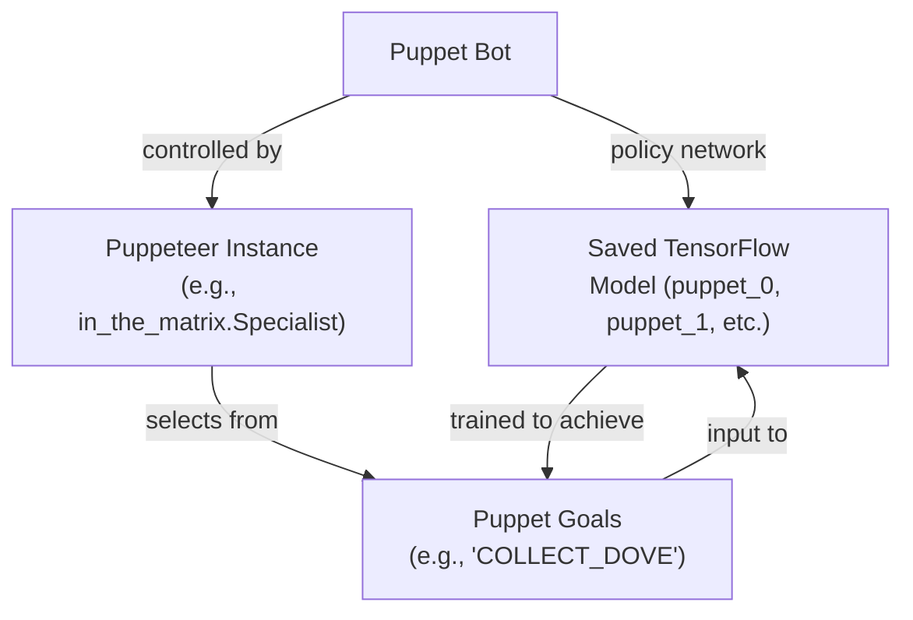
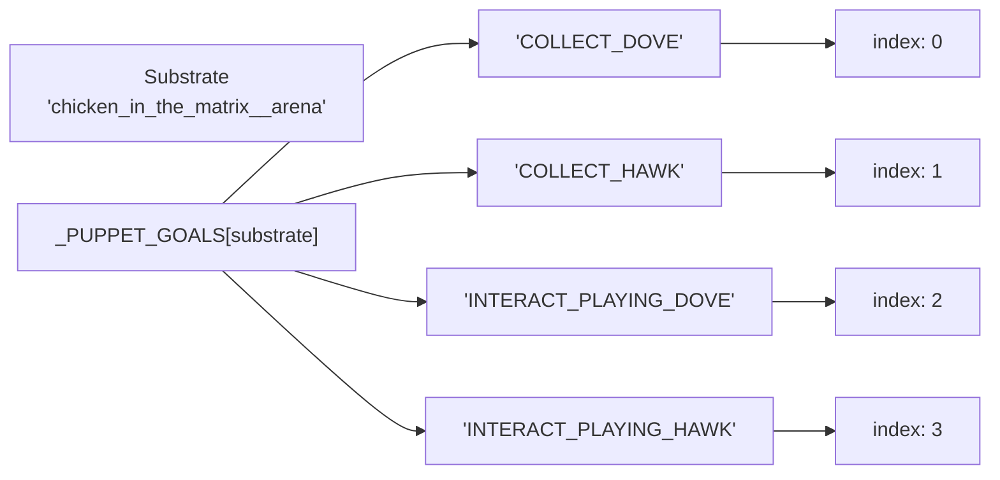
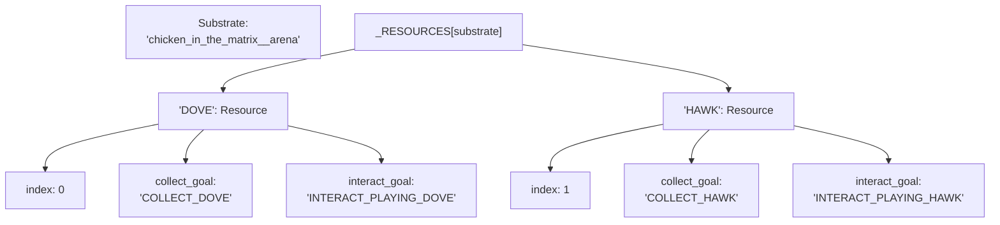
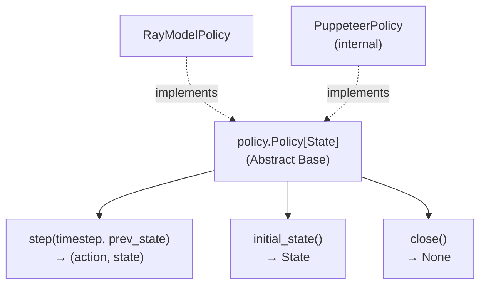
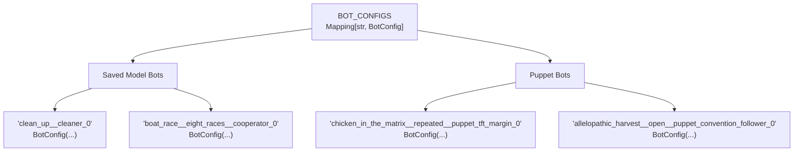
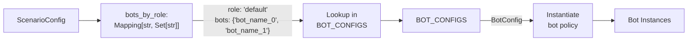

<!-- source: DeepWiki mcp.deepwiki.com · repo google-deepmind/meltingpot · page 3.2 Bots and Policies · fetched 2026-10-26 -->

# Bots and Policies

<details>
<summary>Relevant source files</summary>

The following files were used as context for generating this wiki page:

- [examples/rllib/self_play_train.py](examples/rllib/self_play_train.py)
- [examples/rllib/utils.py](examples/rllib/utils.py)
- [examples/rllib/view_models.py](examples/rllib/view_models.py)
- [meltingpot/configs/bots/__init__.py](meltingpot/configs/bots/__init__.py)
- [meltingpot/configs/scenarios/__init__.py](meltingpot/configs/scenarios/__init__.py)
- [meltingpot/configs/scenarios/scenario_configs_test.py](meltingpot/configs/scenarios/scenario_configs_test.py)

</details>


This page explains the bot configuration system, saved models, puppet bots, puppeteers, and the policy interface in Melting Pot. Bots are pre-configured agents used to populate scenarios with background populations, enabling focal agents to interact with specific behavioral patterns.

For information about how scenarios use bots to create specific social situations, see [Substrates and Scenarios](#3.1). For guidance on creating new bots, see [Bot Implementation](#6.3). For training policies using RLLib, see [RLLib Integration](#5.1).

## Bot Configuration System

The bot configuration system is built around the `BotConfig` dataclass, which encapsulates all information needed to instantiate a bot for a specific substrate.

### BotConfig Structure



**Sources:** [meltingpot/configs/bots/__init__.py:445-463]()

The `BotConfig` attributes are:

| Attribute | Type | Purpose |
|-----------|------|---------|
| `substrate` | `str` | The substrate the bot was trained for |
| `roles` | `AbstractSet[str]` | The roles the bot can play (e.g., 'default', 'bach_fan') |
| `model_path` | `str` | Path to the saved TensorFlow model |
| `puppeteer_builder` | `Optional[Callable[[], Puppeteer]]` | Factory function for puppeteer; `None` for saved model bots |

### Factory Functions

Two factory functions create `BotConfig` instances:



**Sources:** [meltingpot/configs/bots/__init__.py:465-507]()

## Saved Model Bots

Saved model bots are agents trained via reinforcement learning and stored as TensorFlow checkpoints. They provide realistic, learned behaviors for specific substrates and roles.

### Creating Saved Model Bots

The `saved_model()` function creates configurations for pre-trained bots:

```python
# From meltingpot/configs/bots/__init__.py:465-483
def saved_model(*,
                substrate: str,
                roles: Iterable[str] = ('default',),
                model: str,
                models_root: str = MODELS_ROOT) -> BotConfig
```

Example usage from `BOT_CONFIGS`:

```python
# allelopathic_harvest__open__bot_that_supports_green_0
BotConfig(
    substrate='allelopathic_harvest__open',
    roles={'default', 'player_who_likes_red', 'player_who_likes_green'},
    model_path='assets/saved_models/allelopathic_harvest__open/bot_that_loves_green_0',
    puppeteer_builder=None
)
```

**Sources:** [meltingpot/configs/bots/__init__.py:465-483, 511-515]()

### Model Storage Structure



**Sources:** [meltingpot/configs/bots/__init__.py:34-39]()

## Puppet Bots and Puppeteers

Puppet bots are agents controlled by **puppeteers**—scripted logic that interprets observations and selects puppet goals to achieve specific behavioral patterns.

### Puppet Bot Architecture



**Sources:** [meltingpot/configs/bots/__init__.py:486-507]()

### Creating Puppet Bots

The `puppet()` function creates configurations for puppeteer-controlled bots:

```python
# From meltingpot/configs/bots/__init__.py:486-506
def puppet(*,
           substrate: str,
           roles: Iterable[str] = ('default',),
           model: str,
           puppeteer_builder: Callable[[], puppeteer.Puppeteer],
           models_root: str = MODELS_ROOT) -> BotConfig
```

Example puppet bot from `BOT_CONFIGS`:

```python
# chicken_in_the_matrix__repeated__puppet_dove_margin_0
puppet(
    substrate='chicken_in_the_matrix__repeated',
    model='puppet_1',
    puppeteer_builder=functools.partial(
        in_the_matrix.Specialist,
        target=_RESOURCES['chicken_in_the_matrix__repeated']['DOVE'],
        margin=5,
    ),
)
```

**Sources:** [meltingpot/configs/bots/__init__.py:921-929]()

### Puppet Goals

Puppet goals are named objectives that puppet models are trained to achieve. Each substrate has a specific set of puppet goals:



The `_PUPPET_GOALS` dictionary maps substrate names to ordered goal mappings. Example:

```python
# From meltingpot/configs/bots/__init__.py:66-77
'chicken_in_the_matrix__arena': puppeteer.puppet_goals([
    'COLLECT_DOVE',
    'COLLECT_HAWK',
    'INTERACT_PLAYING_DOVE',
    'INTERACT_PLAYING_HAWK',
])
```

**Sources:** [meltingpot/configs/bots/__init__.py:44-222]()

### Puppeteer Types

Common puppeteer classes implement different behavioral patterns:

| Puppeteer Class | Module | Behavior |
|----------------|--------|----------|
| `Specialist` | `in_the_matrix` | Always pursues a single target resource |
| `TitForTat` | `in_the_matrix` | Reciprocates partner's previous action |
| `GrimTrigger` | `in_the_matrix` | Cooperates until defected on k times, then always defects |
| `AlternatingSpecialist` | `in_the_matrix` | Alternates between resources on a schedule |
| `Corrigible` | `in_the_matrix` | Starts defecting, switches to TFT if punished |
| `ConventionFollower` | `allelopathic_harvest` | Adapts to the prevailing color convention |
| `Alternator` | `alternator` | Cycles through goals on a fixed schedule |
| `CorrigibleReciprocator` | `clean_up` | Clean-up specific reciprocal behavior |

**Sources:** [meltingpot/configs/bots/__init__.py:22-31, 573-1127]()

### Resources (In The Matrix Games)

For "in_the_matrix" substrates, the `_RESOURCES` dictionary maps resource names to `Resource` objects containing collect and interact goals:



**Sources:** [meltingpot/configs/bots/__init__.py:224-442]()

## Policy Interface

The `Policy` interface defines the contract for agent policies, whether learned or scripted. It is implemented by both model-based policies and puppeteer-based policies.

### Policy Protocol



**Sources:** [examples/rllib/utils.py:134-179]()

### RayModelPolicy Implementation

The `RayModelPolicy` class wraps RLLib trained models to implement the `Policy` interface:

```python
# From examples/rllib/utils.py:134-179
class RayModelPolicy(policy.Policy[policy.State]):
    def __init__(self,
                 model: algorithms.Algorithm,
                 policy_id: str = sample_batch.DEFAULT_POLICY_ID):
        self._model = model
        self._prev_action = 0
        self._policy_id = policy_id

    def step(self, timestep: dm_env.TimeStep,
             prev_state: policy.State) -> Tuple[int, policy.State]:
        observations = {
            key: value
            for key, value in timestep.observation.items()
            if 'WORLD' not in key  # Filter out world observations
        }
        
        action, state, _ = self._model.compute_single_action(
            observations,
            prev_state,
            policy_id=self._policy_id,
            prev_action=self._prev_action,
            prev_reward=timestep.reward)
        
        self._prev_action = action
        return action, state
```

**Sources:** [examples/rllib/utils.py:134-179]()

## Bot Registry

All available bots are registered in the `BOT_CONFIGS` dictionary, which maps bot names to their configurations.

### Bot Naming Convention

Bot names follow a structured pattern:

```
{substrate}__{variant}__{behavior}_{version}
```

Examples:
- `allelopathic_harvest__open__bot_that_supports_green_0`
- `chicken_in_the_matrix__arena__puppet_dove_margin_0`
- `clean_up__cleaner_0`

### Bot Registry Structure



**Sources:** [meltingpot/configs/bots/__init__.py:509-1848]()

### Example Bot Configurations

**Saved Model Bot:**
```python
# From BOT_CONFIGS
allelopathic_harvest__open__bot_that_supports_green_0=saved_model(
    substrate='allelopathic_harvest__open',
    model='bot_that_loves_green_0',
    roles=('default', 'player_who_likes_red', 'player_who_likes_green',),
)
```

**Puppet Bot:**
```python
# From BOT_CONFIGS
chicken_in_the_matrix__repeated__puppet_tft_margin_0=puppet(
    substrate='chicken_in_the_matrix__repeated',
    model='puppet_1',
    puppeteer_builder=functools.partial(
        in_the_matrix.TitForTat,
        cooperate_resource=_RESOURCES['chicken_in_the_matrix__repeated']['DOVE'],
        defect_resource=_RESOURCES['chicken_in_the_matrix__repeated']['HAWK'],
        tremble_probability=0,
        margin=5,
    ),
)
```

**Sources:** [meltingpot/configs/bots/__init__.py:511-1056]()

## Integration with Scenarios

Scenarios use bots to fill background player slots, creating specific social dynamics for focal agents to navigate.

### Bot Assignment Flow



**Sources:** [meltingpot/configs/scenarios/__init__.py:23-52]()

### Scenario Bot Usage Example

```python
# From scenarios/__init__.py:406-419
bach_or_stravinsky_in_the_matrix__repeated_0=ScenarioConfig(
    description='meeting a stubborn bach picker',
    tags={'convention_following'},
    substrate='bach_or_stravinsky_in_the_matrix__repeated',
    roles=('stravinsky_fan',) + ('bach_fan',),
    is_focal=(True,) + (False,),
    bots_by_role=immutabledict.immutabledict(
        bach_fan=(
            'bach_or_stravinsky_in_the_matrix__repeated__bach_picker_0',
        ),
    ),
)
```

The scenario references bot `'bach_or_stravinsky_in_the_matrix__repeated__bach_picker_0'`, which is defined in `BOT_CONFIGS` as a puppet bot using the `Specialist` puppeteer.

**Sources:** [meltingpot/configs/scenarios/__init__.py:406-419, meltingpot/configs/bots/__init__.py:621-630]()

### Bot Validation

Scenarios are validated to ensure bot compatibility:

| Validation Check | Purpose |
|-----------------|---------|
| Bot exists | Referenced bot name is in `BOT_CONFIGS` |
| Substrate matches | Bot's substrate matches scenario's substrate |
| Role compatibility | Bot supports the assigned role |
| No missing assignments | All background roles have bots assigned |
| No unused assignments | All bot assignments correspond to background roles |

**Sources:** [meltingpot/configs/scenarios/scenario_configs_test.py:30-105]()

## Usage Examples

### Loading a Bot in a Training Script

```python
# From examples/rllib/view_models.py:63-66
bots = [
    utils.RayModelPolicy(trainer, f"agent_{i}")
    for i in range(len(config["env_config"]["default_player_roles"]))
]
```

**Sources:** [examples/rllib/view_models.py:63-66]()

### Using Bots in Policy Evaluation

```python
# Initialize bot policies
timestep = env.reset()
states = [bot.initial_state() for bot in bots]

# Step each bot
for i, bot in enumerate(bots):
    timestep_bot = dm_env.TimeStep(
        step_type=timestep.step_type,
        reward=timestep.reward[i],
        discount=timestep.discount,
        observation=timestep.observation[i])
    
    actions[i], states[i] = bot.step(timestep_bot, states[i])
```

**Sources:** [examples/rllib/view_models.py:68-105]()

---

