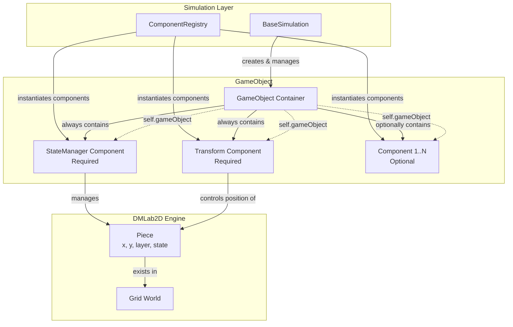
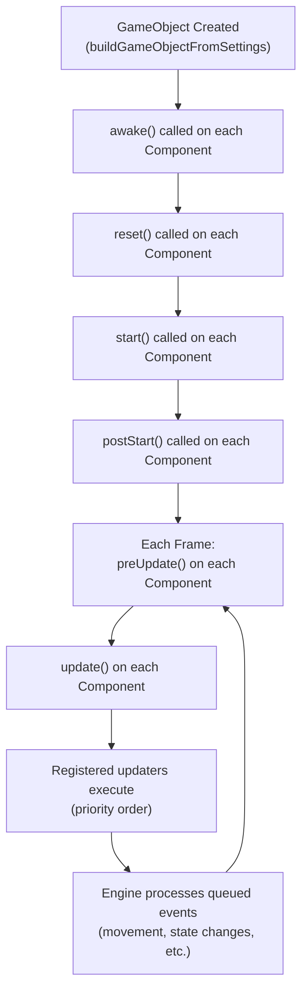
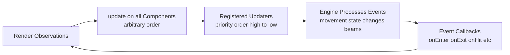
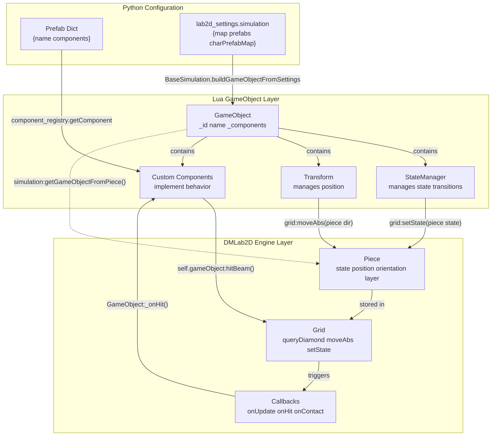

<!-- source: DeepWiki mcp.deepwiki.com · repo google-deepmind/meltingpot · page 3.3 GameObject and Component System · fetched 2026-10-26 -->

# GameObject and Component System

<details>
<summary>Relevant source files</summary>

The following files were used as context for generating this wiki page:

- [docs/advanced.md](docs/advanced.md)
- [docs/concepts.md](docs/concepts.md)
- [docs/extending.md](docs/extending.md)
- [docs/substrate_tutorial/index.md](docs/substrate_tutorial/index.md)
- [docs/substrates.md](docs/substrates.md)
- [meltingpot/lua/levels/clean_up/components.lua](meltingpot/lua/levels/clean_up/components.lua)
- [meltingpot/lua/modules/avatar_library.lua](meltingpot/lua/modules/avatar_library.lua)
- [meltingpot/lua/modules/base_simulation.lua](meltingpot/lua/modules/base_simulation.lua)
- [meltingpot/lua/modules/colors.lua](meltingpot/lua/modules/colors.lua)
- [meltingpot/lua/modules/component.lua](meltingpot/lua/modules/component.lua)
- [meltingpot/lua/modules/game_object.lua](meltingpot/lua/modules/game_object.lua)

</details>


This page documents the component-based architecture that powers Melting Pot substrates. GameObjects are containers that gain functionality through modular Components, following a composition-over-inheritance design pattern similar to modern game engines.

For information about creating substrates using this system, see [Substrate Creation Tutorial](#6.1). For Python-level configuration of GameObjects, see [Python Configuration Layer](#4.1).

---

## Architecture Overview

Melting Pot uses a component-based entity system where all entities in a substrate are `GameObject`s that gain functionality through `Component`s. This architecture wraps the underlying DMLab2D piece system with an object-oriented paradigm.

**Core Components of the System:**



Sources: [meltingpot/lua/modules/game_object.lua:1-669](), [meltingpot/lua/modules/base_simulation.lua:1-625](), [meltingpot/lua/modules/component.lua:1-91]()

---

## GameObject

A `GameObject` is an empty container that gains all functionality through its `Component`s. Every entity in a Melting Pot substrate—avatars, walls, spawn points, collectibles, etc.—is a GameObject.

### GameObject Properties

| Property | Type | Description |
|----------|------|-------------|
| `_id` | string | Unique identifier (e.g., `"OID_avatar_1"`) |
| `name` | string | Human-readable name for grouping/searching |
| `_components` | table | Components indexed by name |
| `simulation` | BaseSimulation | Reference to parent simulation |
| `_grid` | Grid | Reference to DMLab2D grid (set during `start()`) |
| `_stateManager` | StateManager | Required component managing state |
| `_transform` | Transform | Required component managing position |

Sources: [meltingpot/lua/modules/game_object.lua:77-97]()

### GameObject API

**Component Access:**
```lua
-- Check if component exists
gameObject:hasComponent("Avatar")  -- returns boolean

-- Get first component of type
gameObject:getComponent("Avatar")  -- returns Component or errors

-- Get all components of type
gameObject:getComponents("Avatar")  -- returns array of Components
```

**State Management (delegates to StateManager):**
```lua
gameObject:getState()           -- current state as string
gameObject:getAllStates()       -- array of all possible states
gameObject:setState("newState") -- schedule state change (queued)
gameObject:getLayer()           -- current layer
gameObject:getSprite()          -- current sprite name
gameObject:getGroups()          -- array of group names
```

**Transform (delegates to Transform):**
```lua
gameObject:getPosition()        -- {x=int, y=int}
gameObject:getOrientation()     -- "N", "E", "S", or "W"
gameObject:moveAbs("N")        -- move absolute direction
gameObject:moveRel("N")        -- move relative to orientation
gameObject:teleport(pos, ori)  -- instant position change
gameObject:turn(1)             -- rotate (1=90° CW, 2=180°, 3=90° CCW)
```

Sources: [meltingpot/lua/modules/game_object.lua:456-658]()

### GameObject Lifecycle



Sources: [meltingpot/lua/modules/game_object.lua:134-154](), [meltingpot/lua/modules/base_simulation.lua:450-486]()

---

## Component System

A `Component` is a modular piece of logic that can be attached to a GameObject. Components implement specific behaviors and can interact with other components on the same GameObject or other GameObjects.

### Component Structure

**Key Component Properties:**
```lua
-- In component:__init__()
self.name = "ComponentName"        -- identifies this component type
self._config = {}                  -- static configuration (from kwargs)
self._variables = {}               -- mutable runtime state
self.gameObject = nil              -- set when added to GameObject
```

Sources: [meltingpot/lua/modules/component.lua:67-75]()

### Component Lifecycle Methods

All lifecycle methods are **optional**. Components only implement what they need.

| Method | When Called | Purpose |
|--------|-------------|---------|
| `awake()` | When added to GameObject | Initialize references |
| `reset()` | Before each episode starts | Reset runtime variables |
| `start(locator)` | After all objects created | Initialize with grid reference |
| `postStart()` | After all `start()` complete | Cross-object initialization |
| `preUpdate()` | Every frame, before `update()` | Pre-computation |
| `update()` | Every frame | Main logic (unordered) |
| `registerUpdaters(registry)` | During initialization | Register ordered updates |

Sources: [meltingpot/lua/modules/component.lua:22-66](), [meltingpot/lua/modules/game_object.lua:34-39]()

### Component Event Callbacks

Components respond to events through callback methods:

```lua
-- Movement/collision events
function Component:onBlocked(blockingGameObject)
  -- Called when movement fails due to occupied cell
end

-- Contact events (same x,y, different layers)
function Component:onEnter(enteringGameObject, contactName)
  -- Another object entered same position
end

function Component:onExit(exitingGameObject, contactName)
  -- Another object left same position
end

-- Beam/raycast events
function Component:onHit(hitterGameObject, hitName)
  -- Hit by a beam (e.g., "zapHit", "cleanHit")
  return true  -- blocks beam from passing through
end

-- State changes
function Component:onStateChange(previousState)
  -- GameObject changed state
end
```

Sources: [meltingpot/lua/modules/game_object.lua:290-373](), [docs/concepts.md:234-248]()

### Component Registration

Components must be registered with the `ComponentRegistry` to be usable:

```lua
local component_registry = require(meltingpot .. 'component_registry')

local MyComponent = class.Class(component.Component)

function MyComponent:__init__(kwargs)
  -- ...
end

-- Register all components
local allComponents = {
    MyComponent = MyComponent,
    AnotherComponent = AnotherComponent,
}

component_registry.registerAllComponents(allComponents)
```

Sources: [meltingpot/lua/levels/clean_up/components.lua:560-580](), [docs/substrate_tutorial/index.md:583-590]()

---

## Required Components

Every GameObject must have exactly one `StateManager` and one `Transform`. These are automatically added if not explicitly provided.

### StateManager Component

Manages the GameObject's state, which determines its appearance and behavior.

**State Configuration:**
```python
{
    "component": "StateManager",
    "kwargs": {
        "initialState": "wall",
        "stateConfigs": [
            {
                "state": "wall",           # state identifier
                "layer": "upperPhysical",  # which layer (z-coordinate)
                "sprite": "Wall",          # which sprite to render
                "groups": ["obstacles"],   # group membership
                "contact": "wall"          # contact name for onEnter/onExit
            },
            # More states...
        ]
    }
}
```

**State Attributes:**

| Attribute | Type | Description |
|-----------|------|-------------|
| `state` | string | Unique state identifier for this GameObject |
| `layer` | string | Grid layer (e.g., "upperPhysical", "lowerPhysical", "background") |
| `sprite` | string | Sprite name to render |
| `groups` | array | Groups for querying/filtering (e.g., spawn points) |
| `contact` | string | Contact identifier for `onEnter`/`onExit` events |

Sources: [docs/substrate_tutorial/index.md:104-113](), [docs/concepts.md:122-163]()

### Transform Component

Manages position and orientation in the grid world.

**Configuration:**
```python
{
    "component": "Transform",
    "kwargs": {
        "position": [5, 10],    # Initial [x, y] - optional
        "orientation": "N"      # Initial facing - optional
    }
}
```

**Key Methods:**
- `getPosition()` → `{x, y}` table
- `getOrientation()` → `"N"`, `"E"`, `"S"`, or `"W"`
- `moveAbs(direction)` → move in absolute direction
- `moveRel(direction)` → move relative to current orientation
- `teleport(position, orientation)` → instant position change
- `queryDiamond(layer, radius)` → get nearby objects (L1 distance)
- `queryDisc(layer, radius)` → get nearby objects (L2 distance)

Sources: [docs/concepts.md:168-207](), [meltingpot/lua/modules/game_object.lua:567-657]()

---

## Updaters and Update Ordering

Components can update in two ways: unordered `update()` or priority-based updaters.

### Unordered Updates

```lua
function MyComponent:update()
  -- Called every frame, no guaranteed order
  -- Avoid if order matters across components
end
```

### Priority-Based Updaters

Updaters provide fine control over execution order, delay, and probability:

```lua
function MyComponent:registerUpdaters(updaterRegistry)
  updaterRegistry:registerUpdater{
    updateFn = function()
      -- Update logic here
    end,
    priority = 150,              -- Higher = earlier (default: 100)
    state = "activeState",       -- Only when in this state
    startFrame = 10,             -- Wait 10 frames after state change
    probability = 0.5,           -- Execute with 50% probability
  }
end
```

**Updater Parameters:**

| Parameter | Type | Default | Description |
|-----------|------|---------|-------------|
| `updateFn` | function | required | Function to execute |
| `priority` | number | 100 | Higher executes first |
| `state` | string | nil | Execute only in this state |
| `states` | array | nil | Execute in any of these states |
| `group` | string | auto | Execute for objects in this group |
| `startFrame` | number | 0 | Delay after state change |
| `probability` | number | 1.0 | Execution probability per frame |

Sources: [docs/concepts.md:275-322](), [meltingpot/lua/modules/avatar_library.lua:155-203]()

### Update Execution Order



Sources: [docs/advanced.md:34-56]()

---

## Component Communication Patterns

Components communicate through several patterns:

### 1. Same GameObject Communication

```lua
-- Access sibling component
function MyComponent:start()
  local avatar = self.gameObject:getComponent("Avatar")
  self._playerIndex = avatar:getIndex()
end
```

### 2. Parent Simulation Access

```lua
function MyComponent:postStart()
  -- Access other GameObjects via simulation
  local sim = self.gameObject.simulation
  
  -- By name
  local walls = sim:getGameObjectsByName("wall")
  
  -- By component
  local avatars = sim:getAllGameObjectsWithComponent("Avatar")
  
  -- Scene object (global state holder)
  local scene = sim:getSceneObject()
  local globalData = scene:getComponent("GlobalData")
end
```

### 3. Event-Based Communication

```lua
-- Zapper component hits DirtCleaning component
function DirtCleaning:onHit(hittingGameObject, hitName)
  if hitName == "cleanHit" then
    -- Access hitting object's components
    local avatar = hittingGameObject:getComponent("Avatar")
    avatar:addReward(10)
  end
end
```

### 4. Scene-Level State

Use a scene GameObject to hold global state:

```lua
-- Scene component holds shared data
local GlobalData = class.Class(component.Component)

function GlobalData:reset()
  self.dirtCount = 0
end

-- Other components access it
function MyComponent:update()
  local scene = self.gameObject.simulation:getSceneObject()
  local globalData = scene:getComponent("GlobalData")
  local count = globalData.dirtCount
end
```

Sources: [meltingpot/lua/levels/clean_up/components.lua:59-62](), [meltingpot/lua/levels/clean_up/components.lua:467-501](), [meltingpot/lua/modules/base_simulation.lua:569-572]()

---

## Creating GameObjects

GameObjects are created from **prefab** configurations in Python and instantiated by `BaseSimulation`.

### From Prefab Configuration

**Python Configuration:**
```python
WALL = {
    "name": "wall",
    "components": [
        {
            "component": "StateManager",
            "kwargs": {
                "initialState": "wall",
                "stateConfigs": [{
                    "state": "wall",
                    "layer": "upperPhysical",
                    "sprite": "Wall",
                }],
            }
        },
        {
            "component": "Transform",
        },
        {
            "component": "Appearance",
            "kwargs": {
                "renderMode": "ascii_shape",
                "spriteNames": ["Wall"],
                "spriteShapes": [shapes.WALL],
            }
        },
    ]
}

# Add to substrate config
config.lab2d_settings = {
    "simulation": {
        "map": "***\n* *\n***",
        "prefabs": {"wall": WALL},
        "charPrefabMap": {"*": "wall"},
    }
}
```

**Lua Instantiation:**
```lua
-- BaseSimulation builds GameObjects from prefabs
function BaseSimulation:buildGameObjectFromSettings(gameObjectConfig)
  local components = {}
  
  -- Instantiate each component
  for _, config in ipairs(gameObjectConfig.components) do
    local component = component_registry.getComponent(config.component)(config.kwargs)
    table.insert(components, component)
  end
  
  -- Create GameObject
  local gameObject = GameObject{
    id = "OID_" .. name .. "_" .. id,
    name = name,
    components = components
  }
  
  return gameObject
end
```

Sources: [docs/substrate_tutorial/index.md:296-337](), [meltingpot/lua/modules/base_simulation.lua:189-249]()

### Avatar GameObjects

Avatars are special GameObjects with an `Avatar` component:

```python
AVATAR = {
    "name": "avatar",
    "components": [
        {
            "component": "StateManager",
            "kwargs": {
                "initialState": "player",
                "stateConfigs": [{
                    "state": "player",
                    "layer": "upperPhysical",
                    "sprite": "Avatar",
                    "contact": "avatar",  # Other objects detect avatar contact
                }]
            }
        },
        {
            "component": "Transform",
        },
        {
            "component": "Avatar",
            "kwargs": {
                "index": 1,              # Player index
                "aliveState": "player",
                "waitState": "playerWait",
                "spawnGroup": "spawnPoints",
                "view": {
                    "left": 3, "right": 3,
                    "forward": 5, "backward": 1,
                    "centered": False
                }
            }
        },
    ]
}
```

Sources: [docs/substrate_tutorial/index.md:100-142](), [meltingpot/lua/modules/avatar_library.lua:37-125]()

---

## Built-in Component Library

Melting Pot provides a library of reusable components:

### Core Components

| Component | File | Purpose |
|-----------|------|---------|
| `StateManager` | component_library.lua | Manages GameObject state |
| `Transform` | component_library.lua | Manages position/orientation |
| `Appearance` | component_library.lua | Manages sprites and rendering |

### Avatar Components

| Component | File | Purpose |
|-----------|------|---------|
| `Avatar` | avatar_library.lua:37-501 | Player control and observations |
| `Zapper` | avatar_library.lua:570-850 | Beam weapon system |
| `AvatarDirectionIndicator` | avatar_library.lua:532-564 | Visual facing indicator |
| `ReadyToShootObservation` | avatar_library.lua:858-881 | Cooldown observation |
| `GraduatedSanctionsMarking` | avatar_library.lua:948-1084 | Punishment level system |

### Interaction Components

| Component | File | Purpose |
|-----------|------|---------|
| `Edible` | component_library.lua | Consumable items with rewards |
| `DensityRegrow` | (custom) | Density-dependent respawning |
| `BeamBlocker` | component_library.lua | Blocks specific beam types |

### Example Custom Component

```lua
local DensityRegrow = class.Class(component.Component)

function DensityRegrow:__init__(kwargs)
  kwargs = args.parse(kwargs, {
      {'name', args.default('DensityRegrow')},
      {'baseRate', args.ge(0.0), args.le(1.0)},
      {'liveState', args.stringType},
      {'waitState', args.stringType},
      {'neighborhoodRadius', args.default(1), args.numberType},
  })
  DensityRegrow.Base.__init__(self, kwargs)
  
  self._config.baseRate = kwargs.baseRate
  self._config.liveState = kwargs.liveState
  self._config.waitState = kwargs.waitState
  self._config.neighborhoodRadius = kwargs.neighborhoodRadius
end

function DensityRegrow:registerUpdaters(updaterRegistry)
  updaterRegistry:registerUpdater{
    state = self._config.waitState,
    updateFn = function()
      local transform = self.gameObject:getComponent("Transform")
      local neighbors = transform:queryDiamond("lowerPhysical", 
                                                self._config.neighborhoodRadius)
      
      local liveCount = 0
      for _, obj in pairs(neighbors) do
        if obj:getState() == self._config.liveState then
          liveCount = liveCount + 1
        end
      end
      
      if random:uniformReal(0, 1) < liveCount * self._config.baseRate then
        self.gameObject:setState(self._config.liveState)
      end
    end,
  }
end
```

Sources: [docs/substrate_tutorial/index.md:564-669](), [meltingpot/lua/modules/avatar_library.lua:1-2140](), [meltingpot/lua/modules/component_library.lua]()

---

## GameObject-Component-Piece Relationship

The relationship between Melting Pot's GameObject/Component system and DMLab2D's underlying piece system:



Sources: [meltingpot/lua/modules/base_simulation.lua:189-249](), [meltingpot/lua/modules/game_object.lua:77-669](), [docs/concepts.md:55-121]()

---

