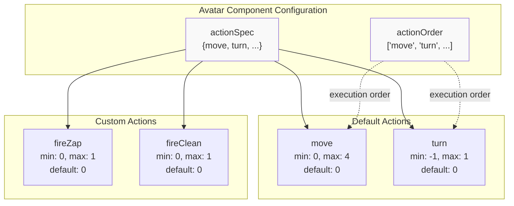
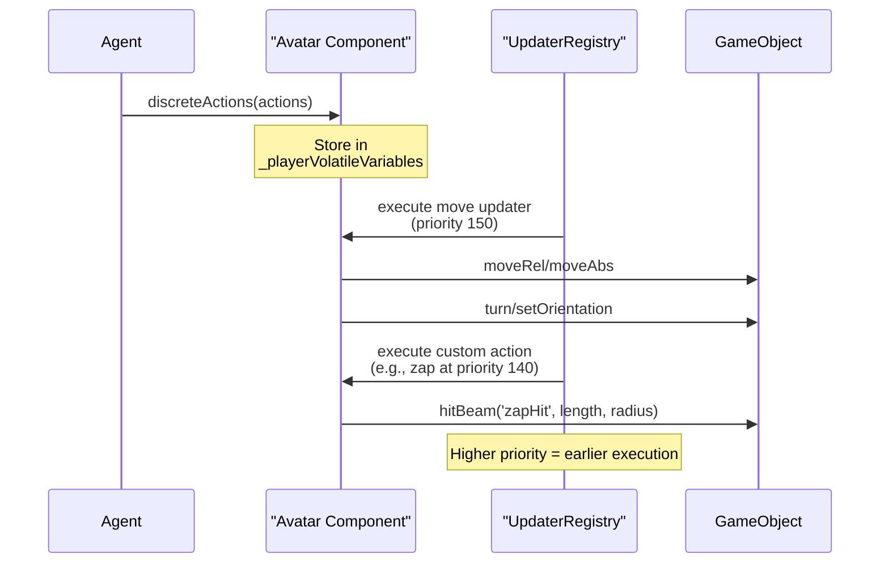
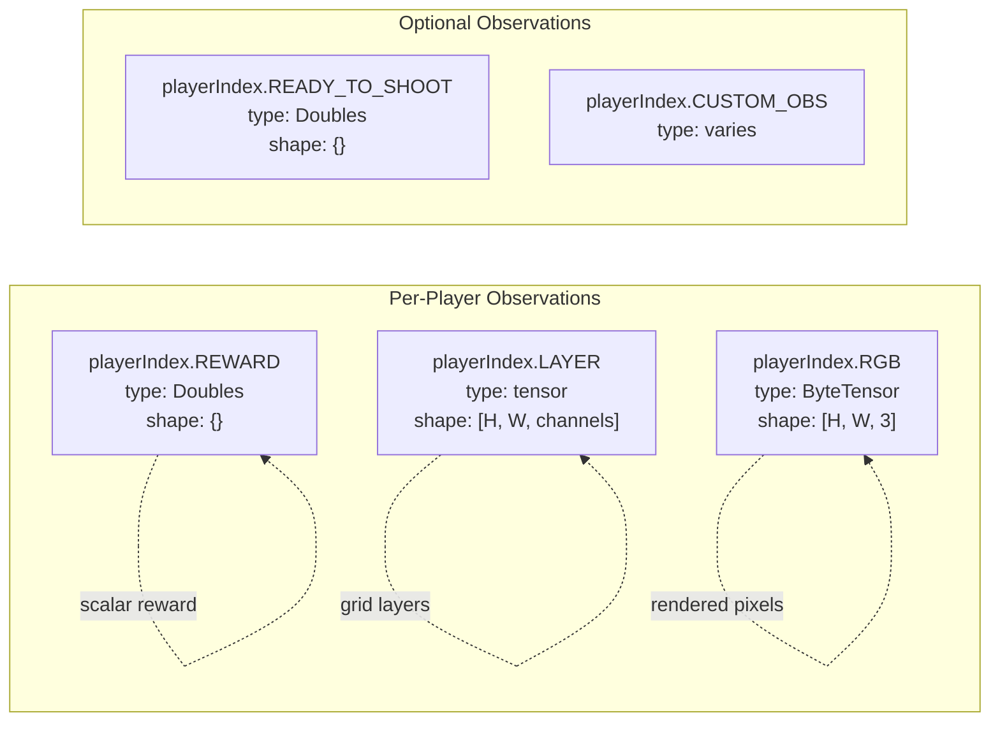
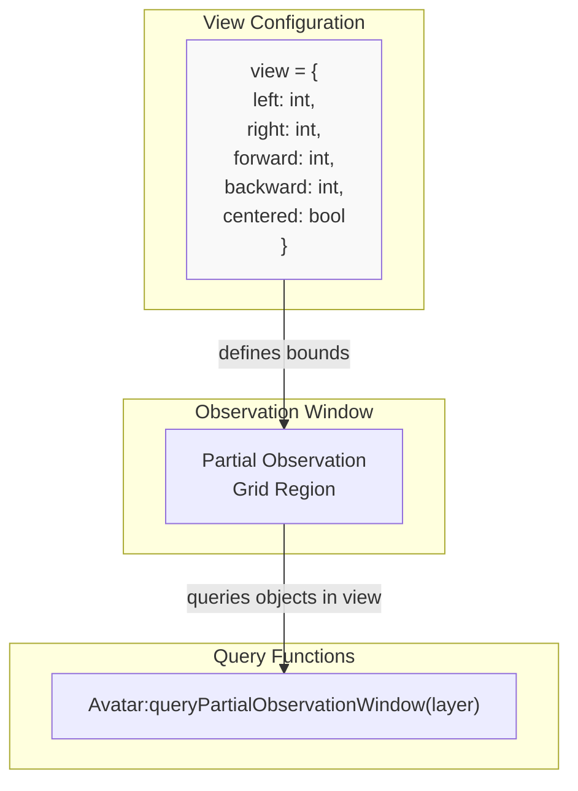
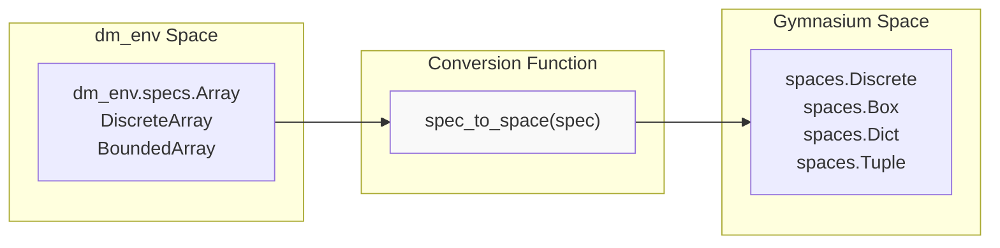
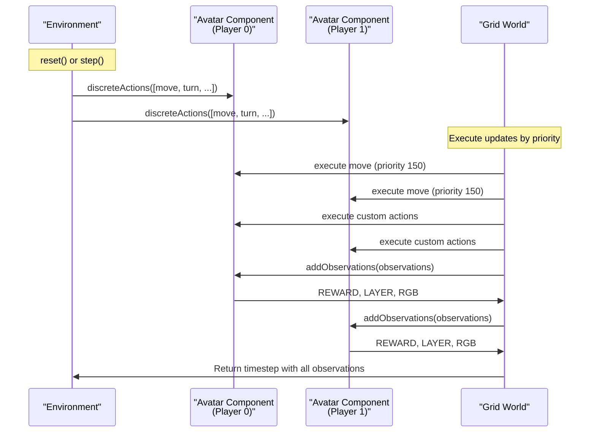

<!-- source: DeepWiki mcp.deepwiki.com · repo google-deepmind/meltingpot · page 3.4 Observations and Action Spaces · fetched 2026-10-26 -->

# Observations and Action Spaces

<details>
<summary>Relevant source files</summary>

The following files were used as context for generating this wiki page:

- [docs/concepts.md](docs/concepts.md)
- [examples/gym/__init__.py](examples/gym/__init__.py)
- [examples/gym/utils.py](examples/gym/utils.py)
- [examples/rllib/__init__.py](examples/rllib/__init__.py)
- [examples/rllib/self_play_train_test.py](examples/rllib/self_play_train_test.py)
- [examples/rllib/utils_test.py](examples/rllib/utils_test.py)
- [meltingpot/lua/levels/clean_up/components.lua](meltingpot/lua/levels/clean_up/components.lua)
- [meltingpot/lua/modules/avatar_library.lua](meltingpot/lua/modules/avatar_library.lua)
- [meltingpot/lua/modules/component.lua](meltingpot/lua/modules/component.lua)

</details>


## Purpose and Scope

This document explains the observation and action spaces used in Melting Pot substrates. It covers how actions are specified and executed, the different types of observations available to agents (RGB, layered, reward, and custom), and how partial observability is implemented. For information on configuring substrates and scenarios that use these observations and actions, see [Substrates and Scenarios](#3.1). For details on the component architecture that implements these systems, see [GameObject and Component System](#3.3).

## Action Spaces

### Action Specification Format

Actions in Melting Pot are discrete and defined per-player through the `Avatar` component. Each action has a name, minimum value, maximum value, and default value.



**Sources:** [meltingpot/lua/modules/avatar_library.lua:68-72](), [meltingpot/lua/modules/avatar_library.lua:103-104]()

### Default Action Set

The `Avatar` component provides two default actions:

| Action | Type | Range | Default | Description |
|--------|------|-------|---------|-------------|
| `move` | Discrete | 0-4 | 0 | Movement direction (0=no-op, 1-4=cardinal directions) |
| `turn` | Discrete | -1 to 1 | 0 | Rotation (-1=counter-clockwise, 0=no-op, 1=clockwise) |

Movement can use either **relative coordinates** (default) or **absolute coordinates** (when `useAbsoluteCoordinates=true`):

- **Relative mode**: Actions move/turn relative to the avatar's current orientation using `moveRel` and `turn`
- **Absolute mode**: Actions specify cardinal directions (N/E/S/W) using `moveAbs` and `setOrientation`

**Sources:** [meltingpot/lua/modules/avatar_library.lua:68-72](), [meltingpot/lua/modules/avatar_library.lua:83-87](), [meltingpot/lua/modules/avatar_library.lua:156-203]()

### Custom Actions

Substrates can add custom actions by extending the `actionSpec`. Common examples include:

**Zapper Actions:**
```lua
actionSpec = {
    move = {default = 0, min = 0, max = #_COMPASS},
    turn = {default = 0, min = -1, max = 1},
    fireZap = {default = 0, min = 0, max = 1},  -- Binary action
}
```

**Cleaner Actions (Clean Up substrate):**
```lua
actionSpec = {
    move = {default = 0, min = 0, max = #_COMPASS},
    turn = {default = 0, min = -1, max = 1},
    fireClean = {default = 0, min = 0, max = 1},  -- Binary action
}
```

**Sources:** [meltingpot/lua/modules/avatar_library.lua:567-682]() (Zapper), [meltingpot/lua/levels/clean_up/components.lua:168-233]() (Cleaner)

### Action Execution Pipeline



**Sources:** [meltingpot/lua/modules/avatar_library.lua:155-203](), [meltingpot/lua/modules/avatar_library.lua:218-223]()

### Action Speed and Probability

The `Avatar` component supports **stochastic movement** via a `speed` parameter (0.0 to 1.0). When speed < 1.0, movement actions execute probabilistically:

```lua
updaterRegistry:registerUpdater{
    updateFn = move,
    priority = 150,
    probability = self._speed,  -- e.g., 0.8 = 80% chance per frame
}
```

**Sources:** [meltingpot/lua/modules/avatar_library.lua:64-66](), [meltingpot/lua/modules/avatar_library.lua:190-202]()

## Observation Types

### Observation Structure

Each player receives multiple observations, all keyed by their player index. The `Avatar` component's `addObservations` method creates three standard observations:



**Sources:** [meltingpot/lua/modules/avatar_library.lua:225-277]()

### RGB Observations

RGB observations provide a rendered pixel view of the game world from the avatar's perspective:

- **Type:** `tensor.ByteTensor`
- **Shape:** `[height, width, 3]` where dimensions depend on view configuration
- **Content:** Pixel values (0-255) for RGB channels
- **Rendering:** Sprites are rendered onto the layered observation to produce the RGB image

The rendering pipeline:
1. Create layered observation from grid
2. Apply sprite mapping (if configured)
3. Render sprites using `tile.Scene` to produce RGB output

**Sources:** [meltingpot/lua/modules/avatar_library.lua:259-277]()

### Layered Observations

Layered observations provide the raw grid state as a multi-channel tensor:

- **Type:** Tensor
- **Shape:** `[height, width, num_layers]`
- **Content:** Integer values representing sprite IDs at each grid position
- **Purpose:** Structured representation of the game world without rendering

The observation window is determined by the `view` configuration with fields:
- `left`, `right`: Horizontal extent
- `forward`, `backward`: Vertical extent
- `centered`: Whether avatar is at center of view

**Sources:** [meltingpot/lua/modules/avatar_library.lua:247-257]()

### Reward Observations

Each timestep, players receive a scalar reward observation:

- **Type:** `Doubles`
- **Shape:** `{}` (scalar)
- **Key:** `"{playerIndex}.REWARD"`
- **Accumulated:** Rewards from all sources are summed per frame

Rewards can be added from multiple components using `Avatar:addReward(amount)`. The `skipWaitStateRewards` flag (default: true) prevents reward accumulation when avatars are in wait state.

**Sources:** [meltingpot/lua/modules/avatar_library.lua:238-245](), [meltingpot/lua/modules/avatar_library.lua:364-378]()

### Custom Observations

Components can add custom observations via the `addObservations` callback. For example, the `ReadyToShootObservation` component adds a cooldown indicator:

```lua
observations[#observations + 1] = {
    name = tostring(playerIndex) .. '.READY_TO_SHOOT',
    type = 'Doubles',
    shape = {},
    func = function(grid)
      return zapper:readyToShoot()  -- Returns 0.0 to 1.0
    end
}
```

**Sources:** [meltingpot/lua/modules/avatar_library.lua:853-881]()

## Partial Observability

### View Configuration

Partial observability is implemented through view window configuration. Each avatar observes only a local region around itself:



The view is always oriented relative to the avatar's facing direction (unless `orientation='N'` is specified in the observation function).

**Sources:** [meltingpot/lua/modules/avatar_library.lua:73-81](), [meltingpot/lua/modules/avatar_library.lua:508-526]()

### Sprite Mapping

Avatars can have different visual perspectives through **sprite mapping**, which remaps source sprites to target sprites in their view:

```lua
Avatar:setSpriteMap({
    originalSprite1 = newSprite1,
    originalSprite2 = newSprite2,
})
```

This allows implementing features like:
- Team-based coloring (allies vs enemies)
- Hidden information (showing different sprites to different players)
- Player-specific visual feedback

**Sources:** [meltingpot/lua/modules/avatar_library.lua:88-91](), [meltingpot/lua/modules/avatar_library.lua:143-153](), [meltingpot/lua/modules/avatar_library.lua:228-236]()

### Querying Partial Observation Window

The `Avatar` component provides a utility to query all objects within the visible window:

```lua
local foundObjects = avatar:queryPartialObservationWindow(layer)
```

This method:
1. Calculates the absolute grid coordinates of the observation window
2. Uses `Transform:queryRectangle` to find all objects on the specified layer
3. Returns an array of `GameObject`s

**Sources:** [meltingpot/lua/modules/avatar_library.lua:502-526]()

## Framework Integration

### dm_env Specification

Melting Pot natively uses the `dm_env` interface. Action and observation specs follow this structure:

**Action Spec:**
```python
# DiscreteArray for each action dimension
{
    'name': 'playerIndex.actionName',
    'min': min_value,
    'max': max_value,
}
```

**Observation Spec:**
```python
{
    'name': 'playerIndex.OBS_NAME',
    'type': 'tensor.ByteTensor' | 'Doubles' | ...,
    'shape': tuple,
}
```

**Sources:** [meltingpot/lua/modules/avatar_library.lua:205-216]()

### Gymnasium Conversion



The `spec_to_space` utility converts dm_env specs to Gymnasium spaces:

| dm_env Type | Gymnasium Type | Notes |
|-------------|---------------|-------|
| `DiscreteArray` | `spaces.Discrete` | Discrete action/observation |
| `BoundedArray` | `spaces.Box` | Continuous with bounds |
| `Array` (float) | `spaces.Box` | Unbounded continuous |
| `Array` (int) | `spaces.Box` | Integer range from dtype |
| `dict` | `spaces.Dict` | Nested structure |
| `list/tuple` | `spaces.Tuple` | Ordered structure |

**Sources:** [examples/gym/utils.py:45-74]()

### Observation Filtering

World observations (prefixed with `WORLD.`) are typically filtered out for individual agents:

```python
def timestep_to_observations(timestep: dm_env.TimeStep):
  gym_observations = {}
  for index, observation in enumerate(timestep.observation):
    gym_observations[f'player_{index}'] = {
        key: value
        for key, value in observation.items()
        if 'WORLD.' not in key  # Filter world observations
    }
  return gym_observations
```

**Sources:** [examples/gym/utils.py:27-35](), [examples/gym/utils.py:38-42]()

### RLLib Action Space Example

RLLib integration uses the converted action spaces:

```python
# Test from examples/rllib/utils_test.py
env_action_space = env.action_space['player_1']
# Expected: Discrete(n) where n = len(ACTION_SET)
```

For multi-agent scenarios, each agent gets its own action space keyed by player identifier (e.g., `'player_0'`, `'player_1'`, ...).

**Sources:** [examples/rllib/utils_test.py:38-42]()

## Action and Observation Coordination



**Sources:** [meltingpot/lua/modules/avatar_library.lua:155-203](), [meltingpot/lua/modules/avatar_library.lua:218-223](), [meltingpot/lua/modules/avatar_library.lua:225-277]()

---

