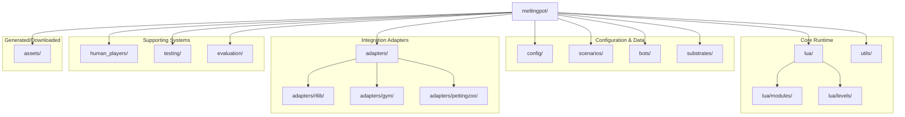
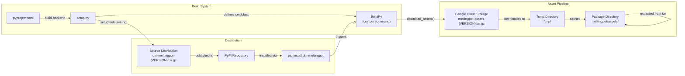
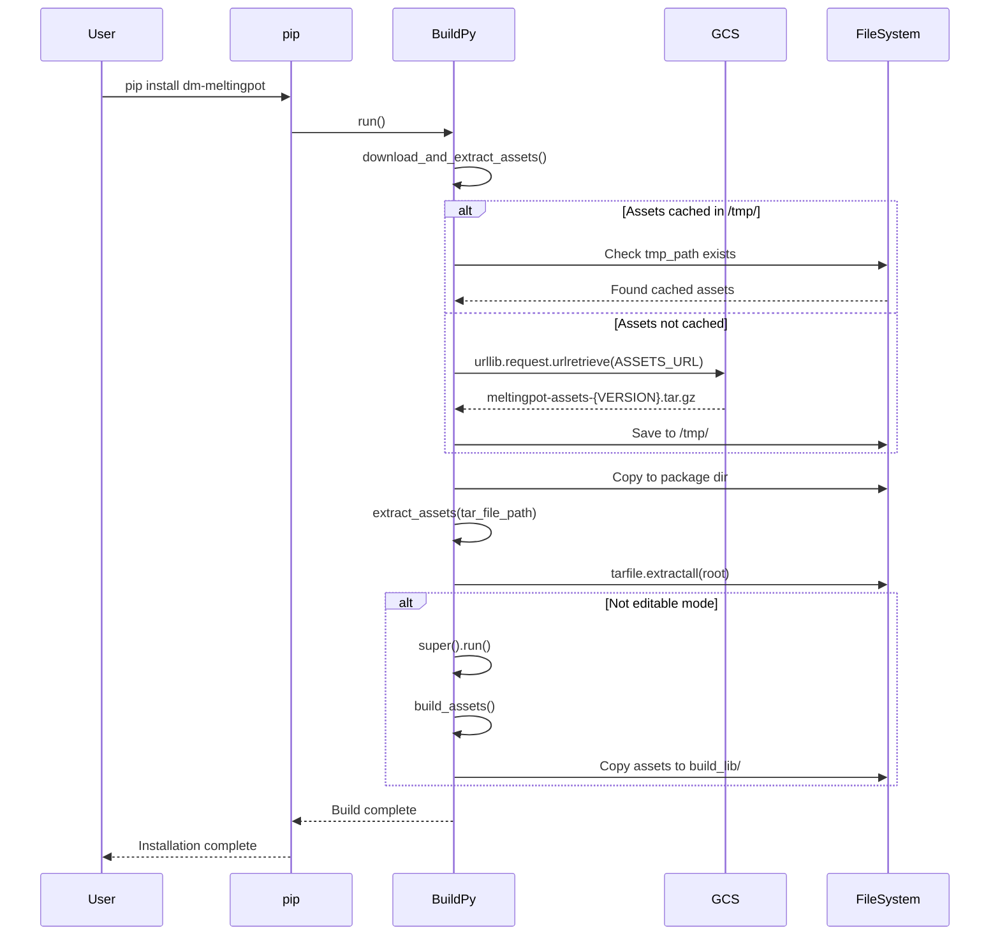
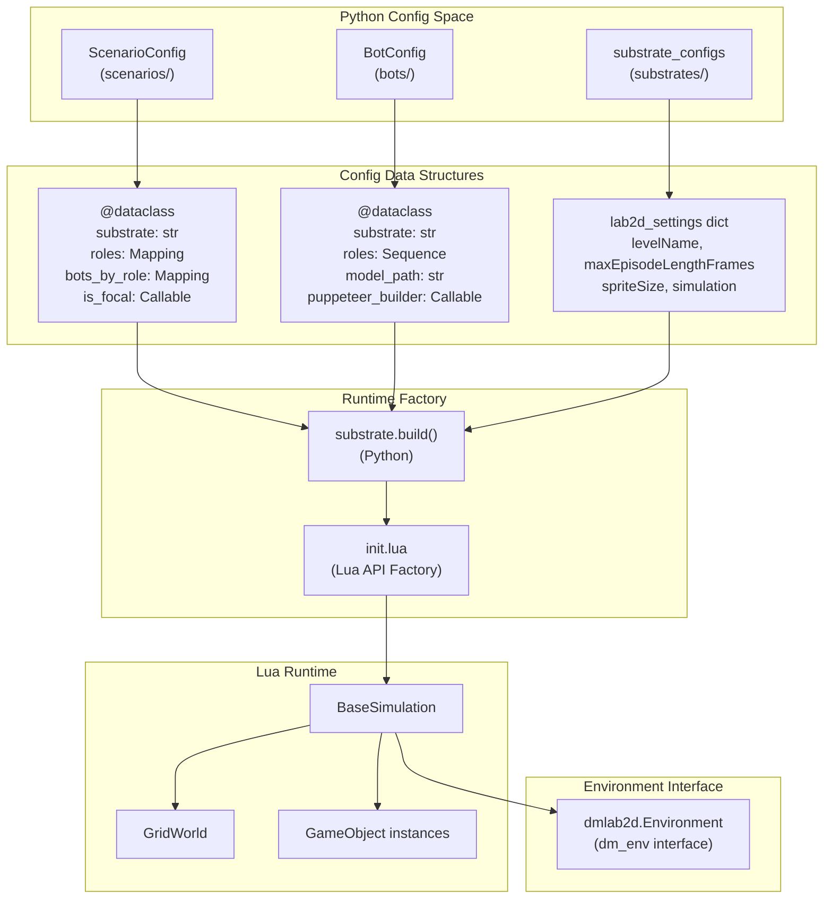
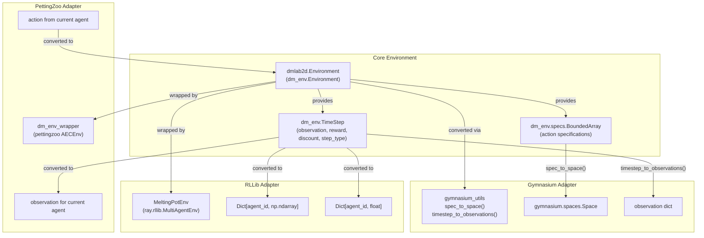

<!-- source: DeepWiki mcp.deepwiki.com · repo google-deepmind/meltingpot · page 4 Package Architecture · fetched 2026-10-26 -->

# Package Architecture

<details>
<summary>Relevant source files</summary>

The following files were used as context for generating this wiki page:

- [.gitignore](.gitignore)
- [CHANGELOG.md](CHANGELOG.md)
- [examples/tutorial/harvest/play_harvest.py](examples/tutorial/harvest/play_harvest.py)
- [notebooks/evaluation_results.ipynb](notebooks/evaluation_results.ipynb)
- [pyproject.toml](pyproject.toml)
- [setup.py](setup.py)

</details>


## Purpose and Scope

This document describes the high-level architecture of the Melting Pot package, including its module organization, distribution system, and how the major subsystems interact. It focuses on the structural organization of the codebase and the build/distribution pipeline.

For detailed information about specific subsystems, see:
- [Python Configuration Layer](#4.1) - configuration files and data structures
- [Lua Simulation Engine](#4.2) - the core game engine implementation
- [Component Library](#4.3) - individual component implementations
- [Asset Management](#4.4) - asset downloading and versioning details

## Overview

Melting Pot is organized as a multi-layered system where Python code provides configuration and integration adapters, while Lua code implements the core simulation engine. The package is distributed via PyPI with assets hosted separately on Google Cloud Storage.

**Key Architectural Principles:**
- **Separation of concerns**: Configuration (Python), simulation (Lua), integration (Python adapters)
- **Split versioning**: Code and assets are versioned independently
- **Modular design**: Component-based architecture for game objects
- **Multi-framework support**: Adapters for RLLib, Gymnasium, and PettingZoo

## Package Module Organization

The Melting Pot package follows a hierarchical structure organized by functionality:



**Module Responsibilities:**

| Module | Purpose | Key Contents |
|--------|---------|--------------|
| `config/` | Base configuration data structures | `ScenarioConfig`, `BotConfig`, substrate settings |
| `scenarios/` | Scenario definitions | Registry of 256+ scenario configurations |
| `bots/` | Bot implementations | Puppeteers, policies, bot configurations |
| `substrates/` | Substrate definitions | 50+ substrate configurations and factories |
| `lua/` | Simulation engine | BaseSimulation, GameObject system, components |
| `lua/modules/` | Lua utilities | Helper modules for game logic |
| `lua/levels/` | Level-specific Lua code | Per-substrate initialization and logic |
| `utils/` | Python utilities | Helpers for sprites, colors, maps, observations |
| `adapters/` | Framework integrations | RLLib, Gymnasium, PettingZoo wrappers |
| `human_players/` | Interactive play | Pygame-based human player interface |
| `testing/` | Test utilities | Mocks, fixtures, test helpers |
| `evaluation/` | Evaluation tools | Performance analysis and scoring |
| `assets/` | Game assets | Sprites, maps, prefabs (downloaded at install) |

Sources: [setup.py:132-138](), directory structure inferred from import patterns

## Distribution Architecture

Melting Pot uses a custom build process to handle the split between code and assets:



**Version Management:**

The package uses split versioning as defined in `setup.py`:

```python
VERSION = '2.4.0'        # Code version
ASSETS_VERSION = '2.3.0' # Asset version
```

This allows assets to remain stable while code evolves, reducing download overhead during development iterations.

Sources: [setup.py:25-26](), [setup.py:44-100]()

## Build Process Flow

The custom `BuildPy` command orchestrates the build process:



**Key Methods:**

- [`BuildPy.download_and_extract_assets()`](setup.py:53-65) - Main orchestration method
- [`BuildPy.download_assets()`](setup.py:67-76) - Downloads tar from GCS with caching
- [`BuildPy.extract_assets()`](setup.py:78-87) - Extracts tar to `meltingpot/assets/`
- [`BuildPy.build_assets()`](setup.py:89-99) - Copies assets to build directory

Sources: [setup.py:44-100]()

## Configuration-to-Runtime Pipeline

The system transforms Python configurations into runtime Lua simulations:



**Configuration Loading Process:**

1. **Configuration registration**: Configs are registered in module-level dictionaries (`SCENARIO_CONFIGS`, `BOT_CONFIGS`, `SUBSTRATE_CONFIGS`)
2. **Substrate factory**: `substrate.build(roles=...)` creates a configured environment
3. **Lua initialization**: `init.lua` receives Python configs via dmlab2d API
4. **Simulation setup**: `BaseSimulation` instantiates GameObjects from prefabs
5. **Environment interface**: dmlab2d.Environment exposes dm_env API to Python

Sources: Configuration system inferred from high-level architecture diagrams

## Integration Adapter Architecture

Melting Pot provides adapters to three major RL frameworks:



**Adapter Responsibilities:**

| Adapter | Module | Key Transformations |
|---------|--------|---------------------|
| RLLib | `adapters/rllib/` | dm_env → MultiAgentEnv, single timestep → per-agent dicts |
| Gymnasium | `adapters/gym/` | dm_env.specs → gym.spaces, observations → gym format |
| PettingZoo | `adapters/pettingzoo/` | dm_env → AECEnv, parallel → sequential agent turns |

**Common Pattern**: All adapters handle the impedance mismatch between dm_env's unified timestep interface and framework-specific APIs that expect per-agent observations, actions, and rewards.

Sources: Integration architecture from high-level diagrams

## Dependency Management

The package declares dependencies in two locations:

**Build Configuration** ([pyproject.toml](pyproject.toml:1-3)):
```toml
[build-system]
requires = ["setuptools>=42"]
build-backend = "setuptools.build_meta"
```

**Runtime Dependencies** ([setup.py:140-155]()):
```python
install_requires=[
    'absl-py',
    'chex',
    'dm-env',         # DeepMind environment API
    'dmlab2d',        # Core Lua game engine
    'dm-tree',
    'immutabledict',
    'ml-collections',
    'networkx',
    'numpy',
    'opencv-python',
    'pandas',
    'pygame',         # Human player interface
    'reactivex',      # Observable pattern for events
    'tensorflow',     # Neural network inference
]
```

**Development Dependencies** ([setup.py:156-169]()):
```python
extras_require={
    'dev': [
        'build',         # Package building
        'isort',         # Import sorting
        'pipreqs',       # Requirements generation
        'pip-tools',     # Dependency compilation
        'pyink',         # Code formatting
        'pylint',        # Linting
        'pytest-xdist',  # Parallel testing
        'pytype',        # Type checking
        'twine',         # PyPI publishing
    ],
}
```

**Tool Configuration** ([pyproject.toml:5-38]()):

The package configures development tools in `pyproject.toml`:
- `isort`: Import statement organization
- `pyink`: Code formatting (Google style with 2-space indentation)
- `pytest`: Test discovery and parallel execution
- `pytype`: Static type analysis

Sources: [setup.py:140-169](), [pyproject.toml:1-38]()

## Package Data and Inclusion Rules

The package includes specific non-Python files:

**Included Files** ([setup.py:133-138]()):
```python
packages=setuptools.find_packages(include=['meltingpot', 'meltingpot.*'])
package_data={
    'meltingpot': [
        'lua/levels/*/*.lua',    # Per-substrate Lua implementations
        'lua/modules/*.lua',     # Shared Lua modules
    ],
}
```

**Excluded Files** ([.gitignore:13-30]()):
```
*.egg-info          # Build artifacts
.eggs/
/assets/            # Generated during installation
/build/
/dist/
/lab2d/             # dmlab2d build artifacts
.pytest_cache       # Test cache
.pytype             # Type checking cache
/examples/results/  # Training outputs
/meltingpot/assets/ # Downloaded assets
```

The `assets/` directory is deliberately excluded from version control because it's generated during installation via the custom `BuildPy` command.

Sources: [setup.py:132-138](), [.gitignore:13-30]()

## Summary

The Melting Pot package architecture achieves several design goals:

1. **Modularity**: Clear separation between configuration (Python), simulation (Lua), and integration (adapters)
2. **Efficiency**: Split versioning allows stable assets to be cached while code evolves
3. **Extensibility**: Component-based GameObject system enables easy addition of new behaviors
4. **Compatibility**: Framework adapters enable use with RLLib, Gymnasium, and PettingZoo
5. **Developer experience**: Comprehensive tooling for formatting, linting, type checking, and testing

The custom build process handles the complexity of downloading and extracting assets, while the standard setuptools infrastructure manages Python package distribution. This hybrid approach balances ease of installation with efficient asset management.

Sources: [setup.py:1-171](), [pyproject.toml:1-38](), [CHANGELOG.md:1-234]()

---

