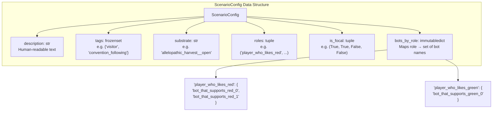
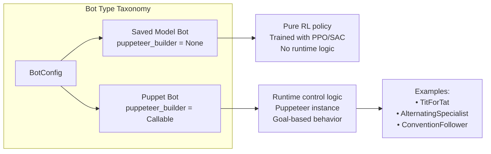
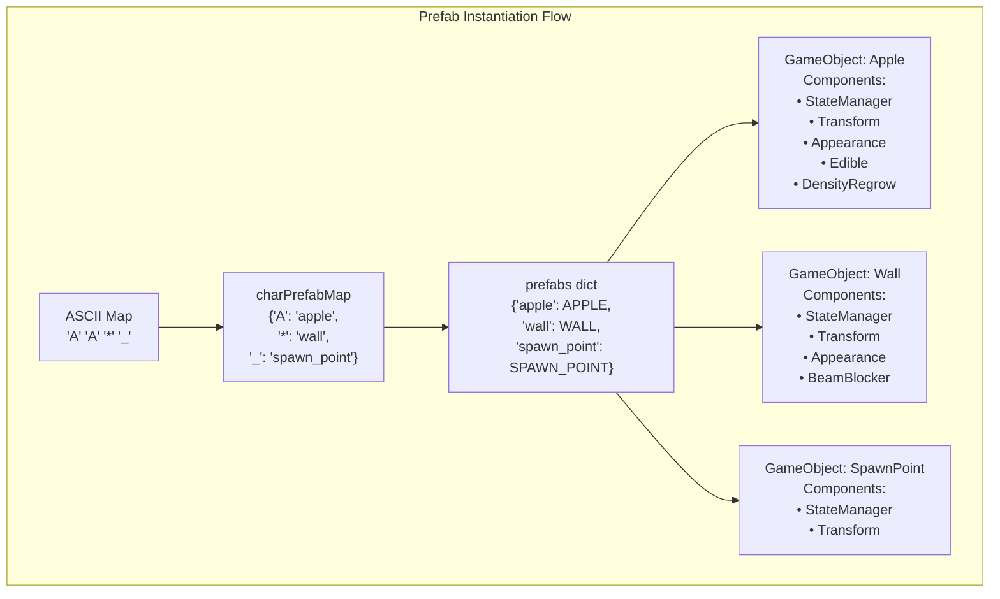
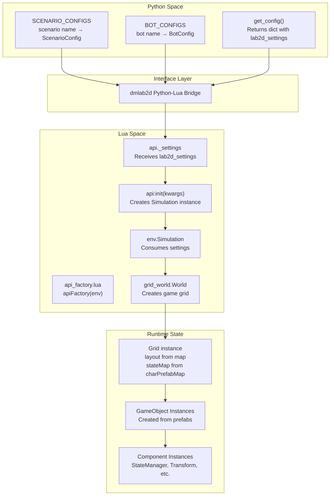
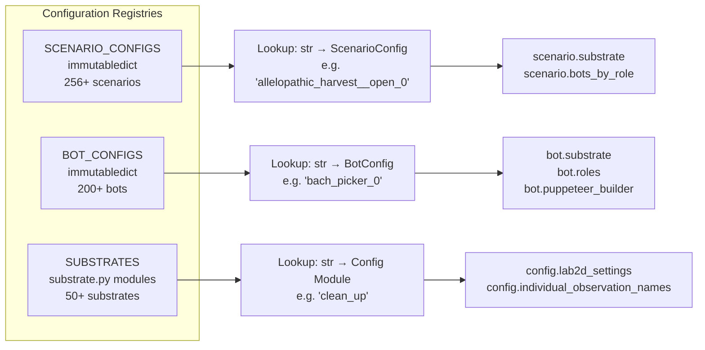

<!-- source: DeepWiki mcp.deepwiki.com · repo google-deepmind/meltingpot · page 4.1 Python Configuration Layer · fetched 2026-10-26 -->

# Python Configuration Layer

<details>
<summary>Relevant source files</summary>

The following files were used as context for generating this wiki page:

- [examples/tutorial/harvest/configs/environment/harvest.py](examples/tutorial/harvest/configs/environment/harvest.py)
- [examples/tutorial/harvest/configs/environment/harvest_finished.py](examples/tutorial/harvest/configs/environment/harvest_finished.py)
- [meltingpot/configs/bots/__init__.py](meltingpot/configs/bots/__init__.py)
- [meltingpot/configs/scenarios/__init__.py](meltingpot/configs/scenarios/__init__.py)
- [meltingpot/configs/scenarios/scenario_configs_test.py](meltingpot/configs/scenarios/scenario_configs_test.py)
- [meltingpot/lua/modules/api_factory.lua](meltingpot/lua/modules/api_factory.lua)

</details>


## Purpose and Scope

The Python Configuration Layer provides declarative configuration objects that define the complete setup of Melting Pot environments. This layer translates high-level specifications of scenarios, bots, and game environments into structured data consumed by the Lua simulation engine.

This page covers:
- **ScenarioConfig**: defines player roles, focal vs. bot assignments, and bot selection
- **BotConfig**: specifies bot models, puppeteers, and substrate compatibility
- **Substrate Configuration**: `lab2d_settings` dictionaries that define game environments via prefabs, maps, and simulation parameters

For information about the Lua simulation engine that consumes these configurations, see [Lua Simulation Engine](#4.2). For details on implementing custom components referenced in prefabs, see [Component Library](#4.3).

---

## Core Configuration Objects

### ScenarioConfig

The `ScenarioConfig` dataclass defines a specific test scenario within a substrate. Each scenario specifies the composition of players (focal agents vs. bots) and their assigned roles.

**Structure:**

| Field | Type | Description |
|-------|------|-------------|
| `description` | `str` | Human-readable scenario description |
| `tags` | `AbstractSet[str]` | Semantic tags (e.g., 'visitor', 'convention_following') |
| `substrate` | `str` | Name of the substrate this scenario uses |
| `roles` | `Sequence[str]` | Role assignment for each player slot |
| `is_focal` | `Sequence[bool]` | Whether each slot is filled by focal agent (True) or bot (False) |
| `bots_by_role` | `Mapping[str, AbstractSet[str]]` | Bot names to sample from for each role |

**Immutability Enforcement:**

The `__post_init__` method converts mutable collections to immutable equivalents using `frozenset`, `tuple`, and `immutabledict` to ensure configuration objects cannot be modified after creation.

Sources: [meltingpot/configs/scenarios/__init__.py:23-52]()



Sources: [meltingpot/configs/scenarios/__init__.py:23-52]()

**Example Configuration:**

```python
allelopathic_harvest__open_0=ScenarioConfig(
    description='visiting a population where planting green berries is the prevailing convention',
    tags={'visitor', 'convention_following'},
    substrate='allelopathic_harvest__open',
    roles=['player_who_likes_red',] * 8 + ['player_who_likes_green',] * 8,
    is_focal=(True,) * 4 + (False,) * 12,
    bots_by_role={
        'player_who_likes_red': {
            'allelopathic_harvest__open__bot_that_supports_green_0',
            'allelopathic_harvest__open__bot_that_supports_green_1',
        },
        'player_who_likes_green': {
            'allelopathic_harvest__open__bot_that_supports_green_0',
            'allelopathic_harvest__open__bot_that_supports_green_1',
        },
    },
)
```

This scenario has 16 total players: 4 focal agents and 12 bots. All players are split evenly between two roles. Bots are sampled from the specified sets for each role.

Sources: [meltingpot/configs/scenarios/__init__.py:57-83]()

### BotConfig

The `BotConfig` dataclass specifies a bot that can fill background player slots in scenarios. Bots come in two varieties: **saved model bots** (pure RL policies) and **puppet bots** (controlled by puppeteer logic).

**Structure:**

| Field | Type | Description |
|-------|------|-------------|
| `substrate` | `str` | Substrate the bot was trained for |
| `roles` | `AbstractSet[str]` | Roles the bot can play |
| `model_path` | `str` | Path to saved model weights |
| `puppeteer_builder` | `Optional[Callable]` | Factory function returning a `Puppeteer` instance, or `None` for pure RL bots |

Sources: [meltingpot/configs/bots/__init__.py:445-463]()



Sources: [meltingpot/configs/bots/__init__.py:445-507]()

**Factory Functions:**

```python
# Saved model bot - pure RL policy
saved_model(
    substrate='allelopathic_harvest__open',
    model='bot_that_loves_green_0',
    roles=('default', 'player_who_likes_red', 'player_who_likes_green')
)

# Puppet bot - controlled by puppeteer logic
puppet(
    substrate='bach_or_stravinsky_in_the_matrix__arena',
    model='puppet_0',
    roles=('default', 'bach_fan', 'stravinsky_fan'),
    puppeteer_builder=functools.partial(
        in_the_matrix.Specialist,
        target=RESOURCES['bach_or_stravinsky_in_the_matrix__arena']['BACH'],
        margin=3
    )
)
```

Sources: [meltingpot/configs/bots/__init__.py:465-507]()

### Substrate Configuration

Substrate configurations are defined as Python dictionaries returned by `get_config()` functions. The primary configuration key is `lab2d_settings`, which contains all parameters needed by the Lua simulation engine.

**Core Structure:**

| Key | Type | Description |
|-----|------|-------------|
| `individual_observation_names` | `list[str]` | Observations returned to each agent |
| `global_observation_names` | `list[str]` | Global observations (e.g., `"WORLD.RGB"`) |
| `lab2d_settings` | `dict` | Lua simulation configuration |

**lab2d_settings Structure:**

| Key | Type | Description |
|-----|------|-------------|
| `levelName` | `str` | Unique identifier for the substrate |
| `levelDirectory` | `str` | Path to Lua implementation files |
| `maxEpisodeLengthFrames` | `int` | Episode length limit |
| `numPlayers` | `int` | Number of players |
| `spriteSize` | `int` | Sprite dimensions in pixels |
| `simulation` | `dict` | Contains `map`, `prefabs`, `charPrefabMap` |

Sources: [examples/tutorial/harvest/configs/environment/harvest_finished.py:176-227]()

---

## Prefab System

Prefabs are GameObject templates that define the components and initial configuration of entities in the simulation. Each prefab specifies a list of components with their initialization parameters.



Sources: [examples/tutorial/harvest/configs/environment/harvest_finished.py:176-227]()

**Example Prefab Definition:**

```python
APPLE = {
    "name": "apple",
    "components": [
        {
            "component": "StateManager",
            "kwargs": {
                "initialState": "apple",
                "stateConfigs": [
                    {
                        "state": "apple",
                        "layer": "lowerPhysical",
                        "sprite": "Apple",
                    },
                    {
                        "state": "appleWait",
                    }
                ],
            }
        },
        {
            "component": "Transform",
        },
        {
            "component": "Appearance",
            "kwargs": {
                "renderMode": "ascii_shape",
                "spriteNames": ["Apple"],
                "spriteShapes": [shapes.LEGACY_APPLE],
                "palettes": [shapes.GREEN_COIN_PALETTE],
                "noRotates": [True],
            }
        },
        {
            "component": "Edible",
            "kwargs": {
                "liveState": "apple",
                "waitState": "appleWait",
                "rewardForEating": 1.0,
            }
        },
        {
            "component": "DensityRegrow",
            "kwargs": {
                "liveState": "apple",
                "waitState": "appleWait",
                "baseRate": 0.01,
            }
        },
    ]
}
```

Sources: [examples/tutorial/harvest/configs/environment/harvest_finished.py:127-173]()

**Prefab Component Structure:**

Each component entry in the `components` list has:
- `component`: Component class name (string)
- `kwargs`: Dictionary of initialization parameters (optional)

**Common Components:**

| Component | Required | Purpose |
|-----------|----------|---------|
| `StateManager` | Yes | Manages entity state transitions |
| `Transform` | Yes | Provides position and orientation |
| `Appearance` | Often | Defines visual rendering |
| `Avatar` | For players | Enables agent control |
| `Edible` | For consumables | Provides eating mechanics |
| `DensityRegrow` | For resources | Controls respawn logic |
| `BeamBlocker` | For walls | Blocks beams (zap, gift) |

Sources: [examples/tutorial/harvest/configs/environment/harvest_finished.py:19-173]()

---

## Puppet Goals and Resources

For puppet bots, the configuration layer defines **puppet goals** and **resources** that puppeteers use to control bot behavior.

### Puppet Goals

Puppet goals are immutable dictionaries mapping goal names to integer indices. The order must match the order used during bot training.

```python
_PUPPET_GOALS = immutabledict.immutabledict(
    allelopathic_harvest__open=puppeteer.puppet_goals([
        'CONSUME_ANY',
        'PREFER_RED',
        'PREFER_GREEN',
        'FREERIDE_RED',
        'FREERIDE_GREEN',
        'ZAP_OTHERS',
    ]),
    bach_or_stravinsky_in_the_matrix__arena=puppeteer.puppet_goals([
        'COLLECT_BACH',
        'COLLECT_STRAVINSKY',
        'INTERACT_PLAYING_BACH',
        'INTERACT_PLAYING_STRAVINSKY',
    ]),
)
```

Sources: [meltingpot/configs/bots/__init__.py:44-221]()

### Resources

Resources represent game objects that puppeteers can target. Each resource has an index and associated collect/interact goals.

```python
_RESOURCES = immutabledict.immutabledict(
    bach_or_stravinsky_in_the_matrix__arena=immutabledict.immutabledict({
        'BACH': in_the_matrix.Resource(
            index=0,
            collect_goal=_PUPPET_GOALS['bach_or_stravinsky_in_the_matrix__arena']['COLLECT_BACH'],
            interact_goal=_PUPPET_GOALS['bach_or_stravinsky_in_the_matrix__arena']['INTERACT_PLAYING_BACH'],
        ),
        'STRAVINSKY': in_the_matrix.Resource(
            index=1,
            collect_goal=_PUPPET_GOALS['bach_or_stravinsky_in_the_matrix__arena']['COLLECT_STRAVINSKY'],
            interact_goal=_PUPPET_GOALS['bach_or_stravinsky_in_the_matrix__arena']['INTERACT_PLAYING_STRAVINSKY'],
        ),
    }),
)
```

Sources: [meltingpot/configs/bots/__init__.py:224-442]()

**Puppeteer Integration:**

Puppeteers use goals and resources to dynamically control bot behavior:

```python
# Specialist puppeteer - always targets one resource
puppeteer_builder=functools.partial(
    in_the_matrix.Specialist,
    target=_RESOURCES['bach_or_stravinsky_in_the_matrix__arena']['BACH'],
    margin=3
)

# TitForTat puppeteer - reciprocal behavior
puppeteer_builder=functools.partial(
    in_the_matrix.TitForTat,
    cooperate_resource=_RESOURCES['bach_or_stravinsky_in_the_matrix__repeated']['BACH'],
    defect_resource=_RESOURCES['bach_or_stravinsky_in_the_matrix__repeated']['STRAVINSKY'],
    tremble_probability=0.25,
    margin=5
)
```

Sources: [meltingpot/configs/bots/__init__.py:573-687]()

---

## Configuration Data Flow

The configuration layer bridges Python and Lua through a structured data flow that transforms declarative configurations into runtime simulation state.



Sources: [meltingpot/lua/modules/api_factory.lua:26-117](), [examples/tutorial/harvest/configs/environment/harvest_finished.py:176-227]()

### Initialization Sequence

**Step 1: Python Configuration Assembly**

```python
# Substrate config
config = get_config()  # Returns dict with lab2d_settings

# Scenario selection
scenario = SCENARIO_CONFIGS['allelopathic_harvest__open_0']

# Bot instantiation based on scenario
bots = [BOT_CONFIGS[bot_name] for bot_name in scenario.bots_by_role['role_name']]
```

**Step 2: Lua API Initialization**

The `api_factory.lua` receives configurations and creates the simulation environment:

```lua
function api:init(kwargs)
  read_settings.apply(kwargs, self._settings)  -- Merge lab2d_settings
  random:seed(self._settings.env_seed)
  
  self.simulation = env.Simulation{
    numPlayers = self._settings.numPlayers,
    settings = self._settings.simulation,  -- Contains map, prefabs, charPrefabMap
  }
  
  local worldConfig = self.simulation:worldConfig()
  self._world = grid_world.World(worldConfig)
end
```

Sources: [meltingpot/lua/modules/api_factory.lua:53-67]()

**Step 3: Grid Creation from Map**

```lua
function api:start(episode, seed)
  random:seed(seed)
  local stateCallbacks = {}
  self.simulation:stateCallbacks(stateCallbacks)
  local textMap = self.simulation:textMap()
  
  self._grid = self._world:createGrid{
    layout = textMap.layout,              -- ASCII map
    stateMap = textMap.stateMap,          -- charPrefabMap mappings
    stateCallbacks = stateCallbacks,
    topology = grid_world.TOPOLOGY[self._settings.topology],
  }
  
  self.simulation:start(self._grid)
  self._grid:update(random)
end
```

Sources: [meltingpot/lua/modules/api_factory.lua:85-102]()

---

## Configuration Registry

The configuration layer maintains three primary registries as immutable dictionaries:



Sources: [meltingpot/configs/scenarios/__init__.py:55](), [meltingpot/configs/bots/__init__.py:509]()

---

## Validation and Testing

The configuration layer includes comprehensive validation to ensure consistency across scenarios, bots, and substrates.

**Validation Tests:**

| Test | Purpose | Source |
|------|---------|--------|
| `test_has_description` | Every scenario has non-empty description | [scenario_configs_test.py:40-41]() |
| `test_has_tags` | Every scenario has semantic tags | [scenario_configs_test.py:43-45]() |
| `test_has_valid_substrate` | Substrate exists in `SUBSTRATES` | [scenario_configs_test.py:47-49]() |
| `test_name_starts_with_substrate_name` | Naming convention enforcement | [scenario_configs_test.py:51-54]() |
| `test_has_focal_players` | At least one focal player per scenario | [scenario_configs_test.py:56-58]() |
| `test_has_matching_sizes` | `roles` and `is_focal` same length | [scenario_configs_test.py:60-62]() |
| `test_has_valid_roles` | Roles match substrate's `valid_roles` | [scenario_configs_test.py:64-67]() |
| `test_has_valid_bots` | All bots exist in `BOT_CONFIGS` | [scenario_configs_test.py:69-72]() |
| `test_bots_compatible` | Bot substrate/roles match scenario | [scenario_configs_test.py:74-85]() |
| `test_no_missing_role_assigments` | All background roles have bot assignments | [scenario_configs_test.py:87-96]() |
| `test_no_unused_role_assignments` | No bot assignments for non-existent roles | [scenario_configs_test.py:98-104]() |

Sources: [meltingpot/configs/scenarios/scenario_configs_test.py:37-105]()

**Compatibility Check:**

```python
def _is_compatible(bot_name, substrate, role):
  if bot_name == bot_factory.NOOP_BOT_NAME:
    return True
  bot_config = bots.BOT_CONFIGS[bot_name]
  return substrate == bot_config.substrate and role in bot_config.roles
```

This ensures bots are only used in scenarios for substrates they were trained on, with roles they support.

Sources: [meltingpot/configs/scenarios/scenario_configs_test.py:30-34]()

---

## Summary

The Python Configuration Layer provides:

1. **Declarative Configuration Objects**: `ScenarioConfig`, `BotConfig`, and substrate dictionaries define all aspects of environments
2. **Immutable Data Structures**: All configurations use `frozenset`, `tuple`, and `immutabledict` to prevent modification
3. **Prefab System**: GameObject templates specify component composition and initialization
4. **Puppet Control**: Goals and resources enable dynamic bot behavior via puppeteers
5. **Validation Framework**: Comprehensive tests ensure consistency across 256+ scenarios, 200+ bots, and 50+ substrates
6. **Clean Interface to Lua**: Structured data flows through `dmlab2d` to the simulation engine

This layer enables researchers to configure complex multi-agent scenarios without writing Lua code, while maintaining the flexibility to create custom substrates with full component-based control.

---

