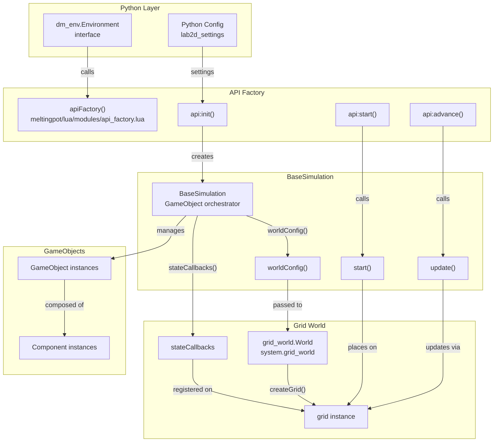
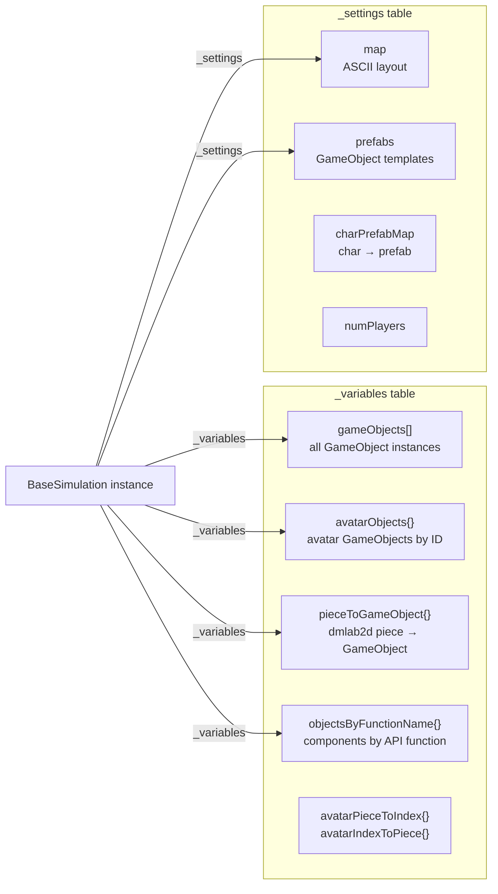
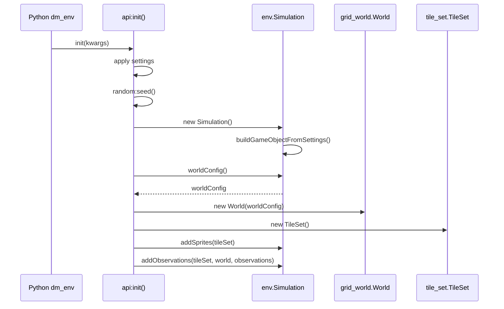
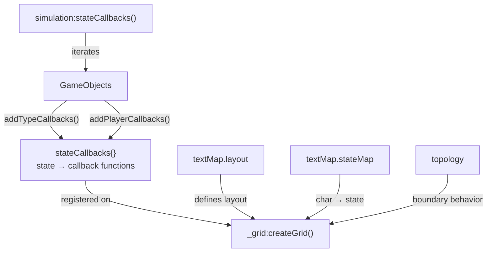
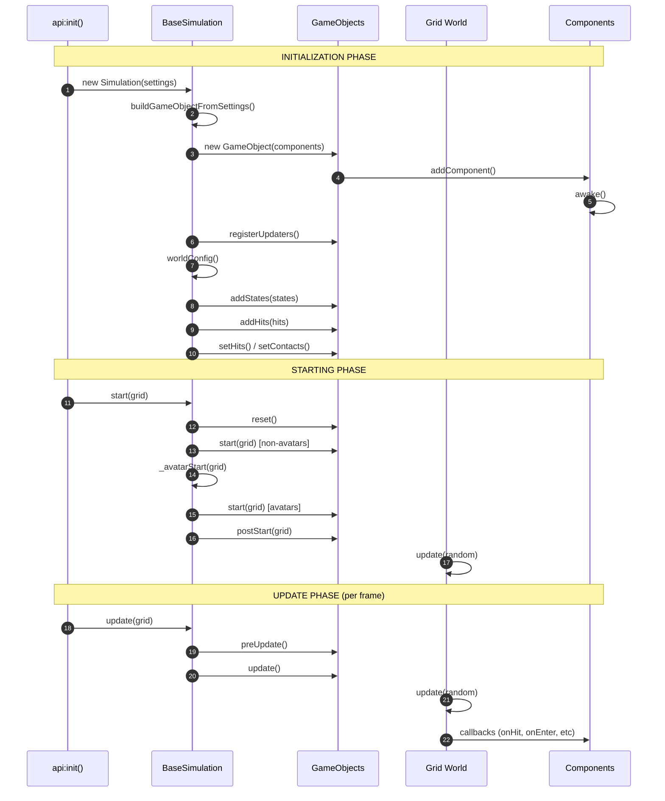
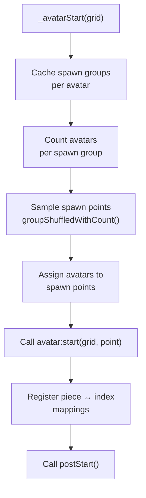

<!-- source: DeepWiki mcp.deepwiki.com · repo google-deepmind/meltingpot · page 4.2 Lua Simulation Engine · fetched 2026-10-26 -->

# Lua Simulation Engine

<details>
<summary>Relevant source files</summary>

The following files were used as context for generating this wiki page:

- [examples/tutorial/harvest/configs/environment/harvest.py](examples/tutorial/harvest/configs/environment/harvest.py)
- [examples/tutorial/harvest/configs/environment/harvest_finished.py](examples/tutorial/harvest/configs/environment/harvest_finished.py)
- [meltingpot/lua/modules/api_factory.lua](meltingpot/lua/modules/api_factory.lua)
- [meltingpot/lua/modules/base_simulation.lua](meltingpot/lua/modules/base_simulation.lua)
- [meltingpot/lua/modules/game_object.lua](meltingpot/lua/modules/game_object.lua)

</details>


## Purpose and Scope

The Lua Simulation Engine is the runtime component that executes game logic in Melting Pot. It manages the game state, orchestrates GameObject interactions, handles the spatial grid, and provides the interface between Python configuration and runtime execution. This page covers `BaseSimulation`, the API Factory, grid world integration, and the simulation lifecycle.

For information about the Python configuration that drives this engine, see [Python Configuration Layer](#4.1). For details on the component architecture that provides game logic, see [Component Library](#4.3). For the GameObject and Component system concepts, see [GameObject and Component System](#3.3).

**Sources:** [meltingpot/lua/modules/base_simulation.lua:1-624](), [meltingpot/lua/modules/api_factory.lua:1-118]()

## Architecture Overview

The Lua Simulation Engine consists of three primary subsystems: the API Factory (Python-Lua bridge), BaseSimulation (GameObject orchestrator), and the Grid World (spatial manager).



**Sources:** [meltingpot/lua/modules/api_factory.lua:26-115](), [meltingpot/lua/modules/base_simulation.lua:47-148]()

## BaseSimulation Class

`BaseSimulation` is the central orchestrator that manages all GameObjects and coordinates the simulation lifecycle. It maintains registries of GameObjects, tracks avatar-specific objects, and provides methods for querying and manipulating the game state.

### Core Responsibilities

| Responsibility | Description | Key Methods |
|---|---|---|
| GameObject Registry | Maintains all GameObjects in the simulation | `buildGameObjectFromSettings()`, `getAllGameObjects()` |
| Avatar Management | Tracks player-controlled avatars separately | `getAvatarGameObjects()`, `getAvatarFromIndex()` |
| Lifecycle Orchestration | Coordinates initialization, start, and update phases | `worldConfig()`, `start()`, `update()` |
| State Callbacks | Registers GameObject callbacks with grid world | `stateCallbacks()` |
| Updater Registry | Manages frame-based update callbacks | `_updaterRegistry` |
| Spatial Queries | Provides methods to query GameObjects by position/group | `getGroupRandom()`, `getGroupShuffled()` |

**Sources:** [meltingpot/lua/modules/base_simulation.lua:40-148]()

### Internal State

BaseSimulation maintains several critical internal tables:



**Sources:** [meltingpot/lua/modules/base_simulation.lua:83-101]()

The `_variables.objectsByFunctionName` table is particularly important - it indexes GameObjects by which component functions they implement, enabling efficient iteration during callbacks:

```lua
_COMPONENT_FUNCTIONS = {
    'awake', 'reset', 'start', 'postStart', 'preUpdate', 'update', 'onBlocked',
    'onEnter', 'onExit', 'onHit', 'onStateChange', 'registerUpdaters',
    'addHits', 'addSprites', 'addCustomSprites', 'addObservations',
    'addPlayerCallbacks'}
```

**Sources:** [meltingpot/lua/modules/base_simulation.lua:34-38](), [meltingpot/lua/modules/base_simulation.lua:97-100]()

## API Factory

The API Factory (`apiFactory`) creates the bridge between Python's `dm_env` interface and the Lua simulation runtime. It receives configuration from Python, instantiates the simulation, and translates environment API calls into simulation operations.

### Initialization Flow



**Sources:** [meltingpot/lua/modules/api_factory.lua:53-67]()

### API Settings and Methods

The API Factory maintains settings that control simulation behavior:

| Setting | Default | Description |
|---|---|---|
| `env_seed` | 1 | Random seed for environment |
| `numPlayers` | 1 | Number of player avatars |
| `spriteSize` | 16 | Pixel size of sprites |
| `maxEpisodeLengthFrames` | 3600 | Maximum episode length |
| `topology` | 'BOUNDED' | Grid world boundary behavior |

**Sources:** [meltingpot/lua/modules/api_factory.lua:37-44]()

Key API methods exposed to Python:

| Method | Purpose | Returns |
|---|---|---|
| `api:init(kwargs)` | Initialize simulation with settings | - |
| `api:start(episode, seed)` | Start new episode with seed | - |
| `api:advance(steps)` | Step simulation forward | continue (bool), reward |
| `api:observationSpec()` | Get observation specifications | observation specs |
| `api:observation(idx)` | Get observation by index | observation tensor |
| `api:discreteActionSpec()` | Get action specifications | action specs |
| `api:discreteActions(actions)` | Apply player actions | - |

**Sources:** [meltingpot/lua/modules/api_factory.lua:69-111]()

## Grid World Integration

The Grid World is the spatial management system that handles piece placement, movement, and collision detection. BaseSimulation interacts with the grid through several mechanisms.

### Grid Creation and State Callbacks

During `api:start()`, the API Factory creates the grid and registers state callbacks:



**Sources:** [meltingpot/lua/modules/api_factory.lua:85-102](), [meltingpot/lua/modules/base_simulation.lua:373-384]()

### Piece-GameObject Mapping

BaseSimulation maintains a bidirectional mapping between dmlab2d pieces (grid elements) and GameObjects:

- `_variables.pieceToGameObject` maps piece IDs to GameObjects
- `_variables.avatarPieceToIndex` maps avatar pieces to player indices
- `_variables.avatarIndexToPiece` maps player indices to avatar pieces

This enables efficient lookups during collision callbacks and spatial queries.

**Sources:** [meltingpot/lua/modules/base_simulation.lua:86-93](), [meltingpot/lua/modules/base_simulation.lua:434-439]()

### Spatial Query Methods

BaseSimulation provides methods to query GameObjects by spatial group:

| Method | Description | Example Use Case |
|---|---|---|
| `getGroupCount(group)` | Count objects in a group | Check apple density |
| `getGroupRandom(group)` | Get random object from group | Select random spawn point |
| `getGroupShuffled(group)` | Get all objects in random order | Iterate over resources |
| `getGroupShuffledWithCount(group, count)` | Get N random objects | Select spawn locations |
| `getGroupShuffledWithProbability(group, prob)` | Get objects with probability | Stochastic selection |

**Sources:** [meltingpot/lua/modules/base_simulation.lua:575-617]()

## Simulation Lifecycle

The simulation follows a strict lifecycle with three main phases: initialization, starting, and updating.

### Complete Lifecycle Flow



**Sources:** [meltingpot/lua/modules/base_simulation.lua:253-486](), [meltingpot/lua/modules/api_factory.lua:85-111]()

### Initialization Phase

During initialization (`api:init()`), the simulation is constructed and configured:

1. **GameObject Creation** - GameObjects are built from prefab configurations, including avatars and world objects
2. **Component Registration** - Each GameObject's components are registered and their `awake()` methods are called
3. **World Configuration** - `worldConfig()` is called to gather states, hits, sprites, and updaters from all GameObjects
4. **State Registration** - All GameObject states are added to the world config
5. **Callback Preparation** - Hits and contacts are registered so GameObjects can prepare their callbacks

**Sources:** [meltingpot/lua/modules/base_simulation.lua:77-148](), [meltingpot/lua/modules/base_simulation.lua:253-320]()

### Starting Phase

When a new episode starts (`api:start()`), the simulation is reset and initialized on the grid:

1. **Grid Creation** - The grid world is created with the layout from `textMap()`
2. **Callback Registration** - `stateCallbacks()` registers all GameObject callbacks with the grid
3. **Reset** - All GameObjects' `reset()` methods are called
4. **Non-Avatar Start** - `start(grid)` is called on all non-avatar GameObjects, creating their pieces
5. **Avatar Spawn** - `_avatarStart(grid)` handles special avatar spawning logic with spawn groups
6. **Post-Start** - `postStart()` is called on all GameObjects for final initialization
7. **Initial Update** - The grid's `update()` is called once to stabilize state

**Sources:** [meltingpot/lua/modules/base_simulation.lua:450-471](), [meltingpot/lua/modules/base_simulation.lua:396-445]()

### Avatar Spawning Logic

Avatar spawning uses a sophisticated algorithm to prevent spawn collisions:



The algorithm ensures:
- Each spawn group provides exactly enough spawn points for its avatars
- No two avatars spawn at the same location
- Spawn points are assigned randomly within each group

**Sources:** [meltingpot/lua/modules/base_simulation.lua:396-445]()

### Update Phase

Each simulation frame follows this update sequence:

1. **Simulation Update** - `simulation:update(grid)` is called
2. **Pre-Update** - All GameObjects with `preUpdate()` are called first
3. **Update** - All GameObjects with `update()` are called
4. **Grid Update** - `grid:update(random)` processes grid-level updates and fires callbacks
5. **Callbacks** - Grid triggers callbacks like `onHit`, `onEnter`, `onExit` based on interactions
6. **Continue Check** - `simulation:continue()` determines if the episode should end

**Sources:** [meltingpot/lua/modules/base_simulation.lua:476-498](), [meltingpot/lua/modules/api_factory.lua:104-111]()

## GameObject Management

BaseSimulation provides extensive methods for querying and managing GameObjects at runtime.

### Query Methods

| Method | Return Type | Description |
|---|---|---|
| `getGameObjectFromPiece(piece)` | GameObject | Get GameObject that owns a piece |
| `getGameObjectsByName(name)` | GameObject[] | Get all GameObjects with a name |
| `getAvatarGameObjects()` | table | Get all avatar GameObjects (keyed by ID) |
| `getAllGameObjectsWithComponent(name)` | GameObject[] | Get GameObjects with a component |
| `getAllGameObjects()` | table | Get all GameObjects |
| `getAvatarFromIndex(index)` | GameObject | Get avatar by player index |
| `getSceneObject()` | GameObject | Get the scene object |

**Sources:** [meltingpot/lua/modules/base_simulation.lua:508-572]()

### Episode Control

BaseSimulation provides methods to control episode flow:

- `endEpisode()` - Sets `_variables.continueEpisodeAfterThisFrame` to false, signaling episode termination
- `continue()` - Returns whether the episode should continue

The `api:advance()` method combines the simulation's `continue()` result with the frame limit to determine if the episode ends.

**Sources:** [meltingpot/lua/modules/base_simulation.lua:496-506](), [meltingpot/lua/modules/api_factory.lua:104-111]()

## Configuration to Runtime Mapping

The following table shows how Python configuration maps to Lua runtime structures:

| Python Config | Lua Runtime | Purpose |
|---|---|---|
| `lab2d_settings.simulation.map` | `_settings.map` → `textMap().layout` | ASCII map layout |
| `lab2d_settings.simulation.prefabs` | `_settings.prefabs` → GameObjects | GameObject templates |
| `lab2d_settings.simulation.charPrefabMap` | `_settings.charPrefabMap` → object placement | Maps ASCII chars to prefabs |
| `lab2d_settings.numPlayers` | `_settings.numPlayers` | Number of avatars to create |
| `lab2d_settings.maxEpisodeLengthFrames` | `_settings.maxEpisodeLengthFrames` | Episode length limit |
| `prefabs.avatar` | Avatar GameObjects | Player-controlled entities |
| `prefabs.<name>` | Non-avatar GameObjects | World objects (walls, items, etc) |

**Sources:** [meltingpot/lua/modules/base_simulation.lua:77-82](), [examples/tutorial/harvest/configs/environment/harvest_finished.py:176-227]()

### Example: Harvest Configuration

The Harvest tutorial demonstrates the configuration-to-runtime flow:

```python
config.lab2d_settings = {
    "simulation": {
        "map": ascii_map,  # ASCII layout
        "prefabs": {
            "avatar": AVATAR,      # Player prefab
            "spawn_point": SPAWN_POINT,
            "wall": WALL,
            "apple": APPLE,
        },
        "charPrefabMap": {
            "_": "spawn_point",
            "*": "wall",
            "A": "apple"
        },
    },
}
```

This configuration creates:
- Avatar GameObjects at spawn points (`_` chars)
- Wall GameObjects at `*` positions
- Apple GameObjects at `A` positions

**Sources:** [examples/tutorial/harvest/configs/environment/harvest_finished.py:198-224]()

## Updater Registry

The `UpdaterRegistry` manages frame-based callbacks that are more complex than simple `update()` methods. It supports:

- **Grouped Updaters** - Callbacks associated with specific states or groups
- **Update Order** - Configurable execution order for updaters
- **Grid Integration** - Registered as callbacks with the grid world

GameObjects populate the updater registry during `registerUpdaters()`, and the simulation merges all GameObject registries into a central registry that is then registered with the grid.

**Sources:** [meltingpot/lua/modules/base_simulation.lua:299-315](), [meltingpot/lua/modules/game_object.lua:182-200]()

## World Configuration

The `worldConfig()` method aggregates configuration data from all GameObjects to create the world specification:

```lua
config = {
    outOfBoundsSprite = 'OutOfBounds',
    outOfViewSprite = 'OutOfView',
    updateOrder = {},        -- Update execution order
    renderOrder = {          -- Layer drawing order
        'logic',
        'alternateLogic',
        'background',
        'lowerPhysical',
        'upperPhysical',     -- Avatars typically here
        'overlay',
        'superOverlay',
    },
    customSprites = {},      -- Sprites for view transformations
    hits = {},               -- Beam hit callbacks
    states = {}              -- State definitions
}
```

**Sources:** [meltingpot/lua/modules/base_simulation.lua:253-320]()

This configuration is passed to `grid_world.World()` to create the spatial simulation environment. Each GameObject contributes to this configuration through methods like `addStates()`, `addHits()`, `addSprites()`, and `registerUpdaters()`.

---

