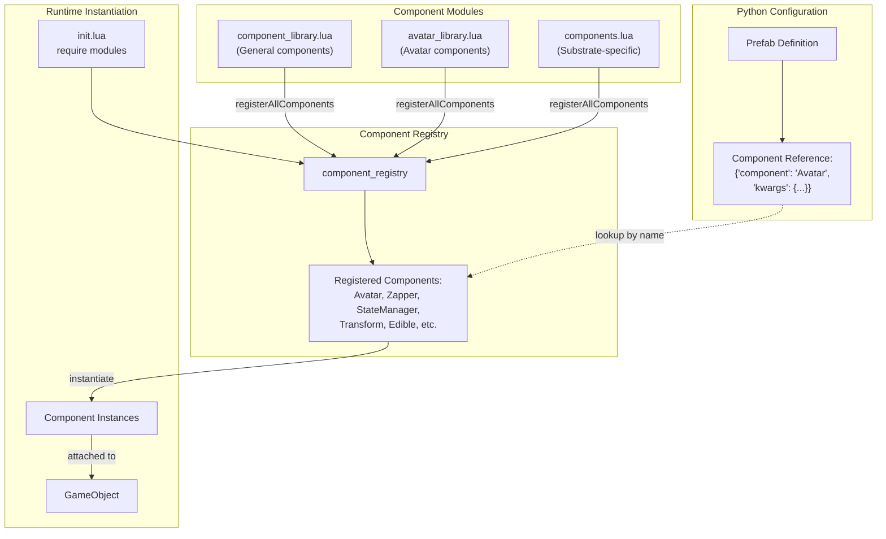
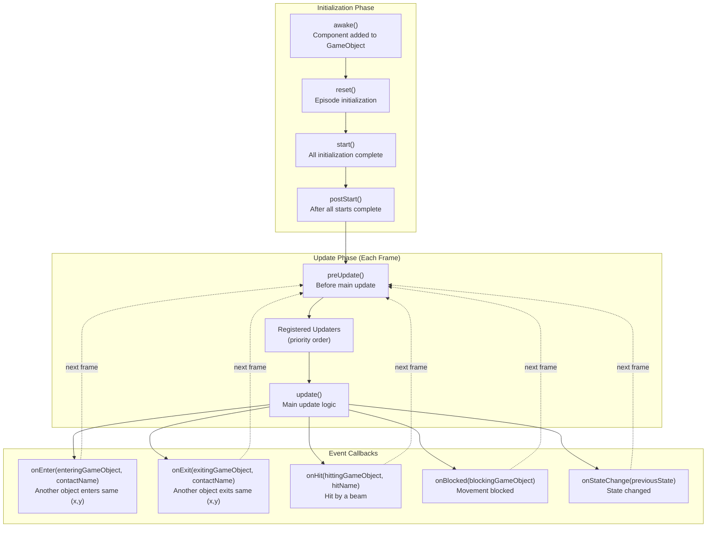
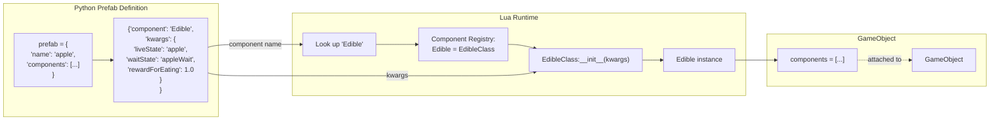

<!-- source: DeepWiki mcp.deepwiki.com · repo google-deepmind/meltingpot · page 4.3 Component Library · fetched 2026-10-26 -->

# Component Library

<details>
<summary>Relevant source files</summary>

The following files were used as context for generating this wiki page:

- [docs/advanced.md](docs/advanced.md)
- [docs/concepts.md](docs/concepts.md)
- [docs/extending.md](docs/extending.md)
- [docs/substrate_tutorial/index.md](docs/substrate_tutorial/index.md)
- [docs/substrates.md](docs/substrates.md)
- [meltingpot/lua/levels/clean_up/components.lua](meltingpot/lua/levels/clean_up/components.lua)
- [meltingpot/lua/modules/avatar_library.lua](meltingpot/lua/modules/avatar_library.lua)
- [meltingpot/lua/modules/colors.lua](meltingpot/lua/modules/colors.lua)
- [meltingpot/lua/modules/component.lua](meltingpot/lua/modules/component.lua)

</details>


This page documents the built-in components provided by Melting Pot. Components are modular pieces of logic that can be attached to GameObjects to give them specific behaviors. For information about the GameObject and Component architecture, see [GameObject and Component System](#3.3). For creating custom components, see [Custom Components](#6.4).

## Overview

The Melting Pot component library provides reusable, composable components organized into several modules:

- **`avatar_library.lua`**: Components for player-controlled avatars and avatar-related functionality
- **`component_library.lua`**: General-purpose components for environment objects
- **`component.lua`**: Base `Component` class that all components inherit from

Components are registered in a **component registry** and can be referenced by name in Python configuration files when defining GameObject prefabs.

Sources: [meltingpot/lua/modules/avatar_library.lua:1-20](), [meltingpot/lua/modules/component.lua:1-91](), [docs/substrates.md:426-493]()

## Component Registration Architecture



Sources: [meltingpot/lua/modules/component_registry.lua](), [docs/substrates.md:458-493](), [meltingpot/lua/levels/clean_up/components.lua:577-580]()

## Required Components

Every GameObject **must** have these two components:

### StateManager

Manages GameObject states, which control appearance, layer, groups, and contact behavior.

**File**: `meltingpot/lua/modules/component_library.lua`

**Configuration Parameters**:
| Parameter | Type | Description |
|-----------|------|-------------|
| `initialState` | string | The state the GameObject starts in |
| `stateConfigs` | table | Array of state configuration objects |

**State Configuration Structure**:
| Field | Type | Description |
|-------|------|-------------|
| `state` | string | Name of the state |
| `layer` | string | Layer the object occupies in this state (optional) |
| `sprite` | string | Sprite to display in this state (optional) |
| `groups` | table[string] | Groups the object belongs to in this state (optional) |
| `contact` | string | Contact name for onEnter/onExit events (optional) |

**Key Methods**:
- `getState()`: Returns current state as string
- `setState(newState)`: Queues state change (takes effect after update)
- `getAllStates()`: Returns list of all possible states
- `getLayer()`, `getSprite()`, `getGroups()`: State-dependent accessors

Sources: [docs/concepts.md:122-166](), [docs/substrates.md:217-237](), [docs/substrate_tutorial/index.md:163-166]()

### Transform

Manages GameObject position, orientation, and spatial queries.

**File**: `meltingpot/lua/modules/component_library.lua`

**Key Methods**:
| Method | Description |
|--------|-------------|
| `getPosition()` | Returns `{x, y}` table |
| `getOrientation()` | Returns `'N'`, `'E'`, `'S'`, or `'W'` |
| `moveAbs(orientation)` | Move one cell in absolute direction |
| `moveRel(orientation)` | Move one cell relative to current orientation |
| `teleport(position, orientation)` | Teleport to absolute position |
| `teleportToGroup(groupName, state, orient)` | Teleport to a random position in group |
| `turn(amount)` | Turn by amount (0=noop, 1=90°CW, 2=180°, 3=90°CCW) |
| `setOrientation(direction)` | Set absolute orientation |
| `queryDiamond(layer, radius)` | Query objects within L1 distance |
| `queryDisc(layer, radius)` | Query objects within L2 distance |
| `queryRectangle(layer, pos1, pos2)` | Query objects in rectangle |
| `rayCastDirection(layer, length, direction, offset)` | Cast ray in direction |

Sources: [docs/concepts.md:169-210](), [meltingpot/lua/modules/avatar_library.lua:508-526]()

## Avatar Components

### Avatar

The core component that makes a GameObject controllable by an agent. Handles actions, observations, rewards, spawning, and avatar lifecycle.

**File**: [meltingpot/lua/modules/avatar_library.lua:37-527]()

**Constructor Parameters**:
| Parameter | Type | Default | Description |
|-----------|------|---------|-------------|
| `index` | number | required | Player index (1-based) |
| `spawnGroup` | string | required | Group name for spawn points |
| `postInitialSpawnGroup` | string | `spawnGroup` | Group for respawning after first spawn |
| `aliveState` | string | required | State when avatar is alive |
| `additionalLiveStates` | table | `{}` | Additional states considered "alive" |
| `waitState` | string | required | State when avatar is inactive/dead |
| `speed` | number | `1.0` | Movement execution probability (0.0-1.0) |
| `actionOrder` | table | `{'move', 'turn'}` | Order actions are processed |
| `actionSpec` | table | see below | Discrete action specification |
| `view` | table | required | Observation window configuration |
| `useAbsoluteCoordinates` | boolean | `false` | Use absolute vs relative movement |
| `spriteMap` | table | `{}` | Remap sprites in avatar's view |
| `skipWaitStateRewards` | boolean | `true` | Don't reward when in wait state |
| `randomizeInitialOrientation` | boolean | `true` | Random initial orientation |

**Action Specification Format**:
```lua
actionSpec = {
    move = {default = 0, min = 0, max = 4},  -- 0=noop, 1-4=N/E/S/W
    turn = {default = 0, min = -1, max = 1}, -- -1=left, 0=noop, 1=right
}
```

**View Configuration**:
```lua
view = {
    left = 3,      -- cells to the left
    right = 3,     -- cells to the right
    forward = 5,   -- cells forward
    backward = 1,  -- cells backward
    centered = false  -- whether view is centered on avatar
}
```

**Key Methods**:
| Method | Description |
|--------|-------------|
| `addReward(amount)` | Add reward to current frame |
| `getReward()` | Get accumulated reward for current frame |
| `getIndex()` | Get player index |
| `getSpawnGroup()` | Get current spawn group |
| `isAlive()` | Returns true if in alive state |
| `isWait()` | Returns true if in wait state |
| `connect(objectToConnect)` | Connect another GameObject to move together |
| `disconnect(objectToDisconnect)` | Disconnect a connected GameObject |
| `getConnectedObjects()` | Get array of connected GameObjects |
| `disallowMovement()` | Prevent avatar from moving |
| `allowMovement()` | Allow avatar to move again |
| `disallowMovementUntil(numFrames)` | Freeze for N frames |
| `removeAfterDelay(delay)` | Set to wait state after delay |
| `queryPartialObservationWindow(layer)` | Get objects in avatar's view |

**Registered Updaters**:
- **Priority 150**: Movement/turning execution (with probability = `speed`)

Sources: [meltingpot/lua/modules/avatar_library.lua:37-527](), [docs/substrates.md:360-421]()

### Zapper

Enables avatars to fire beams that can hit other avatars or objects.

**File**: [meltingpot/lua/modules/avatar_library.lua:567-850]()

**Constructor Parameters**:
| Parameter | Type | Description |
|-----------|------|-------------|
| `cooldownTime` | number | Frames between shots |
| `beamLength` | number | Maximum beam length |
| `beamRadius` | number | Beam width radius (total width = 2*radius + 1) |
| `beamColor` | table | RGB color, default `{252, 252, 106}` (yellow) |
| `framesTillRespawn` | number | Frames until respawn after being zapped |
| `penaltyForBeingZapped` | number | Reward/penalty when hit |
| `rewardForZapping` | number | Reward for hitting another avatar |
| `removeHitPlayer` | boolean | Whether to remove hit player (default true) |

**Hit Registration**:
Adds `'zapHit'` to the world's hit configuration, rendered on layer `'beamZap'` with sprite `'BeamZap'`.

**Key Methods**:
| Method | Description |
|--------|-------------|
| `readyToShoot()` | Returns value 0.0-1.0 indicating cooldown status |
| `disallowZapping()` | Prevent zapping |
| `allowZapping()` | Allow zapping again |
| `disallowZappingUntil(numFrames)` | Prevent zapping for N frames |
| `getWhoZappable(layer)` | Get array of avatars in zap range |
| `getZappablePlayerIndices(layer)` | Get player indices in zap range |
| `getRemoveHitPlayer()` | Returns removeHitPlayer setting |

**Callback Behavior**:
- `onHit('zapHit')`: When hit, triggers state change to wait state, rewards both players, records event

**Registered Updaters**:
- **Priority 140**: Execute zap beam if action `fireZap == 1` and cooldown ready
- **Priority 135** (wait state only): Respawn after `framesTillRespawn` frames

**Volatile State Variables**:
- `playerRespawnedThisStep`: Boolean, true if respawned this frame
- `zapperIndex`: Index of avatar that zapped this one (set when hit)
- `num_others_player_zapped_this_step`: Count of avatars this player zapped

Sources: [meltingpot/lua/modules/avatar_library.lua:567-850]()

### AvatarDirectionIndicator

Draws a visual indicator showing which direction an avatar is facing.

**File**: [meltingpot/lua/modules/avatar_library.lua:529-564]()

**Constructor Parameters**:
| Parameter | Type | Default | Description |
|-----------|------|---------|-------------|
| `color` | table | `{100, 100, 100, 200}` | RGBA color for indicator |

**Behavior**:
- Adds sprite `'DirectionSprite'` with specified color
- Adds hit `'directionHit'` on layer `'directionIndicatorLayer'`
- Fires a beam of length 1 and radius 0 every frame (priority 130)

Sources: [meltingpot/lua/modules/avatar_library.lua:529-564]()

### ReadyToShootObservation

Adds an observation indicating when the avatar can fire its zapper.

**File**: [meltingpot/lua/modules/avatar_library.lua:853-881]()

**Constructor Parameters**:
| Parameter | Type | Default | Description |
|-----------|------|---------|-------------|
| `zapperComponent` | string | `'Zapper'` | Name of zapper component to query |

**Observation Added**:
- **Name**: `{playerIndex}.READY_TO_SHOOT`
- **Type**: `'Doubles'`
- **Shape**: `{}`
- **Value**: Result of `zapper:readyToShoot()` (0.0 to 1.0)

Sources: [meltingpot/lua/modules/avatar_library.lua:853-881]()

### AvatarConnector

Connects a GameObject to an avatar so they move together (e.g., for visual indicators attached to avatars).

**File**: [meltingpot/lua/modules/avatar_library.lua:884-945]()

**Constructor Parameters**:
| Parameter | Type | Description |
|-----------|------|-------------|
| `playerIndex` | number | Index of avatar to connect to |
| `aliveState` | string | State when connected object is active |
| `waitState` | string | State when connected object is inactive |

**Lifecycle**:
- `postStart()`: Sets state to aliveState, teleports to avatar position, connects to avatar
- `avatarStateChange(behavior)`: When avatar respawns or dies, updates own state accordingly

Sources: [meltingpot/lua/modules/avatar_library.lua:884-945]()

### GraduatedSanctionsMarking

Implements a graduated sanctions system where repeated violations increase punishment severity. Typically attached to a marker object connected to an avatar.

**File**: [meltingpot/lua/modules/avatar_library.lua:948-1100+]()

**Constructor Parameters**:
| Parameter | Type | Default | Description |
|-----------|------|---------|-------------|
| `playerIndex` | number | required | Index of player this marking is for |
| `waitState` | string | required | State when avatar is removed |
| `initialLevel` | number | `1` | Starting punishment level |
| `recoveryTime` | number/false | `false` | Frames to wait before resetting to initial level |
| `hitName` | string | required | Hit type that changes marking level |
| `hitLogic` | table | see below | Array of level-specific logic |

**Hit Logic Format**:
```lua
hitLogic = {
    {levelIncrement = 1, sourceReward = 0, targetReward = -2, 
     remove = false, freeze = nil},
    {levelIncrement = 1, sourceReward = 2, targetReward = -8, 
     remove = false, freeze = nil},
    {levelIncrement = -2, sourceReward = 10, targetReward = -16, 
     remove = false, freeze = nil},
}
```

**State Requirements**:
Must have states named `level_1`, `level_2`, ..., `level_N` where N = length of `hitLogic`.

**Behavior**:
- Each hit applies logic from current level: rewards, level increment, optional removal/freeze
- Automatically resets to initial level after `recoveryTime` frames (if specified)
- Connects to avatar and follows its position

Sources: [meltingpot/lua/modules/avatar_library.lua:948-1100]()

## Environment Components

### Edible

Makes a GameObject consumable by avatars, providing reward when touched.

**File**: Referenced in [docs/substrate_tutorial/index.md:434-444](), [meltingpot/lua/levels/clean_up/components.lua:353-408]()

**Constructor Parameters**:
| Parameter | Type | Description |
|-----------|------|-------------|
| `liveState` | string | State when object is consumable |
| `waitState` | string | State when object is consumed/inactive |
| `rewardForEating` | number | Reward given to eating avatar |

**Callback Behavior**:
- `onEnter(enteringGameObject, contactName)`: If `contactName == 'avatar'` and in `liveState`, gives reward and switches to `waitState`

**Example**:
```python
{
    "component": "Edible",
    "kwargs": {
        "liveState": "apple",
        "waitState": "appleWait",
        "rewardForEating": 1.0,
    }
}
```

Sources: [docs/substrate_tutorial/index.md:434-488](), [meltingpot/lua/levels/clean_up/components.lua:353-408]()

### BeamBlocker

Prevents beams from passing through an object.

**File**: `meltingpot/lua/modules/component_library.lua`

**Constructor Parameters**:
| Parameter | Type | Description |
|-----------|------|-------------|
| `beamType` | string | Type of beam to block (e.g., `'zap'`, `'gift'`) |

**Example from Tutorial**:
```python
{
    "component": "BeamBlocker",
    "kwargs": {
        "beamType": "gift"
    }
}
```

Sources: [docs/substrate_tutorial/index.md:324-334]()

### DensityRegrow (Custom Component Example)

An example custom component from the tutorial that regrows objects based on nearby density.

**File**: [docs/substrate_tutorial/index.md:558-668]()

**Constructor Parameters**:
| Parameter | Type | Default | Description |
|-----------|------|---------|-------------|
| `baseRate` | number | required | Base regrowth probability per frame (0.0-1.0) |
| `liveState` | string | required | Active state name |
| `waitState` | string | required | Inactive state name |
| `neighborhoodRadius` | number | `1` | Radius for neighbor detection |
| `queryLayer` | string | `'lowerPhysical'` | Layer to query for neighbors |

**Behavior**:
- Registered updater runs only in `waitState`
- Queries neighborhood for objects in `liveState`
- Regrowth probability = `baseRate * count_of_live_neighbors`
- Switches to `liveState` with computed probability

Sources: [docs/substrate_tutorial/index.md:558-668]()

## Visual Components

### Appearance

Manages sprites and visual rendering for GameObjects.

**File**: `meltingpot/lua/modules/component_library.lua`

**Constructor Parameters**:
| Parameter | Type | Description |
|-----------|------|-------------|
| `renderMode` | string | How sprites are rendered (e.g., `'ascii_shape'`) |
| `spriteNames` | table | Array of sprite names |
| `spriteShapes` | table | Array of ASCII art shapes (for ascii_shape mode) |
| `spriteRGBColors` | table | Array of RGB color tuples |
| `palettes` | table | Array of palette dictionaries |
| `noRotates` | table | Array of booleans indicating if sprite should rotate |

**Example**:
```python
{
    "component": "Appearance",
    "kwargs": {
        "renderMode": "ascii_shape",
        "spriteNames": ["Avatar"],
        "spriteShapes": [shapes.CUTE_AVATAR],
        "palettes": [{}],
        "noRotates": [True],
    }
}
```

Sources: [docs/substrate_tutorial/index.md:278-290](), [docs/substrate_tutorial/index.md:314-322]()

## Component Lifecycle and Callbacks



**Lifecycle Methods** (all optional):
| Method | When Called | Purpose |
|--------|-------------|---------|
| `awake()` | Component added to GameObject | Initialize component |
| `reset()` | Start of each episode | Reset episode-specific variables |
| `start()` | After all initialization | Setup that requires other components |
| `postStart()` | After all `start()` calls | Setup requiring all objects initialized |
| `preUpdate()` | Every frame, before update | Pre-frame logic |
| `update()` | Every frame | Main update logic |

**Event Callbacks** (all optional):
| Method | Trigger |
|--------|---------|
| `onEnter(enteringGameObject, contactName)` | Another object enters same (x,y) location |
| `onExit(exitingGameObject, contactName)` | Another object exits same (x,y) location |
| `onHit(hittingGameObject, hitName)` | GameObject hit by a beam |
| `onBlocked(blockingGameObject)` | Movement attempt blocked |
| `onStateChange(previousState)` | GameObject state changed |

Sources: [meltingpot/lua/modules/component.lua:20-91](), [docs/concepts.md:221-248](), [docs/advanced.md:33-56]()

## Updater Registry System

Components can register updater functions with fine-grained control over execution:

**Registration Example**:
```lua
function MyComponent:registerUpdaters(updaterRegistry)
    updaterRegistry:registerUpdater{
        updateFn = function()
            -- update logic here
        end,
        priority = 200,              -- Higher = earlier execution
        state = 'activeState',       -- Only run in this state
        startFrame = 10,             -- Wait 10 frames after state change
        probability = 0.5,           -- Run with 50% probability each frame
        group = 'specialGroup',      -- Run for objects in this group
    }
end
```

**Updater Parameters**:
| Parameter | Type | Default | Description |
|-----------|------|---------|-------------|
| `updateFn` | function | required | Function to execute |
| `priority` | number | `100` | Execution priority (higher = earlier) |
| `state` | string | all states | State in which to execute |
| `states` | table | all states | Multiple states (overrides `state`) |
| `startFrame` | number | `0` | Frames to wait after state change |
| `probability` | number | `1.0` | Execution probability per frame |
| `group` | string | nil | Execute for objects in group |

**Priority Conventions**:
- **400+**: Cleanup/reset operations
- **200-300**: High-priority game logic
- **140-150**: Actions (zapping, movement)
- **130-140**: Visual indicators
- **1-100**: Low-priority updates
- **1-10**: Monitoring/metrics collection

Sources: [docs/concepts.md:275-322](), [meltingpot/lua/modules/updater_registry.lua](), [meltingpot/lua/modules/avatar_library.lua:155-203]()

## Component Configuration in Python

Components are configured in Python prefabs and instantiated at runtime:



**Prefab Component Structure**:
```python
{
    "component": "ComponentName",  # Must be registered in component_registry
    "kwargs": {
        # Constructor parameters
        "parameterName": value,
        # ...
    }
}
```

**Multiple Components**:
GameObjects can have multiple components, even of the same type:
```python
"components": [
    {"component": "StateManager", "kwargs": {...}},
    {"component": "Transform"},
    {"component": "BeamBlocker", "kwargs": {"beamType": "zap"}},
    {"component": "BeamBlocker", "kwargs": {"beamType": "gift"}},
]
```

Sources: [docs/substrates.md:169-237](), [docs/substrate_tutorial/index.md:241-249]()

## Common Component Patterns

### Movement Control Pattern
```lua
-- In Avatar or custom component
function MyComponent:disableMovement()
    local avatar = self.gameObject:getComponent('Avatar')
    avatar:disallowMovement()
end

function MyComponent:enableMovement()
    local avatar = self.gameObject:getComponent('Avatar')
    avatar:allowMovement()
end
```

### State-Based Behavior Pattern
```lua
function MyComponent:registerUpdaters(updaterRegistry)
    -- Different behavior for different states
    updaterRegistry:registerUpdater{
        state = 'active',
        updateFn = function() self:activeUpdate() end,
        priority = 100,
    }
    
    updaterRegistry:registerUpdater{
        state = 'dormant',
        updateFn = function() self:dormantUpdate() end,
        priority = 100,
    }
end
```

### Scene Component Communication Pattern
```lua
function MyComponent:postStart()
    -- Access scene-level components
    local sceneObject = self.gameObject.simulation:getSceneObject()
    self._sceneComponent = sceneObject:getComponent('SceneComponentName')
end

function MyComponent:update()
    -- Use scene component
    local data = self._sceneComponent:getData()
end
```

### Spatial Query Pattern
```lua
function MyComponent:findNearbyObjects()
    local transform = self.gameObject:getComponent('Transform')
    local nearbyObjects = transform:queryDiamond('lowerPhysical', 2)
    
    for _, obj in ipairs(nearbyObjects) do
        if obj:hasComponent('TargetComponent') then
            -- Process object
        end
    end
end
```

Sources: [meltingpot/lua/modules/avatar_library.lua:463-485](), [meltingpot/lua/levels/clean_up/components.lua:59-62](), [docs/substrate_tutorial/index.md:650-665]()

## Special Component Methods

### Sprite and Visual Methods
| Method | Called By | Purpose |
|--------|-----------|---------|
| `addSprites(tileSet)` | Simulation | Register sprites with tileset |
| `addCustomSprites(customSprites)` | Simulation | Register non-state sprites |
| `getSpriteNames()` | Simulation | Return available sprite names |
| `addHits(worldConfig)` | Simulation | Register beam hit types |

### Avatar-Specific Methods
| Method | Called By | Purpose |
|--------|-----------|---------|
| `addObservations(tileSet, world, observations)` | Simulation | Add observations to spec |
| `discreteActionSpec(actSpec)` | Simulation | Add actions to spec |
| `discreteActions(actions)` | Simulation | Receive action values |

### Updater Registration
| Method | Called By | Purpose |
|--------|-----------|---------|
| `registerUpdaters(updaterRegistry)` | Simulation | Register frame update functions |

Sources: [docs/concepts.md:250-270](), [meltingpot/lua/modules/avatar_library.lua:205-223]()

## Component Internal State Convention

Components maintain state in two tables:

**`self._config`**: Static configuration from constructor
```lua
function MyComponent:__init__(kwargs)
    self._config.parameter1 = kwargs.parameter1
    self._config.parameter2 = kwargs.parameter2
end
```

**`self._variables`**: Mutable runtime state
```lua
function MyComponent:reset()
    self._variables.counter = 0
    self._variables.accumulator = 0
end
```

This separation supports proper episode reset - `_config` persists, `_variables` reset.

Sources: [docs/concepts.md:323-335](), [meltingpot/lua/modules/avatar_library.lua:100-125]()

---

