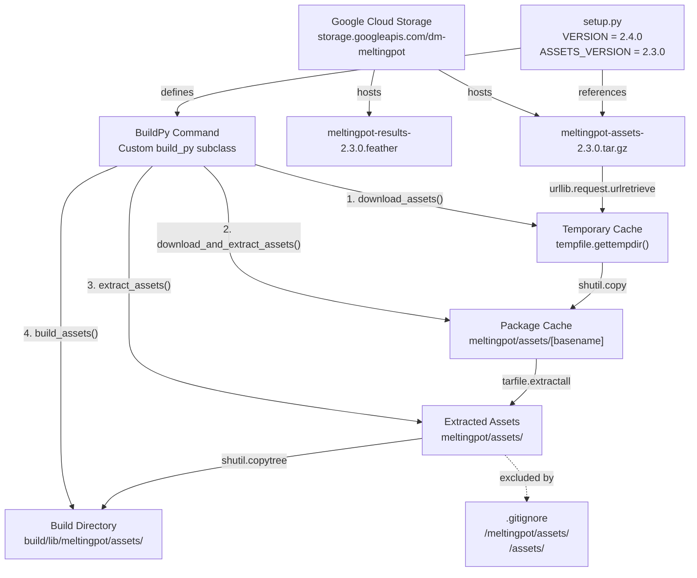
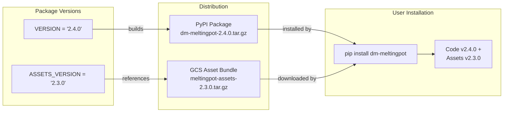
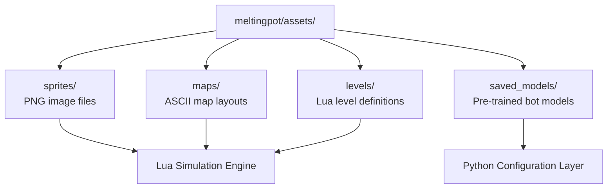
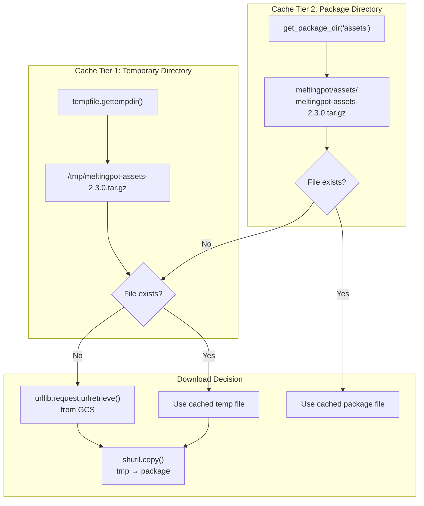

<!-- source: DeepWiki mcp.deepwiki.com · repo google-deepmind/meltingpot · page 4.4 Asset Management · fetched 2026-10-26 -->

# Asset Management

<details>
<summary>Relevant source files</summary>

The following files were used as context for generating this wiki page:

- [.gitignore](.gitignore)
- [CHANGELOG.md](CHANGELOG.md)
- [bin/install.sh](bin/install.sh)
- [bin/test.sh](bin/test.sh)
- [bin/test_examples.sh](bin/test_examples.sh)
- [bin/update_requirements.sh](bin/update_requirements.sh)
- [notebooks/evaluation_results.ipynb](notebooks/evaluation_results.ipynb)
- [requirements.txt](requirements.txt)
- [setup.py](setup.py)

</details>


## Purpose and Scope

This page documents how Melting Pot manages game assets (sprites, maps, levels, and evaluation data) separately from the Python package code. It covers the custom build process that downloads assets from Google Cloud Storage during installation, the split versioning strategy, and the caching mechanisms used to optimize the installation process.

For information about the package build system and dependencies, see [Build and Package System](#7.1). For details on how assets are used by the Lua simulation engine, see [Lua Simulation Engine](#4.2).

---

## Overview

Melting Pot uses a **split distribution model** where game assets are stored separately from the Python package code. Assets are hosted on Google Cloud Storage (GCS) and downloaded automatically during package installation via a custom build command. This approach:

- Reduces the size of the git repository
- Allows independent versioning of assets and code
- Enables faster iteration on visual/game content without code changes
- Provides caching to avoid redundant downloads

**Key Components:**
- `BuildPy` custom command in `setup.py`
- GCS-hosted asset tarball
- Local caching in temporary directories
- Extracted assets in `meltingpot/assets/`

Sources: [setup.py:1-171](), [CHANGELOG.md:76-87]()

---

## Asset Distribution Architecture



**Asset Distribution Flow:**

| Step | Method | Source | Destination | Purpose |
|------|--------|--------|-------------|---------|
| 1 | `download_assets()` | GCS | `/tmp/meltingpot-assets-2.3.0.tar.gz` | Download to temp cache |
| 2 | `download_and_extract_assets()` | Temp | `meltingpot/assets/meltingpot-assets-2.3.0.tar.gz` | Copy to package cache |
| 3 | `extract_assets()` | Package cache | `meltingpot/assets/*` | Extract tarball contents |
| 4 | `build_assets()` | Source assets | `build/lib/meltingpot/assets/*` | Copy to build directory |

Sources: [setup.py:44-100](), [.gitignore:16-30]()

---

## Custom Build Process

The asset management system is implemented through a custom `BuildPy` command that extends `setuptools.command.build_py`:

```mermaid
graph TB
    subgraph "BuildPy.run() Execution"
        START["pip install dm-meltingpot"]
        RUN["BuildPy.run()"]
        
        DOWNLOAD["download_and_extract_assets()"]
        EDITABLE{"editable_mode?"}
        SUPER["super().run()<br/>Build Python package"]
        BUILD_ASSETS["build_assets()"]
        END["Installation complete"]
        
        START --> RUN
        RUN --> DOWNLOAD
        DOWNLOAD --> EDITABLE
        EDITABLE -->|No| SUPER
        SUPER --> BUILD_ASSETS
        BUILD_ASSETS --> END
        EDITABLE -->|Yes| END
    end
    
    subgraph "download_and_extract_assets() Logic"
        CHECK_PKG["Check if tar exists in<br/>meltingpot/assets/"]
        EXISTS_PKG{"Exists?"}
        DOWNLOAD_TMP["download_assets()"]
        COPY["shutil.copy to<br/>meltingpot/assets/"]
        EXTRACT["extract_assets()"]
        
        CHECK_PKG --> EXISTS_PKG
        EXISTS_PKG -->|Yes| EXTRACT
        EXISTS_PKG -->|No| DOWNLOAD_TMP
        DOWNLOAD_TMP --> COPY
        COPY --> EXTRACT
    end
    
    subgraph "download_assets() Logic"
        CHECK_TMP["Check if tar exists in<br/>/tmp/"]
        EXISTS_TMP{"Exists?"}
        URL_RETRIEVE["urllib.request.urlretrieve()<br/>from GCS"]
        RETURN["Return temp path"]
        
        CHECK_TMP --> EXISTS_TMP
        EXISTS_TMP -->|Yes| RETURN
        EXISTS_TMP -->|No| URL_RETRIEVE
        URL_RETRIEVE --> RETURN
    end
```



**Key Methods in BuildPy:**

| Method | Line Range | Purpose |
|--------|------------|---------|
| `run()` | [setup.py:47-51]() | Main entry point, orchestrates download and build |
| `download_and_extract_assets()` | [setup.py:53-65]() | Downloads to package cache and extracts |
| `download_assets()` | [setup.py:67-76]() | Downloads to temp cache with URL retrieval |
| `extract_assets()` | [setup.py:78-87]() | Extracts tarball using `tarfile` module |
| `build_assets()` | [setup.py:89-99]() | Copies assets to build directory |

Sources: [setup.py:44-100]()

---

## Asset Versioning Strategy

Melting Pot uses **split versioning** where code and assets are versioned independently:



**Version History:**

| Package Version | Assets Version | Changes |
|----------------|---------------|----------|
| 2.4.0 | 2.3.0 | Code updates without asset changes |
| 2.3.1 | 2.3.0 | Bug fixes, evaluation notebook updates |
| 2.3.0 | 2.3.0 | New scenarios and bots for NeurIPS 2023 competition |
| 2.2.2 | 2.2.0 | Setup.py fixes |
| 2.2.0 | 2.2.0 | Made pip installable, assets downloaded during install |

**Rationale for Split Versioning:**
- Assets change less frequently than code
- Large asset files don't bloat the git repository
- Allows code bug fixes without re-uploading assets
- Simplifies collaboration on visual/game content

Sources: [setup.py:25-26](), [CHANGELOG.md:1-234]()

---

## Asset Types and Structure

Assets downloaded from GCS include game-related files organized in the `meltingpot/assets/` directory:



**Asset Categories:**

| Category | Format | Usage | Referenced By |
|----------|--------|-------|--------------|
| Sprites | PNG images | Visual rendering of game objects | Lua prefab definitions |
| Maps | ASCII text | Level layout definitions | `lab2d_settings` |
| Levels | Lua scripts | Game-specific logic | `dmlab2d.Environment` |
| Saved Models | TensorFlow SavedModel | Pre-trained bot policies | `BotConfig` |

**Additional Assets:**
- Evaluation results: `meltingpot-results-2.3.0.feather` hosted on GCS
- Used by evaluation notebooks for analysis

Sources: [setup.py:133-138](), [notebooks/evaluation_results.ipynb:275]()

---

## Caching Mechanism

The asset download process implements **two-tier caching** to minimize redundant downloads:



**Caching Strategy:**

| Cache Location | Check Logic | Benefit |
|---------------|-------------|---------|
| Package directory | [setup.py:58-59]() | Persistent across builds |
| Temp directory | [setup.py:70-71]() | Shared across multiple package builds |
| No cache | [setup.py:73-75]() | Downloads from GCS URL |

**Cache Invalidation:**
- Extraction always deletes existing `meltingpot/assets/` directory: [setup.py:82-84]()
- Build always deletes existing `build/lib/meltingpot/assets/`: [setup.py:94-96]()
- Ensures clean state on each build

Sources: [setup.py:53-87]()

---

## Development Workflow

### Installation Process

Developers can install Melting Pot with assets in two ways:

**1. Standard Installation (with asset download):**
```bash
pip install dm-meltingpot
```

**2. Development Installation (editable mode):**
```bash
pip install --no-deps --no-build-isolation --editable .
```



```mermaid
graph TB
    subgraph "Standard Installation"
        STD_START["pip install dm-meltingpot"]
        STD_BUILDPY["BuildPy.run()"]
        STD_DOWNLOAD["Download & extract assets"]
        STD_SUPER["Build Python package"]
        STD_BUILD["Copy assets to build/lib"]
        STD_INSTALL["Install to site-packages"]
        
        STD_START --> STD_BUILDPY
        STD_BUILDPY --> STD_DOWNLOAD
        STD_DOWNLOAD --> STD_SUPER
        STD_SUPER --> STD_BUILD
        STD_BUILD --> STD_INSTALL
    end
    
    subgraph "Editable Installation"
        EDI_START["pip install --editable ."]
        EDI_BUILDPY["BuildPy.run()"]
        EDI_DOWNLOAD["Download & extract assets"]
        EDI_SKIP["Skip build_assets()<br/>editable_mode=True"]
        EDI_SYMLINK["Create symlink to source"]
        
        EDI_START --> EDI_BUILDPY
        EDI_BUILDPY --> EDI_DOWNLOAD
        EDI_DOWNLOAD --> EDI_SKIP
        EDI_SKIP --> EDI_SYMLINK
    end
```

**Key Installation Commands:**

| Command | Script | Purpose |
|---------|--------|---------|
| `pip-compile` | [bin/update_requirements.sh:21-22]() | Generate locked requirements |
| `pip install --no-deps` | [bin/install.sh:22]() | Install with locked deps |
| `pip install --editable` | [bin/install.sh:27]() | Development mode |

Sources: [bin/install.sh:1-32](), [setup.py:47-51]()

### Asset Management in Git

The `.gitignore` file explicitly excludes asset directories:

| Ignored Path | Reason |
|-------------|--------|
| `/meltingpot/assets/` | Downloaded assets, not source code |
| `/assets/` | Root-level asset cache |
| `/build/` | Build artifacts |
| `/dist/` | Distribution packages |

**Why Assets Are Excluded:**
- Binary files don't belong in git
- Large file sizes would bloat repository
- Assets are reproducibly downloaded from GCS
- Versioned separately via `ASSETS_VERSION` constant

Sources: [.gitignore:13-29]()

### URL Construction

The asset URL is constructed programmatically:

```python
ASSETS_URL = f'http://storage.googleapis.com/dm-meltingpot/meltingpot-assets-{ASSETS_VERSION}.tar.gz'
```

**URL Pattern:**
- Base: `http://storage.googleapis.com/dm-meltingpot/`
- Filename pattern: `meltingpot-assets-{version}.tar.gz`
- Current URL: `http://storage.googleapis.com/dm-meltingpot/meltingpot-assets-2.3.0.tar.gz`

**Additional GCS Resources:**
- Evaluation results: `meltingpot-results-2.3.0.feather`
- Legacy saved models (pre-v2.2.0): Bot models previously stored in git

Sources: [setup.py:28](), [notebooks/evaluation_results.ipynb:275]()

---

## Package Metadata

The `setup.py` configures asset inclusion via `package_data`:

```python
package_data={
    'meltingpot': [
        'lua/levels/*/*.lua',
        'lua/modules/*.lua',
    ],
}
```

**Package Data Specification:**

| Pattern | Files Included | Purpose |
|---------|---------------|---------|
| `lua/levels/*/*.lua` | Level-specific Lua scripts | Game logic for each substrate |
| `lua/modules/*.lua` | Shared Lua modules | Common components and utilities |

**Note:** The downloaded assets from GCS are handled separately by `BuildPy` and are not listed in `package_data`. The `package_data` only includes Lua source files that are committed to the repository.

Sources: [setup.py:133-138]()

---

