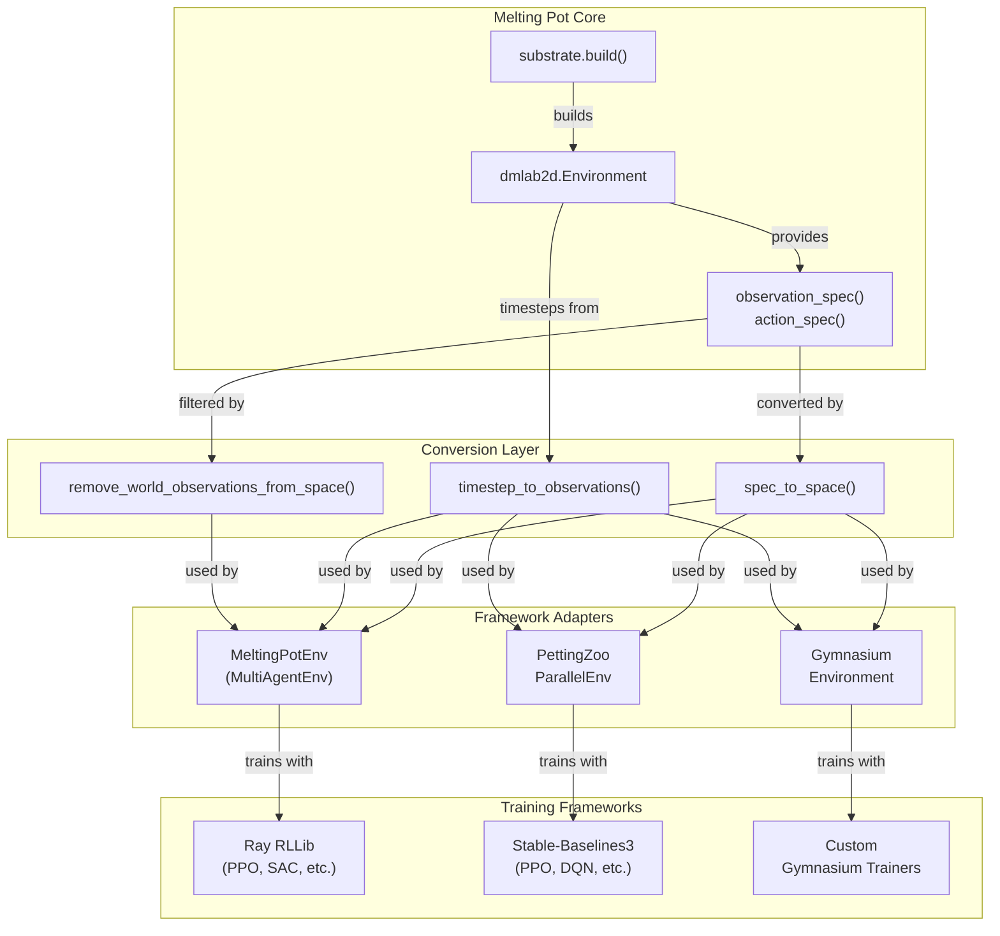
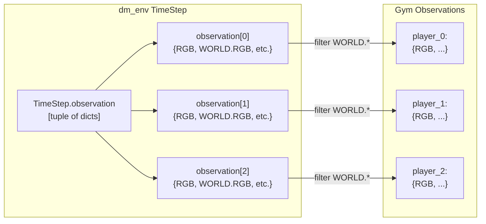
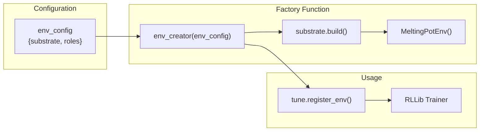

<!-- source: DeepWiki mcp.deepwiki.com · repo google-deepmind/meltingpot · page 5 Framework Integration · fetched 2026-10-26 -->

# Framework Integration

<details>
<summary>Relevant source files</summary>

The following files were used as context for generating this wiki page:

- [examples/gym/__init__.py](examples/gym/__init__.py)
- [examples/gym/utils.py](examples/gym/utils.py)
- [examples/rllib/__init__.py](examples/rllib/__init__.py)
- [examples/rllib/self_play_train.py](examples/rllib/self_play_train.py)
- [examples/rllib/self_play_train_test.py](examples/rllib/self_play_train_test.py)
- [examples/rllib/utils.py](examples/rllib/utils.py)
- [examples/rllib/utils_test.py](examples/rllib/utils_test.py)
- [examples/rllib/view_models.py](examples/rllib/view_models.py)

</details>


## Purpose and Scope

This document describes how Melting Pot integrates with popular reinforcement learning frameworks. Melting Pot provides a core `dm_env.Environment` interface (via `dmlab2d.Environment`) that serves as the foundation for framework-specific adapters. This page covers the common conversion utilities and integration patterns used across all frameworks.

For framework-specific implementation details, see:
- RLLib integration: [5.1](#5.1)
- Gymnasium integration: [5.2](#5.2)  
- PettingZoo integration: [5.3](#5.3)

## Core dm_env Interface

Melting Pot substrates implement the `dmlab2d.Environment` interface, which follows the `dm_env` protocol. This provides a standard interface with methods:

- `reset()` - Returns initial `dm_env.TimeStep`
- `step(actions)` - Takes actions (tuple/list), returns `dm_env.TimeStep`
- `observation_spec()` - Returns specs for observations
- `action_spec()` - Returns specs for actions
- `observation()` - Returns current observations

Each `TimeStep` contains:
- `step_type` - First, mid, or last step indicator
- `reward` - Tuple of rewards (one per agent)
- `discount` - Discount factor
- `observation` - Tuple of observation dicts (one per agent)

Sources: [examples/rllib/utils.py:37-43](), [examples/gym/utils.py:27-35]()

## Integration Architecture



**Framework Integration Architecture**: All frameworks adapt from the `dmlab2d.Environment` core using shared conversion utilities. Each adapter transforms the dm_env API to match the target framework's interface expectations.

Sources: [examples/rllib/utils.py:34-59](), [examples/gym/utils.py:45-74]()

## Common Conversion Utilities

### Spec to Space Conversion

The `spec_to_space()` function converts dm_env specs to Gymnasium spaces:

**Function**: `spec_to_space(spec)` at [examples/gym/utils.py:45-74]()

**Conversion Rules**:

| dm_env Spec Type | Gymnasium Space Type | Notes |
|------------------|---------------------|-------|
| `DiscreteArray` | `spaces.Discrete(num_values)` | Discrete action/observation |
| `BoundedArray` | `spaces.Box(min, max, shape, dtype)` | Bounded continuous values |
| `Array` (float) | `spaces.Box(-inf, inf, shape, dtype)` | Unbounded floats |
| `Array` (int) | `spaces.Box(dtype.min, dtype.max, shape, dtype)` | Unbounded integers |
| `tuple/list` | `spaces.Tuple([...])` | Recursive conversion |
| `dict` | `spaces.Dict({...})` | Recursive conversion |

Sources: [examples/gym/utils.py:45-74]()

### TimeStep to Observations Conversion

The `timestep_to_observations()` function extracts player observations from dm_env timesteps:



**TimeStep to Observations Conversion**: Converts dm_env tuple of observations to framework-specific dictionary format, filtering out world observations.

The function at [examples/gym/utils.py:27-35]():
1. Iterates through each agent's observation in the timestep tuple
2. Creates dictionary with player ID as key (format: `player_0`, `player_1`, etc.)
3. Filters out observations with `WORLD.` prefix
4. Returns mapping of player IDs to their observations

Sources: [examples/gym/utils.py:27-35]()

## Player and Observation Naming Conventions

### Player ID Format

All framework adapters use consistent player naming:

**Format**: `PLAYER_STR_FORMAT = 'player_{index}'` at [examples/gym/utils.py:23]()

This creates agent IDs: `player_0`, `player_1`, `player_2`, etc.

Sources: [examples/rllib/utils.py:31](), [examples/gym/utils.py:23]()

### World vs Player Observations

Observations are categorized into two types:

**World Observations** (prefix: `WORLD.`):
- Global environment state visible to all agents
- Examples: `WORLD.RGB` (full world view)
- Typically removed for agent training to ensure partial observability
- Used for rendering and visualization

**Player Observations** (no prefix):
- Agent-specific observations
- Examples: `RGB` (agent's local view), `POSITION`, `ORIENTATION`
- Used for agent policy decisions

The `remove_world_observations_from_space()` function filters world observations:

```python
def remove_world_observations_from_space(observation: spaces.Dict) -> spaces.Dict:
  return spaces.Dict({
      key: observation[key] for key in observation if _WORLD_PREFIX not in key
  })
```

Sources: [examples/gym/utils.py:24](), [examples/gym/utils.py:38-42](), [examples/rllib/utils.py:120-121]()

## Multi-Agent Environment Patterns

### Action and Observation Dictionaries

Framework adapters convert between different multi-agent conventions:

**dm_env Convention** (tuple-based):
- Actions: `[action_0, action_1, action_2, ...]` (tuple/list)
- Observations: `(obs_0, obs_1, obs_2, ...)` (tuple)
- Rewards: `[reward_0, reward_1, reward_2, ...]` (list/array)

**Framework Convention** (dict-based):
- Actions: `{'player_0': action_0, 'player_1': action_1, ...}` (dict)
- Observations: `{'player_0': obs_0, 'player_1': obs_1, ...}` (dict)
- Rewards: `{'player_0': reward_0, 'player_1': reward_1, ...}` (dict)

The RLLib adapter performs this conversion in the `step()` method at [examples/rllib/utils.py:66-78]():

1. Converts action dict to ordered list: `[action_dict[agent_id] for agent_id in self._ordered_agent_ids]`
2. Steps the environment with action list
3. Converts reward tuple to dict: `{agent_id: timestep.reward[index] for index, agent_id in enumerate(...)}`
4. Returns observations, rewards, and done flags as dicts

Sources: [examples/rllib/utils.py:66-78]()

### Environment Creation Pattern

All framework examples use a factory pattern for environment creation:



**Environment Factory Pattern**: Factory function creates and wraps substrate based on configuration.

The `env_creator()` function at [examples/rllib/utils.py:126-131]():
1. Accepts environment config dict with `substrate` and `roles`
2. Calls `substrate.build()` to create dmlab2d environment
3. Wraps in framework-specific adapter (e.g., `MeltingPotEnv`)
4. Returns wrapped environment

Sources: [examples/rllib/utils.py:126-131]()

## Space Conversion Examples

### Discrete Action Space

For discrete actions (e.g., movement, interactions):

```
dm_env: DiscreteArray(num_values=9, name='action')
↓
Gymnasium: Discrete(9)
```

Example at [examples/rllib/utils_test.py:38-42]() shows action space conversion for Commons Harvest substrate.

Sources: [examples/gym/utils.py:57-58](), [examples/rllib/utils_test.py:38-42]()

### RGB Observation Space

For RGB observations (typical agent view):

```
dm_env: BoundedArray(shape=(88, 88, 3), dtype=uint8, minimum=0, maximum=255)
↓
Gymnasium: Box(low=0, high=255, shape=(88, 88, 3), dtype=uint8)
```

Sources: [examples/gym/utils.py:59-60]()

### Complex Nested Observations

For multi-modal observations (RGB + scalar features):

```
dm_env: {
  'RGB': BoundedArray(shape=(88, 88, 3), ...),
  'POSITION': Array(shape=(2,), dtype=float32),
  'ORIENTATION': DiscreteArray(num_values=4)
}
↓
Gymnasium: Dict({
  'RGB': Box(low=0, high=255, shape=(88, 88, 3), dtype=uint8),
  'POSITION': Box(low=-inf, high=inf, shape=(2,), dtype=float32),
  'ORIENTATION': Discrete(4)
})
```

The conversion handles nested structures recursively at [examples/gym/utils.py:69-72]().

Sources: [examples/gym/utils.py:69-72]()

## Rendering Support

Framework adapters provide rendering capabilities for visualization:

The `render()` method in `MeltingPotEnv` at [examples/rllib/utils.py:92-107]():
1. Retrieves current observation from environment
2. Extracts world RGB view: `observation[0]['WORLD.RGB']`
3. Returns as numpy array with shape `(height, width, 3)`

This supports:
- Video recording via RLLib's `record_env` config
- Custom visualization scripts
- Debugging and analysis

The test at [examples/rllib/utils_test.py:68-72]() verifies render output dimensions for Commons Harvest substrate (144 x 192 pixels).

Sources: [examples/rllib/utils.py:92-107](), [examples/rllib/utils_test.py:64-72]()

## Integration Testing

Each framework integration includes tests to verify:

1. **Action Space Validation**: Ensures converted spaces match expected dimensions [examples/rllib/utils_test.py:38-42]()
2. **Reset Behavior**: Confirms all agents receive observations [examples/rllib/utils_test.py:44-47]()
3. **Step Behavior**: Validates reward distribution to all agents [examples/rllib/utils_test.py:49-62]()
4. **Render Modes**: Checks metadata and output format [examples/rllib/utils_test.py:64-72]()

Sources: [examples/rllib/utils_test.py:24-76]()

---

