<!-- source: DeepWiki mcp.deepwiki.com · repo google-deepmind/meltingpot · page 5.1 RLLib Integration · fetched 2026-10-26 -->

# RLLib Integration

<details>
<summary>Relevant source files</summary>

The following files were used as context for generating this wiki page:

- [README.md](README.md)
- [examples/rllib/self_play_train.py](examples/rllib/self_play_train.py)
- [examples/rllib/utils.py](examples/rllib/utils.py)
- [examples/rllib/view_models.py](examples/rllib/view_models.py)

</details>


This page documents how to use Melting Pot substrates with [Ray RLLib](https://docs.ray.io/en/latest/rllib/index.html), a scalable reinforcement learning library. The integration provides a `MeltingPotEnv` wrapper that adapts Melting Pot's `dmlab2d.Environment` to RLLib's `MultiAgentEnv` interface, enabling distributed multi-agent training with algorithms like PPO.

**Scope**: This page covers the RLLib-specific adapter implementation, training configuration, and example usage. For general multi-agent environment concepts, see [3.1](#3.1). For other framework integrations, see [5.2](#5.2) (Gymnasium) and [5.3](#5.3) (PettingZoo).

## Architecture Overview

The RLLib integration uses an adapter pattern to bridge Melting Pot's DeepMind environment interface with RLLib's multi-agent expectations.

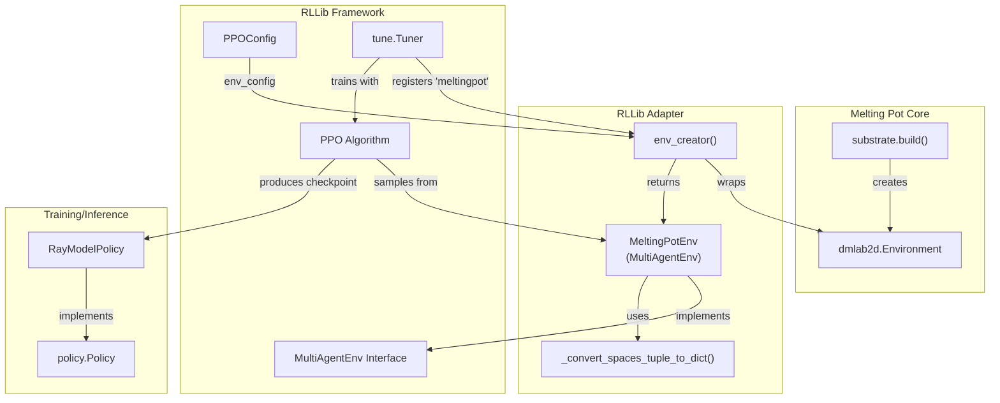

**Sources:** [examples/rllib/utils.py:1-179](), [examples/rllib/self_play_train.py:1-166]()

## MeltingPotEnv Wrapper

The `MeltingPotEnv` class is the core adapter that wraps a `dmlab2d.Environment` and exposes it as an RLLib `MultiAgentEnv`.

### Class Structure

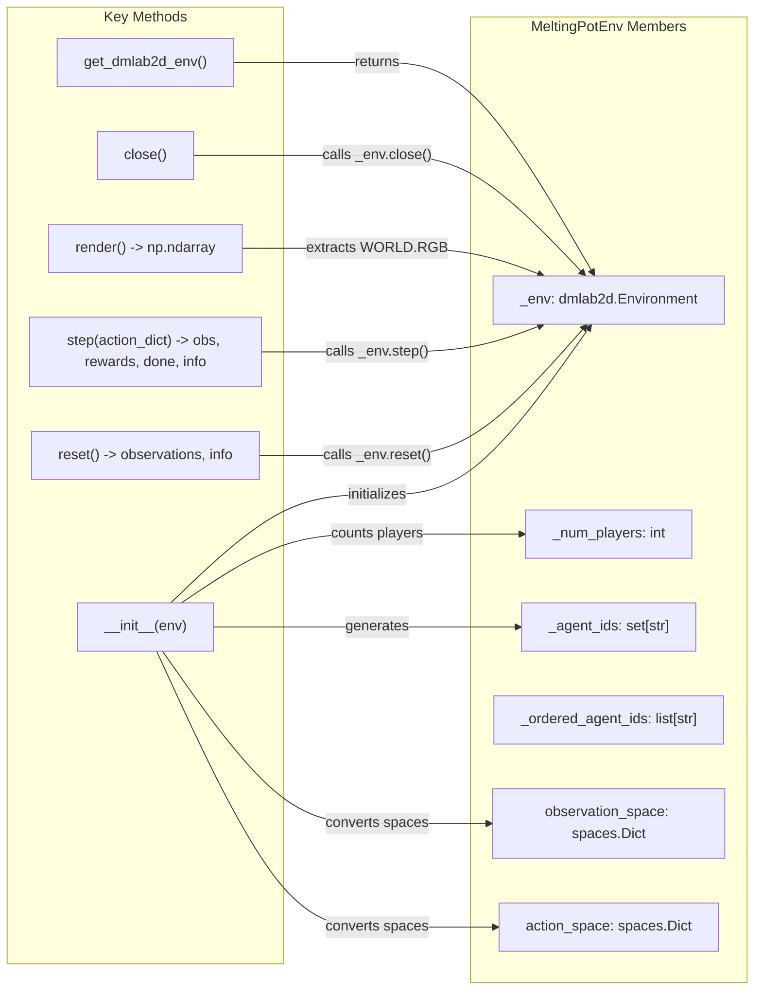

**Sources:** [examples/rllib/utils.py:34-124]()

### Agent ID Mapping

RLLib requires dictionary-based agent identification, while Melting Pot uses tuple-based indexing. The wrapper handles this conversion:

| Melting Pot Index | RLLib Agent ID | Format |
|-------------------|----------------|--------|
| 0 | `"player_0"` | `PLAYER_STR_FORMAT.format(index=0)` |
| 1 | `"player_1"` | `PLAYER_STR_FORMAT.format(index=1)` |
| ... | ... | ... |
| N-1 | `"player_{N-1}"` | `PLAYER_STR_FORMAT.format(index=N-1)` |

The `_ordered_agent_ids` list maintains the mapping from agent ID string back to index for action/observation conversion.

**Sources:** [examples/rllib/utils.py:31-48]()

### Space Conversion

The `_convert_spaces_tuple_to_dict()` method transforms Melting Pot's tuple-based observation and action spaces into RLLib's expected dictionary format:

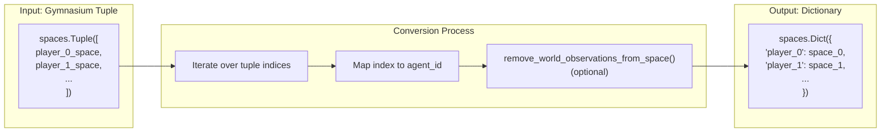

The `remove_world_observations` flag (set to `True` for observation space) removes global "WORLD.*" observations, leaving only per-agent observations.

**Sources:** [examples/rllib/utils.py:109-123](), [examples/rllib/utils.py:54-58]()

### Step Method Implementation

The `step()` method orchestrates the conversion between RLLib's dictionary-based interface and Melting Pot's tuple-based interface:

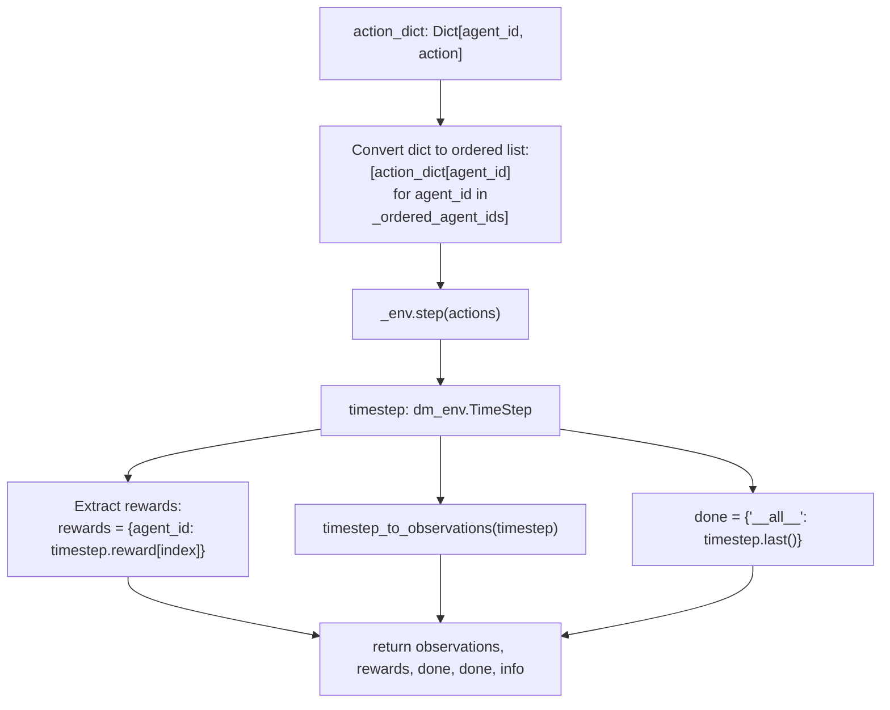

**Note:** The `done` dictionary is returned twice to satisfy RLLib's new API that returns both `terminated` and `truncated` flags.

**Sources:** [examples/rllib/utils.py:66-78]()

### Rendering Support

The `render()` method extracts the global RGB observation for video recording:

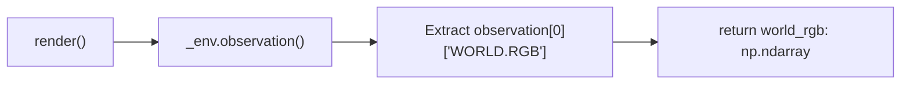

This enables RLLib's `record_env` feature in training configuration.

**Sources:** [examples/rllib/utils.py:92-107]()

## Environment Registration

The `env_creator()` function serves as a factory for creating wrapped environments and is registered with RLLib's environment registry.

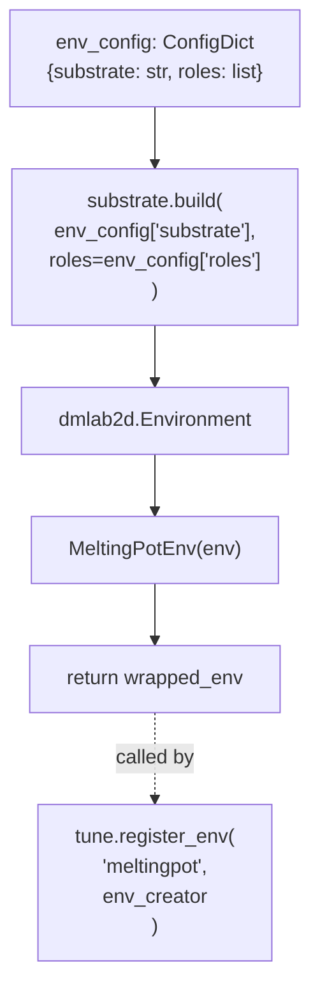

**Usage Pattern:**
1. Call `tune.register_env("meltingpot", utils.env_creator)` once before training
2. Set `config.env = "meltingpot"` in PPO configuration
3. Pass substrate and roles via `config.env_config`

**Sources:** [examples/rllib/utils.py:126-131](), [examples/rllib/self_play_train.py:145]()

## Training Configuration

The `get_config()` function in `self_play_train.py` demonstrates a complete PPO training setup for Melting Pot substrates.

### PPO Configuration Structure

```mermaid
graph TB
    subgraph "Core PPO Settings"
        PPOCONFIG["PPOConfig()"]
        WORKERS["num_rollout_workers: int"]
        FRAGMENT["rollout_fragment_length: int"]
        TRAINBATCH["train_batch_size: int"]
        MINIBATCH["sgd_minibatch_size: int"]
    end
    
    subgraph "Environment Setup"
        ENVNAME["env: 'meltingpot'"]
        ENVCONFIG["env_config: {<br/>  substrate: str,<br/>  roles: list<br/>}"]
    end
    
    subgraph "Framework Settings"
        FRAMEWORK["framework: 'tf'"]
        GPUS["num_gpus: int"]
        PREPROC["preprocessor_pref: None"]
    end
    
    subgraph "Multi-Agent Config"
        POLICIES["policies: Dict[str, PolicySpec]"]
        MAPPING["policy_mapping_fn"]
    end
    
    subgraph "Model Architecture"
        CONVFILTERS["conv_filters"]
        FCNET["fcnet_hiddens"]
        POSTFC["post_fcnet_hiddens"]
        LSTM["lstm_cell_size"]
    end
    
    PPOCONFIG --> WORKERS
    PPOCONFIG --> FRAGMENT
    PPOCONFIG --> TRAINBATCH
    PPOCONFIG --> MINIBATCH
    PPOCONFIG --> ENVNAME
    PPOCONFIG --> ENVCONFIG
    PPOCONFIG --> FRAMEWORK
    PPOCONFIG --> GPUS
    PPOCONFIG --> PREPROC
    PPOCONFIG --> POLICIES
    PPOCONFIG --> MAPPING
    PPOCONFIG --> CONVFILTERS
    PPOCONFIG --> FCNET
    PPOCONFIG --> POSTFC
    PPOCONFIG --> LSTM
```

**Sources:** [examples/rllib/self_play_train.py:28-132]()

### Multi-Agent Policy Setup

Each player role gets a dedicated policy with custom observation/action spaces and model configuration:

| Configuration Step | Code Reference | Description |
|--------------------|----------------|-------------|
| Get player roles | `substrate.get_config(substrate_name).default_player_roles` | Extract roles from substrate config |
| Create test env | `utils.env_creator(config.env_config)` | Instantiate env to inspect spaces |
| Extract RGB shape | `test_env.observation_space[f"player_{i}"]["RGB"].shape` | Get observation dimensions |
| Calculate sprite size | `sprite_x = rgb_shape[0] // 8` | Compute sprite dimensions (8x8 sprites) |
| Define policy | `policy.PolicySpec(...)` | Create policy with custom conv filters |
| Map agents | `player_to_agent[f"player_{i}"] = f"agent_{i}"` | Map player IDs to policy IDs |

**Sources:** [examples/rllib/self_play_train.py:76-107]()

### CNN Architecture

The model uses a two-layer convolutional network specifically designed for Melting Pot's 8x8 sprite-based observations:

```mermaid
graph LR
    INPUT["RGB Input<br/>(H, W, 3)"]
    CONV1["Conv Layer 1<br/>16 filters, 8x8 kernel, stride 8"]
    CONV2["Conv Layer 2<br/>128 filters, (sprite_x, sprite_y) kernel, stride 1"]
    OUTPUT["Output: (B, 1, 1, 128)"]
    FC["Fully Connected<br/>fcnet_hiddens: (64, 64)"]
    POSTFC["Post-FC<br/>post_fcnet_hiddens: (256,)"]
    LSTM["LSTM<br/>lstm_cell_size: 256"]
    
    INPUT --> CONV1
    CONV1 -->|"Downsamples to sprite grid"| CONV2
    CONV2 -->|"Must output (B, 1, 1, X)"| OUTPUT
    OUTPUT --> FC
    FC --> POSTFC
    POSTFC --> LSTM
```

**Key Design Decisions:**
- **First conv layer stride of 8**: Aligns perfectly with 8x8 sprite boundaries
- **Second conv layer dimensions**: Calculated as `sprite_x = rgb_shape[0] // 8` to ensure output shape is `[B, 1, 1, X]` (required by RLLib)
- **LSTM with previous action**: Enables temporal reasoning with `lstm_use_prev_action=True`

**Sources:** [examples/rllib/self_play_train.py:88-130]()

### Hyperparameter Reference

| Parameter | Default Value | Description |
|-----------|---------------|-------------|
| `substrate_name` | `"bach_or_stravinsky_in_the_matrix__repeated"` | Substrate to train on |
| `num_rollout_workers` | 2 | Parallel environments for sampling |
| `rollout_fragment_length` | 100 | Episode chunk length per worker |
| `train_batch_size` | 6400 | Total timesteps per training iteration |
| `fcnet_hiddens` | `(64, 64)` | Fully connected layer sizes |
| `post_fcnet_hiddens` | `(256,)` | Post-convolution FC layer |
| `lstm_cell_size` | 256 | LSTM hidden state size |
| `sgd_minibatch_size` | 128 | Mini-batch size for SGD updates |

**Sources:** [examples/rllib/self_play_train.py:28-52]()

## RayModelPolicy

The `RayModelPolicy` class wraps a trained RLLib checkpoint for inference, implementing Melting Pot's `policy.Policy` interface.

### Class Architecture

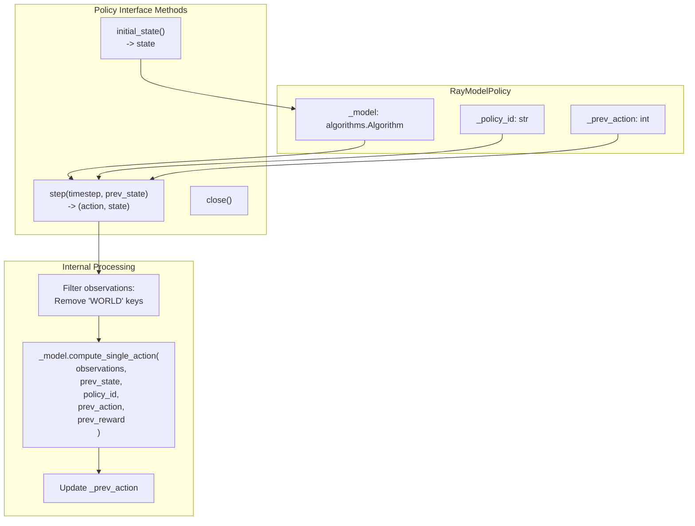

**Usage Pattern:**
```python
# Load checkpoint
trainer = get_trainer_class("PPO")(config=config)
trainer.restore(checkpoint_path)

# Create policy wrapper
policy = RayModelPolicy(trainer, policy_id="agent_0")

# Use in episode loop
state = policy.initial_state()
action, state = policy.step(timestep, state)
```

**Sources:** [examples/rllib/utils.py:134-179]()

### Observation Filtering

The `step()` method filters out global "WORLD.*" observations before passing to the model, as these were removed during training:

```python
observations = {
    key: value
    for key, value in timestep.observation.items()
    if 'WORLD' not in key
}
```

**Sources:** [examples/rllib/utils.py:156-160]()

## Complete Training Example

### Training Script Workflow

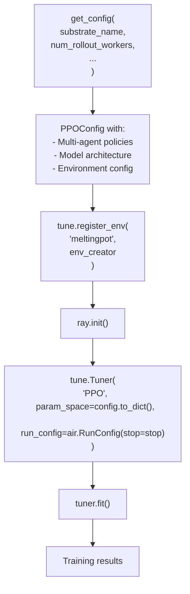

**Sources:** [examples/rllib/self_play_train.py:135-155]()

### Running Training

**Step 1:** Install dependencies:
```bash
cd <meltingpot_root>
pip install -r examples/requirements.txt
```

**Step 2:** Run training:
```bash
cd examples/rllib
python self_play_train.py
```

**Step 3:** Configure GPU usage (optional):
```bash
export RLLIB_NUM_GPUS=1
python self_play_train.py
```

**Sources:** [README.md:163-175]()

### Training Output

The training script produces:
- Checkpoints in `~/ray_results/PPO/`
- TensorBoard logs for monitoring
- `experiment_state-<DATETIME>.json` files for resuming training

**Sources:** [examples/rllib/self_play_train.py:135-155]()

## Model Visualization

The `view_models.py` script demonstrates using trained checkpoints with Pygame rendering:

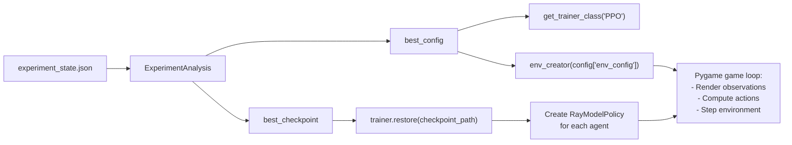

**Usage:**
```bash
python view_models.py --experiment_state ~/ray_results/PPO/experiment_state-<DATETIME>.json
```

**Sources:** [examples/rllib/view_models.py:1-110]()

## Integration Summary

### Key Components Reference

| Component | File | Purpose |
|-----------|------|---------|
| `MeltingPotEnv` | [examples/rllib/utils.py:34-124]() | Wraps dmlab2d.Environment as MultiAgentEnv |
| `env_creator()` | [examples/rllib/utils.py:126-131]() | Factory for environment registration |
| `RayModelPolicy` | [examples/rllib/utils.py:134-179]() | Wraps RLLib checkpoint as Policy |
| `get_config()` | [examples/rllib/self_play_train.py:28-132]() | Configures PPO for multi-agent training |
| `train()` | [examples/rllib/self_play_train.py:135-155]() | Executes training with Ray Tune |

### Conversion Flow Summary

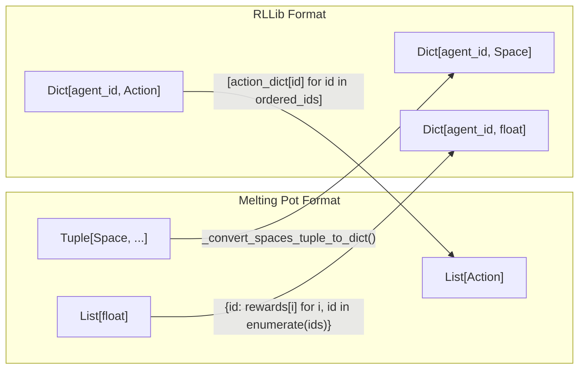

**Sources:** [examples/rllib/utils.py:34-124]()

---

