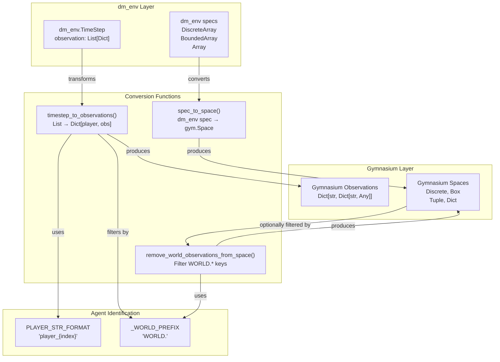
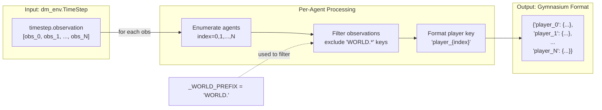
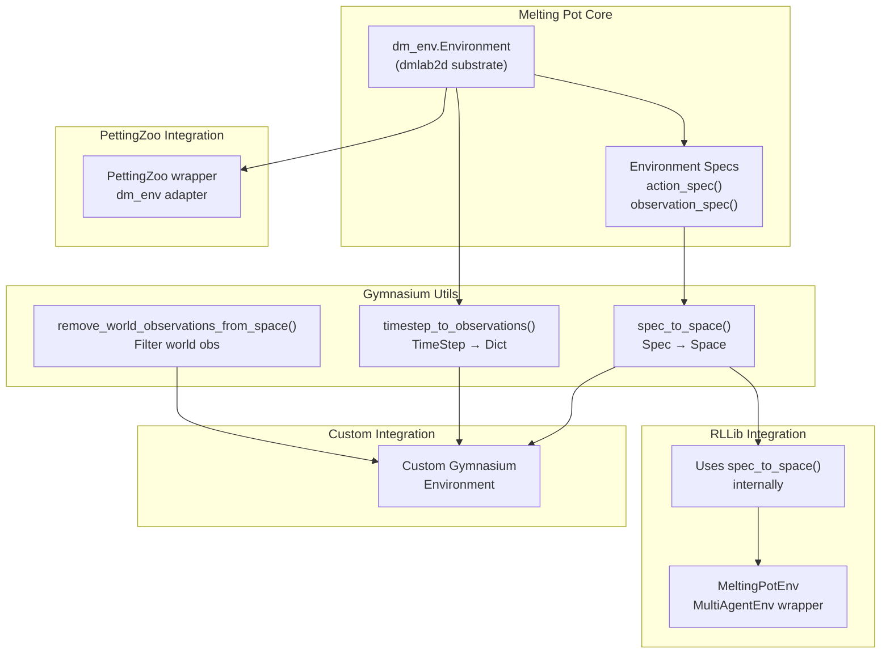

<!-- source: DeepWiki mcp.deepwiki.com · repo google-deepmind/meltingpot · page 5.2 Gymnasium Integration · fetched 2026-10-26 -->

# Gymnasium Integration

<details>
<summary>Relevant source files</summary>

The following files were used as context for generating this wiki page:

- [examples/gym/__init__.py](examples/gym/__init__.py)
- [examples/gym/utils.py](examples/gym/utils.py)
- [examples/requirements.in](examples/requirements.in)
- [examples/rllib/__init__.py](examples/rllib/__init__.py)
- [examples/rllib/self_play_train_test.py](examples/rllib/self_play_train_test.py)
- [examples/rllib/utils_test.py](examples/rllib/utils_test.py)

</details>


## Purpose and Scope

This page documents how Melting Pot integrates with the Gymnasium library, providing utilities to convert dm_env-based environments into Gymnasium-compatible spaces and observations. For training with RLLib's MultiAgentEnv wrapper, see [RLLib Integration](#5.1). For PettingZoo/Stable-Baselines3 integration, see [PettingZoo Integration](#5.3).

The Gymnasium integration consists of utility functions that handle the impedance mismatch between DeepMind's `dm_env` API and Gymnasium's space-based interface. These utilities enable Melting Pot environments to work with any Gymnasium-compatible RL library.

## Overview

Melting Pot environments natively use the `dm_env` interface from DeepMind, which differs from Gymnasium's expectations in several ways:

- **Specification types**: dm_env uses `DiscreteArray`, `BoundedArray`, and `Array` specs; Gymnasium uses `Discrete`, `Box`, `Tuple`, and `Dict` spaces
- **Observation structure**: dm_env returns lists of observations per timestep; Gymnasium expects dictionaries keyed by agent names
- **World observations**: dm_env includes special "WORLD.*" observations that may not be needed in standard Gymnasium workflows

The integration layer provides conversion utilities that bridge these differences while preserving the multi-agent nature of Melting Pot environments.

Sources: [examples/gym/utils.py:1-75]()

## Core Conversion Functions

The Gymnasium integration provides three primary conversion functions located in `examples/gym/utils.py`:

### spec_to_space()

Converts dm_env spec structures to Gymnasium spaces recursively:

| dm_env Spec Type | Gymnasium Space Type | Conversion Logic |
|------------------|---------------------|------------------|
| `DiscreteArray` | `Discrete` | Uses `spec.num_values` for space size |
| `BoundedArray` | `Box` | Uses `spec.minimum`, `spec.maximum`, `spec.shape`, `spec.dtype` |
| `Array` (float) | `Box` | Unbounded: `(-inf, inf)` with spec shape/dtype |
| `Array` (int) | `Box` | Bounded by dtype limits (e.g., int32 min/max) |
| `dict` | `Dict` | Recursively converts each value |
| `list/tuple` | `Tuple` | Recursively converts each element |

The function handles nested structures, allowing complex observation and action spaces to be properly converted.

Sources: [examples/gym/utils.py:45-75]()

### timestep_to_observations()

Transforms a dm_env timestep into a Gymnasium-compatible observation dictionary:

```
dm_env.TimeStep (list of observations) 
    → Dict[str, Dict[str, Any]] (keyed by player names)
```

The function:
1. Iterates through the timestep's observation list (one per agent)
2. Creates player keys using the format `"player_{index}"`
3. Filters out observations with the `"WORLD."` prefix
4. Returns a dictionary mapping player names to their observations

Sources: [examples/gym/utils.py:23-35]()

### remove_world_observations_from_space()

Filters a Gymnasium `Dict` space to exclude world-level observations:

- Removes any observation keys containing the `_WORLD_PREFIX` (`"WORLD."`)
- Returns a new `spaces.Dict` with only player-specific observations
- Useful for creating agent-specific observation spaces

Sources: [examples/gym/utils.py:38-42]()

## Conversion Architecture



Sources: [examples/gym/utils.py:1-75]()

## Space Conversion Details

### Discrete Actions

The most common case is converting discrete action spaces:

```python
# dm_env DiscreteArray with num_values=9
DiscreteArray(num_values=9, dtype=np.int32)

# Converts to:
spaces.Discrete(9)
```

This conversion is validated in the RLLib integration tests, where action spaces from substrate configs are verified.

Sources: [examples/gym/utils.py:57-58](), [examples/rllib/utils_test.py:38-42]()

### Bounded Observations

Visual observations (RGB arrays) are typically bounded:

```python
# dm_env BoundedArray for RGB observations
BoundedArray(shape=(72, 96, 3), dtype=np.uint8, minimum=0, maximum=255)

# Converts to:
spaces.Box(low=0, high=255, shape=(72, 96, 3), dtype=np.uint8)
```

Sources: [examples/gym/utils.py:59-60]()

### Nested Structures

Complex observation spaces with multiple components are handled recursively:

```python
# Input: dict of specs
{
  'RGB': BoundedArray(shape=(72, 96, 3), ...),
  'READY_TO_SHOOT': DiscreteArray(num_values=2, ...),
  'POSITION': Array(shape=(2,), dtype=np.float32)
}

# Converts to: spaces.Dict
spaces.Dict({
  'RGB': spaces.Box(...),
  'READY_TO_SHOOT': spaces.Discrete(2),
  'POSITION': spaces.Box(-inf, inf, shape=(2,), dtype=np.float32)
})
```

Sources: [examples/gym/utils.py:69-74]()

### Type Handling

The conversion handles different data types appropriately:

- **Floating point types**: Create unbounded `Box` spaces with `(-inf, inf)` range
- **Integer types**: Create bounded `Box` spaces using `np.iinfo()` to determine dtype limits
- **Unsupported types**: Raise `NotImplementedError`

Sources: [examples/gym/utils.py:62-68]()

## Observation Transformation Pipeline



Sources: [examples/gym/utils.py:27-35]()

## Multi-Agent Observation Handling

Melting Pot environments are inherently multi-agent, and the Gymnasium integration preserves this structure:

### Player Naming Convention

Each agent is identified using the `PLAYER_STR_FORMAT` constant:
- Format: `"player_{index}"`
- Example: `"player_0"`, `"player_1"`, `"player_2"`, etc.
- Index corresponds to the position in the timestep's observation list

Sources: [examples/gym/utils.py:23]()

### World vs. Player Observations

The dm_env interface can include two types of observations:

1. **Player-specific observations**: Standard observations for individual agents
2. **World observations**: Global observations prefixed with `"WORLD."`

The `timestep_to_observations()` function automatically filters out world observations, keeping only player-specific ones. If world observations are needed, they can be accessed directly from the original timestep before conversion.

Sources: [examples/gym/utils.py:31-34]()

### Observation Space Filtering

To create agent-specific observation spaces that exclude world information:

```python
# Start with full observation space (includes WORLD.* keys)
full_obs_space = spec_to_space(env.observation_spec())

# Filter to get player-only space
player_obs_space = remove_world_observations_from_space(full_obs_space)
```

This is particularly useful when wrapping environments for frameworks that expect per-agent observation spaces.

Sources: [examples/gym/utils.py:38-42]()

## Integration with RL Frameworks

### Dependencies

Gymnasium integration requires the following packages (defined in examples requirements):

- `gymnasium` - Core Gymnasium library
- `dm_env` - DeepMind environment interface
- `dm_tree` - For nested structure handling
- `numpy` - Numerical operations

Sources: [examples/requirements.in:3-9]()

### Usage Pattern

The typical integration pattern involves:

1. **Create substrate environment** using Melting Pot's substrate API
2. **Extract specifications** for actions and observations
3. **Convert to Gymnasium spaces** using `spec_to_space()`
4. **Transform timesteps** using `timestep_to_observations()` during environment steps
5. **Optionally filter** world observations using `remove_world_observations_from_space()`

This pattern allows Melting Pot to integrate with any Gymnasium-compatible library while maintaining the multi-agent structure.

Sources: [examples/gym/utils.py:1-75]()

## Relationship to Other Integrations



The Gymnasium utilities serve as foundational conversion tools:

- **RLLib integration** (page [5.1](#5.1)) internally uses `spec_to_space()` to define action spaces in the `MeltingPotEnv` wrapper
- **Custom integrations** can use all three utilities to build Gymnasium-compatible wrappers
- **PettingZoo integration** (page [5.3](#5.3)) uses a different wrapping approach but addresses similar conversion challenges

Sources: [examples/gym/utils.py:1-75](), [examples/rllib/utils_test.py:17-42]()

## Validation and Testing

The conversion functions are validated through the RLLib integration tests, which verify:

- **Action space conversion**: Discrete action spaces match expected sizes from substrate configurations
- **Space type correctness**: Converted spaces have appropriate Gymnasium types (`Discrete`, `Box`, etc.)
- **Multi-agent structure**: Observations are properly keyed by player identifiers

Example validation from tests:

| Test Case | Validation |
|-----------|------------|
| Action space size | `env.action_space['player_1'] == Discrete(actions_count)` |
| Observation count | `len(obs) == num_players` after reset |
| Reward structure | `len(rewards) == num_players` after step |

Sources: [examples/rllib/utils_test.py:38-62]()

---

