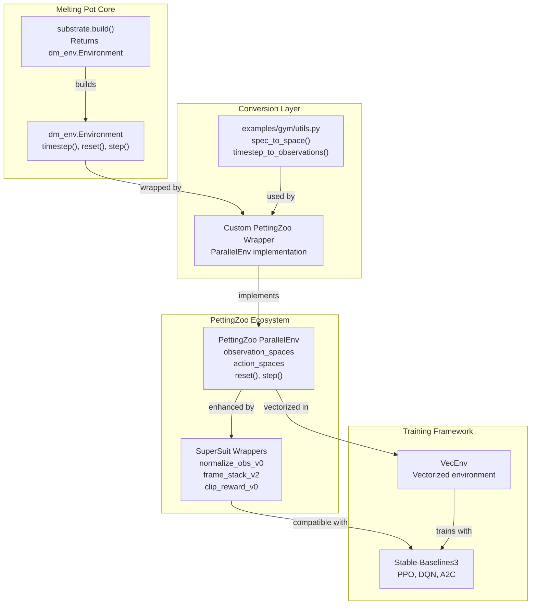
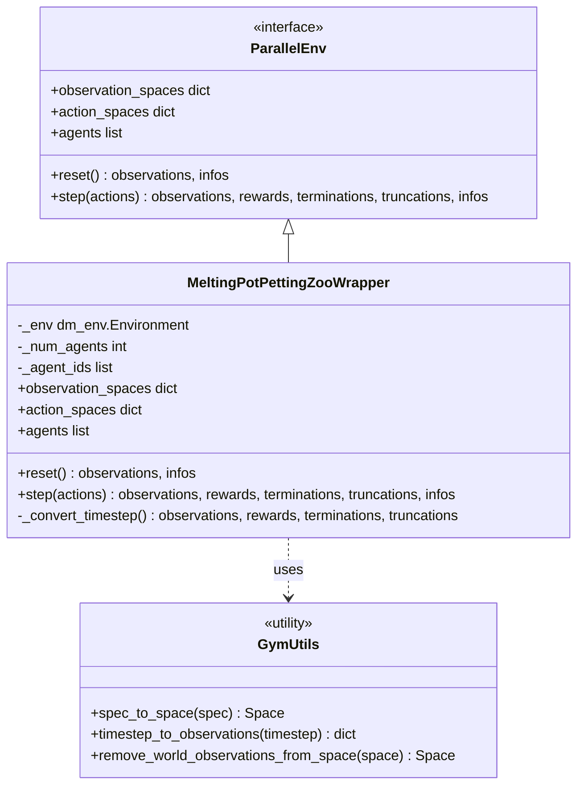
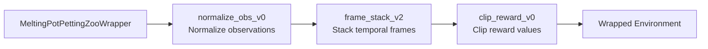
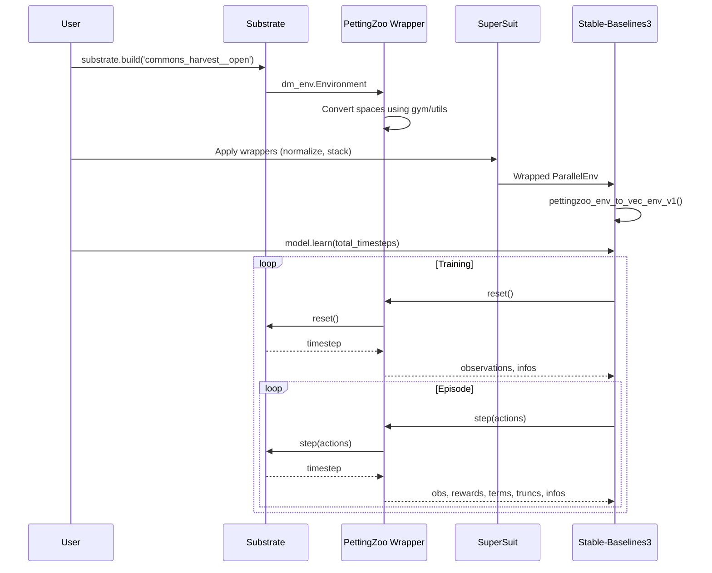

<!-- source: DeepWiki mcp.deepwiki.com · repo google-deepmind/meltingpot · page 5.3 PettingZoo Integration · fetched 2026-10-26 -->

# PettingZoo Integration

<details>
<summary>Relevant source files</summary>

The following files were used as context for generating this wiki page:

- [examples/gym/__init__.py](examples/gym/__init__.py)
- [examples/gym/utils.py](examples/gym/utils.py)
- [examples/requirements.in](examples/requirements.in)
- [examples/rllib/__init__.py](examples/rllib/__init__.py)
- [examples/rllib/self_play_train_test.py](examples/rllib/self_play_train_test.py)
- [examples/rllib/utils_test.py](examples/rllib/utils_test.py)

</details>


## Purpose and Scope

This document describes how to integrate Melting Pot environments with PettingZoo, a Python library for multi-agent reinforcement learning that provides a standard API compatible with Stable-Baselines3. Unlike RLLib integration ([5.1](#5.1)) which has a built-in `MeltingPotEnv` wrapper, and Gymnasium integration ([5.2](#5.2)) which provides conversion utilities, PettingZoo integration requires implementing a custom wrapper that adapts Melting Pot's `dm_env` interface to PettingZoo's API specifications.

The integration enables:
- Training with Stable-Baselines3 algorithms (PPO, DQN, A2C, etc.)
- Using SuperSuit wrappers for preprocessing and observation manipulation
- Leveraging PettingZoo's ecosystem of multi-agent environments and tools

**Scope**: This page covers the conceptual approach to PettingZoo integration, the necessary adapter implementation, and how to use SuperSuit and Stable-Baselines3 with Melting Pot. For RLLib-based training, see [5.1](#5.1). For general Gymnasium space conversions, see [5.2](#5.2).

## PettingZoo API Overview

PettingZoo provides two API standards for multi-agent environments:

| API Type | Description | Use Case |
|----------|-------------|----------|
| **AEC (Agent Environment Cycle)** | Turn-based API where agents act sequentially | Environments where agent order matters, easier to implement |
| **Parallel API** | All agents act simultaneously each step | Environments where agents act in parallel, more efficient |

Melting Pot environments are naturally parallel (all agents observe and act simultaneously), making the Parallel API the more appropriate choice. However, both APIs are interconvertible using PettingZoo's utilities.

### Parallel API Requirements

A PettingZoo Parallel environment must implement:

```python
# Core methods
reset(seed=None, options=None) -> observations, infos
step(actions) -> observations, rewards, terminations, truncations, infos

# Properties
agents: list  # List of agent IDs
observation_spaces: dict  # Gymnasium spaces per agent
action_spaces: dict  # Gymnasium spaces per agent
```

Sources: PettingZoo documentation (external), [examples/gym/utils.py:45-74]()

## Architecture Overview



Sources: [examples/gym/utils.py:1-75](), [examples/requirements.in:1-13]()

## Implementing the PettingZoo Wrapper

Since Melting Pot does not provide a built-in PettingZoo wrapper, you must implement a custom adapter. This wrapper should leverage the existing Gymnasium conversion utilities.

### Basic Wrapper Structure



Sources: [examples/gym/utils.py:27-43](), [examples/gym/utils.py:45-74]()

### Key Implementation Details

#### Agent Naming Convention

Melting Pot uses zero-indexed agent observations. The wrapper should convert these to PettingZoo's string-based agent IDs:

```
PLAYER_STR_FORMAT = 'player_{index}'
```

This format is used in both the Gymnasium utilities and should be consistent across integrations.

Sources: [examples/gym/utils.py:23-24]()

#### Space Conversion

The wrapper must convert dm_env specs to Gymnasium spaces for both observations and actions:

**Observation Spaces**:
- Use `spec_to_space()` to convert dm_env specs to Gymnasium spaces
- Use `timestep_to_observations()` to convert timesteps to agent-keyed dictionaries
- Filter out world observations (prefixed with `'WORLD.'`) using `remove_world_observations_from_space()`

**Action Spaces**:
- Convert `dm_env.specs.DiscreteArray` to `spaces.Discrete`
- All agents in a substrate share the same action space

Sources: [examples/gym/utils.py:27-43](), [examples/gym/utils.py:45-74]()

#### Timestep Conversion

The wrapper must map dm_env timesteps to PettingZoo's return format:

| dm_env | PettingZoo Parallel |
|--------|---------------------|
| `timestep.observation` | `observations` (dict keyed by agent ID) |
| `timestep.reward` | `rewards` (dict keyed by agent ID) |
| `timestep.discount == 0.0` | `terminations` (dict of booleans) |
| Episode length limit | `truncations` (dict of booleans) |
| Extra data | `infos` (dict of dicts) |

Note that dm_env uses `discount` to signal termination (0.0 = terminal), while PettingZoo uses explicit `terminations` and `truncations` dictionaries.

#### World Observations Handling

Melting Pot environments provide both per-agent observations and global "world" observations (prefixed with `'WORLD.'`). These should typically be filtered out for PettingZoo compatibility, as Stable-Baselines3 expects consistent observation spaces across agents:

```python
# Filter implementation from gym/utils.py
_WORLD_PREFIX = 'WORLD.'

def remove_world_observations_from_space(observation: spaces.Dict) -> spaces.Dict:
  return spaces.Dict({
      key: observation[key] for key in observation if _WORLD_PREFIX not in key
  })
```

Sources: [examples/gym/utils.py:24-25](), [examples/gym/utils.py:38-42]()

## SuperSuit Integration

SuperSuit provides a collection of wrappers for PettingZoo environments. Once you have a PettingZoo-compatible wrapper, you can apply SuperSuit transformations:



### Common SuperSuit Wrappers

| Wrapper | Purpose | Configuration |
|---------|---------|---------------|
| `normalize_obs_v0` | Normalize observations to [0, 1] or [-1, 1] | Useful for vision-based observations |
| `frame_stack_v2` | Stack multiple consecutive frames | Provides temporal context (e.g., velocity) |
| `clip_reward_v0` | Clip rewards to a range | Stabilize training with reward clipping |
| `dtype_v0` | Convert observation dtype | E.g., float64 to float32 for efficiency |
| `flatten_v0` | Flatten observation spaces | Convert Dict spaces to Box spaces |

SuperSuit is included in the examples requirements:

```
supersuit>=3.7.2
```

Sources: [examples/requirements.in:11-12]()

## Training with Stable-Baselines3

Stable-Baselines3 (SB3) supports PettingZoo environments but expects single-agent interfaces. You must either:

1. **Convert to AEC API**: Use PettingZoo's `parallel_to_aec()` converter and SB3's `ss.pettingzoo_env_to_vec_env_v1()` from SuperSuit
2. **Use Independent Learners**: Treat each agent as an independent learner with its own policy

### Example Training Flow



Sources: [examples/requirements.in:11-12](), [examples/gym/utils.py:27-35]()

## Comparison with Other Integrations

| Aspect | PettingZoo | RLLib ([5.1](#5.1)) | Gymnasium ([5.2](#5.2)) |
|--------|------------|---------------------|--------------------------|
| **Built-in Wrapper** | No (custom required) | Yes (`MeltingPotEnv`) | Utilities only |
| **API Type** | Parallel/AEC | MultiAgentEnv | Single-agent focused |
| **Training Framework** | Stable-Baselines3 | Ray RLLib algorithms | Generic (any framework) |
| **Preprocessing** | SuperSuit | RLLib preprocessors | Manual |
| **Multi-agent Support** | Native | Native | Requires manual handling |
| **Complexity** | Medium (wrapper needed) | Low (built-in) | Low (utilities only) |
| **Scalability** | Limited (single machine) | High (distributed) | Depends on framework |

### When to Use PettingZoo Integration

**Use PettingZoo/Stable-Baselines3 when**:
- You want simple, single-machine training
- You need Stable-Baselines3 algorithms (PPO, SAC, TD3)
- You prefer a simple API without distributed complexity
- Your environments fit in single-machine memory

**Use RLLib instead when**:
- You need distributed, scalable training
- You want built-in support without custom wrappers
- You're training on large-scale substrates

**Use Gymnasium utilities when**:
- You're building custom training loops
- You want maximum flexibility
- You're integrating with other frameworks

Sources: [examples/requirements.in:10-12](), [examples/rllib/utils_test.py:24-76]()

## Implementation Checklist

When implementing a PettingZoo wrapper for Melting Pot:

- [ ] Import conversion utilities from `examples.gym.utils`
- [ ] Implement `ParallelEnv` interface (or `AECEnv` if needed)
- [ ] Use `spec_to_space()` for observation and action space conversion
- [ ] Use `timestep_to_observations()` for observation dictionary creation
- [ ] Filter world observations with `remove_world_observations_from_space()`
- [ ] Map agent indices to string IDs using `PLAYER_STR_FORMAT`
- [ ] Convert dm_env discounts to PettingZoo terminations/truncations
- [ ] Ensure all agents have consistent observation and action spaces
- [ ] Add SuperSuit wrappers as needed (normalize, frame stack, etc.)
- [ ] Test with a simple Stable-Baselines3 algorithm (e.g., PPO)
- [ ] Verify compatibility with `pettingzoo_env_to_vec_env_v1()`

Sources: [examples/gym/utils.py:1-75](), [examples/requirements.in:1-13]()

---

