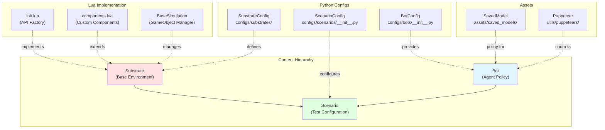
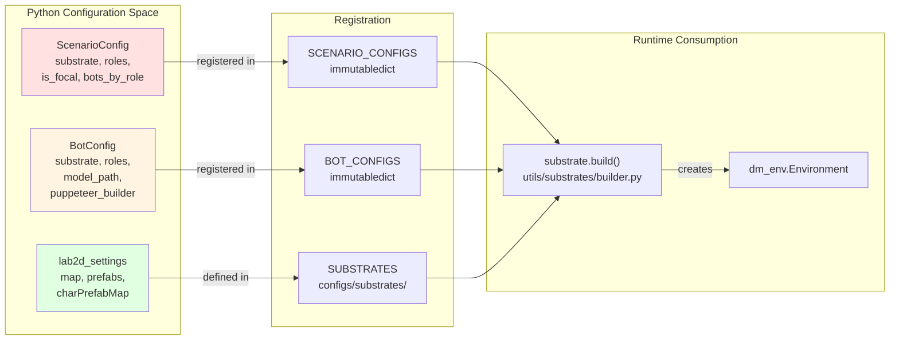
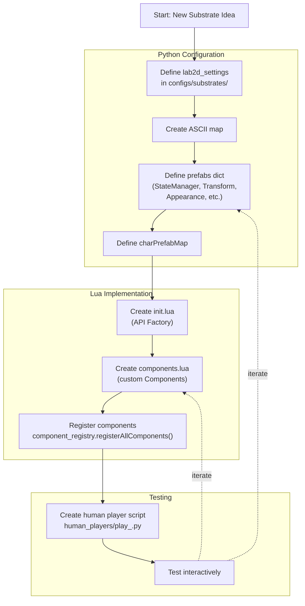
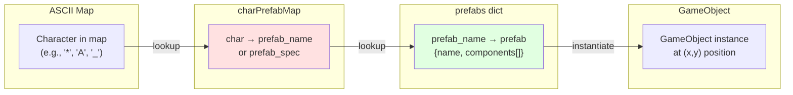
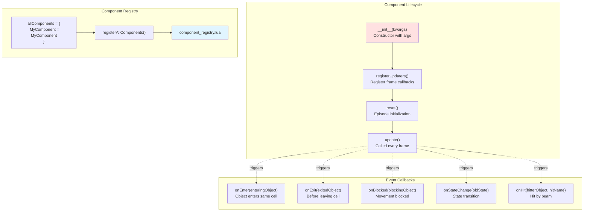
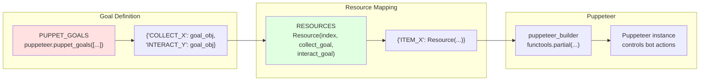
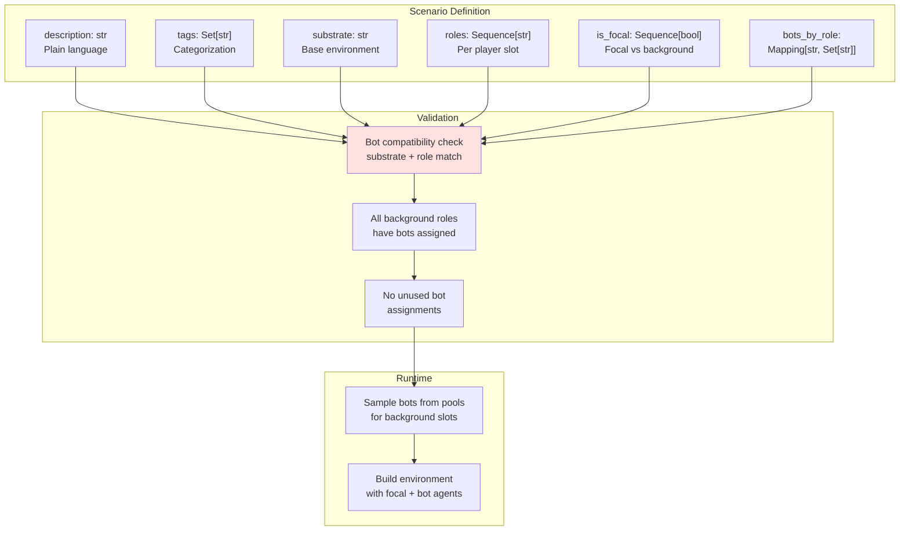

<!-- source: DeepWiki mcp.deepwiki.com · repo google-deepmind/meltingpot · page 6 Creating Content · fetched 2026-10-26 -->

# Creating Content

<details>
<summary>Relevant source files</summary>

The following files were used as context for generating this wiki page:

- [docs/advanced.md](docs/advanced.md)
- [docs/extending.md](docs/extending.md)
- [docs/substrate_tutorial/index.md](docs/substrate_tutorial/index.md)
- [docs/substrates.md](docs/substrates.md)
- [meltingpot/configs/bots/__init__.py](meltingpot/configs/bots/__init__.py)
- [meltingpot/configs/scenarios/__init__.py](meltingpot/configs/scenarios/__init__.py)
- [meltingpot/configs/scenarios/scenario_configs_test.py](meltingpot/configs/scenarios/scenario_configs_test.py)
- [meltingpot/lua/modules/colors.lua](meltingpot/lua/modules/colors.lua)

</details>


This page provides a comprehensive overview of creating new content for Melting Pot. Content creation encompasses three main activities: creating substrates (game environments), configuring scenarios (specific test conditions with bots), and implementing bots (agents with pre-trained policies or scripted behaviors).

For detailed step-by-step instructions on creating a substrate, see [Substrate Creation Tutorial](#6.1). For scenario-specific configuration details, see [Scenario Configuration](#6.2). For bot implementation patterns, see [Bot Implementation](#6.3). For custom component development, see [Custom Components](#6.4).

## Content Types and Relationships

Melting Pot content is organized into three interconnected types that build upon each other:



Sources: [meltingpot/configs/scenarios/__init__.py:23-52](), [meltingpot/configs/bots/__init__.py:445-463](), [docs/extending.md:1-79]()

### Substrates

A **substrate** is a base game environment that defines the world, rules, and physics. Each substrate consists of:
- ASCII map defining the world layout
- Prefab definitions for GameObjects (walls, items, avatars)
- Custom Lua components implementing game logic
- Python configuration specifying settings

### Scenarios

A **scenario** is a specific test configuration of a substrate that defines:
- Which player slots are focal (being tested) vs. background (bots)
- Role assignments for each player slot
- Bot sampling pools for background players

### Bots

A **bot** is an agent policy that can fill background player slots in scenarios. Bots come in two types:
- **Saved models**: TensorFlow SavedModel with trained policy
- **Puppets**: Scripted agents controlled by a `Puppeteer` class

## Configuration System Architecture

The configuration system uses Python `ConfigDict` objects and dataclasses to define content, which are then consumed by the Lua runtime:



Sources: [meltingpot/configs/scenarios/__init__.py:23-52](), [meltingpot/configs/bots/__init__.py:445-463](), [meltingpot/configs/substrates/__init__.py]()

## Directory Structure for New Content

When creating new content, follow this directory organization:

| Content Type | Location | Required Files |
|--------------|----------|----------------|
| **Substrate (Lua)** | `meltingpot/lua/levels/<substrate_name>/` | `init.lua`, `components.lua` (optional) |
| **Substrate (Python)** | `meltingpot/configs/substrates/<substrate_name>.py` | Config with `lab2d_settings` |
| **Scenario** | Add to `meltingpot/configs/scenarios/__init__.py` | Entry in `SCENARIO_CONFIGS` dict |
| **Bot (Saved Model)** | `meltingpot/assets/saved_models/<substrate_name>/<model_name>/` | TensorFlow SavedModel files |
| **Bot (Puppet)** | `meltingpot/utils/puppeteers/<name>.py` | `Puppeteer` subclass |
| **Bot Config** | Add to `meltingpot/configs/bots/__init__.py` | Entry in `BOT_CONFIGS` dict |
| **Human Player** | `meltingpot/human_players/play_<substrate_name>.py` | Interactive test script |

Sources: [docs/substrates.md:5-52](), [docs/extending.md:8-79]()

## Substrate Creation Workflow

Creating a substrate involves coordinating Python configuration with Lua implementation:



Sources: [docs/substrate_tutorial/index.md:1-769](), [docs/substrates.md:54-516]()

### Key Configuration Objects

**ScenarioConfig Structure:**

```python
@dataclasses.dataclass(frozen=True)
class ScenarioConfig:
    description: str                              # Plain language description
    tags: AbstractSet[str]                        # Categorization tags
    substrate: str                                # Substrate name
    roles: Sequence[str]                          # Role per player slot
    is_focal: Sequence[bool]                      # True if focal agent
    bots_by_role: Mapping[str, AbstractSet[str]]  # Bot pools by role
```

Sources: [meltingpot/configs/scenarios/__init__.py:23-52]()

**BotConfig Structure:**

```python
@dataclasses.dataclass(frozen=True)
class BotConfig:
    substrate: str                                     # Substrate trained on
    roles: AbstractSet[str]                            # Valid roles
    model_path: str                                    # Path to SavedModel
    puppeteer_builder: Optional[Callable[[], Puppeteer]]  # For puppets
```

Sources: [meltingpot/configs/bots/__init__.py:445-463]()

## Prefab System

Prefabs are templates for GameObjects that define their components and behavior. The prefab system uses a three-level mapping:



Sources: [docs/substrates.md:168-243](), [docs/substrate_tutorial/index.md:203-239]()

### Prefab Specification Types

Prefabs can be specified in `charPrefabMap` in three ways:

| Type | Structure | Purpose |
|------|-----------|---------|
| **Direct** | `"*": "wall"` | Single prefab name |
| **All** | `{"type": "all", "list": ["wall", "spawn"]}` | Multiple GameObjects at same location (different layers) |
| **Choice** | `{"type": "choice", "list": ["apple_red", "apple_green"]}` | Random selection from list |

Sources: [docs/substrates.md:266-291]()

## Component Development

Components are the building blocks of GameObject behavior, implemented in Lua:



Sources: [docs/substrates.md:425-486](), [docs/substrate_tutorial/index.md:549-692]()

### Required vs Optional Components

Every GameObject must have these components:

- **`StateManager`**: Manages state transitions, layer, sprite, groups
- **`Transform`**: Handles position and orientation

Common optional components:

| Component | Purpose | Key Parameters |
|-----------|---------|----------------|
| `Avatar` | Player control | `index`, `spawnGroup`, `actionSpec`, `view` |
| `Appearance` | Visual rendering | `spriteNames`, `spriteShapes`, `palettes` |
| `Edible` | Consumable items | `liveState`, `waitState`, `rewardForEating` |
| `BeamBlocker` | Block beams/zaps | `beamType` |
| `Zapper` | Fire beams | `cooldownTime`, `beamLength`, `beamRadius` |

Sources: [meltingpot/lua/modules/component_library.lua](), [meltingpot/lua/modules/avatar_library.lua](), [docs/substrate_tutorial/index.md:82-160]()

## Bot Types and Implementation

Bots provide background agents for scenarios. They are configured in Python but may have Lua or Python runtime components:

**Saved Model Bot:**

```python
saved_model(
    substrate='substrate_name',
    roles=('role1', 'role2'),
    model='model_directory_name',
    models_root=MODELS_ROOT
)
```

**Puppet Bot:**

```python
puppet(
    substrate='substrate_name', 
    roles=('role1', 'role2'),
    model='model_directory_name',
    puppeteer_builder=functools.partial(
        PuppeteerClass,
        initial_goal=PUPPET_GOALS['substrate']['GOAL_NAME'],
        **other_kwargs
    )
)
```

Sources: [meltingpot/configs/bots/__init__.py:465-507](), [docs/extending.md:26-35]()

### Puppet Goals and Resources

Puppets use goal-based control where goals are mapped to resources in the environment:



Sources: [meltingpot/configs/bots/__init__.py:43-222](), [meltingpot/configs/bots/__init__.py:224-442]()

## Scenario Configuration

Scenarios combine substrates and bots to create specific test conditions:



Sources: [meltingpot/configs/scenarios/__init__.py:23-52](), [meltingpot/configs/scenarios/scenario_configs_test.py:30-105]()

### Scenario Naming Convention

Scenarios follow the naming pattern: `<substrate_name>__<variant>_<number>`

Example: `allelopathic_harvest__open_0` where:
- `allelopathic_harvest__open` is the substrate
- `0` is the variant number

Sources: [meltingpot/configs/scenarios/scenario_configs_test.py:52-54]()

## Validation and Testing

Content must pass several validation checks before use:

**Scenario Validation:**

| Check | Validates | Location |
|-------|-----------|----------|
| `test_has_description` | Non-empty description | [scenario_configs_test.py:40-41]() |
| `test_has_tags` | Non-empty tags | [scenario_configs_test.py:44-45]() |
| `test_has_valid_substrate` | Substrate exists | [scenario_configs_test.py:48-49]() |
| `test_name_starts_with_substrate_name` | Naming convention | [scenario_configs_test.py:53-54]() |
| `test_has_focal_players` | At least one focal player | [scenario_configs_test.py:57-58]() |
| `test_has_matching_sizes` | `roles` and `is_focal` match | [scenario_configs_test.py:61-62]() |
| `test_has_valid_roles` | Roles valid for substrate | [scenario_configs_test.py:65-67]() |
| `test_bots_compatible` | Bots support substrate+role | [scenario_configs_test.py:75-85]() |
| `test_no_missing_role_assigments` | All background roles have bots | [scenario_configs_test.py:88-96]() |
| `test_no_unused_role_assignments` | No redundant bot assignments | [scenario_configs_test.py:99-104]() |

Sources: [meltingpot/configs/scenarios/scenario_configs_test.py:37-105]()

**Interactive Testing:**

Use human player scripts to interactively test substrates:

```python
# Example: meltingpot/human_players/play_<substrate>.py
python meltingpot/human_players/play_substrate.py \
    --substrate_name=your_substrate \
    --observation=WORLD.RGB \
    --verbose=True
```

The `--verbose` flag enables debugging output through the `verbose_fn` callback.

Sources: [docs/substrate_tutorial/index.md:536-547](), [docs/substrates.md:495-516]()

## Content Creation Checklist

When creating new content, ensure you complete these steps:

**For a New Substrate:**
- [ ] Create Lua directory structure: `meltingpot/lua/levels/<name>/`
- [ ] Implement `init.lua` with API Factory
- [ ] Define custom components in `components.lua` (if needed)
- [ ] Create Python config in `meltingpot/configs/substrates/<name>.py`
- [ ] Define `lab2d_settings` with `map`, `prefabs`, `charPrefabMap`
- [ ] Create human player script in `meltingpot/human_players/`
- [ ] Test interactively

**For a New Scenario:**
- [ ] Train or implement bots for the substrate
- [ ] Add bot configs to `meltingpot/configs/bots/__init__.py`
- [ ] Add scenario config to `meltingpot/configs/scenarios/__init__.py`
- [ ] Verify bot compatibility with substrate and roles
- [ ] Ensure all background roles have bot assignments
- [ ] Run scenario validation tests

**For a New Bot:**
- [ ] Train SavedModel OR implement Puppeteer class
- [ ] Save model to `meltingpot/assets/saved_models/<substrate>/<model>/`
- [ ] Add entry to `BOT_CONFIGS` in `meltingpot/configs/bots/__init__.py`
- [ ] Specify substrate, roles, and model path
- [ ] For puppets: define puppet goals and resource mappings
- [ ] Test bot in target scenario

Sources: [docs/extending.md:1-79](), [docs/substrates.md:1-516]()

---

