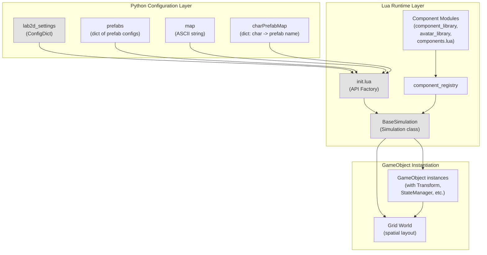
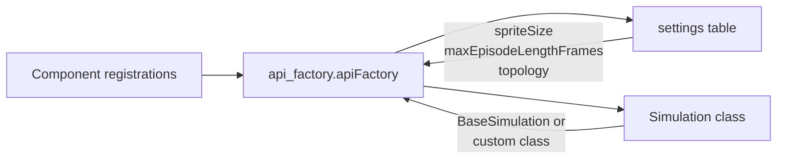
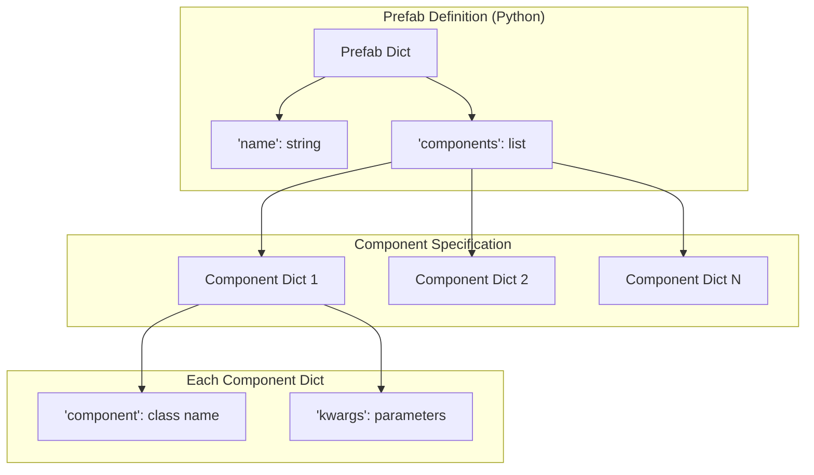
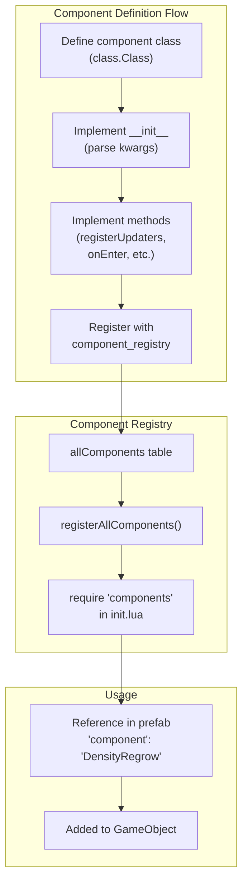
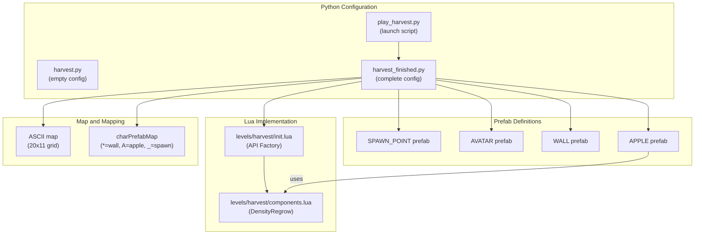
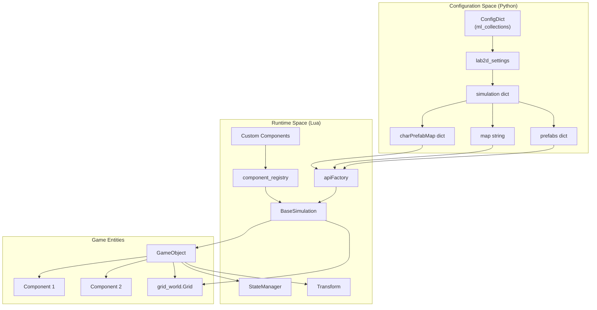

<!-- source: DeepWiki mcp.deepwiki.com · repo google-deepmind/meltingpot · page 6.1 Substrate Creation Tutorial · fetched 2026-10-26 -->

# Substrate Creation Tutorial

<details>
<summary>Relevant source files</summary>

The following files were used as context for generating this wiki page:

- [docs/advanced.md](docs/advanced.md)
- [docs/extending.md](docs/extending.md)
- [docs/substrate_tutorial/index.md](docs/substrate_tutorial/index.md)
- [docs/substrates.md](docs/substrates.md)
- [examples/tutorial/harvest/configs/environment/harvest.py](examples/tutorial/harvest/configs/environment/harvest.py)
- [examples/tutorial/harvest/configs/environment/harvest_finished.py](examples/tutorial/harvest/configs/environment/harvest_finished.py)
- [meltingpot/lua/modules/api_factory.lua](meltingpot/lua/modules/api_factory.lua)
- [meltingpot/lua/modules/colors.lua](meltingpot/lua/modules/colors.lua)

</details>


## Purpose and Scope

This document provides a step-by-step guide for creating a new substrate (game environment) in Melting Pot. A substrate defines the core game mechanics, visual layout, and object behaviors that form the foundation for multi-agent scenarios.

This tutorial covers:
- Setting up the directory structure and configuration files
- Defining GameObjects using prefabs
- Creating ASCII maps and mapping characters to prefabs
- Implementing custom components in Lua
- Testing substrates interactively

For information on configuring scenarios (which assign bots to substrates), see [Scenario Configuration](#6.2). For bot implementation details, see [Bot Implementation](#6.3).

---

## Substrate Architecture Overview

A Melting Pot substrate consists of two main layers: a Python configuration layer that defines what objects exist and their properties, and a Lua runtime layer that implements the game logic.



**Substrate Creation Flow**

Sources: [docs/substrate_tutorial/index.md:1-68](), [docs/substrates.md:1-53](), [meltingpot/lua/modules/api_factory.lua:26-115]()

---

## Required Components

### Directory Structure

Substrates follow a specific directory structure that allows the dmlab2d engine to locate files correctly.

| Directory/File | Purpose | Required |
|---------------|---------|----------|
| `levelDirectory/substrate_name/` | Root directory for substrate | Yes |
| `levelDirectory/substrate_name/init.lua` | API Factory implementation | Yes |
| `levelDirectory/substrate_name/components.lua` | Custom component definitions | Optional |
| `configs/environment/substrate_name.py` | Python configuration | Yes |

The `levelDirectory` parameter is specified in the Python configuration and tells the engine where to find Lua files.

Sources: [docs/substrates.md:7-46]()

### Python Configuration File

The Python configuration uses `ml_collections.ConfigDict` to define substrate parameters. The minimal structure includes:

```python
# Required structure in get_config()
config.lab2d_settings = {
    "levelName": "substrate_name",           # Directory name in levelDirectory
    "levelDirectory": "path/to/levels",      # Where to find init.lua
    "maxEpisodeLengthFrames": 1000,          # Episode length
    "numPlayers": 1,                          # Number of players
    "spriteSize": 8,                          # Sprite dimensions (8x8 pixels)
    "simulation": {
        "map": "...",                         # ASCII layout
        "prefabs": {},                        # GameObject templates
        "charPrefabMap": {},                  # ASCII char to prefab mapping
        "playerPalettes": [],                 # Optional color palettes
    },
}
```

Key configuration parameters:

| Parameter | Type | Description |
|-----------|------|-------------|
| `individual_observation_names` | list | Per-player observations (e.g. `["RGB"]`) |
| `global_observation_names` | list | World observations (e.g. `["WORLD.RGB"]`) |
| `lab2d_settings.simulation.map` | str | ASCII map layout |
| `lab2d_settings.simulation.prefabs` | dict | Prefab name to prefab config mapping |
| `lab2d_settings.simulation.charPrefabMap` | dict | ASCII character to prefab name mapping |

Sources: [examples/tutorial/harvest/configs/environment/harvest.py:19-46](), [docs/substrates.md:138-167]()

### Lua API Factory (init.lua)

The `init.lua` file creates an API Factory that bridges the Python configuration to the Lua simulation engine.



**API Factory Structure in init.lua**

Minimal `init.lua` structure:

```lua
local meltingpot = 'meltingpot.lua.modules.'
local api_factory = require(meltingpot .. 'api_factory')
local simulation = require(meltingpot .. 'base_simulation')

-- Register components by requiring them
local component_library = require(meltingpot .. 'component_library')
local avatar_library = require(meltingpot .. 'avatar_library')
local components = require 'components'  -- Custom components

return api_factory.apiFactory{
    Simulation = simulation.BaseSimulation,
    settings = {
        spriteSize = 8,
        maxEpisodeLengthFrames = 1000,
        simulation = {},  -- Filled from Python config
        topology = 'BOUNDED',  -- or 'TORUS'
    }
}
```

The `topology` parameter controls world wrapping behavior. `'BOUNDED'` creates walls at edges, while `'TORUS'` wraps around.

Sources: [docs/substrates.md:69-106](), [meltingpot/lua/modules/api_factory.lua:26-115]()

---

## GameObject Prefabs

Prefabs are templates that define GameObject structure and components. They are Python dictionaries that specify which components a GameObject has and their parameters.



**Prefab Structure**

### Required Components

Every GameObject must have two components:

1. **StateManager**: Manages visual state, layer, and groups
2. **Transform**: Manages position and orientation

Example minimal prefab from the tutorial:

```python
SPAWN_POINT = {
    "name": "spawn_point",
    "components": [
        {
            "component": "StateManager",
            "kwargs": {
                "initialState": "spawnPoint",
                "stateConfigs": [{
                    "state": "spawnPoint",
                    "groups": ["spawnPoints"],
                }],
            }
        },
        {
            "component": "Transform",
        },
    ]
}
```

Sources: [docs/substrate_tutorial/index.md:177-195](), [docs/substrates.md:169-233]()

### Common Components

| Component | Purpose | Common kwargs |
|-----------|---------|---------------|
| `StateManager` | State, layer, sprite management | `initialState`, `stateConfigs` |
| `Transform` | Position and orientation | Usually no kwargs (set by map) |
| `Appearance` | Visual rendering | `spriteNames`, `spriteShapes`, `palettes`, `renderMode` |
| `Avatar` | Player control | `aliveState`, `waitState`, `spawnGroup`, `view` |
| `Edible` | Consumable items | `liveState`, `waitState`, `rewardForEating` |
| `BeamBlocker` | Block zaps/gifts | `beamType` |

### Avatar Prefab Example

The avatar prefab defines player-controlled entities:

```python
AVATAR = {
    "name": "avatar",
    "components": [
        {
            "component": "StateManager",
            "kwargs": {
                "initialState": "player",
                "stateConfigs": [
                    {
                        "state": "player",
                        "layer": "upperPhysical",
                        "contact": "avatar",  # Contact group for interactions
                        "sprite": "Avatar",
                    }
                ]
            }
        },
        {
            "component": "Transform",
        },
        {
            "component": "Appearance",
            "kwargs": {
                "renderMode": "ascii_shape",
                "spriteNames": ["Avatar"],
                "spriteShapes": [shapes.CUTE_AVATAR],
                "palettes": [{}],  # Overridden by playerPalettes
                "noRotates": [True],
            }
        },
        {
            "component": "Avatar",
            "kwargs": {
                "aliveState": "player",
                "waitState": "playerWait",
                "spawnGroup": "spawnPoints",  # Matches spawn point groups
                "view": {
                    "left": 3,
                    "right": 3,
                    "forward": 5,
                    "backward": 1,
                    "centered": False,
                }
            }
        },
    ]
}
```

Sources: [examples/tutorial/harvest/configs/environment/harvest_finished.py:38-82](), [docs/substrate_tutorial/index.md:100-141]()

### Appearance and Sprites

The `Appearance` component supports two render modes:

1. **`renderMode: "ascii_shape"`**: Uses shapes from `meltingpot.utils.substrates.shapes`
2. **`renderMode: "colored_square"`**: Simple colored blocks

Common sprite shapes available in `shapes.py`:

- `shapes.CUTE_AVATAR`: Directional avatar sprite
- `shapes.WALL`: Wall sprite
- `shapes.LEGACY_APPLE`: Apple sprite
- Palettes: `shapes.WALL_PALETTE`, `shapes.GREEN_COIN_PALETTE`

Sources: [docs/substrate_tutorial/index.md:269-291](), [examples/tutorial/harvest/configs/environment/harvest_finished.py:57-65]()

---

## ASCII Map and Character Mapping

### Map Definition

The ASCII map defines the spatial layout of the substrate. Each character represents a GameObject to instantiate at that position.

```python
ascii_map = """
**********************
*      AAA       AAA *
* AAA   A   AAA   A  *
*AAAAA  _  AAAAA  _  *
* AAA       AAA      *
*      AAA       AAA *
*     AAAAA  _  AAAAA*
*      AAA       AAA *
*  A         A       *
* AAA   _   AAA   _  *
**********************
"""

config.lab2d_settings["simulation"]["map"] = ascii_map
```

Sources: [examples/tutorial/harvest/configs/environment/harvest_finished.py:184-196]()

### Character to Prefab Mapping

The `charPrefabMap` links ASCII characters to prefab names:

```python
config.lab2d_settings["simulation"]["charPrefabMap"] = {
    "_": "spawn_point",
    "*": "wall",
    "A": "apple"
}
```

Characters not in `charPrefabMap` are ignored (rendered as empty space).

### Prefab Specifications

For advanced cases, `charPrefabMap` can use prefab specifications instead of simple names:

```python
# Type: "all" - instantiate multiple prefabs at same location (different layers)
"X": {
    "type": "all",
    "list": ["floor_tile", "spawn_point"]
}

# Type: "choice" - randomly select one prefab from list
"?": {
    "type": "choice",
    "list": ["apple", "berry", "coin"]
}
```

Sources: [docs/substrates.md:243-290](), [docs/substrate_tutorial/index.md:204-232]()

### Complete Simulation Configuration

The final `simulation` dict in `lab2d_settings`:

```python
config.lab2d_settings["simulation"] = {
    "map": ascii_map,
    "prefabs": {
        "avatar": AVATAR,
        "spawn_point": SPAWN_POINT,
        "wall": WALL,
        "apple": APPLE,
    },
    "charPrefabMap": {
        "_": "spawn_point",
        "*": "wall",
        "A": "apple"
    },
    "playerPalettes": [],  # Optional: custom colors for players
}
```

Sources: [examples/tutorial/harvest/configs/environment/harvest_finished.py:210-224]()

---

## Custom Components in Lua

Custom components implement substrate-specific game logic. They are defined in `components.lua` and registered with the component registry.



**Custom Component Creation Flow**

### Component File Structure

Create `levelDirectory/substrate_name/components.lua`:

```lua
local args = require 'common.args'
local class = require 'common.class'
local meltingpot = 'meltingpot.lua.modules.'
local component = require(meltingpot .. 'component')
local component_registry = require(meltingpot .. 'component_registry')

-- Component class definition
local MyComponent = class.Class(component.Component)

function MyComponent:__init__(kwargs)
  -- Parse and store kwargs
end

function MyComponent:registerUpdaters(updaterRegistry)
  -- Register frame callbacks
end

-- Register all components
local allComponents = {
    MyComponent = MyComponent,
}

component_registry.registerAllComponents(allComponents)

return allComponents
```

Sources: [docs/substrate_tutorial/index.md:564-589](), [docs/substrates.md:425-485]()

### Component Constructor

The `__init__` method uses `args.parse` to validate and extract parameters:

```lua
function DensityRegrow:__init__(kwargs)
  kwargs = args.parse(kwargs, {
      {'name', args.default('DensityRegrow')},
      {'baseRate', args.ge(0.0), args.le(1.0)},  -- Range validation
      {'liveState', args.stringType},
      {'waitState', args.stringType},
      {'neighborhoodRadius', args.numberType, args.default(1)},
      {'queryLayer', args.stringType, args.default("lowerPhysical")},
  })
  DensityRegrow.Base.__init__(self, kwargs)
  
  -- Store configuration
  self._config.baseRate = kwargs.baseRate
  self._config.liveState = kwargs.liveState
  self._config.waitState = kwargs.waitState
  self._config.neighborhoodRadius = kwargs.neighborhoodRadius
  self._config.queryLayer = kwargs.queryLayer
end
```

Available argument validators from `args.lua`:
- `args.default(value)`: Default value if not provided
- `args.ge(n)` / `args.le(n)`: Greater/less than or equal
- `args.stringType` / `args.numberType`: Type validation

Sources: [docs/substrate_tutorial/index.md:609-632]()

### Updater Registration

Components can register updaters that execute every frame when the GameObject is in a specific state:

```lua
function DensityRegrow:registerUpdaters(updaterRegistry)
  updaterRegistry:registerUpdater{
      state = self._config.waitState,
      updateFn = function()
          local transform = self.gameObject:getComponent("Transform")
          
          -- Query neighboring objects
          local objects = transform:queryDiamond(
              self._config.queryLayer, 
              self._config.neighborhoodRadius
          )
          
          -- Count neighbors in live state
          local liveNeighbors = 0
          for _, object in pairs(objects) do
            if object:getState() == self._config.liveState then
              liveNeighbors = liveNeighbors + 1
            end
          end
          
          -- Stochastic state change based on density
          local actualRate = liveNeighbors * self._config.baseRate
          if random:uniformReal(0, 1) < actualRate then
            self.gameObject:setState(self._config.liveState)
          end
      end,
  }
end
```

The `updaterRegistry` provides state-specific callbacks. Common query methods on `Transform`:
- `transform:queryDiamond(layer, radius)`: Objects in diamond pattern
- `transform:queryRectangle(layer, width, height)`: Objects in rectangle
- `transform:queryDisc(layer, radius)`: Objects in circular area

Sources: [docs/substrate_tutorial/index.md:643-669]()

### Component Registration

At the end of `components.lua`, register all defined components:

```lua
local allComponents = {
    DensityRegrow = DensityRegrow,
    AnotherComponent = AnotherComponent,
    -- Add all custom components
}

component_registry.registerAllComponents(allComponents)

return allComponents
```

Then require in `init.lua`:

```lua
local components = require 'components'
```

This makes components available for use in Python prefab configurations:

```python
{
    "component": "DensityRegrow",
    "kwargs": {
        "liveState": "apple",
        "waitState": "appleWait",
        "baseRate": 0.01,
    }
}
```

Sources: [docs/substrate_tutorial/index.md:674-691](), [docs/substrates.md:459-485]()

---

## Component Lifecycle and Callbacks

Components can implement callback methods that execute when specific events occur:

| Callback Method | When Called | Common Use Cases |
|----------------|-------------|------------------|
| `registerUpdaters(registry)` | During initialization | Register per-frame update functions |
| `onEnter(enteringGameObject, contactName)` | Another object enters same position | Trigger interactions, apply effects |
| `onExit(exitingGameObject, contactName)` | Another object exits position | Clean up interactions |
| `onStateChange(oldState)` | GameObject changes state | Reset variables, update behavior |
| `onBlocked(blockedGameObject)` | Movement/state change blocked | Handle collisions |
| `update()` | Every frame | General per-frame logic |

The `contactName` parameter in `onEnter`/`onExit` comes from the `contact` field in `StateManager.stateConfigs`.

Sources: [docs/substrates.md:437-440](), [docs/advanced.md:34-56]()

---

## StateManager and Layers

The `StateManager` component controls GameObject visual state and physics layers.

### State Configuration

Each state has properties that control rendering and physics:

```python
"stateConfigs": [
    {
        "state": "apple",           # State name
        "layer": "lowerPhysical",   # Physics layer
        "sprite": "Apple",          # Sprite to render
        "groups": ["edibles"],      # Optional: group membership
        "contact": "food",          # Optional: contact group for callbacks
    }
]
```

### Layer Hierarchy

Layers determine which objects can occupy the same position:

| Layer | Purpose | Typical Use |
|-------|---------|-------------|
| `background` | Non-interactive background | Floor tiles, decorations |
| `lowerPhysical` | Lower physical layer | Items that can be walked over |
| `upperPhysical` | Upper physical layer | Avatars, walls (blocks movement) |
| `overlay` | Visual overlay | Effects, indicators |

Objects on different layers can coexist at the same position. Objects on the same layer block each other.

Sources: [docs/substrate_tutorial/index.md:406-427](), [examples/tutorial/harvest/configs/environment/harvest_finished.py:131-141]()

---

## Testing and Debugging

### Interactive Human Player

Test substrates interactively by creating a play script. The tutorial provides an example at `examples/tutorial/harvest/play_harvest.py`:

```python
from meltingpot.utils.substrates import builder
from meltingpot.human_players import level_playing_utils
from .configs.environment import harvest as game

env_config = game.get_config()
env = builder.builder(**env_config)

# Launch interactive game
level_playing_utils.run_episode(env, player_index=0)
```

Run with observation mode flags:

```bash
# First-person view (player RGB observation)
python examples/tutorial/harvest/play_harvest.py

# Third-person view (world RGB observation)
python examples/tutorial/harvest/play_harvest.py --observation WORLD.RGB
```

Default controls:
- `WASD`: Movement
- `Q/E`: Turn left/right
- `TAB`: Switch observation mode
- `SPACE`: Primary action

Sources: [docs/substrate_tutorial/index.md:13-67](), [docs/substrates.md:495-516]()

### Verbose Debugging

Enable verbose mode to inspect timestep data:

```bash
python examples/tutorial/harvest/play_harvest.py --verbose True
```

This activates a `verbose_fn` callback where you can print observations, rewards, or other timestep attributes for debugging.

Sources: [docs/substrate_tutorial/index.md:535-547]()

### Observation Configuration

Substrates must specify which observations are available:

```python
# Individual observations (per-player)
config.individual_observation_names = ["RGB"]

# Global observations (world view)
config.global_observation_names = ["WORLD.RGB", "WORLD.TEXT"]
```

Common observation types:
- `"RGB"`: Egocentric pixel observation
- `"WORLD.RGB"`: Full world pixel observation
- `"WORLD.TEXT"`: ASCII text representation

The observation must be configured before launching; attempting to view an unavailable observation causes errors.

Sources: [docs/substrate_tutorial/index.md:74-79](), [examples/tutorial/harvest/configs/environment/harvest_finished.py:181-182]()

---

## Complete Substrate Example Reference

The tutorial provides a complete working example in `examples/tutorial/harvest/`:



**Tutorial Substrate File Structure**

Key files to reference:

| File | Purpose | Key Contents |
|------|---------|--------------|
| [examples/tutorial/harvest/configs/environment/harvest.py:1-46]() | Empty starter config | Minimal `lab2d_settings` structure |
| [examples/tutorial/harvest/configs/environment/harvest_finished.py:1-228]() | Complete implementation | All prefabs, map, configuration |
| `examples/tutorial/harvest/levels/harvest/init.lua` | API Factory | Requires components, sets up simulation |
| `examples/tutorial/harvest/levels/harvest/components.lua` | Custom components | `DensityRegrow` implementation |

Complete prefab examples:
- [Spawn Point: examples/tutorial/harvest/configs/environment/harvest_finished.py:19-36]()
- [Avatar: examples/tutorial/harvest/configs/environment/harvest_finished.py:38-82]()
- [Wall: examples/tutorial/harvest/configs/environment/harvest_finished.py:85-125]()
- [Apple with Edible: examples/tutorial/harvest/configs/environment/harvest_finished.py:127-173]()

Sources: [docs/substrate_tutorial/index.md:1-769](), [examples/tutorial/harvest/configs/environment/harvest_finished.py:1-228]()

---

## Key Substrate Concepts Summary



**Substrate Entity Relationships**

Core concepts:

1. **ConfigDict** (`ml_collections.config_dict.ConfigDict`): Python configuration container
2. **lab2d_settings**: Main configuration dict containing all substrate parameters
3. **Prefabs**: Templates defining GameObject structure (dict with `name` and `components`)
4. **Components**: Modular functionality added to GameObjects (e.g., `StateManager`, `Avatar`, `Edible`)
5. **apiFactory**: Lua function that creates the substrate API from configuration
6. **BaseSimulation**: Manages GameObjects, grid, and callbacks
7. **component_registry**: Registers custom components for use in prefabs

File references for core implementations:
- ConfigDict usage: [examples/tutorial/harvest/configs/environment/harvest.py:16-21]()
- Prefab structure: [docs/substrates.md:169-233]()
- Component base class: [meltingpot/lua/modules/component.lua]()
- API Factory: [meltingpot/lua/modules/api_factory.lua:26-115]()
- BaseSimulation: [meltingpot/lua/modules/base_simulation.lua]()
- Component registry: [docs/substrates.md:459-485]()

Sources: [docs/substrate_tutorial/index.md:1-769](), [docs/substrates.md:1-516](), [meltingpot/lua/modules/api_factory.lua:1-118]()

---

