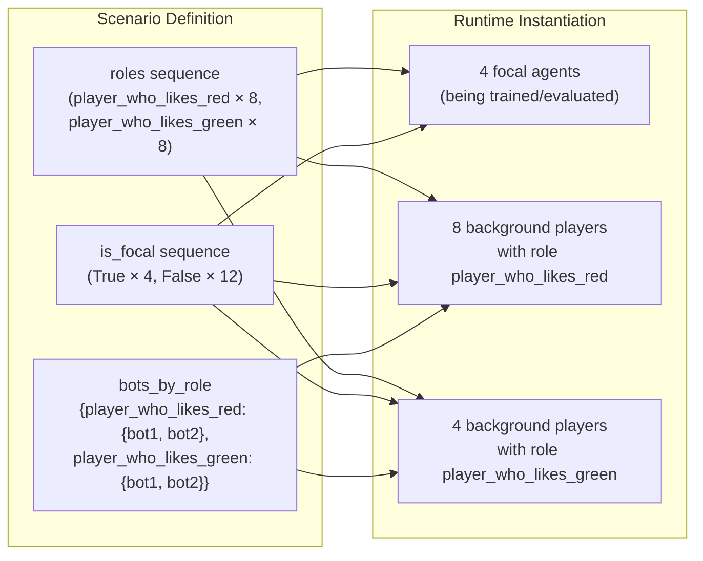
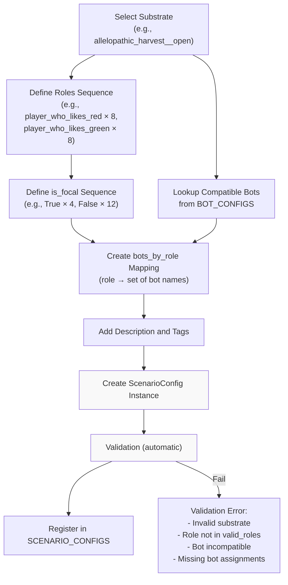

<!-- source: DeepWiki mcp.deepwiki.com · repo google-deepmind/meltingpot · page 6.2 Scenario Configuration · fetched 2026-10-26 -->

# Scenario Configuration

<details>
<summary>Relevant source files</summary>

The following files were used as context for generating this wiki page:

- [examples/tutorial/harvest/configs/environment/harvest.py](examples/tutorial/harvest/configs/environment/harvest.py)
- [examples/tutorial/harvest/configs/environment/harvest_finished.py](examples/tutorial/harvest/configs/environment/harvest_finished.py)
- [meltingpot/configs/bots/__init__.py](meltingpot/configs/bots/__init__.py)
- [meltingpot/configs/scenarios/__init__.py](meltingpot/configs/scenarios/__init__.py)
- [meltingpot/configs/scenarios/scenario_configs_test.py](meltingpot/configs/scenarios/scenario_configs_test.py)
- [meltingpot/lua/modules/api_factory.lua](meltingpot/lua/modules/api_factory.lua)

</details>


## Purpose and Scope

This page describes how to configure scenarios in Melting Pot. A **scenario** defines a specific social situation by specifying the substrate (game environment), the player composition (roles and population size), and which players are focal agents versus bots. Scenarios are the primary mechanism for creating reproducible test conditions for multi-agent reinforcement learning research.

For information about creating the underlying substrate environments, see [Substrate Creation Tutorial](#6.1). For information about implementing bot behaviors, see [Bot Implementation](#6.3). For the distinction between substrates and scenarios, see [Substrates and Scenarios](#3.1).

---

## ScenarioConfig Data Structure

Scenarios are defined using the `ScenarioConfig` dataclass. This immutable configuration object specifies all aspects of a scenario's player composition and social context.

```
ScenarioConfig Fields
┌─────────────────┬──────────────────────────────────────────────────────────┐
│ Field           │ Purpose                                                  │
├─────────────────┼──────────────────────────────────────────────────────────┤
│ description     │ Human-readable explanation of the social situation       │
│ tags            │ Set of categorical labels (e.g., 'visitor', 'resident')  │
│ substrate       │ Name of the base environment                             │
│ roles           │ Sequence specifying role for each player slot           │
│ is_focal        │ Boolean sequence indicating focal vs bot players         │
│ bots_by_role    │ Mapping from role names to sets of eligible bot names    │
└─────────────────┴──────────────────────────────────────────────────────────┘
```

The `ScenarioConfig` class implements immutability through `__post_init__` which converts mutable collections to their frozen equivalents:

[meltingpot/configs/scenarios/__init__.py:44-51]()

Sources: [meltingpot/configs/scenarios/__init__.py:23-52]()

---

## Player Composition Structure

### Roles

Each player slot in a scenario has an assigned **role**. Roles define the strategic position or preference of a player within the game. The available roles are determined by the substrate's `valid_roles` configuration.

**Role Examples:**
- `'default'` - Generic player with no special preferences
- `'player_who_likes_red'`, `'player_who_likes_green'` - Players with color preferences (allelopathic_harvest)
- `'bach_fan'`, `'stravinsky_fan'` - Players with musical preferences (bach_or_stravinsky)
- `'target'` - Special role for partner selection scenarios (boat_race)

### Focal vs Bot Players

The `is_focal` sequence determines which player slots are controlled by agents being trained/evaluated (focal) versus pre-trained bots (background):

```
Example: 4 focal players, 12 bots (visitor scenario)
is_focal: (True, True, True, True, False, False, False, False, False, False, False, False, False, False, False, False)
            └────────┬────────┘ └──────────────────────────┬──────────────────────────┘
              Focal agents                             Bot-controlled players
```

**Key constraint:** Every scenario must have at least one focal player (validated in tests).

[meltingpot/configs/scenarios/scenario_configs_test.py:57-58]()

### Population Size

Population size is implicitly defined by the length of the `roles` and `is_focal` sequences. These must have matching lengths:

[meltingpot/configs/scenarios/scenario_configs_test.py:61-62]()

Sources: [meltingpot/configs/scenarios/__init__.py:40-41](), [meltingpot/configs/scenarios/scenario_configs_test.py:57-62]()

---

## Bot Assignment System

### bots_by_role Mapping

The `bots_by_role` field maps role names to sets of bot names that can fill non-focal player slots with that role. At runtime, bots are randomly sampled from these sets.



**Example from allelopathic_harvest:**

[meltingpot/configs/scenarios/__init__.py:66-82]()

Sources: [meltingpot/configs/scenarios/__init__.py:42](), [meltingpot/configs/scenarios/__init__.py:66-82]()

### Bot Compatibility Rules

Bots must be compatible with the substrate and role they are assigned to. The validation logic checks:

1. **Substrate match:** Bot's `substrate` field must match scenario's substrate
2. **Role support:** Role must be in bot's `roles` set

[meltingpot/configs/scenarios/scenario_configs_test.py:30-34]()

Compatibility validation ensures no runtime errors:

[meltingpot/configs/scenarios/scenario_configs_test.py:75-85]()

### Completeness Requirements

All non-focal roles must have bot assignments, and no role should have bots assigned if no player uses it:

[meltingpot/configs/scenarios/scenario_configs_test.py:88-104]()

Sources: [meltingpot/configs/scenarios/scenario_configs_test.py:30-34](), [meltingpot/configs/scenarios/scenario_configs_test.py:75-104]()

---

## Naming and Categorization

### Naming Convention

Scenario names follow the pattern: `{substrate}__{variant_number}`

This convention is enforced by tests:

[meltingpot/configs/scenarios/scenario_configs_test.py:51-54]()

**Examples:**
- `allelopathic_harvest__open_0`
- `bach_or_stravinsky_in_the_matrix__arena_5`
- `chemistry__three_metabolic_cycles_1`

### Tag System

Tags provide semantic categorization for scenarios. Common tags include:

```
Social Structure Tags:
- 'visitor' - Focal agents are newcomers to an established population
- 'resident' - Focal agents form the established population

Behavioral Tags:
- 'convention_following' - Tests ability to adopt group conventions
- 'reciprocity' - Tests conditional cooperation strategies
- 'turn_taking' - Tests alternating resource access
- 'partner_choice' - Tests selective cooperation
- 'dyadic_trust' - Tests bilateral cooperation
- 'niche_discovery' - Tests role specialization

Interaction Tags:
- 'prosocial_newcomers' - Bots join cooperatively
- 'antisocial_newcomers' - Bots join antagonistically
- 'exploitation' - Tests response to exploitable bots
```

Tag requirements are validated:

[meltingpot/configs/scenarios/scenario_configs_test.py:44-45]()

Sources: [meltingpot/configs/scenarios/__init__.py:29](), [meltingpot/configs/scenarios/scenario_configs_test.py:44-45](), [meltingpot/configs/scenarios/scenario_configs_test.py:51-54]()

---

## Scenario Configuration Workflow



Sources: [meltingpot/configs/scenarios/__init__.py:23-52](), [meltingpot/configs/scenarios/scenario_configs_test.py]()

---

## Configuration Examples

### Visitor Scenario

A small number of focal agents visit a large established population. This tests how agents adapt to existing conventions.

[meltingpot/configs/scenarios/__init__.py:57-83]()

**Key characteristics:**
- 4 focal players (25% of population)
- 12 bot players (75% of population)
- Bots sample from convention-supporting populations
- Tagged as `'visitor'` and `'convention_following'`

### Resident Scenario

Focal agents form the majority population, with a few bot visitors. This tests how agents establish and maintain conventions.

[meltingpot/configs/scenarios/__init__.py:111-133]()

**Key characteristics:**
- 14 focal players (87.5% of population)
- 2 bot players (12.5% of population)
- Bots sample from diverse behavior sets
- Tagged as `'resident'`

### Partner Selection Scenario

Focal agent must identify and cooperate with the right partner among defectors.

[meltingpot/configs/scenarios/__init__.py:581-594]()

**Key characteristics:**
- 1 focal player
- 5 bot players total (4 defectors + 1 cooperator target)
- Role differentiation: `'default'` vs `'target'`
- Tagged as `'partner_choice'` and `'dyadic_trust'`

Sources: [meltingpot/configs/scenarios/__init__.py:57-83](), [meltingpot/configs/scenarios/__init__.py:111-133](), [meltingpot/configs/scenarios/__init__.py:581-594]()

---

## Common Configuration Patterns

### Population Size Variations

Different population sizes test different social dynamics:

```
Scenario Family: allelopathic_harvest__open

Full Population (16 players):
- allelopathic_harvest__open_0: 4 focal, 12 bots
- allelopathic_harvest__open_11: 14 focal, 2 bots

Medium Population (10 players):
- allelopathic_harvest__open_6: 5 focal, 5 bots

Small Population (4 players):
- allelopathic_harvest__open_8: 2 focal, 2 bots
```

[meltingpot/configs/scenarios/__init__.py:57-83](), [meltingpot/configs/scenarios/__init__.py:186-210](), [meltingpot/configs/scenarios/__init__.py:211-225]()

### Bot Diversity Strategies

**Homogeneous:** All bots from one strategy
[meltingpot/configs/scenarios/__init__.py:287-303]()

**Heterogeneous:** Bots sample from multiple strategies
[meltingpot/configs/scenarios/__init__.py:595-610]()

**Conditional:** Different roles get different bot sets
[meltingpot/configs/scenarios/__init__.py:529-594]()

Sources: [meltingpot/configs/scenarios/__init__.py:57-225](), [meltingpot/configs/scenarios/__init__.py:287-303](), [meltingpot/configs/scenarios/__init__.py:529-610]()

---

## Validation Reference

The test suite enforces the following constraints on all scenarios:

| Validation Rule | Enforcement Location | Error Message Pattern |
|-----------------|----------------------|----------------------|
| Non-empty description | [scenario_configs_test.py:40-41]() | - |
| Non-empty tags | [scenario_configs_test.py:44-45]() | - |
| Valid substrate exists | [scenario_configs_test.py:48-49]() | - |
| Name starts with substrate | [scenario_configs_test.py:53-54]() | - |
| At least one focal player | [scenario_configs_test.py:57-58]() | - |
| Matching sequence lengths | [scenario_configs_test.py:61-62]() | - |
| Roles valid for substrate | [scenario_configs_test.py:65-67]() | - |
| Bots exist | [scenario_configs_test.py:70-72]() | - |
| Bots compatible | [scenario_configs_test.py:75-85]() | `'Substrate X, role Y not supported by: {bots}'` |
| All background roles assigned | [scenario_configs_test.py:88-96]() | `'Background roles X have not been assigned bots.'` |
| No unused role assignments | [scenario_configs_test.py:98-104]() | `'Bots assigned to X are unused.'` |

**Additional global validations:**
- No duplicate scenarios: [scenario_configs_test.py:106-111]()
- All substrates used: [scenario_configs_test.py:113-116]()
- All bots used: [scenario_configs_test.py:118-123]()

Sources: [meltingpot/configs/scenarios/scenario_configs_test.py:37-123]()

---

## Registration and Discovery

All scenarios are registered in the `SCENARIO_CONFIGS` immutabledict:

[meltingpot/configs/scenarios/__init__.py:55-56]()

This registry enables:
- **Enumeration:** Iterate over all available scenarios
- **Lookup:** Access scenarios by name
- **Validation:** Verify references to scenario names

The immutabledict ensures the registry cannot be modified at runtime, maintaining configuration integrity.

**Usage pattern:**
```python
from meltingpot.configs.scenarios import SCENARIO_CONFIGS

# Get specific scenario
scenario = SCENARIO_CONFIGS['allelopathic_harvest__open_0']

# List all scenarios for a substrate
substrate_scenarios = {
    name: config for name, config in SCENARIO_CONFIGS.items()
    if config.substrate == 'allelopathic_harvest__open'
}

# Filter by tag
visitor_scenarios = {
    name: config for name, config in SCENARIO_CONFIGS.items()
    if 'visitor' in config.tags
}
```

Sources: [meltingpot/configs/scenarios/__init__.py:55-56]()

---

## Creating a New Scenario

### Step-by-Step Process

1. **Choose substrate:** Select from existing substrates in `SUBSTRATE_CONFIGS`

2. **Determine population:** Decide total number of players (constrained by substrate)

3. **Define role distribution:** Assign roles to each player slot based on substrate's `valid_roles`

4. **Set focal/bot split:** Mark which positions are focal agents vs bots

5. **Select compatible bots:** Query `BOT_CONFIGS` for bots matching substrate and roles

6. **Assign bots to roles:** Create `bots_by_role` mapping ensuring all non-focal roles covered

7. **Add metadata:** Write description and select appropriate tags

8. **Create config:** Instantiate `ScenarioConfig` with all fields

9. **Add to registry:** Insert into `SCENARIO_CONFIGS` with appropriate name

10. **Run tests:** Verify with `pytest meltingpot/configs/scenarios/scenario_configs_test.py`

### Template

```python
scenario_name=ScenarioConfig(
    description='Brief explanation of the social situation',
    tags={
        'primary_category',  # visitor, resident
        'behavior_tested',   # convention_following, reciprocity, etc.
    },
    substrate='substrate_name',
    roles=('role1',) * count1 + ('role2',) * count2,
    is_focal=(True,) * focal_count + (False,) * bot_count,
    bots_by_role={
        'role1': {
            'compatible_bot_1',
            'compatible_bot_2',
        },
        'role2': {
            'compatible_bot_3',
        },
    },
)
```

Sources: [meltingpot/configs/scenarios/__init__.py:23-52](), [meltingpot/configs/scenarios/__init__.py:57-83]()

---

