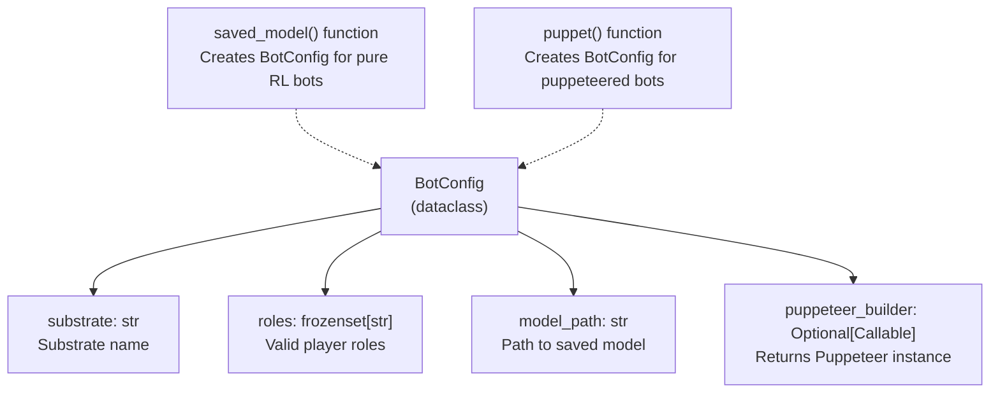
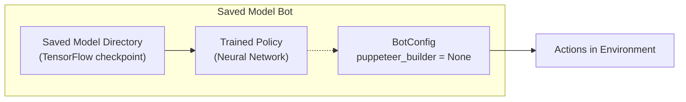
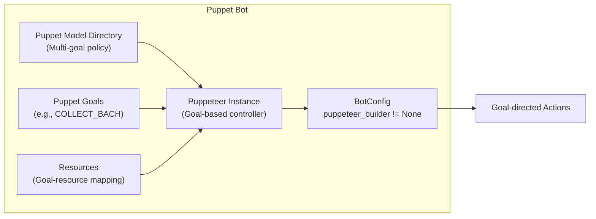
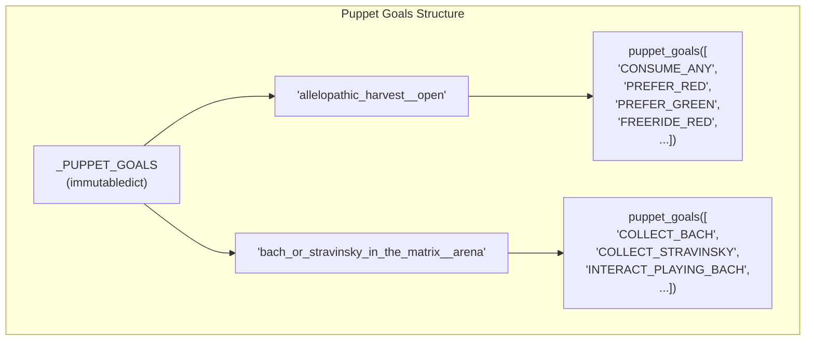
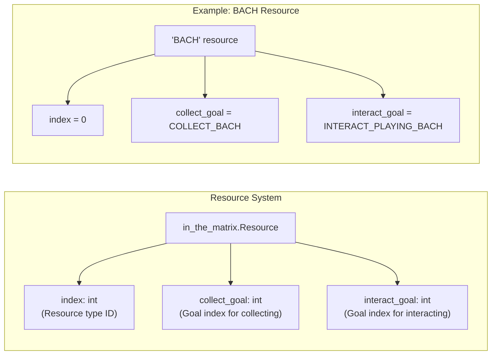
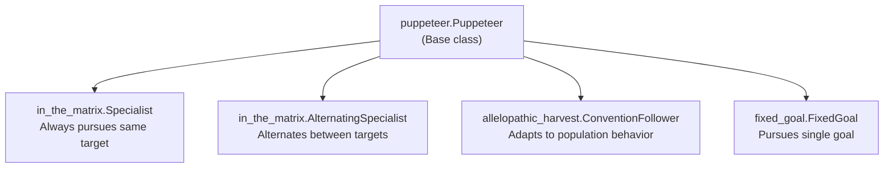
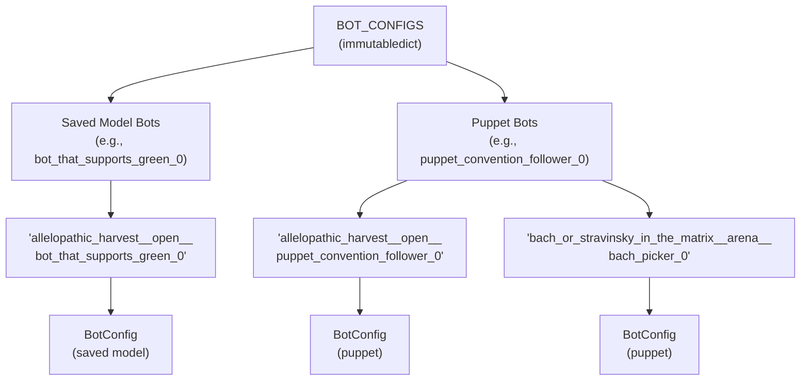
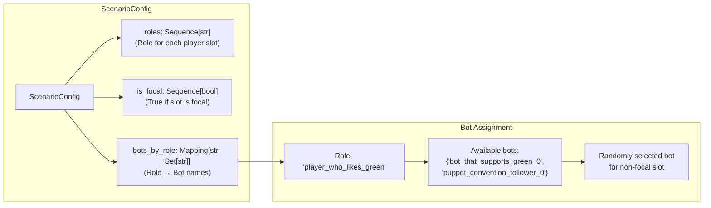
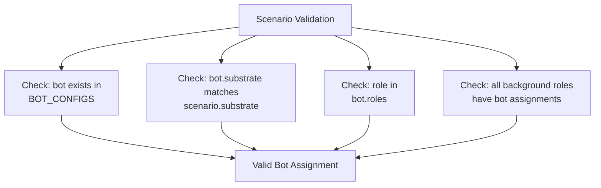

<!-- source: DeepWiki mcp.deepwiki.com · repo google-deepmind/meltingpot · page 6.3 Bot Implementation · fetched 2026-10-26 -->

# Bot Implementation

<details>
<summary>Relevant source files</summary>

The following files were used as context for generating this wiki page:

- [docs/concepts.md](docs/concepts.md)
- [meltingpot/configs/bots/__init__.py](meltingpot/configs/bots/__init__.py)
- [meltingpot/configs/scenarios/__init__.py](meltingpot/configs/scenarios/__init__.py)
- [meltingpot/configs/scenarios/scenario_configs_test.py](meltingpot/configs/scenarios/scenario_configs_test.py)
- [meltingpot/lua/levels/clean_up/components.lua](meltingpot/lua/levels/clean_up/components.lua)
- [meltingpot/lua/modules/avatar_library.lua](meltingpot/lua/modules/avatar_library.lua)
- [meltingpot/lua/modules/component.lua](meltingpot/lua/modules/component.lua)

</details>


## Purpose and Scope

This page explains how to create and configure bots for Melting Pot scenarios. Bots are non-focal agents that populate scenarios to provide background populations and interaction partners for focal (trainable) agents.

For information about configuring scenarios that use bots, see [Scenario Configuration](#6.2). For implementing custom bot behaviors as components, see [Custom Components](#6.4).

## Bot Configuration Overview

Bots in Melting Pot are defined using the `BotConfig` dataclass, which specifies the substrate, roles, model path, and optionally a puppeteer for controlling the bot.



**Sources:** [meltingpot/configs/bots/__init__.py:445-463]()

The `BotConfig` dataclass has four key attributes:

| Attribute | Type | Description |
|-----------|------|-------------|
| `substrate` | `str` | The substrate the bot was trained for |
| `roles` | `AbstractSet[str]` | The roles the bot can play (frozen set) |
| `model_path` | `str` | Path to the bot's saved model directory |
| `puppeteer_builder` | `Optional[Callable]` | Function that returns a `Puppeteer` instance (None for saved model bots) |

**Sources:** [meltingpot/configs/bots/__init__.py:445-463]()

## Types of Bots

Melting Pot supports two distinct types of bots, each serving different purposes in scenarios.

### Saved Model Bots

Saved model bots are pre-trained reinforcement learning agents loaded from checkpoints. These bots execute learned policies without additional control logic.



**Creating a saved model bot:**

The `saved_model()` function creates a `BotConfig` for a bot loaded from a saved TensorFlow model.

```python
# Example from BOT_CONFIGS
allelopathic_harvest__open__bot_that_supports_green_0 = saved_model(
    substrate='allelopathic_harvest__open',
    model='bot_that_loves_green_0',
    roles=('default', 'player_who_likes_red', 'player_who_likes_green',),
)
```

**Sources:** [meltingpot/configs/bots/__init__.py:465-484](), [meltingpot/configs/bots/__init__.py:511-515]()

**Key parameters:**

| Parameter | Description |
|-----------|-------------|
| `substrate` | Substrate on which the bot was trained |
| `roles` | Roles the bot can play (defaults to `('default',)`) |
| `model` | Name of the model directory under `{models_root}/{substrate}/` |
| `models_root` | Root directory for saved models (defaults to `MODELS_ROOT`) |

**Sources:** [meltingpot/configs/bots/__init__.py:465-484]()

### Puppet Bots

Puppet bots are controlled by `Puppeteer` objects that implement goal-directed behavior. The puppeteer receives observations and selects actions to achieve specified goals using the bot's underlying policy.



**Creating a puppet bot:**

The `puppet()` function creates a `BotConfig` with a puppeteer that controls the bot's behavior.

```python
# Example from BOT_CONFIGS
bach_or_stravinsky_in_the_matrix__arena__bach_picker_0 = puppet(
    substrate='bach_or_stravinsky_in_the_matrix__arena',
    model='puppet_0',
    roles=('default', 'bach_fan', 'stravinsky_fan',),
    puppeteer_builder=functools.partial(
        in_the_matrix.Specialist,
        target=_RESOURCES['bach_or_stravinsky_in_the_matrix__arena']['BACH'],
        margin=3,
    ),
)
```

**Sources:** [meltingpot/configs/bots/__init__.py:486-507](), [meltingpot/configs/bots/__init__.py:573-582]()

**Key parameters:**

| Parameter | Description |
|-----------|-------------|
| `substrate` | Substrate on which the bot was trained |
| `roles` | Roles the bot can play |
| `model` | Name of the puppet model directory |
| `puppeteer_builder` | Callable that returns a `Puppeteer` instance when invoked |
| `models_root` | Root directory for saved models |

**Sources:** [meltingpot/configs/bots/__init__.py:486-507]()

## Puppet Goals and Resources

Puppet bots use a goal-based system where goals define what the bot should pursue, and resources map domain concepts to goals.

### Puppet Goals

Puppet goals are immutable dictionaries mapping goal names to integer indices. These indices correspond to the multi-goal policy outputs in the puppet model.



**Example puppet goals definition:**

```python
_PUPPET_GOALS = immutabledict.immutabledict(
    allelopathic_harvest__open=puppeteer.puppet_goals([
        'CONSUME_ANY',
        'PREFER_RED',
        'PREFER_GREEN',
        'FREERIDE_RED',
        'FREERIDE_GREEN',
        'ZAP_OTHERS',
    ]),
    bach_or_stravinsky_in_the_matrix__arena=puppeteer.puppet_goals([
        'COLLECT_BACH',
        'COLLECT_STRAVINSKY',
        'INTERACT_PLAYING_BACH',
        'INTERACT_PLAYING_STRAVINSKY',
    ]),
)
```

**Important:** The order of goals must match the order used during bot training. The puppet model was trained to handle these specific goals in this specific order.

**Sources:** [meltingpot/configs/bots/__init__.py:44-222]()

### Resources

Resources map high-level domain concepts (like "BACH" or "STRAVINSKY") to their corresponding collect and interact goals. This abstraction allows puppeteers to work with semantic concepts rather than raw goal indices.



**Example resource definition:**

```python
_RESOURCES = immutabledict.immutabledict(
    bach_or_stravinsky_in_the_matrix__arena=immutabledict.immutabledict({
        'BACH': in_the_matrix.Resource(
            index=0,
            collect_goal=_PUPPET_GOALS['bach_or_stravinsky_in_the_matrix__arena']['COLLECT_BACH'],
            interact_goal=_PUPPET_GOALS['bach_or_stravinsky_in_the_matrix__arena']['INTERACT_PLAYING_BACH'],
        ),
        'STRAVINSKY': in_the_matrix.Resource(
            index=1,
            collect_goal=_PUPPET_GOALS['bach_or_stravinsky_in_the_matrix__arena']['COLLECT_STRAVINSKY'],
            interact_goal=_PUPPET_GOALS['bach_or_stravinsky_in_the_matrix__arena']['INTERACT_PLAYING_STRAVINSKY'],
        ),
    }),
)
```

**Sources:** [meltingpot/configs/bots/__init__.py:224-442]()

## Puppeteers

Puppeteers are Python classes that control puppet bots by dynamically selecting goals based on observations and internal state. Common puppeteer types include:



**Sources:** [meltingpot/configs/bots/__init__.py:22-32]()

### Specialist Puppeteer

The `Specialist` puppeteer always pursues a single target resource with a specified margin.

```python
# Creating a specialist that always collects BACH
puppeteer_builder=functools.partial(
    in_the_matrix.Specialist,
    target=_RESOURCES['bach_or_stravinsky_in_the_matrix__arena']['BACH'],
    margin=3,
)
```

**Sources:** [meltingpot/configs/bots/__init__.py:573-582]()

### Alternating Specialist Puppeteer

The `AlternatingSpecialist` switches between multiple targets, repeating each for a specified number of steps.

```python
# Creating a turn-taking bot that alternates between BACH and STRAVINSKY
puppeteer_builder=functools.partial(
    in_the_matrix.AlternatingSpecialist,
    targets=[
        _RESOURCES['bach_or_stravinsky_in_the_matrix__arena']['BACH'],
        _RESOURCES['bach_or_stravinsky_in_the_matrix__arena']['STRAVINSKY'],
    ],
    margin=3,
    num_steps_per_target=2,
)
```

**Sources:** [meltingpot/configs/bots/__init__.py:594-608]()

### Convention Follower Puppeteer

The `ConventionFollower` observes population behavior and adapts its goals to follow prevailing conventions.

```python
# Creating a convention follower for allelopathic harvest
puppeteer_builder=functools.partial(
    allelopathic_harvest.ConventionFollower,
    initial_goal=_PUPPET_GOALS['allelopathic_harvest__open']['CONSUME_ANY'],
    preference_goals=(
        _PUPPET_GOALS['allelopathic_harvest__open']['PREFER_RED'],
        _PUPPET_GOALS['allelopathic_harvest__open']['PREFER_GREEN'],
        _PUPPET_GOALS['allelopathic_harvest__open']['CONSUME_ANY'],
    ),
    color_threshold=57.0,
    recency_window=5,
)
```

**Sources:** [meltingpot/configs/bots/__init__.py:551-572]()

## Bot Registry

All available bots are registered in the `BOT_CONFIGS` dictionary, which maps bot names to their configurations.



**Bot naming convention:**

Bot names follow the pattern: `{substrate}__{variant}__{description}_{version}`

Examples:
- `allelopathic_harvest__open__bot_that_supports_green_0`
- `bach_or_stravinsky_in_the_matrix__arena__bach_picker_0`
- `chicken_in_the_matrix__arena__puppet_dove_0`

**Sources:** [meltingpot/configs/bots/__init__.py:509-507]()

## Integration with Scenarios

Scenarios use bots to populate non-focal player slots. The `ScenarioConfig` specifies which bots can fill which roles.



**Example scenario configuration:**

```python
allelopathic_harvest__open_0 = ScenarioConfig(
    description='visiting a population where planting green berries is the prevailing convention',
    tags={'visitor', 'convention_following'},
    substrate='allelopathic_harvest__open',
    roles=['player_who_likes_red',] * 8 + ['player_who_likes_green',] * 8,
    is_focal=(True,) * 4 + (False,) * 12,  # 4 focal, 12 bot-controlled
    bots_by_role={
        'player_who_likes_red': {
            'allelopathic_harvest__open__bot_that_supports_green_0',
            'allelopathic_harvest__open__bot_that_supports_green_1',
            'allelopathic_harvest__open__bot_that_supports_green_2',
            'allelopathic_harvest__open__bot_that_supports_green_3',
        },
        'player_who_likes_green': {
            'allelopathic_harvest__open__bot_that_supports_green_0',
            'allelopathic_harvest__open__bot_that_supports_green_1',
            'allelopathic_harvest__open__bot_that_supports_green_2',
            'allelopathic_harvest__open__bot_that_supports_green_3',
        },
    },
)
```

**Sources:** [meltingpot/configs/scenarios/__init__.py:57-83]()

### Bot Compatibility Validation

Scenarios validate that assigned bots are compatible with the specified roles and substrate:



**Sources:** [meltingpot/configs/scenarios/scenario_configs_test.py:75-86](), [meltingpot/configs/scenarios/scenario_configs_test.py:88-97]()

## Creating New Bots

### Step 1: Train the Bot

Train a multi-agent RL policy on the target substrate. For puppet bots, train a multi-goal policy that can pursue different goals based on input.

### Step 2: Save the Model

Save the trained model to the appropriate directory:
```
meltingpot/assets/saved_models/{substrate}/{model_name}/
```

### Step 3: Define Puppet Goals (Puppet Bots Only)

If creating a puppet bot, add goal definitions to `_PUPPET_GOALS`:

```python
_PUPPET_GOALS = immutabledict.immutabledict(
    my_new_substrate=puppeteer.puppet_goals([
        'GOAL_1',
        'GOAL_2',
        'GOAL_3',
    ]),
)
```

**Sources:** [meltingpot/configs/bots/__init__.py:44-222]()

### Step 4: Define Resources (Puppet Bots Only)

For puppet bots, define resources mapping domain concepts to goals:

```python
_RESOURCES = immutabledict.immutabledict(
    my_new_substrate=immutabledict.immutabledict({
        'RESOURCE_A': ResourceType(
            index=0,
            collect_goal=_PUPPET_GOALS['my_new_substrate']['GOAL_1'],
            interact_goal=_PUPPET_GOALS['my_new_substrate']['GOAL_2'],
        ),
    }),
)
```

**Sources:** [meltingpot/configs/bots/__init__.py:224-442]()

### Step 5: Create Bot Config

Add the bot to `BOT_CONFIGS`:

```python
# For saved model bot:
BOT_CONFIGS = immutabledict.immutabledict(
    my_new_substrate__my_bot_0=saved_model(
        substrate='my_new_substrate',
        model='my_model_name',
        roles=('default', 'role_a', 'role_b'),
    ),
)

# For puppet bot:
BOT_CONFIGS = immutabledict.immutabledict(
    my_new_substrate__my_puppet_0=puppet(
        substrate='my_new_substrate',
        model='puppet_0',
        roles=('default',),
        puppeteer_builder=functools.partial(
            MyPuppeteer,
            goal=_PUPPET_GOALS['my_new_substrate']['GOAL_1'],
        ),
    ),
)
```

**Sources:** [meltingpot/configs/bots/__init__.py:509-507]()

### Step 6: Use in Scenarios

Reference the bot in scenario configurations:

```python
my_scenario = ScenarioConfig(
    substrate='my_new_substrate',
    roles=['default'] * 8,
    is_focal=(True,) * 4 + (False,) * 4,
    bots_by_role={
        'default': {'my_new_substrate__my_bot_0'},
    },
)
```

**Sources:** [meltingpot/configs/scenarios/__init__.py:57-83]()

## Advanced: Graduated Sanctions

Some puppet bots implement graduated sanctions systems that track and respond to violations. While the implementation details are substrate-specific, the pattern involves:

1. Tracking violation counts in puppeteer state
2. Escalating responses based on violation severity
3. Resetting sanctions under certain conditions

This is typically implemented in custom puppeteer classes for substrates that require norm enforcement.

**Sources:** [meltingpot/configs/bots/__init__.py:1-507]() (references to graduated sanctions appear in bot names and puppeteer implementations)

---

