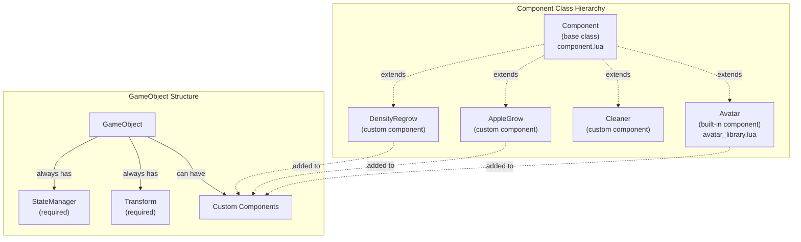
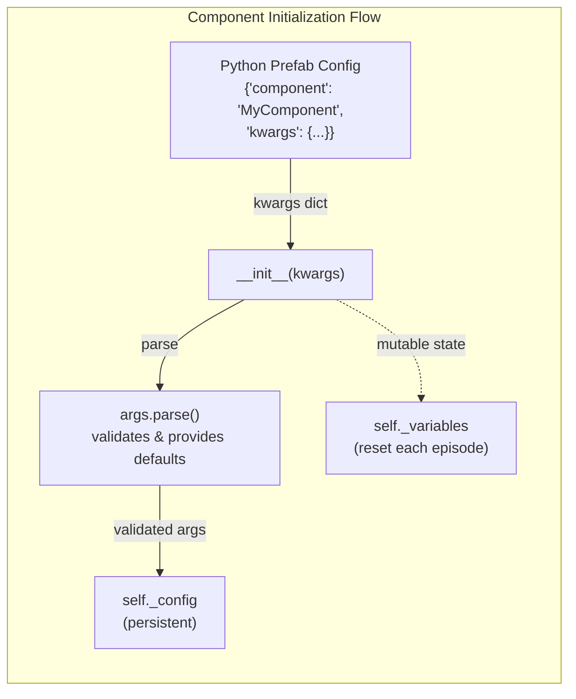
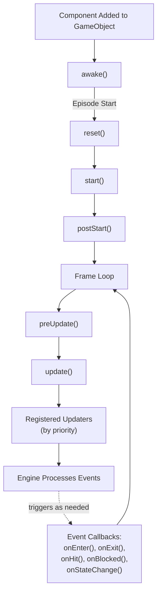
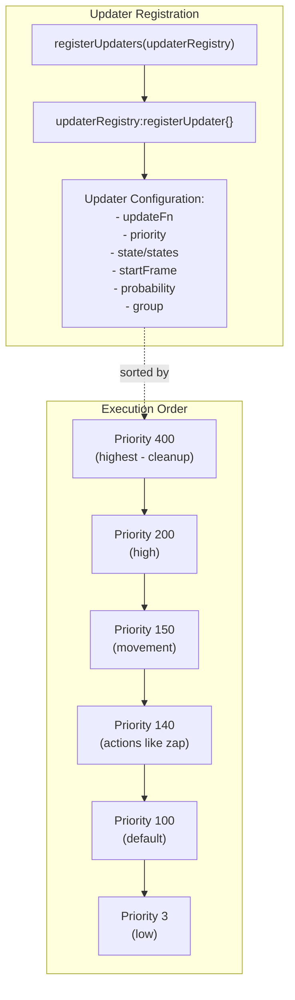
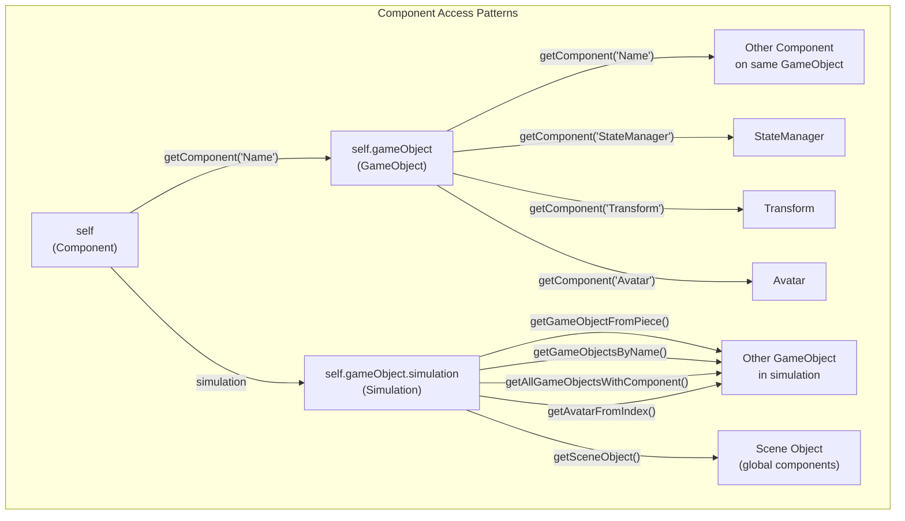
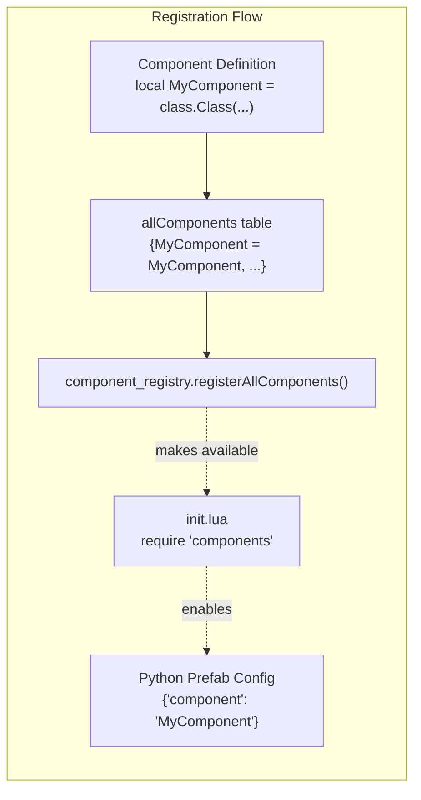

<!-- source: DeepWiki mcp.deepwiki.com · repo google-deepmind/meltingpot · page 6.4 Custom Components · fetched 2026-10-26 -->

# Custom Components

<details>
<summary>Relevant source files</summary>

The following files were used as context for generating this wiki page:

- [docs/advanced.md](docs/advanced.md)
- [docs/concepts.md](docs/concepts.md)
- [docs/extending.md](docs/extending.md)
- [docs/substrate_tutorial/index.md](docs/substrate_tutorial/index.md)
- [docs/substrates.md](docs/substrates.md)
- [meltingpot/lua/levels/clean_up/components.lua](meltingpot/lua/levels/clean_up/components.lua)
- [meltingpot/lua/modules/avatar_library.lua](meltingpot/lua/modules/avatar_library.lua)
- [meltingpot/lua/modules/colors.lua](meltingpot/lua/modules/colors.lua)
- [meltingpot/lua/modules/component.lua](meltingpot/lua/modules/component.lua)

</details>


This page describes how to implement custom component logic for Melting Pot substrates. Components are modular pieces of Lua code that add functionality to GameObjects. While Melting Pot provides built-in components in `component_library.lua` and `avatar_library.lua`, most substrates require custom logic specific to their game mechanics.

For a step-by-step tutorial on creating your first custom component, see [Substrate Creation Tutorial](#6.1). For information about configuring scenarios and bots, see [Scenario Configuration](#6.2) and [Bot Implementation](#6.3).

## Component Architecture

Custom components extend the base `Component` class and implement callback methods that are invoked during specific events in the game lifecycle. Each component instance belongs to exactly one GameObject and can access other components through the parent GameObject.



**Sources:** [meltingpot/lua/modules/component.lua:1-91](), [docs/concepts.md:212-274](), [meltingpot/lua/modules/avatar_library.lua:1-50]()

## File Structure

Custom components are conventionally placed in a `components.lua` file within your substrate's directory. The file must register components with the component registry and be required by your substrate's `init.lua`.

**File Location Pattern:**
```
path/to/levelDirectory/
└── your_substrate_name/
    ├── init.lua
    └── components.lua
```

**Basic Template:**

```lua
local args = require 'common.args'
local class = require 'common.class'
local random = require 'system.random'
local meltingpot = 'meltingpot.lua.modules.'
local component = require(meltingpot .. 'component')
local component_registry = require(meltingpot .. 'component_registry')

-- Define your components here
local MyComponent = class.Class(component.Component)

-- Component implementation...

-- Register all components
local allComponents = {
    MyComponent = MyComponent,
}

component_registry.registerAllComponents(allComponents)

return allComponents
```

**Sources:** [docs/substrate_tutorial/index.md:564-590](), [docs/substrates.md:425-493](), [meltingpot/lua/levels/clean_up/components.lua:1-28]()

## Component Constructor

The constructor (`__init__`) defines the component's parameters and validates them using the `args` module. All configuration should be stored in `self._config` for persistence across episode resets.



**Example Constructor:**

```lua
function DensityRegrow:__init__(kwargs)
  kwargs = args.parse(kwargs, {
      {'name', args.default('DensityRegrow')},
      {'baseRate', args.ge(0.0), args.le(1.0)},
      {'liveState', args.stringType},
      {'waitState', args.stringType},
      {'neighborhoodRadius', args.numberType, args.default(1)},
      {'queryLayer', args.stringType, args.default("lowerPhysical")},
  })
  DensityRegrow.Base.__init__(self, kwargs)
  
  -- Store configuration (persistent across resets)
  self._config.baseRate = kwargs.baseRate
  self._config.liveState = kwargs.liveState
  self._config.waitState = kwargs.waitState
  self._config.neighborhoodRadius = kwargs.neighborhoodRadius
  self._config.queryLayer = kwargs.queryLayer
end
```

| Argument Validator | Purpose | Example |
|-------------------|---------|---------|
| `args.default(value)` | Provides default value if not specified | `args.default(1.0)` |
| `args.stringType` | Requires string type | `args.stringType` |
| `args.numberType` | Requires number type | `args.numberType` |
| `args.booleanType` | Requires boolean type | `args.booleanType` |
| `args.tableType` | Requires table type | `args.tableType` |
| `args.ge(n)` | Greater than or equal to n | `args.ge(0.0)` |
| `args.le(n)` | Less than or equal to n | `args.le(1.0)` |
| `args.positive` | Must be positive number | `args.positive` |
| `args.nonNegative` | Must be non-negative | `args.nonNegative` |

**Sources:** [docs/substrate_tutorial/index.md:599-632](), [meltingpot/lua/levels/clean_up/components.lua:45-57](), [meltingpot/lua/modules/avatar_library.lua:41-125]()

## Component Lifecycle Methods

Components have optional callback methods invoked at specific points in the game lifecycle. All methods are optional—implement only what you need.



### Initialization Phase

| Method | When Called | Purpose |
|--------|------------|---------|
| `awake()` | When component added to GameObject | One-time setup, access to `self.gameObject` available |
| `reset()` | Start of each episode, before `start()` | Initialize/reset `self._variables` |
| `start()` | After all initialization complete | Setup that requires other objects to exist |
| `postStart()` | After all `start()` calls on all objects | Setup requiring all objects to be fully initialized |

**Sources:** [meltingpot/lua/modules/component.lua:30-34](), [docs/concepts.md:222-228]()

### Update Phase

| Method | When Called | Purpose |
|--------|------------|---------|
| `preUpdate()` | Every frame, before `update()` | Preparation work |
| `update()` | Every frame | General frame logic (no order guarantee) |
| `registerUpdaters(updaterRegistry)` | During setup | Register prioritized update functions |

**Sources:** [meltingpot/lua/modules/component.lua:35-36](), [docs/concepts.md:229-230]()

### Event Callbacks

| Method | When Called | Parameters |
|--------|------------|-----------|
| `onEnter(enteringGameObject, contactName)` | Another object enters same (x,y) | The entering object, contact string |
| `onExit(exitingGameObject, contactName)` | Another object leaves same (x,y) | The exiting object, contact string |
| `onHit(hittingGameObject, hitName)` | Object hit by a beam | The hitting object, hit type string |
| `onBlocked(blockingGameObject)` | Movement/state change blocked | The blocking object |
| `onStateChange(previousState)` | GameObject state changes | The previous state string |

**Sources:** [meltingpot/lua/modules/component.lua:37-48](), [docs/concepts.md:234-248](), [meltingpot/lua/levels/clean_up/components.lua:390-408]()

## The Updater System

Instead of using `update()` with no execution order guarantees, components should use `registerUpdaters()` to register prioritized update functions with fine-grained control over execution timing.



### Updater Parameters

| Parameter | Type | Purpose | Default |
|-----------|------|---------|---------|
| `updateFn` | function | The function to call | **Required** |
| `priority` | number | Execution order (higher = earlier) | 100 |
| `state` | string | Only call when GameObject in this state | All states |
| `states` | table | Only call when GameObject in one of these states | All states |
| `startFrame` | number | Frames to wait after state change | 0 |
| `probability` | number | Probability of execution per frame (0-1) | 1.0 |
| `group` | string | Only execute for objects in this group | Component's objects |

**Example Updater Registration:**

```lua
function DensityRegrow:registerUpdaters(updaterRegistry)
  updaterRegistry:registerUpdater{
      state = self._config.waitState,
      updateFn = function()
          local transform = self.gameObject:getComponent("Transform")
          local objects = transform:queryDiamond(
              self._config.queryLayer, self._config.neighborhoodRadius)
          
          local liveNeighbors = 0
          for _, object in pairs(objects) do
            if object:getState() == self._config.liveState then
              liveNeighbors = liveNeighbors + 1
            end
          end
          
          local actualRate = liveNeighbors * self._config.baseRate
          if random:uniformReal(0, 1) < actualRate then
            self.gameObject:setState(self._config.liveState)
          end
      end,
  }
end
```

**Sources:** [docs/substrate_tutorial/index.md:647-669](), [docs/concepts.md:275-322](), [meltingpot/lua/modules/avatar_library.lua:155-203](), [meltingpot/lua/levels/clean_up/components.lua:197-233]()

## Accessing Game State

Components can access various parts of the game state through their parent GameObject and the simulation.



### Accessing Components on Same GameObject

```lua
-- Check if component exists
if self.gameObject:hasComponent('Avatar') then
  local avatar = self.gameObject:getComponent('Avatar')
  avatar:addReward(10)
end

-- Get required components
local transform = self.gameObject:getComponent('Transform')
local position = transform:getPosition()
```

### Accessing Other GameObjects

```lua
function MyComponent:postStart()
  local sim = self.gameObject.simulation
  
  -- Get scene object (for global state)
  local sceneObject = sim:getSceneObject()
  self._globalState = sceneObject:getComponent('GlobalState')
  
  -- Get avatar by index
  local avatarObject = sim:getAvatarFromIndex(self._playerIndex)
  
  -- Get objects by name
  local spawnPoints = sim:getGameObjectsByName('spawn_point')
  
  -- Get all objects with a component
  local allEatable = sim:getAllGameObjectsWithComponent('Edible')
end
```

### Querying Spatial Information

```lua
-- Query nearby objects
local transform = self.gameObject:getComponent('Transform')

-- Diamond query (L1 distance)
local nearbyObjects = transform:queryDiamond('lowerPhysical', 2)

-- Disc query (L2 distance)  
local nearbyObjects = transform:queryDisc('upperPhysical', 3)

-- Rectangle query
local objects = transform:queryRectangle(
    'lowerPhysical',
    {x1, y1},  -- top-left corner
    {x2, y2}   -- bottom-right corner
)

-- Ray cast
local success, foundObject, offset = transform:rayCastDirection(
    'upperPhysical',  -- layer
    5,                -- length
    {1, 0},          -- direction vector
    {0, 0}           -- position offset
)
```

**Sources:** [docs/concepts.md:336-380](), [meltingpot/lua/modules/avatar_library.lua:508-526](), [meltingpot/lua/levels/clean_up/components.lua:59-62, 103-116]()

## Common Component Patterns

### State-Dependent Logic

Components often implement different behavior based on the GameObject's state:

```lua
function Edible:onEnter(enteringGameObject, contactName)
  if contactName == 'avatar' then
    if self.gameObject:getState() == self._liveState then
      -- Reward the player
      local avatar = enteringGameObject:getComponent('Avatar')
      avatar:addReward(self._config.rewardForEating)
      -- Transition to wait state
      self.gameObject:setState(self._waitState)
    end
  end
end
```

**Sources:** [meltingpot/lua/levels/clean_up/components.lua:390-408]()

### Beams and Hits

Components can fire beams and respond to being hit:

```lua
function Cleaner:addHits(worldConfig)
  worldConfig.hits['cleanHit'] = {
      layer = 'beamClean',
      sprite = 'BeamClean',
  }
  component.insertIfNotPresent(worldConfig.renderOrder, 'beamClean')
end

function Cleaner:addSprites(tileSet)
  tileSet:addColor('BeamClean', {99, 223, 242, 175})
end

function Cleaner:registerUpdaters(updaterRegistry)
  local clean = function()
    if actions['fireClean'] == 1 then
      self._coolingTimer = self._config.cooldownTime
      self.gameObject:hitBeam(
          'cleanHit', self._config.beamLength, self._config.beamRadius)
    end
  end
  updaterRegistry:registerUpdater{updateFn = clean, priority = 140}
end

function DirtCleaning:onHit(hittingGameObject, hitName)
  if self.gameObject:getState() == 'dirt' and hitName == 'cleanHit' then
    self.gameObject:setState('dirtWait')
    return true  -- Stop beam propagation
  end
end
```

**Sources:** [meltingpot/lua/levels/clean_up/components.lua:132-157, 184-224](), [meltingpot/lua/modules/avatar_library.lua:597-651]()

### Cooldown Timers

Many components need cooldown mechanisms:

```lua
function Zapper:reset()
  self._coolingTimer = 0
end

function Zapper:registerUpdaters(updaterRegistry)
  local zap = function()
    if self._coolingTimer > 0 then
      self._coolingTimer = self._coolingTimer - 1
    else
      if actions['fireZap'] == 1 then
        self._coolingTimer = self._config.cooldownTime
        self.gameObject:hitBeam('zapHit', length, radius)
      end
    end
  end
  updaterRegistry:registerUpdater{updateFn = zap, priority = 140}
end
```

**Sources:** [meltingpot/lua/modules/avatar_library.lua:609-636, 687-693]()

### Scene-Level State Tracking

Scene components track global state:

```lua
local RiverMonitor = class.Class(component.Component)

function RiverMonitor:reset()
  self._dirtCount = 0
  self._cleanCount = 0
end

function RiverMonitor:incrementDirtCount()
  self._dirtCount = self._dirtCount + 1
end

function RiverMonitor:getDirtCount()
  return self._dirtCount
end

-- Other components access it:
function DirtTracker:postStart()
  local sceneObject = self.gameObject.simulation:getSceneObject()
  self._riverMonitor = sceneObject:getComponent('RiverMonitor')
end

function DirtTracker:onStateChange(oldState)
  if newState == 'dirt' then
    self._riverMonitor:incrementDirtCount()
  end
end
```

**Sources:** [meltingpot/lua/levels/clean_up/components.lua:262-298, 103-129]()

## Component Registration

All custom components must be registered with the component registry to be available for use in prefabs.



**Registration Pattern:**

```lua
-- At end of components.lua

local allComponents = {
    AppleGrow = AppleGrow,
    DirtTracker = DirtTracker,
    DirtCleaning = DirtCleaning,
    Cleaner = Cleaner,
    RiverMonitor = RiverMonitor,
}

component_registry.registerAllComponents(allComponents)

return allComponents
```

**In init.lua:**

```lua
local component_library = require(meltingpot .. 'component_library')
local avatar_library = require(meltingpot .. 'avatar_library')
local components = require 'components'  -- Registers custom components
```

**In Python prefab:**

```python
{
    "component": "DensityRegrow",  # Now available
    "kwargs": {
        "baseRate": 0.1,
        "liveState": "apple",
        "waitState": "appleWait",
    }
}
```

**Sources:** [docs/substrate_tutorial/index.md:583-590](), [docs/substrates.md:459-493](), [meltingpot/lua/levels/clean_up/components.lua:560-580]()

## Complete Component Example

Here is the complete `DensityRegrow` component from the substrate tutorial:

```lua
local DensityRegrow = class.Class(component.Component)

function DensityRegrow:__init__(kwargs)
  kwargs = args.parse(kwargs, {
      {'name', args.default('DensityRegrow')},
      {'baseRate', args.ge(0.0), args.le(1.0)},
      {'liveState', args.stringType},
      {'waitState', args.stringType},
      {'neighborhoodRadius', args.numberType, args.default(1)},
      {'queryLayer', args.stringType, args.default("lowerPhysical")},
  })
  DensityRegrow.Base.__init__(self, kwargs)

  self._config.baseRate = kwargs.baseRate
  self._config.liveState = kwargs.liveState
  self._config.waitState = kwargs.waitState
  self._config.neighborhoodRadius = kwargs.neighborhoodRadius
  self._config.queryLayer = kwargs.queryLayer
end

function DensityRegrow:registerUpdaters(updaterRegistry)
  updaterRegistry:registerUpdater{
      state = self._config.waitState,
      updateFn = function()
          local transform = self.gameObject:getComponent("Transform")
          -- Get neighbors
          local objects = transform:queryDiamond(
              self._config.queryLayer, self._config.neighborhoodRadius)
          -- Count live neighbors
          local liveNeighbors = 0
          for _, object in pairs(objects) do
            if object:getState() == self._config.liveState then
              liveNeighbors = liveNeighbors + 1
            end
          end
          local actualRate = liveNeighbors * self._config.baseRate
          if random:uniformReal(0, 1) < actualRate then
            self.gameObject:setState(self._config.liveState)
          end
        end,
  }
end
```

**Usage in Python prefab:**

```python
APPLE = {
    "name": "apple",
    "components": [
        # ... StateManager, Transform, Appearance ...
        {
            "component": "Edible",
            "kwargs": {
                "liveState": "apple",
                "waitState": "appleWait",
                "rewardForEating": 1.0,
            }
        },
        {
            "component": "DensityRegrow",
            "kwargs": {
                "liveState": "apple",
                "waitState": "appleWait",
                "baseRate": 0.1,
                "neighborhoodRadius": 2,
            }
        },
    ]
}
```

**Sources:** [docs/substrate_tutorial/index.md:558-686]()

## Best Practices

### Configuration vs Variables

- **`self._config`**: Store static configuration that persists across episode resets
- **`self._variables`**: Store mutable state that should be reset each episode
- Always reinitialize `self._variables` in `reset()`

### Accessing Other Components

- Use `postStart()` when you need to access other GameObjects that must be fully initialized
- Cache references to frequently accessed components in `postStart()` rather than looking them up every frame
- Always check with `hasComponent()` before calling `getComponent()` if the component is optional

### Updaters vs Update

- **Use updaters** for most frame-by-frame logic to guarantee execution order
- **Use update()** only when execution order doesn't matter or for simple state tracking
- Higher priority numbers execute earlier (e.g., cleanup at 400, movement at 150, actions at 140)

### State Changes

- State changes are queued and don't take effect immediately
- Use `onStateChange()` to react to state transitions
- Don't read state-dependent attributes immediately after `setState()`

**Sources:** [docs/concepts.md:323-335](), [docs/advanced.md:1-57](), [meltingpot/lua/modules/component.lua:67-75]()

---

