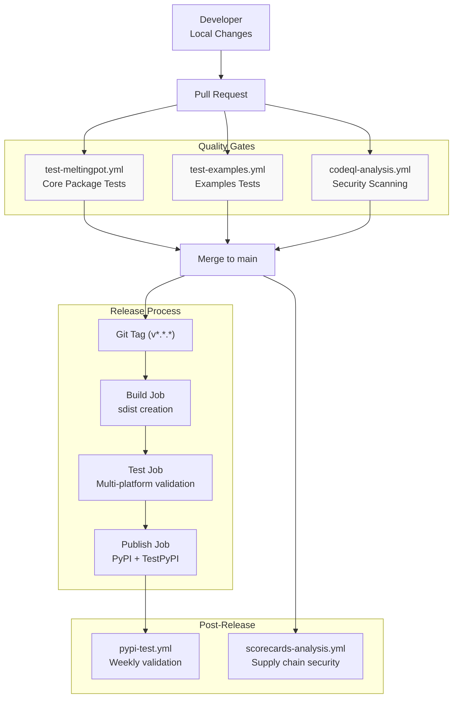
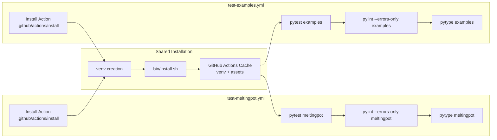
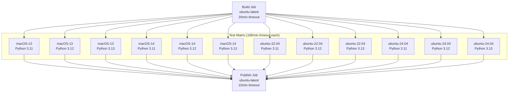
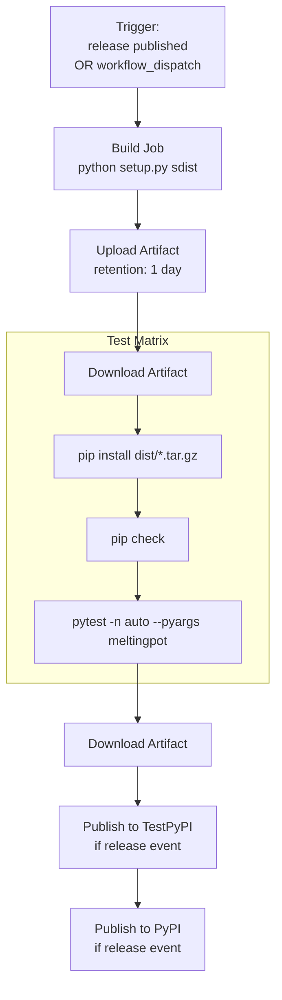

<!-- source: DeepWiki mcp.deepwiki.com · repo google-deepmind/meltingpot · page 7 Development Guide · fetched 2026-10-26 -->

# Development Guide

<details>
<summary>Relevant source files</summary>

The following files were used as context for generating this wiki page:

- [.github/actions/install/action.yml](.github/actions/install/action.yml)
- [.github/workflows/codeql-analysis.yml](.github/workflows/codeql-analysis.yml)
- [.github/workflows/pypi-publish.yml](.github/workflows/pypi-publish.yml)
- [.github/workflows/pypi-test.yml](.github/workflows/pypi-test.yml)
- [.github/workflows/scorecards-analysis.yml](.github/workflows/scorecards-analysis.yml)
- [.github/workflows/test-examples.yml](.github/workflows/test-examples.yml)
- [.github/workflows/test-meltingpot.yml](.github/workflows/test-meltingpot.yml)
- [.python-version](.python-version)

</details>


This document provides comprehensive guidance for contributors working on the Melting Pot codebase. It covers the build system, testing infrastructure, code quality tools, CI/CD pipelines, and security practices. 

For information about creating new substrates and scenarios, see [Creating Content](#6). For package architecture and asset management details, see [Package Architecture](#4).

## Development Workflow Overview

The Melting Pot development process uses GitHub Actions for automated testing, quality checks, and deployment. All code changes go through a standardized validation pipeline before being merged or released.



**Workflow: Developer Commits to Release**

Sources: [.github/workflows/test-meltingpot.yml:1-56](), [.github/workflows/test-examples.yml:1-59](), [.github/workflows/pypi-publish.yml:1-114]()

## CI/CD Pipeline Architecture

### Core Testing Workflows

Two primary workflows validate code changes on every push and pull request:

| Workflow | File | Trigger Paths | Jobs |
|----------|------|---------------|------|
| **test-meltingpot** | `.github/workflows/test-meltingpot.yml` | `meltingpot/**`, `setup.py`, `requirements.txt` | pytest, pylint, pytype |
| **test-examples** | `.github/workflows/test-examples.yml` | `examples/**`, `meltingpot/**` | pytest, pylint, pytype |

Both workflows use the same quality gates but operate on different code sections to enable focused validation.



**Diagram: Testing Workflow Structure**

Sources: [.github/workflows/test-meltingpot.yml:38-56](), [.github/workflows/test-examples.yml:40-59]()

### Reusable Installation Action

The `.github/actions/install/action.yml` provides a reusable installation workflow with caching:

**Key Features:**
- Creates Python virtual environment in `venv/`
- Executes `bin/install.sh` for package installation
- Caches both `venv/` and `meltingpot/assets/` directories
- Cache key includes OS, Python version, and `requirements.txt` hash
- Restores installation if cache hit, otherwise performs full install

**Cache Key Format:**
```
install-{OS_NAME}-{OS_VERSION}-py{PYTHON_VERSION}-{REQUIREMENTS_HASH}
```

Sources: [.github/actions/install/action.yml:24-46](), [.github/actions/install/action.yml:59-87]()

### Concurrency Control

Both testing workflows implement concurrency control to cancel outdated runs:

```yaml
concurrency:
  group: ${{ github.workflow }}-${{ github.head_ref || github.ref }}
  cancel-in-progress: true
```

This ensures that pushing new commits to a PR cancels previous test runs, saving CI resources.

Sources: [.github/workflows/test-meltingpot.yml:31-33](), [.github/workflows/test-examples.yml:33-35]()

## Testing Infrastructure

### Test Execution

The test suite uses `pytest` with the following configuration:

**Core Package Tests:**
```bash
pytest meltingpot
```

**Examples Tests:**
```bash
pytest examples
```

**PyPI Distribution Tests:**
```bash
pytest -n auto --pyargs meltingpot
```

The `-n auto` flag enables parallel test execution using `pytest-xdist`, automatically detecting the number of CPU cores.

Sources: [.github/workflows/test-meltingpot.yml:49](), [.github/workflows/test-examples.yml:52](), [.github/workflows/pypi-publish.yml:82]()

### Multi-Platform Validation

The PyPI publishing workflow tests across multiple platforms and Python versions before release:

| Platform | Python Versions |
|----------|----------------|
| macOS 13 (Intel) | 3.11, 3.12, 3.13 |
| macOS 14 (ARM) | 3.11, 3.12, 3.13 |
| Ubuntu 22.04 | 3.11, 3.12, 3.13 |
| Ubuntu 24.04 | 3.11, 3.12, 3.13 |

**Timeout Configuration:**
- Build job: 20 minutes
- Test job: 180 minutes
- Publish job: 10 minutes



**Diagram: Multi-Platform Test Matrix**

Sources: [.github/workflows/pypi-publish.yml:41-82]()

### Environment Variables

**macOS Compatibility:**
```yaml
env:
  SYSTEM_VERSION_COMPAT: 0
```

This environment variable addresses a known issue with Python setup on macOS in GitHub Actions (see [actions/setup-python#279](https://github.com/actions/setup-python/issues/279)).

Sources: [.github/workflows/pypi-publish.yml:46](), [.github/workflows/pypi-test.yml:38]()

## Code Quality Tools

### Linting with pylint

Pylint is configured to run in errors-only mode:

```bash
pylint --errors-only meltingpot
pylint --errors-only examples
```

Configuration is stored in `.pylintrc` at the repository root. The errors-only mode ensures that only critical issues block CI, while warnings can be addressed separately.

Sources: [.github/workflows/test-meltingpot.yml:52](), [.github/workflows/test-examples.yml:55]()

### Type Checking with pytype

Type checking uses `pytype` without additional flags:

```bash
pytype meltingpot
pytype examples
```

Configuration is in `pyproject.toml`. Pytype performs static type analysis on the codebase to catch type-related errors before runtime.

Sources: [.github/workflows/test-meltingpot.yml:55](), [.github/workflows/test-examples.yml:58]()

### Tool Installation

All development tools are installed via the install action, which shows their versions:

```bash
which python
python --version
which pip
pip --version
which pylint
pylint --version
which pytest
pytest --version
which pytype
pytype --version
pip list
```

Sources: [.github/actions/install/action.yml:65-78]()

## Publishing Pipeline

### Build Process

The build job creates a source distribution:

```bash
python setup.py sdist
```

A workaround handles old setuptools not normalizing package names:

```bash
for OLD in ./dist/dm-meltingpot-*; do
   NEW="$(echo "$OLD" | sed s/dm-meltingpot/dm_meltingpot/)"
   mv "$OLD" "$NEW"
done
```

This ensures the package name uses underscores (`dm_meltingpot`) instead of hyphens.

Sources: [.github/workflows/pypi-publish.yml:26-33]()

### Artifact Management

Built distributions are stored as GitHub Actions artifacts:

**Upload (build job):**
```yaml
- name: Save artifact
  uses: actions/upload-artifact@ea165f8d65b6e75b540449e92b4886f43607fa02
  with:
    name: dist
    path: ./dist
    retention-days: 1
```

**Download (test/publish jobs):**
```yaml
- name: Load artifact
  uses: actions/download-artifact@d3f86a106a0bac45b974a628896c90dbdf5c8093
  with:
    name: dist
    path: ./dist
```

Sources: [.github/workflows/pypi-publish.yml:34-39](), [.github/workflows/pypi-publish.yml:61-65]()

### Publishing Workflow



**Diagram: Publishing Pipeline Flow**

The publish job uses OpenID Connect (OIDC) for authentication:

```yaml
environment:
  name: pypi
  url: https://pypi.org/p/dm-meltingpot
permissions:
  id-token: write
```

Both TestPyPI and PyPI publication use the same action with different repository URLs:

**TestPyPI:**
```yaml
repository-url: https://test.pypi.org/legacy/
```

Sources: [.github/workflows/pypi-publish.yml:84-114]()

### Post-Release Validation

The `pypi-test.yml` workflow runs on multiple schedules:

**Triggers:**
- **Schedule:** Every Monday at 2am (cron: `0 2 * * 1`)
- **Workflow Run:** After `pypi-publish` completes
- **Manual:** Via `workflow_dispatch` with optional version input

**Installation Test:**
```bash
VERSION="${{github.event.inputs.version}}"
pip install "dm-meltingpot${VERSION:+==$VERSION}"
pip check
pytest -n auto --pyargs meltingpot
```

This validates that the published package installs correctly across all supported platforms.

Sources: [.github/workflows/pypi-test.yml:6-74]()

## Security and Supply Chain

### OSSF Scorecards Analysis

The `scorecards-analysis.yml` workflow assesses supply chain security:

**Triggers:**
- **Schedule:** Weekly on Sundays at 10:17am UTC
- **Push:** On main branch
- **Branch Protection:** When protection rules change

**Analysis Process:**
```yaml
- name: "Run analysis"
  uses: ossf/scorecard-action@f49aabe0b5af0936a0987cfb85d86b75731b0186
  with:
    results_file: results.sarif
    results_format: sarif
    publish_results: true
```

**Output Handling:**
1. Upload as artifact (retention: 5 days)
2. Upload to GitHub Code Scanning dashboard

Sources: [.github/workflows/scorecards-analysis.yml:1-63]()

### CodeQL Security Scanning

The `codeql-analysis.yml` workflow performs static security analysis:

**Triggers:**
- **Push:** On main branch
- **Pull Request:** On main branch
- **Schedule:** Weekly on Thursdays at 1:36pm UTC

**Language Analysis:**
```yaml
matrix:
  language: [ 'python' ]
```

**Workflow Steps:**
1. Initialize CodeQL tools for Python
2. Autobuild (automatic dependency detection)
3. Perform CodeQL analysis
4. Upload SARIF results to security dashboard

Sources: [.github/workflows/codeql-analysis.yml:1-63]()

### Permissions Model

All workflows implement least-privilege permissions:

**Default Permissions:**
```yaml
permissions: read-all
```

**Job-Specific Permissions (Scorecards):**
```yaml
permissions:
  security-events: write  # Upload to code-scanning
  id-token: write         # Receive badge
  contents: read
  actions: read
```

**Job-Specific Permissions (CodeQL):**
```yaml
permissions:
  actions: read
  contents: read
  security-events: write
```

**Job-Specific Permissions (Publishing):**
```yaml
permissions:
  id-token: write  # OIDC authentication with PyPI
```

Sources: [.github/workflows/scorecards-analysis.yml:10-24](), [.github/workflows/codeql-analysis.yml:12-22](), [.github/workflows/pypi-publish.yml:92-93]()

### Security Scanning Results

Both security workflows upload results in SARIF format:

```yaml
- name: "Upload to code-scanning"
  uses: github/codeql-action/upload-sarif@28deaeda66b76a05916b6923827895f2b14ab387
  with:
    sarif_file: results.sarif
```

These results appear in GitHub's Security tab under Code Scanning Alerts, enabling automated vulnerability detection and tracking.

Sources: [.github/workflows/scorecards-analysis.yml:59-62](), [.github/workflows/codeql-analysis.yml:61-62]()

## Development Environment

### Python Version

The repository specifies Python 3.11 as the default development version:

```
3.11
```

This is used by tools that auto-detect Python versions from `.python-version` files.

Sources: [.python-version:1]()

### Supported Python Versions

CI/CD testing validates compatibility with Python 3.11, 3.12, and 3.13 across all supported platforms. The test matrix ensures broad compatibility before release.

Sources: [.github/workflows/pypi-publish.yml:56-59](), [.github/workflows/pypi-test.yml:48-51]()

## Workflow Trigger Summary

| Workflow | Push | PR | Release | Schedule | Dispatch |
|----------|------|-----|---------|----------|----------|
| **test-meltingpot** | ✓ main | ✓ main | - | - | ✓ |
| **test-examples** | ✓ main | ✓ main | - | - | ✓ |
| **codeql-analysis** | ✓ main | ✓ main | - | ✓ Thu 13:36 UTC | - |
| **scorecards-analysis** | ✓ main | - | - | ✓ Sun 10:17 UTC | - |
| **pypi-publish** | - | - | ✓ published | - | ✓ |
| **pypi-test** | ✓ (path only) | ✓ (path only) | - | ✓ Mon 02:00 UTC | ✓ |

This trigger matrix ensures comprehensive testing at appropriate stages of the development lifecycle while minimizing unnecessary CI runs through path-based filtering and concurrency controls.

Sources: [.github/workflows/test-meltingpot.yml:3-29](), [.github/workflows/test-examples.yml:3-31](), [.github/workflows/codeql-analysis.yml:3-10](), [.github/workflows/scorecards-analysis.yml:2-8](), [.github/workflows/pypi-publish.yml:5-8](), [.github/workflows/pypi-test.yml:5-28]()

---

