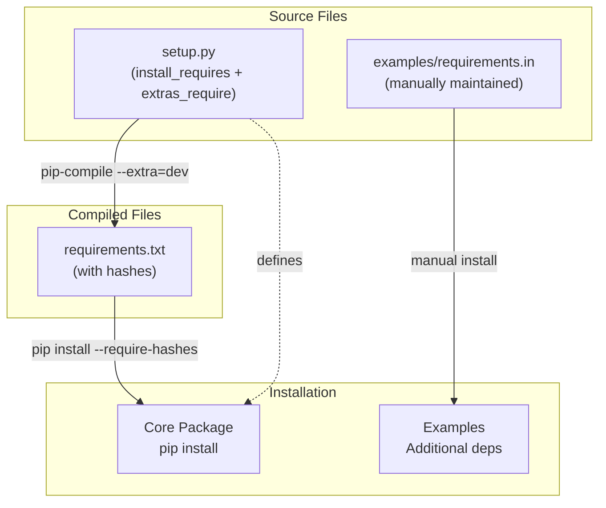
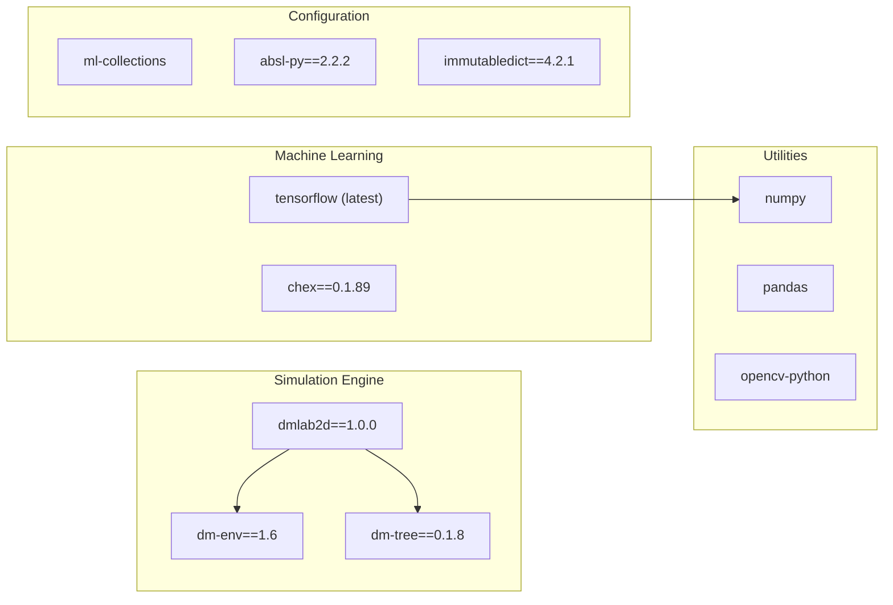
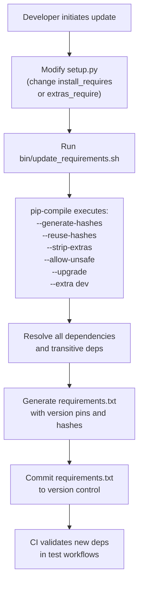
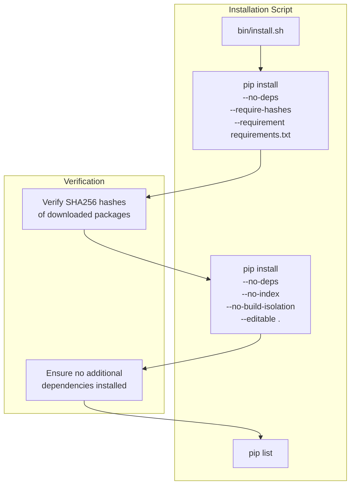
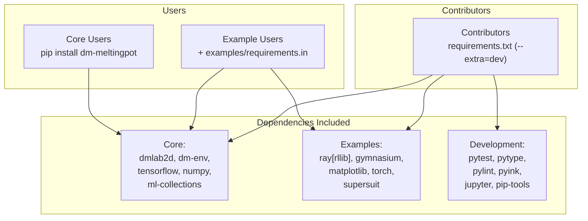

<!-- source: DeepWiki mcp.deepwiki.com · repo google-deepmind/meltingpot · page 7.2 Dependency Management · fetched 2026-10-26 -->

# Dependency Management

<details>
<summary>Relevant source files</summary>

The following files were used as context for generating this wiki page:

- [bin/install.sh](bin/install.sh)
- [bin/test.sh](bin/test.sh)
- [bin/test_examples.sh](bin/test_examples.sh)
- [bin/update_requirements.sh](bin/update_requirements.sh)
- [examples/requirements.in](examples/requirements.in)
- [requirements.txt](requirements.txt)

</details>


## Purpose and Scope

This document covers how Melting Pot manages its Python dependencies, including version pinning, hash verification, compilation workflows, and the distinction between core, development, and example dependencies. For information about the package build system itself, see [Build and Package System](#7.1). For information about security scanning and supply chain management, see [Security and Supply Chain](#7.6).

## Overview

Melting Pot uses **pip-tools** (`pip-compile`) to manage dependencies with a focus on reproducibility and security. All dependencies are pinned to specific versions with cryptographic hashes to ensure builds are deterministic across environments and to protect against supply chain attacks.

**Sources:** [requirements.txt:1-7](), [bin/update_requirements.sh:1-23]()

## Dependency Files

### Requirements File Structure



**Dependency File Workflow**

**Sources:** [requirements.txt:1-7](), [examples/requirements.in:1-13](), [bin/update_requirements.sh:21-22]()

### requirements.txt

The primary dependency file is [requirements.txt](). This file is **autogenerated** by `pip-compile` and contains:

- All core dependencies from `setup.py`
- Development dependencies (when compiled with `--extra=dev`)
- Exact version pins for every package
- SHA256 cryptographic hashes for each package file
- Transitive dependency resolution

**Header format:**
```
# This file is autogenerated by pip-compile with Python 3.11
# by the following command:
#
#    pip-compile --allow-unsafe --extra=dev --generate-hashes --strip-extras setup.py
```

**Entry format:**
```
absl-py==2.2.2 \
    --hash=sha256:bf25b2c2eed013ca456918c453d687eab4e8309fba81ee2f4c1a6aa2494175eb \
    --hash=sha256:e5797bc6abe45f64fd95dc06394ca3f2bedf3b5d895e9da691c9ee3397d70092
    # via
    #   chex
    #   dm-env
    #   dm-meltingpot (setup.py)
```

Each entry includes:
- Package name with exact version (`==`)
- One or more SHA256 hashes (multiple hashes for multiple distribution formats)
- Comments showing which packages require this dependency

**Sources:** [requirements.txt:1-10](), [requirements.txt:7-17]()

### examples/requirements.in

This is a **manually maintained** input file listing additional dependencies needed for running examples:

```
absl_py
dm_env
dm_tree
dmlab2d
gymnasium
matplotlib
ml_collections
numpy
ray[rllib,default]==2.5.0
supersuit>=3.7.2
torch
```

Note:
- Most dependencies use unpinned versions (latest compatible)
- `ray` is pinned to `2.5.0` specifically
- `supersuit` has a minimum version requirement (`>=3.7.2`)

**Sources:** [examples/requirements.in:1-13]()

## Major Dependency Groups

### Core Dependencies



**Core Dependency Categories**

**Sources:** [requirements.txt:310-395](), [requirements.txt:250-253](), [requirements.txt:521-527]()

| Category | Packages | Purpose |
|----------|----------|---------|
| **Simulation Engine** | `dmlab2d`, `dm-env`, `dm-tree` | Core game engine and environment API |
| **Machine Learning** | `tensorflow`, `chex`, `keras` | Neural network training and utilities |
| **Configuration** | `ml-collections`, `absl-py`, `immutabledict` | Scenario/bot configuration management |
| **Data Processing** | `numpy`, `pandas`, `opencv-python` | Numerical computation and image processing |
| **Distribution** | `build`, `setuptools`, `wheel` | Package building and distribution |

**Sources:** [requirements.txt:7-527]()

### Development Dependencies

Development dependencies are included when compiling with `--extra=dev`:

| Category | Packages | Purpose |
|----------|----------|---------|
| **Testing** | `pytest`, `pytest-xdist` | Unit testing with parallel execution |
| **Type Checking** | `pytype`, `importlab` | Static type analysis |
| **Linting** | `pylint`, `astroid` | Code quality enforcement |
| **Formatting** | `pyink`, `black`, `isort` | Code style formatting |
| **Documentation** | `jupyter`, `nbconvert`, `ipython` | Notebook support and documentation |
| **Package Tools** | `pip-tools`, `twine`, `pipreqs` | Dependency compilation and publishing |

**Sources:** [requirements.txt:49-72](), [requirements.txt:526-549](), [requirements.txt:1109-1176]()

## Updating Dependencies

### Update Workflow



**Dependency Update Process**

**Sources:** [bin/update_requirements.sh:1-23]()

### update_requirements.sh

The update script is located at [bin/update_requirements.sh]():

```bash
pip-compile --generate-hashes --reuse-hashes --strip-extras --allow-unsafe \
  --upgrade --extra dev setup.py
```

**Flag explanations:**

| Flag | Purpose |
|------|---------|
| `--generate-hashes` | Generate SHA256 hashes for security verification |
| `--reuse-hashes` | Keep existing hashes when versions don't change |
| `--strip-extras` | Remove `[extra]` markers from package names in output |
| `--allow-unsafe` | Include packages like `setuptools` that pip normally excludes |
| `--upgrade` | Try to upgrade all packages to their latest versions |
| `--extra dev` | Include development dependencies from `extras_require['dev']` |

**Sources:** [bin/update_requirements.sh:21-22]()

### Dependency Resolution

When `pip-compile` runs, it:

1. **Reads `setup.py`** to extract `install_requires` and `extras_require['dev']`
2. **Resolves transitive dependencies** to find all required packages
3. **Determines compatible versions** using each package's version constraints
4. **Downloads package metadata** to obtain SHA256 hashes
5. **Writes `requirements.txt`** with pinned versions and hashes
6. **Adds dependency comments** showing why each package was included

Example of transitive dependency tracking:

```
absl-py==2.2.2 \
    --hash=sha256:...
    # via
    #   chex          <- chex depends on absl-py
    #   dm-env        <- dm-env depends on absl-py
    #   dm-meltingpot (setup.py)  <- direct dependency
    #   keras         <- keras depends on absl-py
    #   ml-collections <- ml-collections depends on absl-py
```

**Sources:** [requirements.txt:7-17]()

## Installing Dependencies

### Installation Workflow



**Installation Process**

**Sources:** [bin/install.sh:1-32]()

### install.sh

The installation script [bin/install.sh]() performs a secure two-step installation:

**Step 1: Install dependencies**
```bash
pip install --no-deps --require-hashes --requirement requirements.txt
```

| Flag | Purpose |
|------|---------|
| `--no-deps` | Only install packages listed, no transitive dependencies |
| `--require-hashes` | Enforce hash verification (security) |
| `--requirement requirements.txt` | Install from compiled requirements |

**Step 2: Install Melting Pot**
```bash
pip install --no-deps --no-index --no-build-isolation --editable .
```

| Flag | Purpose |
|------|---------|
| `--no-deps` | Don't install dependencies (already installed in step 1) |
| `--no-index` | Don't check PyPI (security) |
| `--no-build-isolation` | Use existing build dependencies |
| `--editable` | Install in development mode (changes reflect immediately) |

**Sources:** [bin/install.sh:21-28]()

### Why Two Steps?

The two-step installation ensures:

1. **Security:** All dependencies are verified against their hashes before Melting Pot is installed
2. **Reproducibility:** The exact versions from `requirements.txt` are used
3. **Development workflow:** The package itself is editable while dependencies are locked

**Sources:** [bin/install.sh:21-28]()

## Dependency Pinning Strategy

### Core Package Pins

Melting Pot uses **exact version pinning** (`==`) for all packages in `requirements.txt`:

```
dmlab2d==1.0.0
dm-env==1.6
dm-tree==0.1.8
chex==0.1.89
absl-py==2.2.2
```

This ensures:
- **Deterministic builds** across all environments
- **Reproducible CI/CD** pipelines
- **Protection against breaking changes** in dependencies
- **Security auditing** of specific versions

**Sources:** [requirements.txt:366-395](), [requirements.txt:250-253]()

### Hash Verification

Every package includes SHA256 hashes for verification:

```
cryptography==44.0.2 \
    --hash=sha256:04abd71114848aa25edb28e225ab5f268096f44cf0127f3d36975bdf1bdf3390 \
    --hash=sha256:0529b1d5a0105dd3731fa65680b45ce49da4d8115ea76e9da77a875396727b41 \
    --hash=sha256:1bc312dfb7a6e5d66082c87c34c8a62176e684b6fe3d90fcfe1568de675e6688 \
    ... (multiple hashes for different wheel formats)
```

Multiple hashes accommodate:
- Different Python versions (e.g., Python 3.10 vs 3.11)
- Different platforms (Linux, macOS, Windows)
- Source distributions vs. wheels

**Sources:** [requirements.txt:261-296]()

## Testing with Dependencies

### Test Scripts

Both test scripts ensure dependencies are compatible:

**bin/test.sh:**
```bash
pytest meltingpot || FAILURES=true
pytype meltingpot || FAILURES=true
pylint --errors-only meltingpot || FAILURES=true
```

**bin/test_examples.sh:**
```bash
pytest examples || FAILURES=true
pytype examples || FAILURES=true
pylint --errors-only examples || FAILURES=true
```

These scripts verify:
- All imports resolve correctly
- Type annotations are valid with current dependencies
- No linting errors from dependency API changes

**Sources:** [bin/test.sh:22-33](), [bin/test_examples.sh:22-33]()

## Dependency Categories by Use Case



**Dependency Groups by User Type**

**Sources:** [requirements.txt:1-7](), [examples/requirements.in:1-13]()

## Dependency Version Management

### Current Major Versions

| Package | Version | Notes |
|---------|---------|-------|
| `dmlab2d` | 1.0.0 | Core simulation engine |
| `dm-env` | 1.6 | Environment API |
| `dm-tree` | 0.1.8 | Tree data structures |
| `tensorflow` | Latest compatible | ML framework (not pinned in setup.py) |
| `chex` | 0.1.89 | JAX testing utilities |
| `ray[rllib]` | 2.5.0 | RL framework (examples only) |
| `absl-py` | 2.2.2 | Google's Python utilities |
| `numpy` | Latest compatible | Numerical computing |

**Sources:** [requirements.txt:366-395](), [requirements.txt:250-253](), [examples/requirements.in:10]()

### Upgrade Policy

When updating dependencies:

1. **Run `bin/update_requirements.sh`** to regenerate with latest versions
2. **Test thoroughly** using CI/CD pipelines (see [CI/CD Pipelines](#7.5))
3. **Review changes** in the diff of `requirements.txt`
4. **Check for breaking changes** in package changelogs
5. **Update documentation** if APIs have changed

**Sources:** [bin/update_requirements.sh:21-22]()

## Security Considerations

### Hash Verification

The `--require-hashes` flag during installation provides **supply chain security**:

- Prevents installation if downloaded package doesn't match expected hash
- Protects against compromised PyPI packages
- Ensures downloaded package hasn't been tampered with
- Works with `--no-index` to prevent fallback to PyPI

**Sources:** [bin/install.sh:22]()

### Dependency Scanning

Dependencies are scanned for vulnerabilities through:

- **Dependabot** updates (automated dependency updates, see [Security and Supply Chain](#7.6))
- **CodeQL analysis** (static security scanning)
- **OSSF Scorecards** (supply chain security assessment)

These tools integrate with the locked `requirements.txt` to identify known CVEs in specific versions.

**Sources:** [bin/install.sh:22]()

## Common Workflows

### Adding a New Dependency

1. Add package to `install_requires` in `setup.py` (for core) or `extras_require['dev']` (for dev)
2. Run `bin/update_requirements.sh`
3. Review the diff of `requirements.txt`
4. Run `bin/test.sh` to ensure compatibility
5. Commit both `setup.py` and `requirements.txt`

**Sources:** [bin/update_requirements.sh:21-22](), [bin/test.sh:22-41]()

### Updating All Dependencies

1. Run `bin/update_requirements.sh` (includes `--upgrade` flag)
2. Review all version changes in `requirements.txt`
3. Run full test suite: `bin/test.sh` and `bin/test_examples.sh`
4. Check CI/CD passes (see [CI/CD Pipelines](#7.5))
5. Commit updated `requirements.txt`

**Sources:** [bin/update_requirements.sh:21-22]()

### Reproducing an Environment

```bash
# Clone repository
git clone https://github.com/google-deepmind/meltingpot
cd meltingpot

# Install exact locked versions
bin/install.sh

# Verify installation
pip list
```

This provides bit-for-bit reproducibility of the dependency environment.

**Sources:** [bin/install.sh:1-32]()

---

