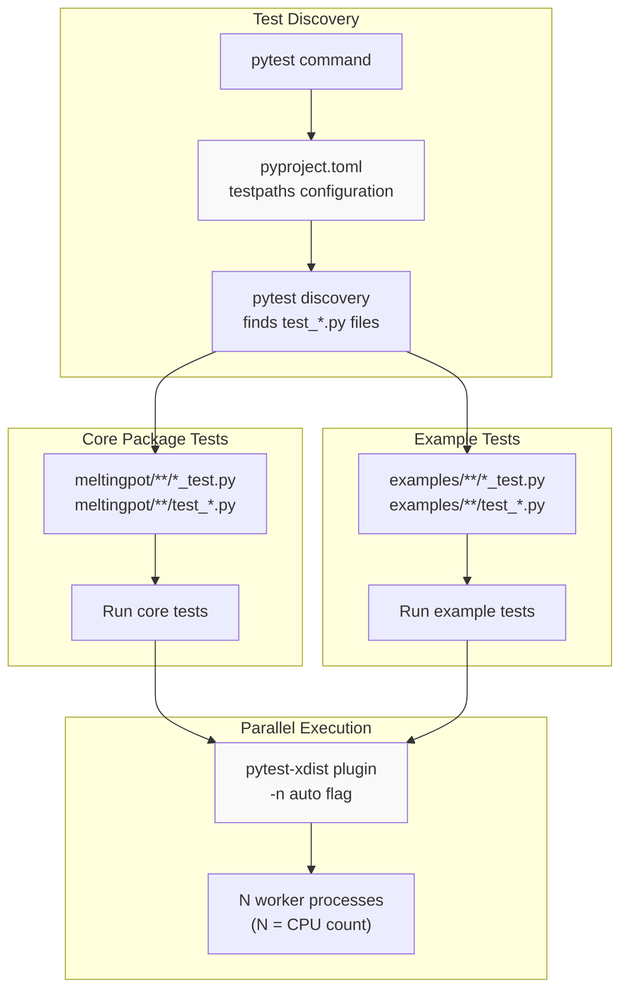
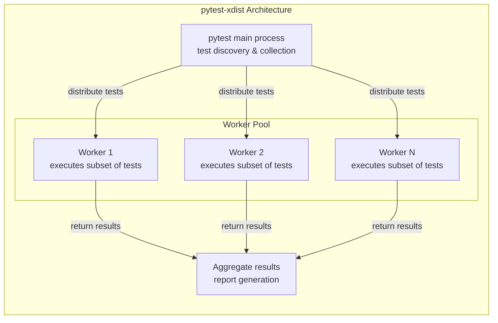
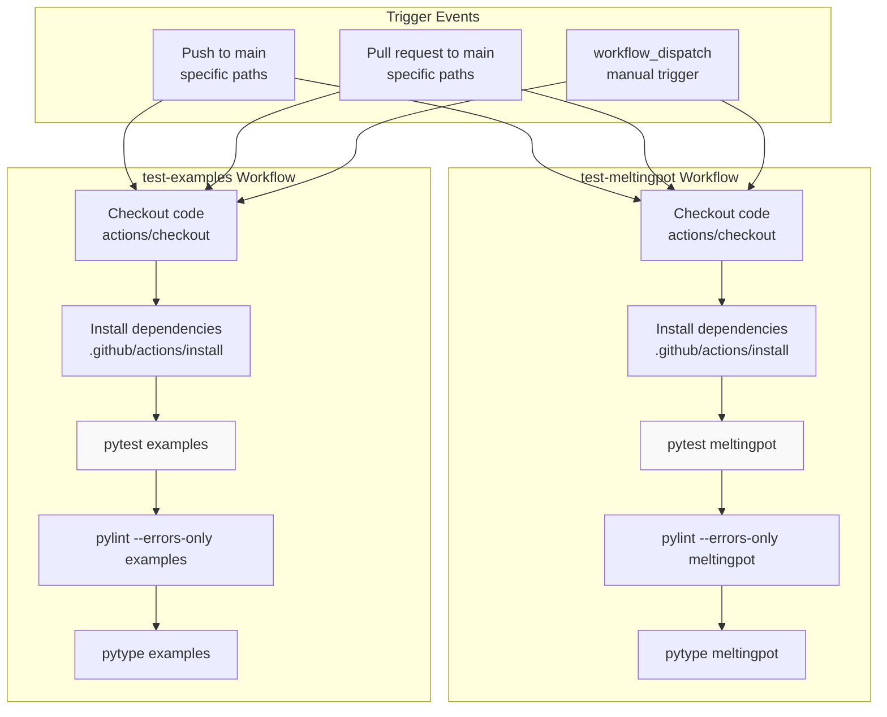
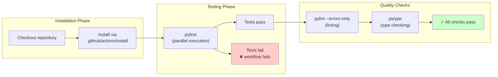

<!-- source: DeepWiki mcp.deepwiki.com · repo google-deepmind/meltingpot · page 7.3 Testing Infrastructure · fetched 2026-10-26 -->

# Testing Infrastructure

<details>
<summary>Relevant source files</summary>

The following files were used as context for generating this wiki page:

- [.github/workflows/test-examples.yml](.github/workflows/test-examples.yml)
- [.github/workflows/test-meltingpot.yml](.github/workflows/test-meltingpot.yml)
- [examples/tutorial/harvest/play_harvest.py](examples/tutorial/harvest/play_harvest.py)
- [pyproject.toml](pyproject.toml)

</details>


## Purpose and Scope

This document describes Melting Pot's testing infrastructure, including how to run tests locally, the pytest configuration, parallel execution strategy, and the CI/CD test workflows. The testing system validates both the core `meltingpot` package and the `examples` directory through automated GitHub Actions workflows.

For information about code quality tools like pylint and pytype that complement testing, see [Code Quality and Linting](#7.4). For details on the overall CI/CD pipeline and publishing process, see [CI/CD Pipelines](#7.5).

## Test Suite Organization

Melting Pot uses `pytest` as its testing framework with tests distributed across two primary locations:

| Test Location | Purpose | Workflow |
|--------------|---------|----------|
| `meltingpot/` | Core package tests (co-located with source) | `test-meltingpot.yml` |
| `examples/` | Example code tests (co-located with examples) | `test-examples.yml` |

Tests are co-located with their source code following a standard Python testing convention. The test discovery is configured in [`pyproject.toml:27`]() where `testpaths = ["meltingpot", "examples"]` specifies both directories as test sources.

### Test Execution Flow



**Sources:** [`.github/workflows/test-meltingpot.yml:49`](), [`.github/workflows/test-examples.yml:52`](), [`pyproject.toml:24-27`]()

## Pytest Configuration

The pytest configuration is centralized in `pyproject.toml` under the `[tool.pytest.ini_options]` section:

### Configuration Settings

| Setting | Value | Purpose |
|---------|-------|---------|
| `required_plugins` | `["pytest-xdist"]` | Enforces parallel execution capability |
| `addopts` | `"-n auto"` | Automatically enables parallel execution |
| `testpaths` | `["meltingpot", "examples"]` | Directories containing tests |

The `required_plugins` setting at [`pyproject.toml:25`]() ensures that `pytest-xdist` is installed, preventing tests from running in serial mode unintentionally. The `addopts = "-n auto"` at [`pyproject.toml:26`]() automatically distributes test execution across all available CPU cores.

**Sources:** [`pyproject.toml:24-27`]()

## Running Tests Locally

### Basic Test Execution

To run all tests in the repository:

```bash
pytest
```

This command automatically:
1. Discovers tests in `meltingpot/` and `examples/` directories
2. Distributes tests across all CPU cores (via `-n auto`)
3. Executes tests in parallel

### Targeting Specific Test Locations

Run only core package tests:
```bash
pytest meltingpot
```

Run only example tests:
```bash
pytest examples
```

Run tests in a specific file:
```bash
pytest meltingpot/path/to/test_file.py
```

### Overriding Parallel Execution

To run tests serially (useful for debugging):
```bash
pytest -n 0
```

To specify a fixed number of workers:
```bash
pytest -n 4
```

**Sources:** [`.github/workflows/test-meltingpot.yml:49`](), [`.github/workflows/test-examples.yml:52`](), [`pyproject.toml:26`]()

## Parallel Test Execution with pytest-xdist

Melting Pot uses `pytest-xdist` to parallelize test execution, significantly reducing test runtime on multi-core machines.

### Architecture



**Sources:** [`pyproject.toml:25-26`]()

### Worker Count Strategy

The `-n auto` flag in [`pyproject.toml:26`]() configures pytest-xdist to:
1. Detect the number of CPU cores available on the host system
2. Spawn one worker process per CPU core
3. Distribute tests evenly across workers

This approach maximizes CPU utilization while avoiding over-subscription. On CI runners (GitHub Actions ubuntu-latest), this typically results in 2-4 worker processes.

### Implications for Test Design

Tests must be written to support parallel execution:
- **Isolation:** Each test must be independent and not rely on shared state
- **Determinism:** Tests should produce consistent results regardless of execution order
- **Resource management:** File handles, network ports, and other resources must be properly managed

**Sources:** [`pyproject.toml:24-27`]()

## CI/CD Test Workflows

Melting Pot implements two parallel GitHub Actions workflows for continuous testing.

### Test Workflow Architecture



**Sources:** [`.github/workflows/test-meltingpot.yml`](), [`.github/workflows/test-examples.yml`]()

### test-meltingpot Workflow

The core package testing workflow is defined in `.github/workflows/test-meltingpot.yml`:

| Step | Command | Purpose |
|------|---------|---------|
| Checkout | `actions/checkout@11bd71901bbe5b1630ceea73d27597364c9af683` | Clone repository |
| Install | `./.github/actions/install` | Install dependencies via custom action |
| Test | `pytest meltingpot` | Run all core package tests |
| Lint | `pylint --errors-only meltingpot` | Check for linting errors |
| Typecheck | `pytype meltingpot` | Static type analysis |

The workflow runs on `ubuntu-latest` and is triggered by:
- Pushes to `main` branch affecting specific paths ([`.github/workflows/test-meltingpot.yml:4-15`]())
- Pull requests to `main` branch affecting specific paths ([`.github/workflows/test-meltingpot.yml:16-28`]())
- Manual workflow dispatch ([`.github/workflows/test-meltingpot.yml:29`]())

**Sources:** [`.github/workflows/test-meltingpot.yml:1-56`]()

### test-examples Workflow

The examples testing workflow mirrors the core workflow structure but targets the `examples/` directory:

| Step | Command | Purpose |
|------|---------|---------|
| Checkout | `actions/checkout@11bd71901bbe5b1630ceea73d27597364c9af683` | Clone repository |
| Install | `./.github/actions/install` | Install dependencies via custom action |
| Test | `pytest examples` | Run all example tests |
| Lint | `pylint --errors-only examples` | Check for linting errors |
| Typecheck | `pytype examples` | Static type analysis |

This workflow includes a 90-minute timeout ([`.github/workflows/test-examples.yml:43`]()) to accommodate longer-running example tests that may involve environment instantiation and episode execution.

**Sources:** [`.github/workflows/test-examples.yml:1-59`]()

### Path-Based Triggering

Both workflows use path filters to optimize CI resource usage. Tests only run when relevant files change:

**test-meltingpot paths:**
- `.github/actions/install/action.yml`
- `.github/workflows/test-meltingpot.yml`
- `.pylintrc`
- `bin/install.sh`
- `meltingpot/**`
- `pyproject.toml`
- `requirements.txt`
- `setup.py`

**test-examples paths:**
- `.github/actions/install/action.yml`
- `.github/workflows/test-examples.yml`
- `.pylintrc`
- `bin/install.sh`
- `examples/**`
- `meltingpot/**` (examples depend on core)
- `pyproject.toml`
- `requirements.txt`
- `setup.py`

Note that changes to `meltingpot/**` trigger both workflows since examples depend on the core package.

**Sources:** [`.github/workflows/test-meltingpot.yml:7-15`](), [`.github/workflows/test-meltingpot.yml:19-28`](), [`.github/workflows/test-examples.yml:7-16`](), [`.github/workflows/test-examples.yml:20-30`]()

### Concurrency Control

Both workflows implement concurrency control to prevent redundant test runs:

```yaml
concurrency:
  group: ${{ github.workflow }}-${{ github.head_ref || github.ref }}
  cancel-in-progress: true
```

This configuration at [`.github/workflows/test-meltingpot.yml:31-33`]() and [`.github/workflows/test-examples.yml:31-33`]():
- Groups workflow runs by workflow name and branch
- Cancels in-progress runs when new commits are pushed to the same branch
- Reduces CI queue times and resource consumption

**Sources:** [`.github/workflows/test-meltingpot.yml:31-33`](), [`.github/workflows/test-examples.yml:31-33`]()

## Test Execution Pipeline

The complete testing pipeline integrates pytest execution with code quality checks:



**Sources:** [`.github/workflows/test-meltingpot.yml:42-55`](), [`.github/workflows/test-examples.yml:45-58`]()

### Sequential Quality Gates

The workflow steps execute sequentially, each acting as a quality gate:

1. **pytest execution** - Tests must pass before linting runs
2. **pylint validation** - No errors must be present before type checking
3. **pytype analysis** - Final static analysis validation

A failure at any stage stops the workflow and reports the failure. This sequential approach provides fast feedback by failing early when tests don't pass, avoiding unnecessary linting and type checking.

**Sources:** [`.github/workflows/test-meltingpot.yml:48-55`](), [`.github/workflows/test-examples.yml:51-58`]()

## Test Coverage and Scope

The testing infrastructure validates multiple aspects of the codebase:

| Test Category | Location | Validation Target |
|--------------|----------|-------------------|
| Unit tests | `meltingpot/` | Core package functionality |
| Integration tests | `meltingpot/` | Component interactions |
| Example tests | `examples/` | Tutorial code, training scripts |
| Interactive tests | `examples/` | Human play interfaces |

### Testing Environment Components

Both test workflows validate against the same environment components:
- Python code in `meltingpot` and `examples`
- Dependencies specified in `requirements.txt`
- Configuration in `pyproject.toml` and `.pylintrc`
- Installation scripts in `bin/install.sh`

This ensures consistency between local development and CI environments.

**Sources:** [`.github/workflows/test-meltingpot.yml:7-15`](), [`.github/workflows/test-examples.yml:7-16`](), [`pyproject.toml:27`]()

## Permissions and Security

Both test workflows operate with minimal permissions following the principle of least privilege:

```yaml
permissions: read-all
```

This configuration at [`.github/workflows/test-meltingpot.yml:35`]() and [`.github/workflows/test-examples.yml:37`]() grants read-only access to repository contents, preventing accidental modifications during test execution.

**Sources:** [`.github/workflows/test-meltingpot.yml:35`](), [`.github/workflows/test-examples.yml:37`]()

---

