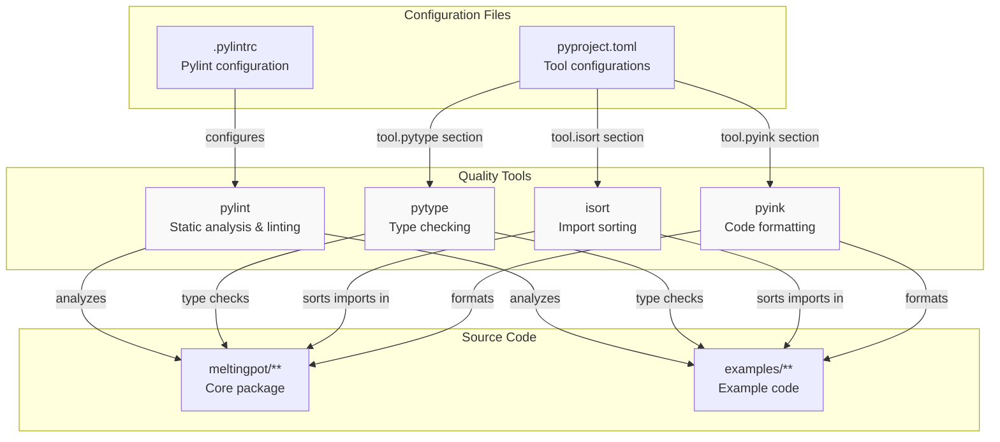
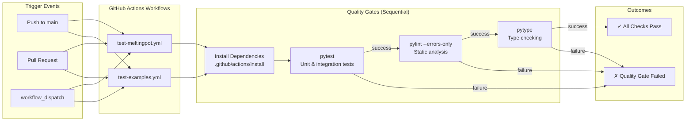
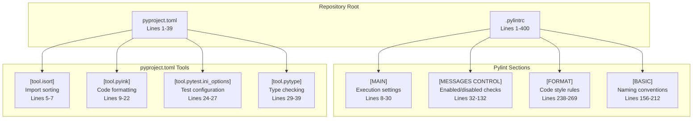

<!-- source: DeepWiki mcp.deepwiki.com · repo google-deepmind/meltingpot · page 7.4 Code Quality and Linting · fetched 2026-10-26 -->

# Code Quality and Linting

<details>
<summary>Relevant source files</summary>

The following files were used as context for generating this wiki page:

- [.github/workflows/test-examples.yml](.github/workflows/test-examples.yml)
- [.github/workflows/test-meltingpot.yml](.github/workflows/test-meltingpot.yml)
- [.pylintrc](.pylintrc)
- [examples/tutorial/harvest/play_harvest.py](examples/tutorial/harvest/play_harvest.py)
- [pyproject.toml](pyproject.toml)

</details>


This document describes the code quality and linting infrastructure used in the Melting Pot codebase. It covers static analysis with `pylint`, type checking with `pytype`, code formatting with `pyink` and `isort`, and how these tools are configured and integrated into the development workflow.

For information about the testing infrastructure that runs these quality checks, see [Testing Infrastructure](#7.3). For information about the CI/CD pipelines that enforce these checks, see [CI/CD Pipelines](#7.5).

## Overview

The Melting Pot codebase uses multiple automated tools to maintain code quality and consistency. These tools are configured to follow the Google Python Style Guide and run automatically in CI/CD pipelines on every push and pull request.

### Quality Assurance Tools

The following diagram shows the core tools and their relationships to configuration files:



**Sources:** [.pylintrc:1-400](), [pyproject.toml:1-39](), [.github/workflows/test-meltingpot.yml:48-55](), [.github/workflows/test-examples.yml:51-58]()

## Pylint: Static Code Analysis

Pylint performs static analysis to detect errors, enforce coding standards, and identify code smells. The codebase uses a comprehensive `.pylintrc` configuration based on the Google Python Style Guide.

### Configuration Location

The main pylint configuration is in [.pylintrc:1-400](). This file is referenced by CI workflows at [.github/workflows/test-meltingpot.yml:10]() and [.github/workflows/test-examples.yml:10]().

### Key Configuration Settings

#### Execution Settings

- **Parallel jobs:** `jobs=4` runs pylint with 4 parallel processes for faster execution [.pylintrc:25]()
- **Ignore patterns:** Third-party code is excluded via `ignore=third_party` [.pylintrc:11]()
- **No persistent cache:** `persistent=no` prevents storing data between runs [.pylintrc:18]()

#### Code Style Enforcement

| Setting | Value | Location |
|---------|-------|----------|
| Max line length | 80 characters | [.pylintrc:241]() |
| Indentation | 2 spaces | [.pylintrc:262]() |
| Hanging indent | 4 spaces | [.pylintrc:265]() |
| Single-line if | Allowed | [.pylintrc:253]() |
| Quote consistency | Enforced | [.pylintrc:281]() |

#### Naming Conventions

Pylint enforces specific naming patterns using regular expressions:

- **Functions:** `^(?:(?P<exempt>setUp|tearDown|setUpModule|tearDownModule)|(?P<camel_case>_?[A-Z][a-zA-Z0-9]*)|(?P<snake_case>_?[a-z][a-z0-9_]*))$` [.pylintrc:176]()
- **Variables:** `^[a-z][a-z0-9_]*$` [.pylintrc:179]()
- **Classes:** `^_?[A-Z][a-zA-Z0-9]*$` [.pylintrc:197]()
- **Constants:** `^(_?[A-Z][A-Z0-9_]*|__[a-z0-9_]+__|_?[a-z][a-z0-9_]*)$` [.pylintrc:182]()

#### Disabled Checks

To reduce noise and focus on critical errors, many checks are disabled. The configuration disables all refactoring suggestions (`R`) and numerous specific warnings [.pylintrc:53-131](). Notable disables include:

- `missing-function-docstring` - Docstrings are not required for all functions
- `no-member` - Avoids false positives with dynamic attributes
- `import-error` - Import validation handled by type checker
- `fixme` - TODO comments are allowed

### Running Pylint

In CI/CD, pylint runs with the `--errors-only` flag to catch only critical issues:

```bash
pylint --errors-only meltingpot
pylint --errors-only examples
```

This is configured in [.github/workflows/test-meltingpot.yml:52]() and [.github/workflows/test-examples.yml:55]().

**Sources:** [.pylintrc:1-400](), [.github/workflows/test-meltingpot.yml:51-52](), [.github/workflows/test-examples.yml:54-55]()

## Pytype: Type Checking

Pytype performs static type inference and checking for Python code. It validates type annotations and catches type-related errors without requiring explicit type hints on all code.

### Configuration

Pytype is configured in the `[tool.pytype]` section of `pyproject.toml`:

```toml
[tool.pytype]
inputs = ["meltingpot", "examples"]
keep_going = true
jobs = 'auto'
use_enum_overlay = true
```

**Configuration Details:**

- **inputs:** Both `meltingpot` and `examples` directories are type-checked [pyproject.toml:30]()
- **keep_going:** Analysis continues past errors to check as many files as possible [pyproject.toml:32]()
- **jobs:** Automatically uses number of CPUs for parallel execution [pyproject.toml:35]()
- **use_enum_overlay:** Enhanced enum checking for more precise type inference [pyproject.toml:38]()

### Execution in CI/CD

Pytype runs after tests and linting in the CI workflows:

```bash
pytype meltingpot
pytype examples
```

Configured at [.github/workflows/test-meltingpot.yml:55]() and [.github/workflows/test-examples.yml:58]().

**Sources:** [pyproject.toml:29-39](), [.github/workflows/test-meltingpot.yml:54-55](), [.github/workflows/test-examples.yml:57-58]()

## Code Formatting

The codebase uses two tools for code formatting: `isort` for import statement ordering and `pyink` for general code formatting.

### isort: Import Sorting

Isort automatically organizes import statements according to a consistent style. Configuration is in `[tool.isort]` section of `pyproject.toml`:

```toml
[tool.isort]
profile = "google"
known_thirdparty = ["meltingpot"]
```

- **profile:** Uses Google's import ordering conventions [pyproject.toml:6]()
- **known_thirdparty:** Treats `meltingpot` as third-party when formatting example code [pyproject.toml:7]()

### pyink: Code Formatting

Pyink is Google's fork of Black, configured to match Google's Python style. Configuration is in `[tool.pyink]` section:

```toml
[tool.pyink]
line-length = 80
unstable = true
pyink-indentation = 2
pyink-use-majority-quotes = true
pyink-annotation-pragmas = ["noqa", "pylint:", "type: ignore", "pytype:", "mypy:", "pyright:", "pyre-"]
```

**Key settings:**

- **line-length:** 80 characters to match pylint [pyproject.toml:10]()
- **pyink-indentation:** 2 spaces (Google style) [pyproject.toml:12]()
- **pyink-use-majority-quotes:** Enforces quote consistency [pyproject.toml:13]()
- **pyink-annotation-pragmas:** Preserves inline directives for other tools [pyproject.toml:14-22]()

**Sources:** [pyproject.toml:5-22]()

## CI/CD Quality Gate Workflow

The following diagram shows how quality checks are integrated into the CI/CD pipeline:



**Workflow Details:**

Both workflows ([test-meltingpot.yml](.github/workflows/test-meltingpot.yml:1-56) and [test-examples.yml](.github/workflows/test-examples.yml:1-59)) execute the same sequence of quality checks:

1. **Install:** Dependencies are installed using a shared GitHub action [.github/workflows/test-meltingpot.yml:45-46]()
2. **Test:** `pytest` runs with parallel execution [.github/workflows/test-meltingpot.yml:48-49]()
3. **Lint:** `pylint --errors-only` checks for critical issues [.github/workflows/test-meltingpot.yml:51-52]()
4. **Typecheck:** `pytype` validates type correctness [.github/workflows/test-meltingpot.yml:54-55]()

The checks run sequentially - if any step fails, subsequent steps are skipped and the workflow fails.

**Sources:** [.github/workflows/test-meltingpot.yml:38-56](), [.github/workflows/test-examples.yml:40-59]()

## Running Quality Checks Locally

Developers can run the same quality checks locally before pushing code.

### Individual Tool Execution

```bash
# Run tests with parallel execution
pytest -n auto meltingpot

# Lint for errors only
pylint --errors-only meltingpot

# Type check
pytype meltingpot

# Sort imports
isort meltingpot

# Format code
pyink meltingpot
```

### Running All Checks

To replicate the CI workflow locally:

```bash
# Run all quality checks in sequence
pytest meltingpot && \
pylint --errors-only meltingpot && \
pytype meltingpot
```

The parallel test execution (`-n auto`) is configured in [pyproject.toml:24-27]().

**Sources:** [.github/workflows/test-meltingpot.yml:48-55](), [pyproject.toml:24-27]()

## Configuration Files Reference

The following table summarizes the configuration files and their purposes:

| File | Purpose | Key Sections |
|------|---------|--------------|
| `.pylintrc` | Pylint static analysis configuration | `[MAIN]`, `[MESSAGES CONTROL]`, `[FORMAT]`, `[BASIC]` |
| `pyproject.toml` | Multi-tool configuration | `[tool.isort]`, `[tool.pyink]`, `[tool.pytype]`, `[tool.pytest.ini_options]` |

### Configuration File Locations



**Sources:** [.pylintrc:1-400](), [pyproject.toml:1-39]()

## Style Guide Compliance

The configuration enforces the Google Python Style Guide with specific adaptations:

### Line Length and Indentation

- Maximum line length: 80 characters [.pylintrc:241]()
- Indentation: 2 spaces [.pylintrc:262]()
- Hanging continuation: 4 spaces [.pylintrc:265]()

### Import Organization

Imports are organized in the following order by `isort` with the `google` profile:

1. Standard library imports
2. Third-party imports  
3. Local application imports

Special handling: `meltingpot` is marked as third-party in examples to ensure proper ordering [pyproject.toml:7]().

### Quote Consistency

Both `pylint` and `pyink` enforce consistent quote usage:

- `pylint`: `check-quote-consistency=yes` [.pylintrc:281]()
- `pyink`: `pyink-use-majority-quotes=true` [pyproject.toml:13]()

**Sources:** [.pylintrc:241-281](), [pyproject.toml:5-22]()

## Pragma Support

The tools support inline directives to suppress specific warnings. The `pyink` formatter preserves these pragmas:

```python
# Supported pragmas (preserved by pyink):
# noqa
# pylint: disable=...
# type: ignore
# pytype: disable=...
# mypy: ...
# pyright: ...
# pyre-...
```

These are configured in [pyproject.toml:14-22]() to prevent the formatter from breaking them across lines.

**Sources:** [pyproject.toml:14-22]()

---

