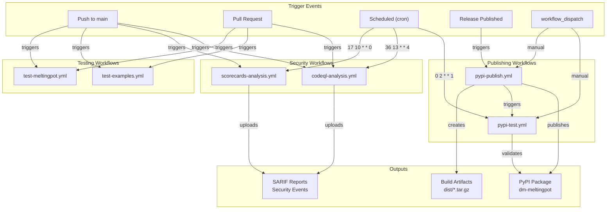
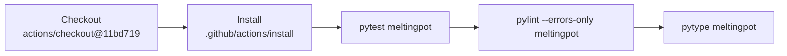
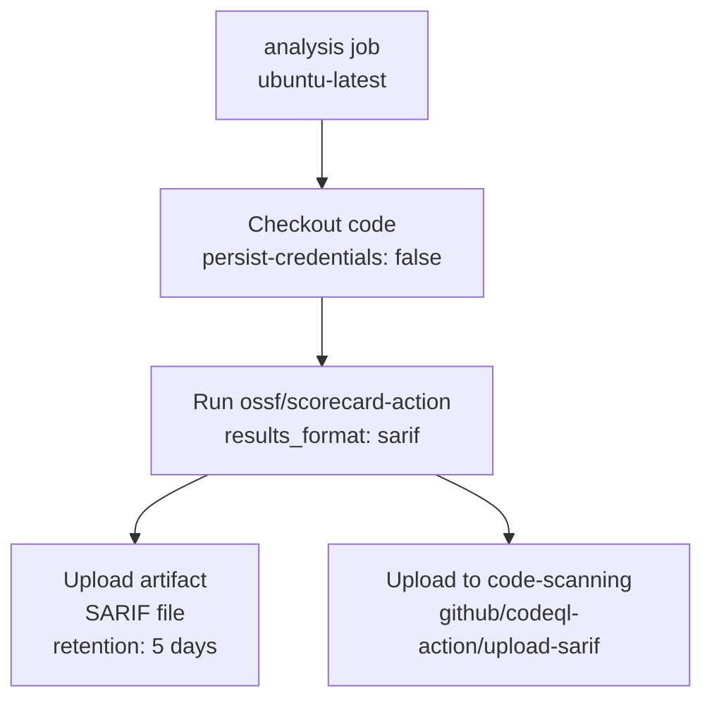
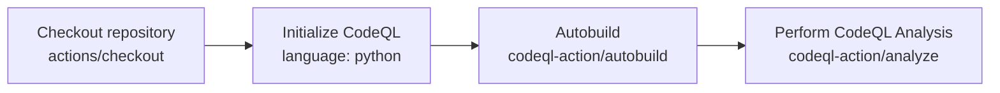
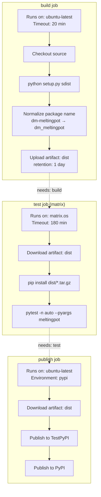
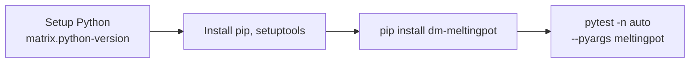
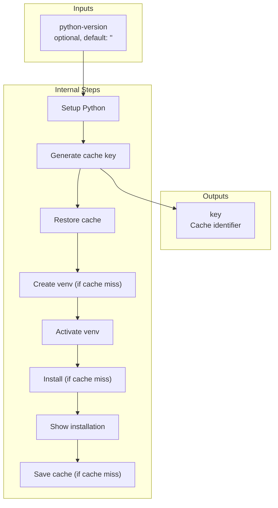
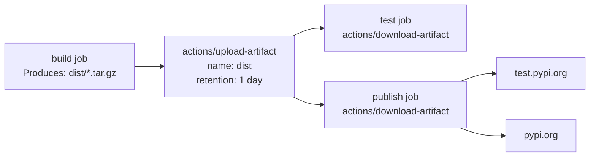

<!-- source: DeepWiki mcp.deepwiki.com · repo google-deepmind/meltingpot · page 7.5 CI/CD Pipelines · fetched 2026-10-26 -->

# CI/CD Pipelines

<details>
<summary>Relevant source files</summary>

The following files were used as context for generating this wiki page:

- [.github/actions/install/action.yml](.github/actions/install/action.yml)
- [.github/workflows/codeql-analysis.yml](.github/workflows/codeql-analysis.yml)
- [.github/workflows/pypi-publish.yml](.github/workflows/pypi-publish.yml)
- [.github/workflows/pypi-test.yml](.github/workflows/pypi-test.yml)
- [.github/workflows/scorecards-analysis.yml](.github/workflows/scorecards-analysis.yml)
- [.github/workflows/test-examples.yml](.github/workflows/test-examples.yml)
- [.github/workflows/test-meltingpot.yml](.github/workflows/test-meltingpot.yml)
- [.python-version](.python-version)

</details>


## Purpose and Scope

This document describes the Continuous Integration and Continuous Deployment (CI/CD) infrastructure for the Melting Pot repository. It covers all GitHub Actions workflows, their triggers, jobs, dependencies, and artifact management.

For information about code quality tools used within these pipelines, see [Code Quality and Linting](#7.4). For security-specific tooling details, see [Security and Supply Chain](#7.6). For package distribution mechanics, see [Build and Package System](#7.1).

---

## Workflow Overview

The Melting Pot CI/CD system consists of six GitHub Actions workflows organized into three categories:

| Category | Workflow | Primary Purpose | Trigger |
|----------|----------|-----------------|---------|
| **Testing** | `test-meltingpot.yml` | Validate core package | Push/PR to main |
| **Testing** | `test-examples.yml` | Validate example code | Push/PR to main |
| **Security** | `scorecards-analysis.yml` | Supply chain security assessment | Weekly schedule + push to main |
| **Security** | `codeql-analysis.yml` | Static security analysis | Push/PR to main + weekly schedule |
| **Publishing** | `pypi-publish.yml` | Build and publish to PyPI | Release creation |
| **Publishing** | `pypi-test.yml` | Validate PyPI distribution | Post-publish + weekly schedule |

### Workflow Dependencies and Triggers



**Sources:** [.github/workflows/test-meltingpot.yml:3-29](), [.github/workflows/test-examples.yml:3-31](), [.github/workflows/scorecards-analysis.yml:2-8](), [.github/workflows/codeql-analysis.yml:3-10](), [.github/workflows/pypi-publish.yml:5-8](), [.github/workflows/pypi-test.yml:5-28]()

---

## Testing Workflows

### test-meltingpot.yml

This workflow validates the core `meltingpot` package with three quality gates: testing, linting, and type checking.

**Trigger Conditions:**
- Push or pull request to `main` branch
- Only when specific paths change: workflow files, pylint config, install script, meltingpot source, requirements, setup files

**Jobs:**

The workflow runs a single job `test-meltingpot` with the following steps:



**Key Implementation Details:**

1. **Path-based triggering**: [.github/workflows/test-meltingpot.yml:7-28]() - Only runs when relevant files change
2. **Concurrency control**: [.github/workflows/test-meltingpot.yml:31-33]() - Cancels in-progress runs for same PR
3. **Reusable install action**: [.github/workflows/test-meltingpot.yml:45-46]() - Uses composite action for installation
4. **Three-phase validation**: [.github/workflows/test-meltingpot.yml:48-55]() - Tests, then lints, then typechecks

**Sources:** [.github/workflows/test-meltingpot.yml]()

### test-examples.yml

This workflow validates example code in the `examples/` directory using the same quality gates as the core package.

**Trigger Conditions:**
- Push or pull request to `main` branch
- Only when examples, meltingpot source, or build configuration changes

**Jobs:**

The `test-examples` job runs with a 90-minute timeout and follows an identical structure to `test-meltingpot`:

| Step | Command | Purpose |
|------|---------|---------|
| Test | `pytest examples` | Run example test suite |
| Lint | `pylint --errors-only examples` | Check for errors |
| Typecheck | `pytype examples` | Verify type annotations |

**Key Implementation Details:**

1. **Extended timeout**: [.github/workflows/test-examples.yml:43]() - 90 minutes for potentially long-running examples
2. **Path filtering**: [.github/workflows/test-examples.yml:12-30]() - Includes both examples and meltingpot changes
3. **Concurrency control**: [.github/workflows/test-examples.yml:33-35]() - Same cancel-in-progress behavior

**Sources:** [.github/workflows/test-examples.yml]()

---

## Security Workflows

### scorecards-analysis.yml

This workflow runs the [OSSF Scorecards](https://github.com/ossf/scorecard) tool to assess supply chain security practices.

**Trigger Conditions:**
- Weekly schedule: Sundays at 10:17 UTC ([.github/workflows/scorecards-analysis.yml:6]())
- Push to `main` branch
- Branch protection rule changes

**Job Execution Flow:**



**Permissions Model:**

The workflow declares minimal default permissions (`read-all`) but grants specific elevated permissions to the `analysis` job:

- `security-events: write` - Upload results to GitHub Security tab
- `id-token: write` - Receive OSSF badge (upcoming feature)
- `contents: read` - Read repository content
- `actions: read` - Read workflow metadata

[.github/workflows/scorecards-analysis.yml:11-24]()

**Key Implementation Details:**

1. **SARIF output**: [.github/workflows/scorecards-analysis.yml:35-36]() - Results formatted as SARIF for GitHub integration
2. **Public results**: [.github/workflows/scorecards-analysis.yml:47]() - `publish_results: true` enables scorecard badges
3. **Pinned actions**: [.github/workflows/scorecards-analysis.yml:28]() - Uses SHA-pinned action versions for security
4. **Dual upload**: [.github/workflows/scorecards-analysis.yml:51-62]() - Artifacts stored both as workflow artifacts and security events

**Sources:** [.github/workflows/scorecards-analysis.yml]()

### codeql-analysis.yml

This workflow performs static security analysis using GitHub's CodeQL engine.

**Trigger Conditions:**
- Push or pull request to `main` branch
- Weekly schedule: Thursdays at 13:36 UTC ([.github/workflows/codeql-analysis.yml:10]())

**Language Matrix:**

The workflow analyzes Python code using a strategy matrix: [.github/workflows/codeql-analysis.yml:24-27]()

**Job Steps:**



**Permissions:**

[.github/workflows/codeql-analysis.yml:19-22]()

- `actions: read` - Access workflow context
- `contents: read` - Read repository files
- `security-events: write` - Upload analysis results

**Key Implementation Details:**

1. **No custom queries**: [.github/workflows/codeql-analysis.yml:38-43]() - Uses default CodeQL query suite
2. **Autobuild**: [.github/workflows/codeql-analysis.yml:48-49]() - Automatic Python environment detection
3. **Fail-fast disabled**: [.github/workflows/codeql-analysis.yml:25]() - Continues even if one language fails

**Sources:** [.github/workflows/codeql-analysis.yml]()

---

## Publishing Workflows

### pypi-publish.yml

This workflow builds the package distribution and publishes it to PyPI and TestPyPI on release.

**Workflow Architecture:**



**Build Job Details:**

The build job creates the source distribution:

1. **Package name normalization**: [.github/workflows/pypi-publish.yml:28-32]() - Converts `dm-meltingpot-*` to `dm_meltingpot-*` for old setuptools compatibility
2. **Single artifact**: [.github/workflows/pypi-publish.yml:34-39]() - Uploads `dist/` directory with 1-day retention
3. **Tag filtering**: [.github/workflows/pypi-publish.yml:15]() - Only runs for tags starting with `v`

**Test Job Matrix:**

The test job validates the distribution across multiple platforms:

| Matrix Dimension | Values |
|------------------|--------|
| Operating Systems | `macos-13`, `macos-14`, `ubuntu-22.04`, `ubuntu-24.04` |
| Python Versions | `3.11`, `3.12`, `3.13` |
| Total Combinations | 12 |

[.github/workflows/pypi-publish.yml:48-59]()

**Test Job Configuration:**

- **Fail-fast**: [.github/workflows/pypi-publish.yml:49]() - Only enabled for actual releases (not workflow_dispatch)
- **Timeout**: 180 minutes for slower platforms
- **Environment variable**: [.github/workflows/pypi-publish.yml:46]() - `SYSTEM_VERSION_COMPAT=0` for macOS Python setup
- **Validation steps**: [.github/workflows/pypi-publish.yml:74-82]() - Install, list, check, test

**Publish Job Details:**

The publish job only runs if build succeeds and test doesn't fail:

[.github/workflows/pypi-publish.yml:87]()
```
if: always() && needs.build.result == 'success' && needs.test.result != 'failure'
```

This allows publishing even if tests are skipped, but blocks on failures.

**Publishing Sequence:**

1. **TestPyPI first**: [.github/workflows/pypi-publish.yml:101-107]() - Only on release events
2. **PyPI second**: [.github/workflows/pypi-publish.yml:108-113]() - Only on release events
3. **Trusted publishing**: Uses `id-token: write` permission for OIDC authentication
4. **No attestations**: [.github/workflows/pypi-publish.yml:105,112]() - `attestations: false`

**Sources:** [.github/workflows/pypi-publish.yml]()

### pypi-test.yml

This workflow validates that the published PyPI package is installable and functional.

**Trigger Conditions:**

- Weekly schedule: Mondays at 02:00 UTC
- After successful `pypi-publish` workflow completion
- Manual trigger with optional version specification
- Push/PR to workflow file itself (for testing changes)

[.github/workflows/pypi-test.yml:5-28]()

**Job Execution:**



**Matrix Configuration:**

Identical to `pypi-publish.yml` test job:
- 4 operating systems (2 macOS, 2 Ubuntu versions)
- 3 Python versions (3.11, 3.12, 3.13)

[.github/workflows/pypi-test.yml:42-51]()

**Version Selection:**

The workflow supports testing specific versions via workflow_dispatch:

[.github/workflows/pypi-test.yml:65-67]()
```yaml
VERSION="${{github.event.inputs.version}}"
pip install "dm-meltingpot${VERSION:+==$VERSION}"
```

If no version specified, installs the latest from PyPI.

**Conditional Execution:**

[.github/workflows/pypi-test.yml:35]()
```yaml
if: ${{ github.event.workflow_run.conclusion != 'failure' }}
```

Skips execution if triggered by a failed `pypi-publish` run.

**Sources:** [.github/workflows/pypi-test.yml]()

---

## Reusable Actions

### install Action

The `.github/actions/install/action.yml` composite action provides a cacheable installation mechanism used by both testing workflows.

**Action Interface:**



**Cache Key Generation:**

The cache key includes:

1. Operating system name and version ([.github/actions/install/action.yml:28-36]())
2. Python version from `setup-python` output
3. Hash of `requirements.txt`

Example key format: `Ubuntu-22.04-py3.11-<requirements-hash>`

[.github/actions/install/action.yml:37]()

**Cache Strategy:**

**Cached Paths:**
- `meltingpot/assets/` - Downloaded game assets
- `venv/` - Python virtual environment

[.github/actions/install/action.yml:43-46]()

**Cache Logic:**

1. **Restore**: [.github/actions/install/action.yml:39-46]() - Attempts to restore from cache
2. **Conditional steps**: [.github/actions/install/action.yml:49,60]() - Only runs if `cache-hit != 'true'`
3. **Save**: [.github/actions/install/action.yml:80-87]() - Saves cache after successful installation

**Virtual Environment Activation:**

[.github/actions/install/action.yml:54-57]()
```yaml
echo "${PWD}/venv/bin" >> $GITHUB_PATH
```

Adds venv to PATH for subsequent steps.

**Installation Script:**

The actual installation is delegated to `bin/install.sh`: [.github/actions/install/action.yml:62-63]()

**Verification Output:**

[.github/actions/install/action.yml:65-78]() - Shows versions of:
- `python`, `pip`, `pylint`, `pytest`, `pytype`
- Full `pip list` output

**Sources:** [.github/actions/install/action.yml]()

---

## Trigger Patterns and Scheduling

### Event-Based Triggers

**Push Triggers:**

All testing and security workflows trigger on push to `main`:

| Workflow | Additional Conditions |
|----------|----------------------|
| `test-meltingpot.yml` | Paths: meltingpot source, config files |
| `test-examples.yml` | Paths: examples, meltingpot source |
| `scorecards-analysis.yml` | No path filtering |
| `codeql-analysis.yml` | No path filtering |

**Pull Request Triggers:**

Testing workflows also trigger on PRs to `main`, with same path filtering.

**Release Triggers:**

[.github/workflows/pypi-publish.yml:6-7]()
```yaml
on:
  release:
    types: [published]
```

Only `pypi-publish.yml` triggers on GitHub release creation.

### Scheduled Triggers

Three workflows run on cron schedules:

| Workflow | Schedule | Cron Expression | Purpose |
|----------|----------|-----------------|---------|
| `scorecards-analysis.yml` | Weekly, Sunday 10:17 UTC | `17 10 * * 0` | Regular security assessment |
| `codeql-analysis.yml` | Weekly, Thursday 13:36 UTC | `36 13 * * 4` | Regular code scanning |
| `pypi-test.yml` | Weekly, Monday 02:00 UTC | `0 2 * * 1` | Validate PyPI package |

**Sources:** [.github/workflows/scorecards-analysis.yml:5-6](), [.github/workflows/codeql-analysis.yml:9-10](), [.github/workflows/pypi-test.yml:6-7]()

### Manual Triggers

Three workflows support `workflow_dispatch` for manual execution:

1. **test-meltingpot.yml**: [.github/workflows/test-meltingpot.yml:29]() - No inputs
2. **test-examples.yml**: [.github/workflows/test-examples.yml:31]() - No inputs  
3. **pypi-publish.yml**: [.github/workflows/pypi-publish.yml:8]() - No inputs
4. **pypi-test.yml**: [.github/workflows/pypi-test.yml:23-28]() - Optional `version` input

---

## Permissions Model

All workflows follow the principle of least privilege with default `permissions: read-all`.

### Per-Job Permissions

**scorecards-analysis.yml:**

[.github/workflows/scorecards-analysis.yml:17-24]()
- `security-events: write` - Upload SARIF to Security tab
- `id-token: write` - OIDC for scorecard badges
- `contents: read` - Repository access
- `actions: read` - Workflow metadata

**codeql-analysis.yml:**

[.github/workflows/codeql-analysis.yml:19-22]()
- `actions: read` - Workflow context
- `contents: read` - Source code access
- `security-events: write` - Upload scan results

**pypi-publish.yml:**

[.github/workflows/pypi-publish.yml:92-93]()
- `id-token: write` - Trusted publishing to PyPI via OIDC

**Testing workflows:**

No elevated permissions required - use default `read-all`.

---

## Artifact Management

### Build Artifacts

**pypi-publish.yml Build Artifacts:**

| Property | Value |
|----------|-------|
| Name | `dist` |
| Path | `./dist` |
| Contents | `dm_meltingpot-*.tar.gz` |
| Retention | 1 day |
| Producer | `build` job |
| Consumers | `test` job, `publish` job |

[.github/workflows/pypi-publish.yml:34-39]()

**Artifact Flow:**



**Sources:** [.github/workflows/pypi-publish.yml:34-113]()

### Security Artifacts (SARIF)

**scorecards-analysis.yml SARIF Artifacts:**

| Property | Value |
|----------|-------|
| Name | `SARIF file` |
| Path | `results.sarif` |
| Retention | 5 days |
| Upload Destination | Code scanning dashboard |

[.github/workflows/scorecards-analysis.yml:51-62]()

**Dual Upload Pattern:**

1. **Workflow artifact**: [.github/workflows/scorecards-analysis.yml:51-56]() - For download/debugging
2. **Security dashboard**: [.github/workflows/scorecards-analysis.yml:59-62]() - For GitHub Security integration

**Sources:** [.github/workflows/scorecards-analysis.yml]()

---

## Concurrency Control

Both testing workflows implement concurrency control to cancel redundant runs:

[.github/workflows/test-meltingpot.yml:31-33]()
```yaml
concurrency:
  group: ${{ github.workflow }}-${{ github.head_ref || github.ref }}
  cancel-in-progress: true
```

**Behavior:**

- **Group key**: Combines workflow name with PR head ref (for PRs) or branch ref (for pushes)
- **Cancel policy**: New runs cancel in-progress runs in same group
- **Effect**: Only the most recent commit triggers a run for each PR/branch

This prevents wasting resources on outdated commits.

**Sources:** [.github/workflows/test-meltingpot.yml:31-33](), [.github/workflows/test-examples.yml:33-35]()

---

## Python Version Strategy

All workflows use Python version `3.11` as the primary version, with multi-version testing in publishing workflows.

**Default Version:**

Specified in `.python-version`: [.python-version:1]()

**Test Matrix Versions:**

Publishing workflows test against: `3.11`, `3.12`, `3.13`

[.github/workflows/pypi-publish.yml:56-59](), [.github/workflows/pypi-test.yml:48-51]()

**Version Setup:**

All workflows use `actions/setup-python@a26af69be951a213d495a4c3e4e4022e16d87065` with SHA pinning for security.

**Sources:** [.python-version](), [.github/workflows/pypi-publish.yml:66-69](), [.github/actions/install/action.yml:18-22]()

---

## Summary

The CI/CD pipeline provides comprehensive coverage:

- **Quality Gates**: Testing, linting, type checking on every PR
- **Security**: Weekly scans + push-triggered analysis with SARIF integration  
- **Distribution**: Multi-platform testing before PyPI publication
- **Efficiency**: Caching, concurrency control, path-based filtering
- **Reliability**: Pinned action versions, fail-safe publish conditions

The workflows are designed to run efficiently while maintaining high quality and security standards, with clear separation between testing, security, and publishing concerns.

---

