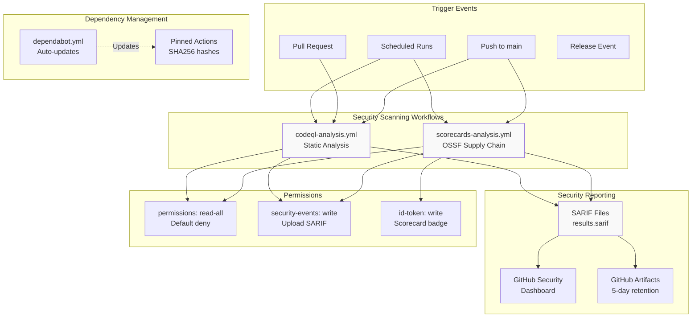
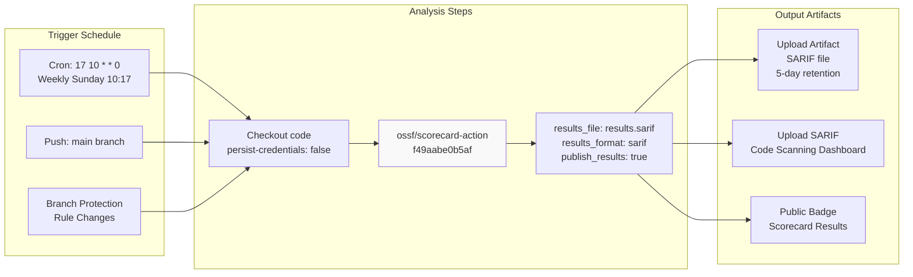
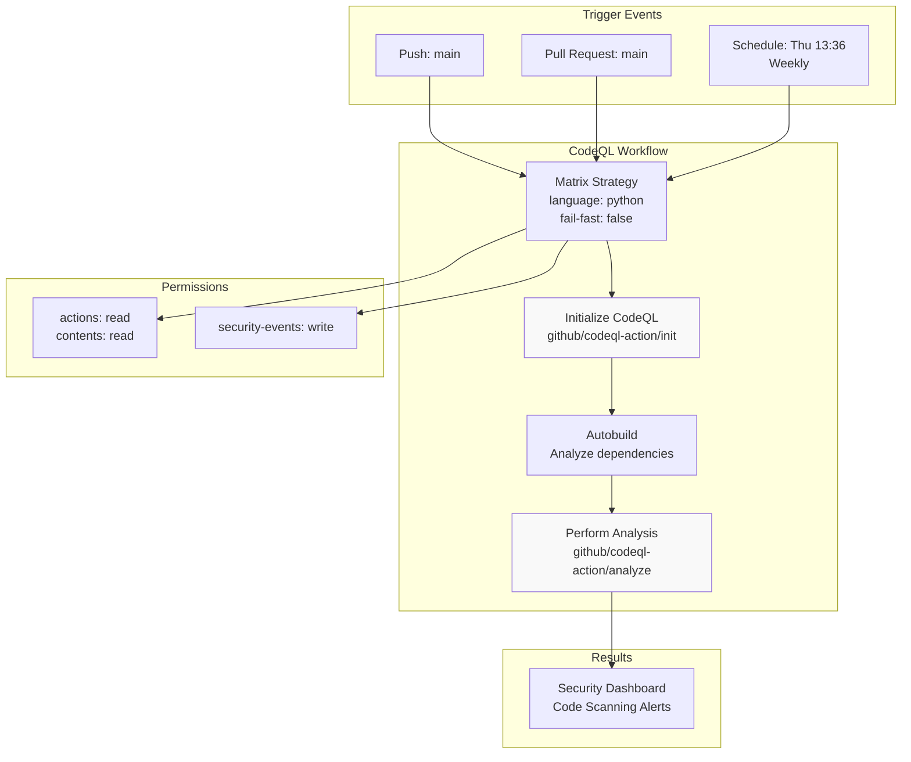
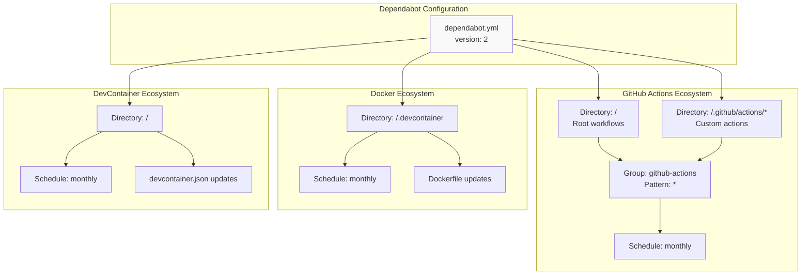
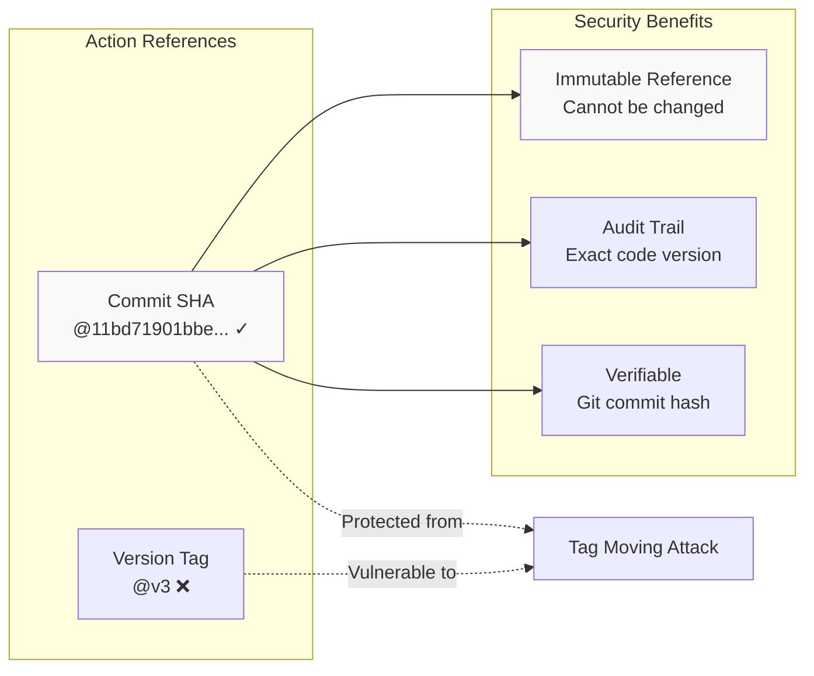
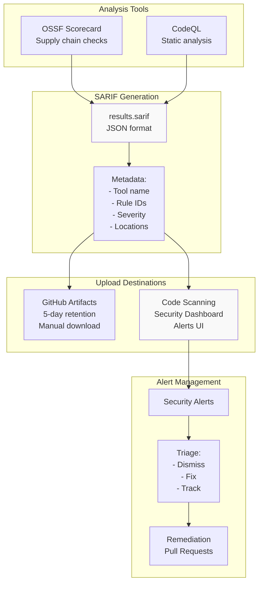
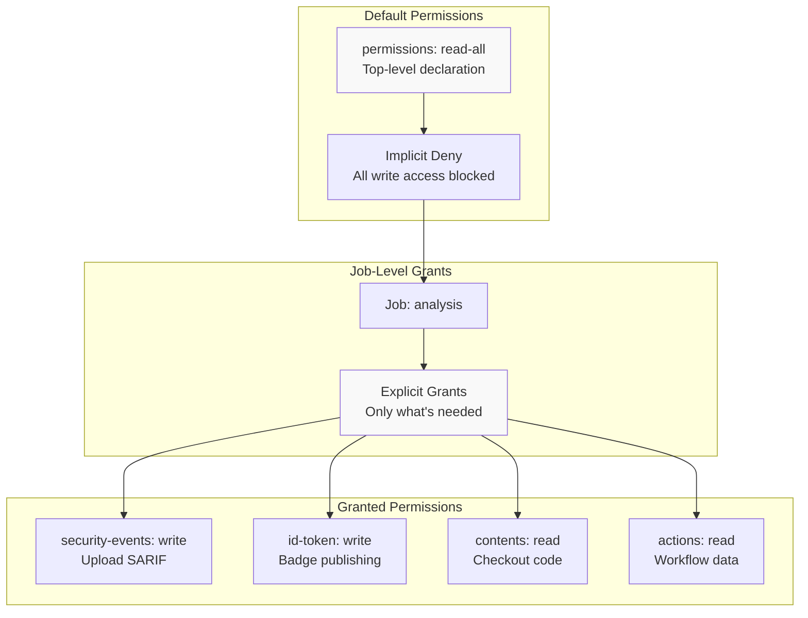
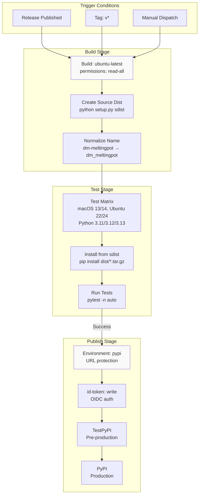

<!-- source: DeepWiki mcp.deepwiki.com · repo google-deepmind/meltingpot · page 7.6 Security and Supply Chain · fetched 2026-10-26 -->

# Security and Supply Chain

<details>
<summary>Relevant source files</summary>

The following files were used as context for generating this wiki page:

- [.devcontainer/Dockerfile](.devcontainer/Dockerfile)
- [.devcontainer/devcontainer.json](.devcontainer/devcontainer.json)
- [.github/actions/install/action.yml](.github/actions/install/action.yml)
- [.github/dependabot.yml](.github/dependabot.yml)
- [.github/workflows/codeql-analysis.yml](.github/workflows/codeql-analysis.yml)
- [.github/workflows/pypi-publish.yml](.github/workflows/pypi-publish.yml)
- [.github/workflows/pypi-test.yml](.github/workflows/pypi-test.yml)
- [.github/workflows/scorecards-analysis.yml](.github/workflows/scorecards-analysis.yml)
- [.python-version](.python-version)
- [.vscode/settings.json](.vscode/settings.json)

</details>


This document describes the security scanning, supply chain protection, and dependency management infrastructure used in the Melting Pot repository. It covers automated security workflows (OSSF Scorecards, CodeQL), dependency management (Dependabot), and security reporting mechanisms (SARIF).

For information about the broader CI/CD pipeline and testing infrastructure, see [CI/CD Pipelines](#7.5). For details on dependency pinning and version management for Python packages, see [Dependency Management](#7.2).

## Purpose and Scope

The security infrastructure provides:
- **Automated security scanning** via GitHub Actions workflows
- **Supply chain risk assessment** using OSSF Scorecards
- **Static analysis security testing** via CodeQL
- **Dependency update automation** through Dependabot
- **Security event reporting** using SARIF format
- **Least-privilege access control** via scoped permissions

## Security Workflow Architecture



**Sources:** [.github/workflows/scorecards-analysis.yml:1-63](), [.github/workflows/codeql-analysis.yml:1-63](), [.github/dependabot.yml:1-23]()

## OSSF Scorecards Analysis

### Overview

The OSSF (Open Source Security Foundation) Scorecard workflow assesses the repository's supply chain security practices. It runs on a weekly schedule, on pushes to `main`, and when branch protection rules change.

### Workflow Configuration



**Sources:** [.github/workflows/scorecards-analysis.yml:1-63]()

### Key Security Features

| Feature | Configuration | Purpose |
|---------|--------------|---------|
| **Default Permissions** | `permissions: read-all` | Minimize access by default |
| **Scoped Permissions** | `security-events: write` | Upload SARIF to code scanning |
| **Badge Publishing** | `id-token: write` | Generate public scorecard badge |
| **Credential Isolation** | `persist-credentials: false` | Prevent credential leakage |
| **Pinned Action** | `@f49aabe0b5af0936a0987cfb85d86b75731b0186` | Use specific commit SHA |

The workflow performs these steps:

1. **Checkout** - Clones the repository without persisting credentials [.github/workflows/scorecards-analysis.yml:27-30]()
2. **Run Analysis** - Executes OSSF scorecard checks [.github/workflows/scorecards-analysis.yml:32-47]()
3. **Upload Artifact** - Saves SARIF results for 5 days [.github/workflows/scorecards-analysis.yml:51-56]()
4. **Upload to Code Scanning** - Integrates with GitHub Security Dashboard [.github/workflows/scorecards-analysis.yml:58-62]()

**Sources:** [.github/workflows/scorecards-analysis.yml:10-62]()

### SARIF Output Format

The workflow produces `results.sarif` files containing:
- Supply chain security scores
- Best practice compliance checks
- Vulnerability assessments
- Recommended remediation actions

**Sources:** [.github/workflows/scorecards-analysis.yml:35-36]()

## CodeQL Static Analysis

### Overview

CodeQL performs static security analysis on the Python codebase to identify potential vulnerabilities, code quality issues, and security weaknesses.

### Workflow Configuration



**Sources:** [.github/workflows/codeql-analysis.yml:1-63]()

### Analysis Pipeline

The CodeQL workflow executes in four stages:

1. **Checkout Repository** - Clones code with read-only access [.github/workflows/codeql-analysis.yml:30-31]()
2. **Initialize CodeQL** - Sets up analysis tools for Python [.github/workflows/codeql-analysis.yml:34-35]()
3. **Autobuild** - Automatically builds the project and analyzes dependencies [.github/workflows/codeql-analysis.yml:48-49]()
4. **Perform Analysis** - Runs security queries and generates SARIF [.github/workflows/codeql-analysis.yml:61-62]()

**Sources:** [.github/workflows/codeql-analysis.yml:29-62]()

### Security Query Packs

CodeQL uses default security query packs but can be configured to use extended queries:

| Query Pack | Description | Configuration |
|------------|-------------|---------------|
| **Default** | Standard security patterns | Enabled by default |
| **security-extended** | Additional security checks | Commented out [.github/workflows/codeql-analysis.yml:43]() |
| **security-and-quality** | Security + code quality | Commented out [.github/workflows/codeql-analysis.yml:43]() |

To enable extended queries, uncomment and specify in the workflow configuration:
```yaml
queries: security-extended,security-and-quality
```

**Sources:** [.github/workflows/codeql-analysis.yml:38-43]()

### Schedule Configuration

CodeQL runs weekly on Thursdays at 13:36 UTC to catch security issues regularly without overwhelming the CI system:

```yaml
schedule:
  - cron: '36 13 * * 4'
```

**Sources:** [.github/workflows/codeql-analysis.yml:9-10]()

## Dependabot Configuration

### Overview

Dependabot automates dependency updates across three ecosystems: GitHub Actions, Docker images, and dev containers. Updates are grouped and scheduled monthly to reduce maintenance burden.

### Ecosystem Coverage



**Sources:** [.github/dependabot.yml:1-23]()

### Update Configuration Details

| Ecosystem | Directories | Schedule | Grouping |
|-----------|-------------|----------|----------|
| **GitHub Actions** | `/`, `/.github/actions/*` | Monthly | All updates grouped |
| **Docker** | `/.devcontainer` | Monthly | Individual updates |
| **DevContainers** | `/` | Monthly | Individual updates |

**GitHub Actions Grouping**: All GitHub Actions updates are grouped into a single PR to simplify review:
```yaml
groups:
  github-actions:
    patterns:
      - "*"
```

This means updates to all actions (e.g., `actions/checkout`, `actions/upload-artifact`, `github/codeql-action`) are bundled together.

**Sources:** [.github/dependabot.yml:9-12]()

## Supply Chain Security Practices

### Pinned Action Versions

All GitHub Actions in workflows use pinned SHA256 commit hashes instead of version tags to prevent supply chain attacks:



**Examples from workflows:**

| Action | Pinned Version | Location |
|--------|---------------|----------|
| `actions/checkout` | `@11bd71901bbe5b1630ceea73d27597364c9af683` | [.github/workflows/scorecards-analysis.yml:28]() |
| `ossf/scorecard-action` | `@f49aabe0b5af0936a0987cfb85d86b75731b0186` | [.github/workflows/scorecards-analysis.yml:33]() |
| `actions/upload-artifact` | `@ea165f8d65b6e75b540449e92b4886f43607fa02` | [.github/workflows/scorecards-analysis.yml:52]() |
| `github/codeql-action/upload-sarif` | `@28deaeda66b76a05916b6923827895f2b14ab387` | [.github/workflows/scorecards-analysis.yml:60]() |
| `github/codeql-action/init` | `@28deaeda66b76a05916b6923827895f2b14ab387` | [.github/workflows/codeql-analysis.yml:35]() |

**Sources:** [.github/workflows/scorecards-analysis.yml:28-60](), [.github/workflows/codeql-analysis.yml:31-62](), [.github/workflows/pypi-publish.yml:20-110]()

### SHA-Verified Container Images

The development container uses SHA256-pinned base images to ensure reproducibility and security:

```dockerfile
FROM nvidia/cuda:12.8.1-devel-ubuntu22.04@sha256:a99a1860ba8e2916e5c3e73b72ec4c4301653a84586e05bfc9a2aa2d58027e97
```

This approach:
- **Prevents tag substitution** - The exact image is specified by its content hash
- **Ensures reproducibility** - Same hash always produces same image
- **Enables verification** - Image integrity can be cryptographically verified

**Sources:** [.devcontainer/Dockerfile:3]()

### Credential Management

Security-sensitive operations use credential isolation:

| Practice | Implementation | Benefit |
|----------|---------------|---------|
| **No Persistent Credentials** | `persist-credentials: false` | Prevents credential leakage to subsequent steps |
| **Scoped Permissions** | `permissions: read-all` | Minimizes default access |
| **Write-Only When Needed** | `security-events: write` | Grants write only for specific tasks |
| **Token Isolation** | `id-token: write` | Separate tokens for different purposes |

**Sources:** [.github/workflows/scorecards-analysis.yml:10-24](), [.github/workflows/codeql-analysis.yml:12-22]()

## SARIF Reporting Integration

### SARIF Workflow

SARIF (Static Analysis Results Interchange Format) provides a standardized format for security findings:



**Sources:** [.github/workflows/scorecards-analysis.yml:35-62](), [.github/workflows/codeql-analysis.yml:61-62]()

### Artifact Upload Configuration

Both security workflows upload SARIF files as artifacts:

**Scorecard Artifact Upload:**
```yaml
- name: "Upload artifact"
  uses: actions/upload-artifact@ea165f8d65b6e75b540449e92b4886f43607fa02
  with:
    name: SARIF file
    path: results.sarif
    retention-days: 5
```

**Sources:** [.github/workflows/scorecards-analysis.yml:51-56]()

### Code Scanning Dashboard Upload

SARIF files are uploaded to GitHub's security dashboard:

```yaml
- name: "Upload to code-scanning"
  uses: github/codeql-action/upload-sarif@28deaeda66b76a05916b6923827895f2b14ab387
  with:
    sarif_file: results.sarif
```

This integration enables:
- **Centralized alerts** - All security findings in one place
- **Pull request annotations** - Inline warnings on code changes
- **Trend tracking** - Historical view of security posture
- **Issue creation** - Automatic GitHub issues for findings

**Sources:** [.github/workflows/scorecards-analysis.yml:58-62](), [.github/workflows/codeql-analysis.yml:61-62]()

## Permission Model

### Principle of Least Privilege

All workflows follow a least-privilege access model:



**Sources:** [.github/workflows/scorecards-analysis.yml:10-24](), [.github/workflows/codeql-analysis.yml:12-22]()

### Permission Scopes by Workflow

| Workflow | Default | Job-Level Permissions |
|----------|---------|----------------------|
| **scorecards-analysis.yml** | `read-all` | `security-events: write`, `id-token: write`, `contents: read`, `actions: read` |
| **codeql-analysis.yml** | `read-all` | `actions: read`, `contents: read`, `security-events: write` |
| **pypi-publish.yml** | `read-all` | `id-token: write` (publish job only) |
| **pypi-test.yml** | `read-all` | None (all read-only) |

**Sources:** [.github/workflows/scorecards-analysis.yml:10-24](), [.github/workflows/codeql-analysis.yml:12-22](), [.github/workflows/pypi-publish.yml:10-93](), [.github/workflows/pypi-test.yml:30]()

### Security-Events Permission

The `security-events: write` permission is required for:
1. **Uploading SARIF files** to the code scanning dashboard
2. **Creating security alerts** from analysis results
3. **Managing security advisories** (if enabled)

This permission is scoped only to jobs that perform security uploads, never granted globally.

**Sources:** [.github/workflows/scorecards-analysis.yml:19](), [.github/workflows/codeql-analysis.yml:22]()

## Security in the Release Pipeline

### Protected Publishing Workflow

The PyPI publishing workflow incorporates security best practices:



**Sources:** [.github/workflows/pypi-publish.yml:1-114]()

### Multi-Stage Verification

The release process includes three verification stages:

1. **Build Stage** - Creates distribution with read-only permissions [.github/workflows/pypi-publish.yml:13-39]()
2. **Test Stage** - Validates distribution across platforms [.github/workflows/pypi-publish.yml:41-83]()
3. **Publish Stage** - Publishes only if tests pass [.github/workflows/pypi-publish.yml:84-114]()

**Conditional Publishing:**
```yaml
publish:
  needs: [build, test]
  if: always() && needs.build.result == 'success' && needs.test.result != 'failure'
```

This ensures packages are only published if:
- Build succeeded
- Tests didn't fail (skipped is acceptable)
- Both dependencies completed

**Sources:** [.github/workflows/pypi-publish.yml:84-87]()

### OIDC Authentication

Publishing uses OpenID Connect (OIDC) for passwordless authentication:

```yaml
environment:
  name: pypi
  url: https://pypi.org/p/dm-meltingpot
permissions:
  id-token: write
```

Benefits:
- **No stored credentials** - No API tokens in repository secrets
- **Short-lived tokens** - Automatic expiration
- **Audit trail** - GitHub tracks all token usage
- **Environment protection** - Optional manual approval gates

**Sources:** [.github/workflows/pypi-publish.yml:89-93]()

## Integration with Installation Security

The installation action caches dependencies securely:

```yaml
- name: Restore installation
  uses: actions/cache/restore@5a3ec84eff668545956fd18022155c47e93e2684
  with:
    path: |
      meltingpot/assets
      venv
    key: install-${{ steps.cache-key.outputs.key }}
```

Cache keys include:
- OS name and version
- Python version
- Hash of `requirements.txt`

This ensures:
- **Reproducible builds** - Same inputs produce same cache
- **Dependency integrity** - Changes to requirements invalidate cache
- **Platform isolation** - macOS/Linux caches don't mix

**Sources:** [.github/actions/install/action.yml:39-46]()

### Cache Key Generation

The cache key incorporates platform-specific information:

```bash
if [ "${RUNNER_OS}" = 'macOS' ]; then
  readonly name="$(sw_vers -productName)"
  readonly version="$(sw_vers -productVersion)"
elif [ "${RUNNER_OS}" = 'Linux' ]; then
  readonly name="$(lsb_release -i -s)"
  readonly version="$(lsb_release -r -s)"
fi
echo "key=${name}-${version}-py${{ steps.setup-python.outputs.python-version }}-${{ hashFiles('requirements.txt') }}"
```

Example key: `Ubuntu-22.04-py3.11-a1b2c3d4e5f6...`

**Sources:** [.github/actions/install/action.yml:24-37]()

---

