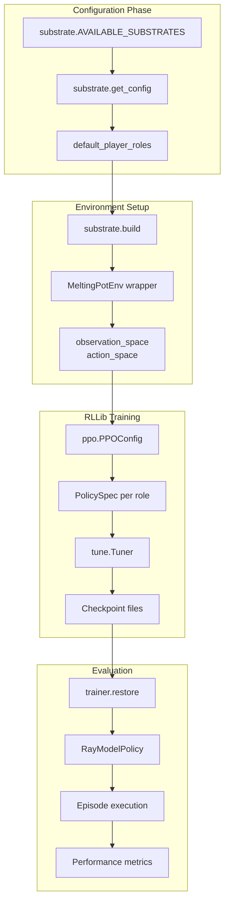
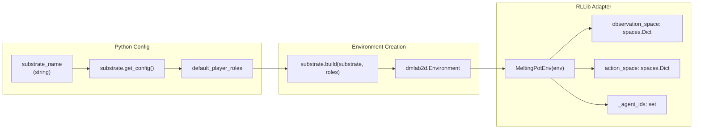
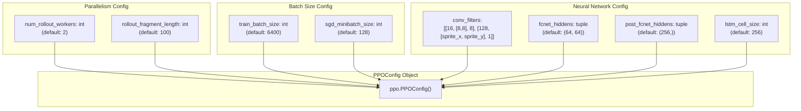
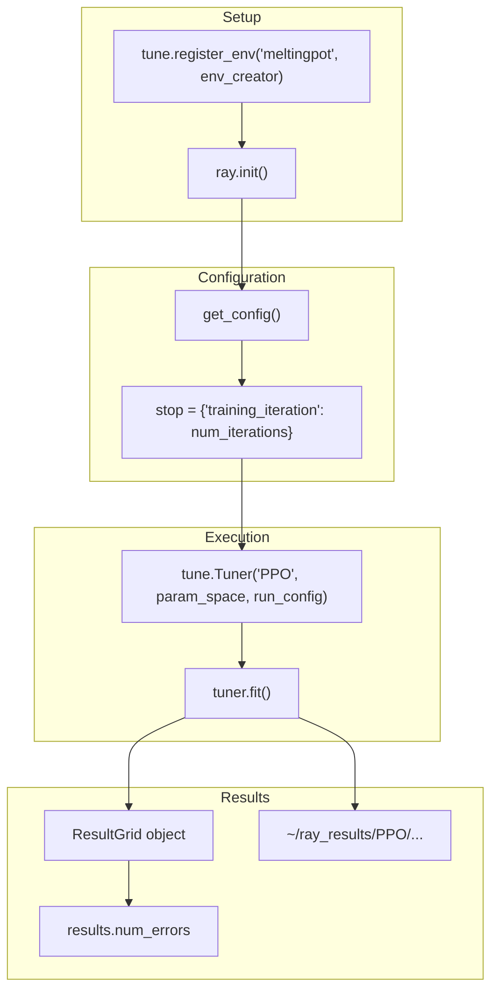
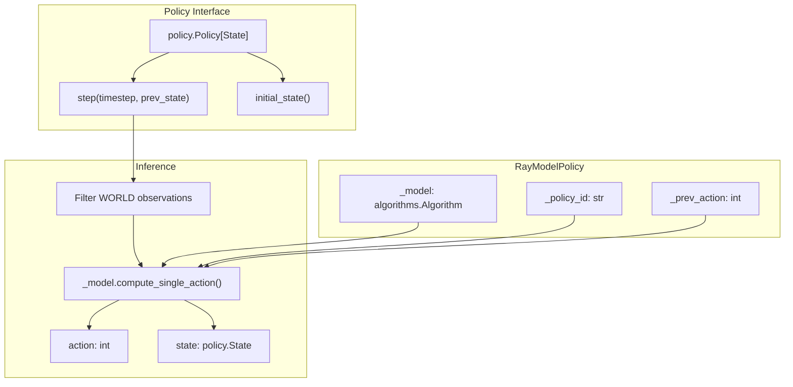
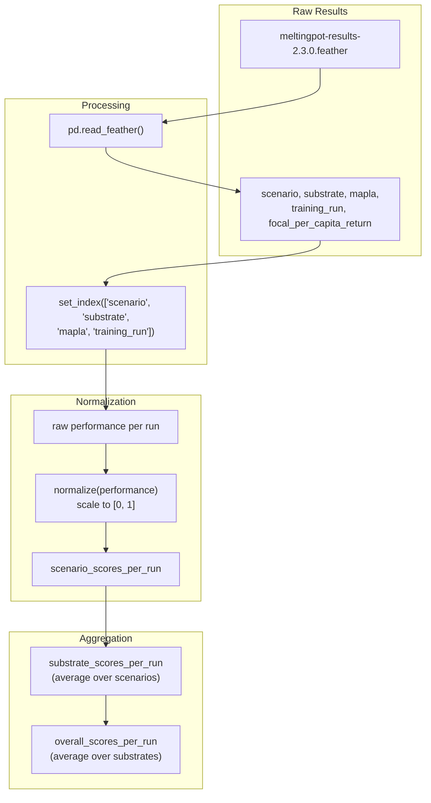

<!-- source: DeepWiki mcp.deepwiki.com · repo google-deepmind/meltingpot · page 8 Training and Evaluation · fetched 2026-10-26 -->

# Training and Evaluation

<details>
<summary>Relevant source files</summary>

The following files were used as context for generating this wiki page:

- [.gitignore](.gitignore)
- [CHANGELOG.md](CHANGELOG.md)
- [examples/rllib/self_play_train.py](examples/rllib/self_play_train.py)
- [examples/rllib/utils.py](examples/rllib/utils.py)
- [examples/rllib/view_models.py](examples/rllib/view_models.py)
- [notebooks/evaluation_results.ipynb](notebooks/evaluation_results.ipynb)
- [setup.py](setup.py)

</details>


This document provides practical guidance for training reinforcement learning agents in Melting Pot environments and evaluating their performance. It covers the complete workflow from environment setup to results analysis.

**Scope**: This page focuses on the training and evaluation workflow using the provided examples and tools. For framework-specific integration details, see [RLLib Integration](#5.1), [Gymnasium Integration](#5.2), and [PettingZoo Integration](#5.3). For creating custom bots and scenarios, see [Bot Implementation](#6.3).

## Training Workflow Overview

The typical training workflow in Melting Pot consists of environment instantiation, policy configuration, training execution, and checkpoint management. The primary example uses Ray RLLib for multi-agent self-play training.

### Training Pipeline Architecture



Sources: [examples/rllib/self_play_train.py:1-166](), [examples/rllib/utils.py:1-179]()

## Environment Configuration for Training

Training requires configuring the substrate, player roles, and environment wrapper. The configuration determines the multi-agent setup and observation/action spaces.

### Key Configuration Components

| Component | Class/Function | Purpose |
|-----------|---------------|---------|
| Substrate Selection | `substrate.get_config()` | Retrieves substrate configuration including default roles |
| Environment Builder | `substrate.build()` | Creates dmlab2d environment instance |
| RLLib Wrapper | `MeltingPotEnv` | Adapts dmlab2d to RLLib's `MultiAgentEnv` interface |
| Policy Specification | `policy.PolicySpec` | Defines observation/action spaces per agent role |



Sources: [examples/rllib/self_play_train.py:28-77](), [examples/rllib/utils.py:34-59]()

### Environment Creator Function

The `env_creator` function is registered with RLLib and creates environment instances for parallel rollout workers:

```python
# From examples/rllib/utils.py
def env_creator(env_config):
    env_config = config_dict.ConfigDict(env_config)
    env = substrate.build(env_config['substrate'], roles=env_config['roles'])
    env = MeltingPotEnv(env)
    return env
```

The `MeltingPotEnv` wrapper performs critical adaptations:
- Converts tuple-based observations/actions to dictionary format keyed by agent ID
- Maps agent indices to string identifiers (`"player_0"`, `"player_1"`, etc.)
- Removes world observations from agent observation spaces (used only for rendering)
- Implements the `MultiAgentEnv` interface required by RLLib

Sources: [examples/rllib/utils.py:126-131](), [examples/rllib/utils.py:34-123]()

## PPO Training Configuration

The `get_config()` function in [examples/rllib/self_play_train.py:28-132]() creates a complete PPO configuration. Key parameters control parallelism, batch sizes, and neural network architecture.

### Training Hyperparameters



Sources: [examples/rllib/self_play_train.py:28-132]()

### Multi-Agent Policy Setup

Each player role gets its own policy specification. The observation space determines the convolutional layer configuration based on sprite dimensions:

```python
# Sprite dimensions derived from RGB observation shape
rgb_shape = test_env.observation_space[f"player_{i}"]["RGB"].shape
sprite_x = rgb_shape[0] // 8
sprite_y = rgb_shape[1] // 8

# Convolutional filters aligned to 8x8 sprites
conv_filters = [
    [16, [8, 8], 8],  # First layer: 8x8 stride aligns with sprites
    [128, [sprite_x, sprite_y], 1]  # Second layer outputs [B, 1, 1, 128]
]
```

The policy mapping function routes each player to their corresponding policy:

Sources: [examples/rllib/self_play_train.py:82-109]()

### Network Architecture Details

| Layer Type | Configuration | Purpose |
|------------|--------------|---------|
| Conv Layer 1 | 16 filters, 8x8 kernel, stride 8 | Aligns with 8x8 sprite grid |
| Conv Layer 2 | 128 filters, sprite-sized kernel, stride 1 | Outputs [B, 1, 1, 128] for flattening |
| FC Layers | `fcnet_hiddens` (default: 64, 64) | Fully connected torso |
| Post-FC | `post_fcnet_hiddens` (default: 256) | After CNN, before LSTM |
| LSTM | `lstm_cell_size` (default: 256) | Recurrent state for partial observability |

The architecture is specifically designed for RLLib's requirements. The second convolutional layer must output `[B, 1, 1, X]` shape for proper flattening.

Sources: [examples/rllib/self_play_train.py:111-131]()

## Running Training

Training execution uses Ray Tune for experiment management and distributed execution.

### Training Function Structure



Sources: [examples/rllib/self_play_train.py:135-155]()

The `train()` function in [examples/rllib/self_play_train.py:135-154]() executes the training loop:

1. Registers the environment creator with Ray Tune
2. Initializes Ray runtime
3. Creates a `tune.Tuner` with PPO algorithm and configuration
4. Runs training with stopping criteria
5. Returns results including checkpoints and error counts

### Checkpoint Management

Checkpoints are saved to `~/ray_results/PPO/` with the following structure:
- `experiment_state-DATETIME.json`: Experiment metadata
- `PPO_meltingpot_*/checkpoint_*/`: Model checkpoints per iteration
- Each checkpoint contains policy weights for all agents

Sources: [examples/rllib/self_play_train.py:135-166](), [examples/rllib/view_models.py:34-58]()

## Using Trained Policies

Trained models can be loaded for evaluation, visualization, or further use. The `RayModelPolicy` class wraps RLLib checkpoints for integration with Melting Pot's policy interface.

### RayModelPolicy Implementation



Sources: [examples/rllib/utils.py:134-179]()

### Loading and Using Trained Models

The workflow for using saved checkpoints:

1. **Load Experiment**: Use `ExperimentAnalysis` to locate best checkpoint
2. **Restore Trainer**: Create trainer instance and restore weights
3. **Create Policy**: Wrap trainer in `RayModelPolicy` for each agent
4. **Execute Episodes**: Use policies with `step()` method

```python
# Key observation filtering in RayModelPolicy.step()
observations = {
    key: value
    for key, value in timestep.observation.items()
    if 'WORLD' not in key  # Remove world observations
}
```

This filtering is critical because agents only receive player-specific observations during inference, not the global `WORLD.RGB` view.

Sources: [examples/rllib/utils.py:153-170](), [examples/rllib/view_models.py:32-66]()

## Visualization with Pygame

The `view_models.py` script demonstrates interactive visualization of trained agents using pygame.

### Visualization Pipeline

```mermaid
graph LR
    subgraph "Loading"
        EXP_STATE["experiment_state JSON"]
        ANALYSIS["ExperimentAnalysis"]
        BEST_CHECKPOINT["best_checkpoint path"]
        TRAINER["trainer.restore()"]
    end
    
    subgraph "Bot Creation"
        NUM_ROLES["len(default_player_roles)"]
        BOTS["List[RayModelPolicy]"]
    end
    
    subgraph "Rendering Loop"
        RESET["env.reset()"]
        WORLD_RGB["observation[0]['WORLD.RGB']"]
        PYGAME_SURF["pygame.surfarray.make_surface()"]
        DISPLAY["pygame.display.update()"]
    end
    
    subgraph "Stepping"
        BOT_STEP["bot.step(timestep, state)"]
        ENV_STEP["env.step(actions)"]
    end
    
    EXP_STATE --> ANALYSIS
    ANALYSIS --> BEST_CHECKPOINT
    BEST_CHECKPOINT --> TRAINER
    TRAINER --> NUM_ROLES
    NUM_ROLES --> BOTS
    BOTS --> RESET
    RESET --> WORLD_RGB
    WORLD_RGB --> PYGAME_SURF
    PYGAME_SURF --> DISPLAY
    DISPLAY --> BOT_STEP
    BOT_STEP --> ENV_STEP
    ENV_STEP --> WORLD_RGB
```



Sources: [examples/rllib/view_models.py:1-110]()

### Rendering Configuration

Key parameters for visualization:
- `scale = 4`: Upscales the pixel grid for visibility
- `fps = 5`: Frame rate for human-readable speed
- `WORLD.RGB` observation: Used for rendering (first agent's observation)

The rendering process:
1. Extracts `WORLD.RGB` from observation
2. Transposes axes for pygame format
3. Creates surface and scales to display size
4. Updates display at configured FPS

Sources: [examples/rllib/view_models.py:72-94]()

## Evaluation System

Melting Pot includes a comprehensive evaluation system for analyzing agent performance across scenarios. Results are stored in feather format and analyzed using Jupyter notebooks.

### Evaluation Data Structure



Sources: [notebooks/evaluation_results.ipynb:274-288](), [notebooks/evaluation_results.ipynb:380-439]()

### Performance Metrics

The evaluation system computes normalized scores at three levels:

| Level | Metric | Calculation |
|-------|--------|-------------|
| Scenario | `scenario_scores_per_run` | Normalized `focal_per_capita_return` per scenario |
| Substrate | `substrate_scores_per_run` | Average scenario scores within substrate |
| Overall | `overall_scores_per_run` | Average substrate scores across all substrates |

### Normalization Process

The `normalize()` function in [notebooks/evaluation_results.ipynb:382-395]() scales raw performance to [0, 1]:

```python
def normalize(performance_per_run):
    raw = performance_per_run.unstack(['mapla', 'training_run'])
    lower = raw.min(axis=1) - 1e-8
    upper = raw.max(axis=1)
    scale = upper - lower
    
    normalized = raw.subtract(lower, axis=0).divide(scale, axis=0)
    return normalized.stack(['mapla', 'training_run'])
```

This ensures fair comparison across scenarios with different reward scales.

Sources: [notebooks/evaluation_results.ipynb:380-396]()

### MAPLA (Multi-Agent Policy Learning Algorithm) Comparison

The evaluation notebook analyzes multiple MAPLA baselines:
- `acb`: Autocurriculum-based learning
- `opre`: Off-policy reinforcement learning
- `acb_prosocial`: Prosocial variant for collective-return substrates
- `opre_prosocial`: Prosocial variant for collective-return substrates  
- `exploiter_*`: Various exploiter strategies (best per scenario selected)

For collective-return substrates, prosocial variants receive identical rewards to non-prosocial variants (modulo scaling), so performance is copied from non-prosocial runs to fill missing data.

Sources: [notebooks/evaluation_results.ipynb:299-329](), [notebooks/evaluation_results.ipynb:341-359]()

### Results Visualization

The notebook generates interactive heatmaps showing:
- **Summary view**: Overall scores and per-substrate breakdown
- **Breakdown view**: Per-scenario performance within each substrate

Visualization uses the `heatmap()` utility function to create annotated seaborn heatmaps with:
- Top rows showing higher-level aggregations (overall, substrate)
- Main grid showing scenario-level performance
- Color mapping from 0 (blue) to 1 (red)

Sources: [notebooks/evaluation_results.ipynb:460-495](), [notebooks/evaluation_results.ipynb:182-253]()

## Results Storage and Distribution

Evaluation results are hosted on Google Cloud Storage for public access:

```
https://storage.googleapis.com/dm-meltingpot/meltingpot-results-2.3.0.feather
```

This enables:
- Reproducible analysis without re-running evaluations
- Community comparison against baselines
- Competition result archival (e.g., NeurIPS 2023 Melting Pot Contest)

The feather format provides efficient columnar storage with pandas compatibility.

Sources: [notebooks/evaluation_results.ipynb:274-276](), [CHANGELOG.md:23-27]()

## Training Best Practices

Based on the example configuration and codebase patterns:

### Computational Requirements

- **GPU Usage**: Controlled by `RLLIB_NUM_GPUS` environment variable
- **Workers**: `num_rollout_workers=2` for parallel environment execution
- **Batch Size**: `train_batch_size=6400` determines samples per update
- **Fragment Length**: `rollout_fragment_length=100` sets episode unroll length

### Architecture Recommendations

1. **Convolutional Layers**: First stride (8) must align with sprite grid
2. **LSTM**: Enable for partial observability scenarios
3. **Previous Action**: Use `lstm_use_prev_action=True` for action history
4. **Output Shape**: Ensure final conv layer outputs `[B, 1, 1, X]` format

### Common Issues

- **Sprite Misalignment**: Verify conv filter dimensions match sprite size
- **World Observations**: Filter out during inference (only for rendering)
- **Policy Mapping**: Ensure all agent IDs map to valid policies
- **Checkpoint Path**: Use `ExperimentAnalysis.best_checkpoint` for loading

Sources: [examples/rllib/self_play_train.py:28-132](), [examples/rllib/utils.py:153-170]()

---

