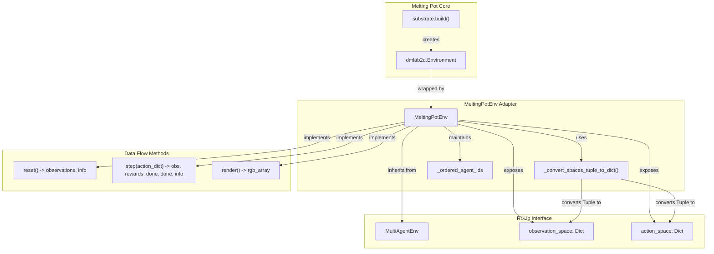
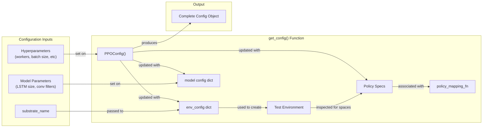
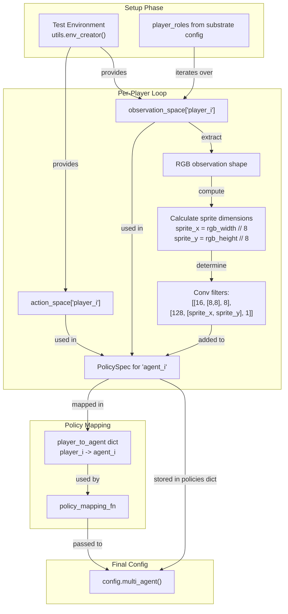
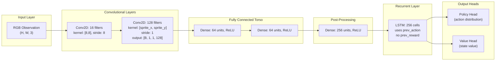
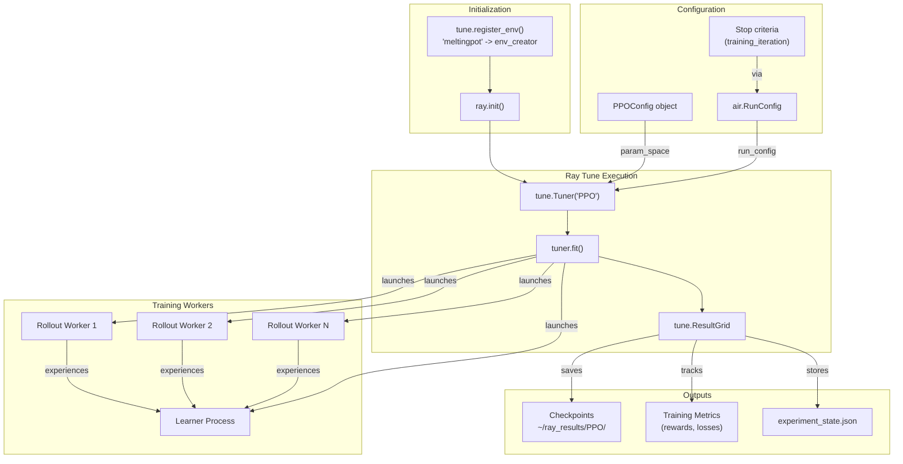
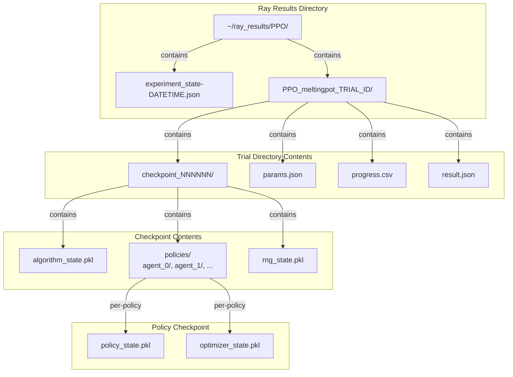

<!-- source: DeepWiki mcp.deepwiki.com · repo google-deepmind/meltingpot · page 8.1 Training with RLLib · fetched 2026-10-26 -->

# Training with RLLib

<details>
<summary>Relevant source files</summary>

The following files were used as context for generating this wiki page:

- [README.md](README.md)
- [examples/rllib/self_play_train.py](examples/rllib/self_play_train.py)
- [examples/rllib/utils.py](examples/rllib/utils.py)
- [examples/rllib/view_models.py](examples/rllib/view_models.py)

</details>


This document provides a practical guide to training agents on Melting Pot substrates using [Ray RLLib](https://github.com/ray-project/ray). It covers the adapter layer, configuration, multi-agent policy setup, model architecture, and training workflow.

**Scope**: This page focuses on the example RLLib training implementation provided in the repository. For general RLLib integration concepts, see [RLLib Integration](#5.1). For evaluation of trained models, see [Evaluation System](#8.3). For interactive testing, see [Human Play Mode](#8.2).

**Important Note**: This example is provided for illustration only and is not intended as a recommendation for achieving high performance on Melting Pot tasks. The suite authors did not use this training script in their own research.

## Overview

The RLLib training example demonstrates self-play training on Melting Pot substrates using Proximal Policy Optimization (PPO). The implementation consists of three main components:

1. **Environment Adapter** (`MeltingPotEnv`) - Wraps dmlab2d environments as RLLib `MultiAgentEnv`
2. **Training Configuration** (`get_config()`) - Configures PPO algorithm and model architecture
3. **Training Loop** (`train()`) - Executes training using Ray Tune

Sources: [examples/rllib/self_play_train.py:1-166](), [examples/rllib/utils.py:1-179](), [README.md:150-176]()

## Environment Adapter Architecture

The `MeltingPotEnv` class bridges Melting Pot's `dmlab2d.Environment` interface with RLLib's `MultiAgentEnv` API. This adapter handles observation/action space conversion and agent ID mapping.

### MeltingPotEnv Class Structure



Sources: [examples/rllib/utils.py:34-124]()

### Key Adapter Components

**Agent ID Mapping**

RLLib requires string-based agent IDs, while Melting Pot uses integer indices. The adapter creates agent IDs using the format `player_{index}`:

[examples/rllib/utils.py:31-51]()

**Observation Space Conversion**

Melting Pot environments return observations as tuples (one per player). RLLib expects dictionaries mapping agent IDs to observations. The conversion also removes `WORLD.*` observations when `remove_world_observations=True`:

[examples/rllib/utils.py:109-123]()

**Step Method**

The step method converts RLLib's action dictionary to an ordered list of actions, executes the environment step, and converts the timestep back to RLLib's expected format:

[examples/rllib/utils.py:66-78]()

**Rendering Support**

The adapter implements rendering for video recording by extracting the `WORLD.RGB` observation:

[examples/rllib/utils.py:92-107]()

Sources: [examples/rllib/utils.py:34-124]()

## Training Configuration

The `get_config()` function constructs a complete PPOConfig object with Melting Pot-specific settings. This configuration defines the training algorithm, model architecture, and multi-agent setup.

### Configuration Pipeline



Sources: [examples/rllib/self_play_train.py:28-133]()

### Core Configuration Parameters

| Parameter | Default Value | Description |
|-----------|--------------|-------------|
| `substrate_name` | `"bach_or_stravinsky_in_the_matrix__repeated"` | Name from `substrate.AVAILABLE_SUBSTRATES` |
| `num_rollout_workers` | `2` | Number of parallel workers for rollouts |
| `rollout_fragment_length` | `100` | Number of timesteps per rollout fragment |
| `train_batch_size` | `6400` | Total timesteps per training iteration |
| `sgd_minibatch_size` | `128` | Minibatch size for SGD updates |
| `lstm_cell_size` | `256` | Size of LSTM hidden state |
| `fcnet_hiddens` | `(64, 64)` | Fully connected layer sizes |
| `post_fcnet_hiddens` | `(256,)` | Post-processing layer sizes |

Sources: [examples/rllib/self_play_train.py:28-52]()

### Environment Configuration Setup

The environment configuration is created from the substrate name and player roles:

[examples/rllib/self_play_train.py:76-79]()

This configuration is passed to the `env_creator()` function during environment instantiation:

[examples/rllib/utils.py:126-131]()

Sources: [examples/rllib/self_play_train.py:76-79](), [examples/rllib/utils.py:126-131]()

## Multi-Agent Policy Setup

Each player in a Melting Pot substrate can have its own policy. The training script creates one policy per player role, enabling heterogeneous multi-agent training.

### Policy Creation Flow



Sources: [examples/rllib/self_play_train.py:82-109]()

### Policy Specification Creation

For each player, a `PolicySpec` is created with player-specific observation and action spaces:

[examples/rllib/self_play_train.py:85-102]()

**Sprite-Based Convolution Configuration**: The convolutional filters are dynamically sized based on the RGB observation dimensions. The first layer uses 8×8 strides to align with the 8×8 sprite size used in Melting Pot. The second layer is sized to perfectly reduce the spatial dimensions to 1×1, as required by RLLib's model architecture.

### Policy Mapping Function

The `policy_mapping_fn` maps RLLib agent IDs (e.g., `"player_0"`) to policy IDs (e.g., `"agent_0"`):

[examples/rllib/self_play_train.py:104-109]()

Sources: [examples/rllib/self_play_train.py:82-109]()

## Model Architecture

The default model architecture combines convolutional neural networks (CNNs) for visual processing with Long Short-Term Memory (LSTM) networks for temporal reasoning.

### Architecture Components



Sources: [examples/rllib/self_play_train.py:111-131]()

### Model Configuration Parameters

The model configuration is set on the `config.model` dictionary:

| Parameter | Value | Description |
|-----------|-------|-------------|
| `conv_filters` | `[[16, [8,8], 8], [128, [sprite_x, sprite_y], 1]]` | Two convolutional layers with sprite-aligned strides |
| `conv_activation` | `"relu"` | Activation for convolutional layers |
| `fcnet_hiddens` | `(64, 64)` | Hidden layer sizes for fully connected network |
| `fcnet_activation` | `"relu"` | Activation for fully connected layers |
| `post_fcnet_hiddens` | `(256,)` | Post-processing layer before LSTM |
| `post_fcnet_activation` | `"relu"` | Activation for post-processing layers |
| `use_lstm` | `True` | Enable LSTM layer |
| `lstm_cell_size` | `256` | Number of LSTM units |
| `lstm_use_prev_action` | `True` | Concatenate previous action to LSTM input |
| `lstm_use_prev_reward` | `False` | Do not use previous reward |

[examples/rllib/self_play_train.py:122-130]()

**Design Rationale**: 
- The 8×8 stride in the first conv layer aligns with Melting Pot's 8×8 sprites
- The second conv layer reduces spatial dimensions to 1×1, which RLLib requires for proper flattening
- LSTM provides memory for partially observable environments
- Previous action conditioning helps with temporal credit assignment

Sources: [examples/rllib/self_play_train.py:111-131]()

## Training Execution

The `train()` function orchestrates the training process using Ray Tune, which handles distributed training, checkpointing, and experiment tracking.

### Training Pipeline



Sources: [examples/rllib/self_play_train.py:135-155]()

### Training Function Implementation

[examples/rllib/self_play_train.py:135-154]()

**Key Components**:

1. **Environment Registration**: `tune.register_env()` associates the string `"meltingpot"` with the `env_creator` function
2. **Ray Initialization**: `ray.init()` starts the Ray runtime for distributed execution
3. **Stop Criteria**: Training runs for the specified number of iterations
4. **Tuner**: The `tune.Tuner` object manages the training experiment
5. **Results**: The `fit()` method returns a `ResultGrid` containing all trial results

Sources: [examples/rllib/self_play_train.py:135-154]()

### Main Entry Point

The default main function demonstrates minimal usage:

[examples/rllib/self_play_train.py:157-165]()

**Running the Training Script**:

```bash
cd examples/rllib
pip install -r ../requirements.txt
python self_play_train.py
```

Sources: [examples/rllib/self_play_train.py:157-165](), [README.md:164-175]()

## Checkpointing and Model Loading

Ray Tune automatically saves checkpoints to `~/ray_results/PPO/` during training. These checkpoints can be loaded for evaluation or continued training.

### Checkpoint Structure



Sources: [examples/rllib/view_models.py:1-110]()

### Loading and Using Trained Models

The `RayModelPolicy` class wraps a trained RLLib model for inference:

[examples/rllib/utils.py:134-179]()

**Usage Example** (from `view_models.py`):

[examples/rllib/view_models.py:49-66]()

**Key Methods**:

- `step(timestep, prev_state)`: Computes action for a single timestep
- `initial_state()`: Returns the initial LSTM state
- `compute_single_action()`: Internal RLLib method for single-agent inference

Sources: [examples/rllib/utils.py:134-179](), [examples/rllib/view_models.py:32-109]()

## Visualization and Debugging

The `view_models.py` script demonstrates how to visualize trained agents using pygame:

[examples/rllib/view_models.py:32-109]()

**Running the Visualization**:

```bash
python examples/rllib/view_models.py --experiment_state ~/ray_results/PPO
```

The script loads the best checkpoint based on `episode_reward_mean` and renders the agents' behavior in real-time.

Sources: [examples/rllib/view_models.py:1-110]()

## Common Configuration Patterns

### GPU Training

Enable GPU usage by setting the `RLLIB_NUM_GPUS` environment variable:

[examples/rllib/self_play_train.py:70-72]()

```bash
RLLIB_NUM_GPUS=1 python self_play_train.py
```

### Custom Substrate

To train on a different substrate, modify the `substrate_name` parameter:

```python
config = get_config(substrate_name="prisoners_dilemma_in_the_matrix__repeated")
```

### Adjusting Training Duration

Control training length via the `num_iterations` parameter:

```python
results = train(config, num_iterations=100)
```

### Hyperparameter Tuning

Use Ray Tune's search algorithms for hyperparameter optimization:

```python
from ray import tune as ray_tune

config = get_config()
config.sgd_minibatch_size = ray_tune.grid_search([64, 128, 256])
config.lr = ray_tune.loguniform(1e-5, 1e-3)
```

Sources: [examples/rllib/self_play_train.py:28-154]()

## Integration with Melting Pot Evaluation

Trained RLLib models can be evaluated using Melting Pot's evaluation system by wrapping them with `RayModelPolicy`. See [Evaluation System](#8.3) for details on running standardized evaluations.

The `RayModelPolicy` class implements the `meltingpot.utils.policies.policy.Policy` interface, making it compatible with the evaluation framework:

[examples/rllib/utils.py:134-179]()

Sources: [examples/rllib/utils.py:134-179]()

---

