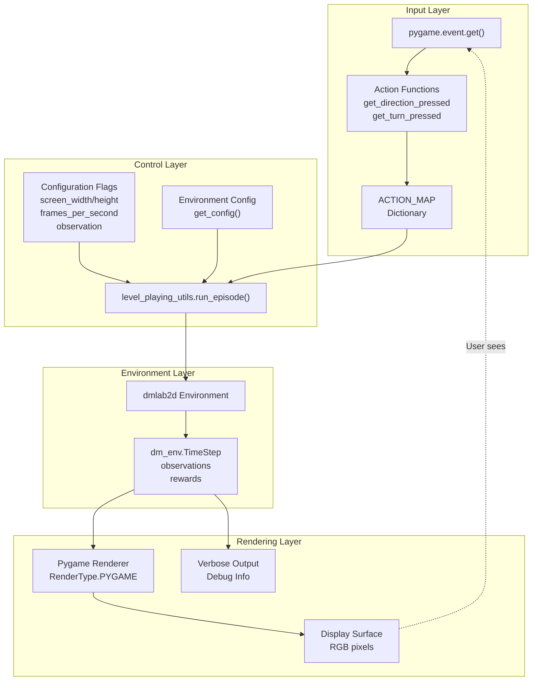
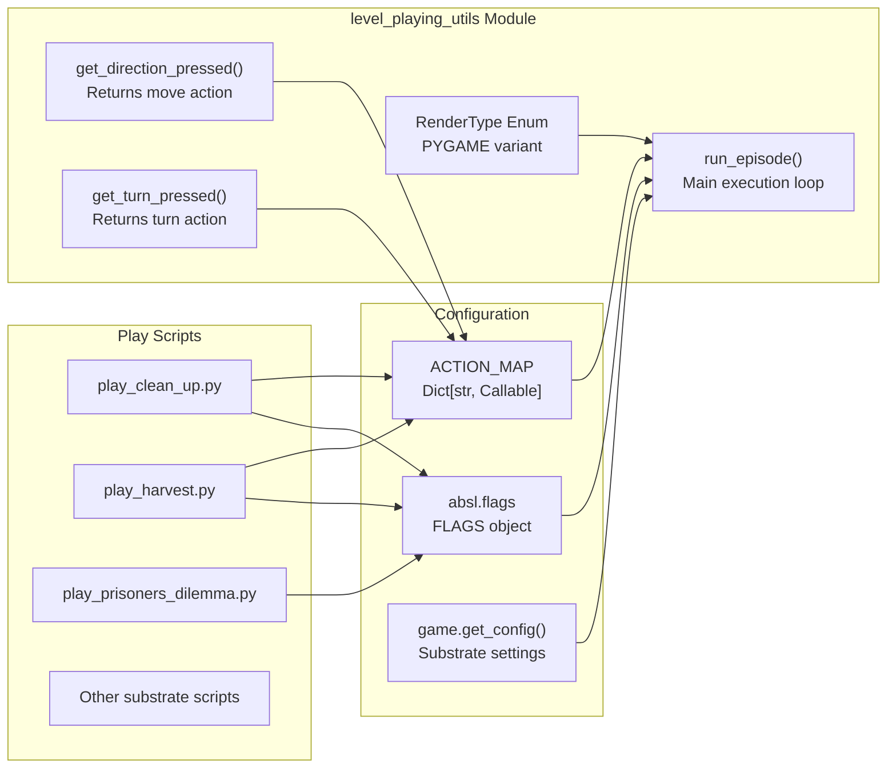

<!-- source: DeepWiki mcp.deepwiki.com · repo google-deepmind/meltingpot · page 8.2 Human Play Mode · fetched 2026-10-26 -->

# Human Play Mode

<details>
<summary>Relevant source files</summary>

The following files were used as context for generating this wiki page:

- [README.md](README.md)
- [examples/tutorial/harvest/play_harvest.py](examples/tutorial/harvest/play_harvest.py)
- [pyproject.toml](pyproject.toml)

</details>


## Purpose and Scope

This document describes the **Human Play Mode** system in Melting Pot, which allows interactive gameplay for testing substrates manually, debugging behaviors, and demonstrating environments. Human Play Mode provides keyboard-based controls for controlling agents in real-time using a Pygame-based rendering interface.

For information about training agents programmatically, see [Training with RLLib](#8.1). For details on how observations are structured in the underlying environment, see [Observations and Action Spaces](#3.4).

## Overview

Human Play Mode enables users to directly control agents in Melting Pot substrates through keyboard input. The system renders the environment using Pygame and maps keyboard events to agent actions, allowing real-time interaction with any substrate. This is particularly useful for:

- **Substrate Testing**: Manually exploring environment dynamics and mechanics
- **Debugging**: Observing agent behaviors and environment states in detail
- **Demonstration**: Showcasing substrate features and social interactions
- **Development**: Rapid iteration when creating new substrates

The human play scripts are located in the `meltingpot/human_players/` directory, with each substrate having its own playable script (e.g., `play_clean_up.py`, `play_prisoners_dilemma_in_the_matrix.py`).

Sources: [README.md:136-147]()

## Architecture

### System Flow

The human play system consists of three main layers: input handling, environment stepping, and rendering.



**Diagram: Human Play Mode Data Flow**

The system operates in a continuous loop:
1. Pygame captures keyboard events
2. Action functions translate keypresses to action indices
3. `run_episode()` applies actions to the environment
4. Environment returns `TimeStep` observations and rewards
5. Renderer displays the current state to the screen
6. Loop continues until episode termination

Sources: [examples/tutorial/harvest/play_harvest.py:1-67]()

### Key Components



**Diagram: Human Play Component Relationships**

Sources: [examples/tutorial/harvest/play_harvest.py:20-22](), [examples/tutorial/harvest/play_harvest.py:39-42]()

## Getting Started

### Running a Human Play Script

To launch human play mode for a substrate, execute the corresponding play script:

```bash
python meltingpot/human_players/play_clean_up.py
```

For substrates with multiple level variants, specify the level name:

```bash
python meltingpot/human_players/play_some_substrate.py --level_name=variant_name
```

For the tutorial example:

```bash
python examples/tutorial/harvest/play_harvest.py
```

Sources: [README.md:136-147]()

### Script Structure

Each human play script follows a standard structure:

1. **Import Dependencies**: Imports `level_playing_utils` and the substrate configuration
2. **Define Flags**: Configures command-line parameters using `absl.flags`
3. **Create Action Map**: Maps action names to keyboard input handler functions
4. **Define Callbacks**: Optional verbose and text display callbacks
5. **Main Function**: Calls `level_playing_utils.run_episode()` with all configuration

Sources: [examples/tutorial/harvest/play_harvest.py:18-67]()

## Control System

### Keyboard Controls

The standard keyboard controls for human play mode are:

| Key | Action | Description |
|-----|--------|-------------|
| `W` | Move Forward | Move agent forward in current facing direction |
| `A` | Move Left | Move agent left |
| `S` | Move Backward | Move agent backward |
| `D` | Move Right | Move agent right |
| `Q` | Turn Left | Rotate agent counterclockwise |
| `E` | Turn Right | Rotate agent clockwise |
| `1` | Primary Action | Substrate-specific (e.g., fire zapper) |
| `2` | Secondary Action | Substrate-specific (e.g., cleaning beam) |
| `TAB` | Switch Player | Cycle control between different agents |

**Note**: Actual action mappings vary by substrate. Not all substrates use all action types.

Sources: [README.md:143-145]()

### Action Mapping

Action maps are defined as dictionaries that associate action names with handler functions:

```python
_ACTION_MAP = {
    'move': level_playing_utils.get_direction_pressed,
    'turn': level_playing_utils.get_turn_pressed,
}
```

The handler functions (`get_direction_pressed`, `get_turn_pressed`) are implemented in `level_playing_utils` and return the appropriate action index based on which key is currently pressed.

**Common Action Handler Functions:**

| Function | Purpose | Returns |
|----------|---------|---------|
| `get_direction_pressed` | Detects W/A/S/D keys | Move action index (0-4) |
| `get_turn_pressed` | Detects Q/E keys | Turn action index (0-2) |
| Custom handlers | Substrate-specific actions | Custom action indices |

Sources: [examples/tutorial/harvest/play_harvest.py:39-42]()

## Configuration Options

### Command-Line Flags

Human play scripts accept multiple command-line flags for customization:

| Flag | Type | Default | Description |
|------|------|---------|-------------|
| `--screen_width` | Integer | 800 | Width of game window in pixels |
| `--screen_height` | Integer | 600 | Height of game window in pixels |
| `--frames_per_second` | Integer | 8 | Rendering frame rate |
| `--observation` | String | 'RGB' | Name of observation to render |
| `--verbose` | Boolean | False | Enable verbose debug output |
| `--display_text` | Boolean | False | Show debug text overlay |
| `--text_message` | String | (varies) | Custom text to display |
| `--level_name` | String | None | Substrate variant to load |

Example with custom flags:

```bash
python meltingpot/human_players/play_clean_up.py \
  --screen_width=1024 \
  --screen_height=768 \
  --frames_per_second=15 \
  --verbose=True
```

Sources: [examples/tutorial/harvest/play_harvest.py:26-36]()

### Settings Overrides

The `run_episode()` function accepts a settings overrides dictionary (typically empty `{}`), which can be used to modify substrate configuration at runtime:

```python
level_playing_utils.run_episode(
    FLAGS.observation,
    {},  # Settings overrides - can modify substrate parameters
    _ACTION_MAP,
    game.get_config(),
    ...
)
```

Sources: [examples/tutorial/harvest/play_harvest.py:55-63]()

## Observation Modes

### Available Observations

The `--observation` flag determines which observation layer is rendered to the screen. Common observation types include:

| Observation Name | Description |
|-----------------|-------------|
| `'RGB'` | Full RGB pixel rendering (default) |
| `'WORLD.RGB'` | Global world view (if available) |
| Custom layers | Substrate-specific observation layers |

The observation name must match an observation provided by the substrate's observation spec. See [Observations and Action Spaces](#3.4) for details on how observations are structured.

### Rendering Types

The system uses `level_playing_utils.RenderType.PYGAME` as the rendering backend, which creates a Pygame display surface and updates it each frame with the selected observation.

Sources: [examples/tutorial/harvest/play_harvest.py:31](), [examples/tutorial/harvest/play_harvest.py:60]()

## Debugging Features

### Verbose Mode

Enabling `--verbose=True` activates verbose output during gameplay. Each play script can define a custom `verbose_fn` callback:

```python
def verbose_fn(unused_timestep, unused_player_index: int) -> None:
  # Custom debug printing logic
  pass
```

This function is called each frame with the current timestep and player index, allowing scripts to print custom debug information to the console.

Sources: [examples/tutorial/harvest/play_harvest.py:45-46](), [examples/tutorial/harvest/play_harvest.py:62]()

### Text Display Overlay

The `--display_text=True` flag enables an on-screen text overlay. Scripts define a `text_display_fn` callback that returns the string to display:

```python
def text_display_fn(unused_timestep, unused_player_index: int) -> str:
  return FLAGS.text_message
```

This can be used to show:
- Current player status
- Game state information
- Instructions or hints
- Custom debug messages

Sources: [examples/tutorial/harvest/play_harvest.py:33-36](), [examples/tutorial/harvest/play_harvest.py:49-50]()

### Player Switching

Pressing `TAB` cycles control between different agents in multi-agent environments. This allows inspection of the environment from different perspectives and testing of multi-agent interactions.

Sources: [README.md:146]()

## Implementation Details

### The run_episode Function

The core of human play mode is `level_playing_utils.run_episode()`, which orchestrates the entire gameplay loop:

```python
level_playing_utils.run_episode(
    observation_name,        # Which observation to render
    settings_overrides,      # Dict of substrate setting overrides
    action_map,             # Dict mapping action names to handler functions
    environment_config,      # Substrate configuration object
    render_type,            # RenderType.PYGAME
    screen_width,           # Display width in pixels
    screen_height,          # Display height in pixels  
    frames_per_second,      # Target FPS
    verbose_fn,             # Optional debug callback
    text_display_fn         # Optional text overlay callback
)
```

This function:
1. Initializes the environment using the provided configuration
2. Creates a Pygame display window
3. Enters the main game loop:
   - Processes keyboard events
   - Maps keys to actions via `action_map`
   - Steps the environment
   - Renders observations to screen
   - Calls debug callbacks if provided
4. Continues until the episode terminates or the window is closed

Sources: [examples/tutorial/harvest/play_harvest.py:55-63]()

### Custom Play Scripts

To create a custom human play script for a new substrate:

1. Create a new Python file (e.g., `play_my_substrate.py`)
2. Import `level_playing_utils` and your substrate configuration
3. Define command-line flags using `absl.flags`
4. Create an `ACTION_MAP` dictionary with appropriate handlers
5. Implement optional `verbose_fn` and `text_display_fn` callbacks
6. Call `level_playing_utils.run_episode()` in the main function

The action map keys should match the action names in your substrate's action spec.

Sources: [examples/tutorial/harvest/play_harvest.py:1-67]()

## Summary

The Human Play Mode system provides an accessible interface for interactive substrate exploration through:

- **Keyboard-based controls** mapped via customizable action maps
- **Pygame rendering** with configurable display parameters
- **Debug features** including verbose output and text overlays
- **Multi-agent support** with player switching capabilities
- **Flexible configuration** via command-line flags and settings overrides

The standardized structure of play scripts, centered around `level_playing_utils.run_episode()`, makes it straightforward to create interactive versions of any Melting Pot substrate.

Sources: [README.md:136-147](), [examples/tutorial/harvest/play_harvest.py:1-67]()

---

